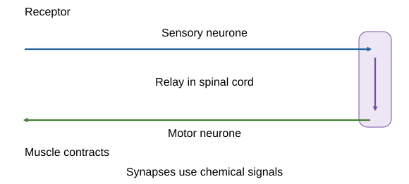
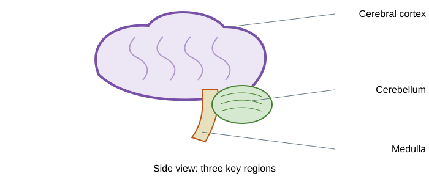
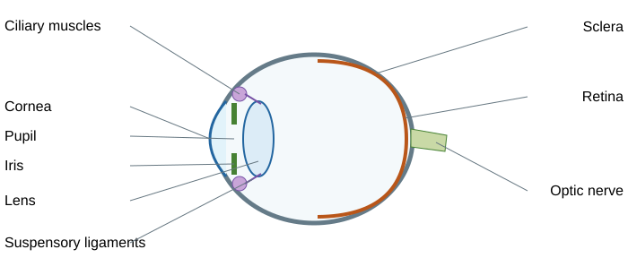
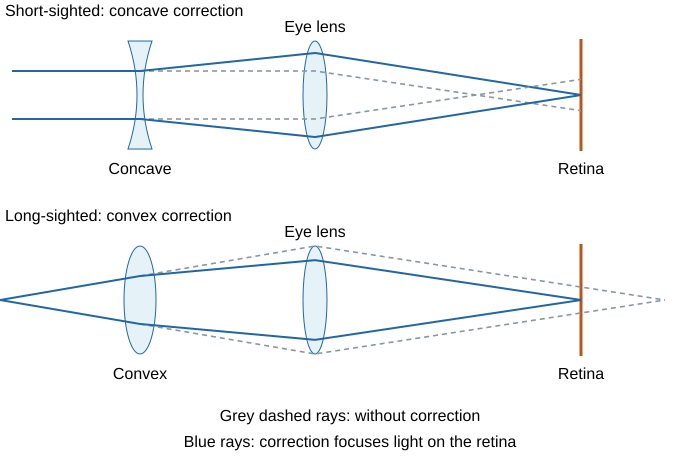
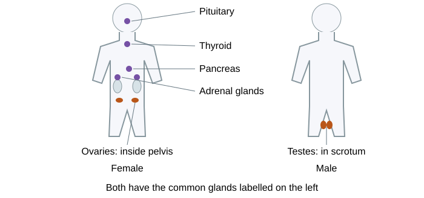
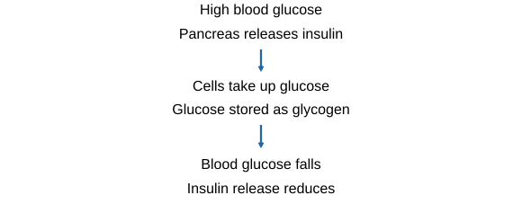
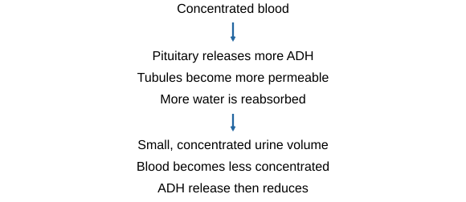
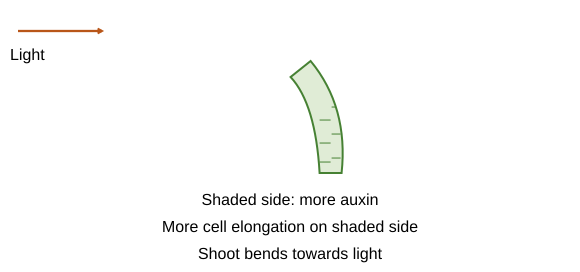

# Homeostasis and response

## Keeping internal conditions suitable

**Homeostasis** means regulating internal conditions to maintain **optimum conditions for function**, despite changes inside or outside the body. Blood glucose, water levels and body temperature are important examples. These conditions allow **enzymes and cells to work efficiently**.

Think of a thermostat: if a room becomes too cold, heating turns on; when it warms enough, heating reduces. Homeostasis also monitors a change and adjusts the response, rather than holding every measurement perfectly constant.

- **Receptors** detect a stimulus: a change in a condition.
- A **coordination centre**, such as the brain, spinal cord or pancreas, receives and processes information.
- **Effectors** are muscles or glands that produce the response.
- **Negative feedback** counteracts a deviation from the desired level. As the condition returns towards normal, the corrective response reduces. “Negative” means opposing the change, not harmful.

## Nervous signals and reflexes

The **central nervous system (CNS)** is the **brain and spinal cord**. Information travels along **neurones as electrical impulses**, enabling rapid coordination.

**Stimulus → receptor → sensory neurone → CNS → motor neurone → effector → response.** A muscle may contract; a gland may secrete a substance.

A **reflex** is **rapid and automatic**, protecting the body without waiting for a conscious decision. For a withdrawal reflex:

1. A skin receptor detects a potentially damaging stimulus.
2. A **sensory neurone** carries an impulse to the spinal cord.
3. A **relay neurone** passes the signal within the CNS.
4. A **motor neurone** carries an impulse to a muscle.
5. The muscle contracts, moving the body part away.

At a **synapse**, neurones are separated by a small gap. An arriving impulse causes release of a **chemical transmitter**. It diffuses across the gap, binds to the next cell's receptors and can start a new impulse. Electrical impulses travel along neurones; chemicals cross these synapses. Do not claim an electrical impulse jumps across the gap.

Imagine urgent messages taking a short local route instead of waiting for a long discussion. Reflexes still use a coordination centre; they do not bypass all nervous processing. Some reflexes involve the brain, so “no conscious decision” is more accurate than “no brain ever involved”.

## The brain and investigating it

The brain contains billions of connected neurones. Different regions perform different functions.

| Region | Must-know function |
|---|---|
| **Cerebral cortex** | Conscious thought, intelligence, memory and language |
| **Cerebellum** | Balance and coordination of movement |
| **Medulla** | Automatic functions, including breathing and heart rate |

Scientists investigate function by studying **patients with brain damage**, **electrically stimulating regions**, and using **MRI scans**. Combining scans with a person's symptoms helps link an affected region to a function.

Investigation and treatment are difficult because the brain is **complex and delicate**. Damage can affect essential functions; areas interact, so a symptom does not always identify one isolated cause. Electrical stimulation or surgery can provide information or treatment but risk damaging healthy tissue. Scanning avoids cutting into the brain, though a structural image alone does not explain every function. Evaluate a procedure using its likely benefit, the evidence and the specific risk, rather than declaring all brain treatment equally dangerous.

## Practical: reaction time

Test how a chosen factor affects reaction time using a ruler-drop method, for example quiet conditions versus a defined distraction.

1. One person holds a ruler vertically with zero level with another person's thumb and finger, without touching it.
2. Release it at an **unpredictable time**. The participant catches it as quickly as possible.
3. Record the distance fallen. Use a supplied **distance-to-time conversion table** where time is required; distance is not itself reaction time.
4. Repeat enough times in each condition and compare **mean times**. Allow practice before recorded trials and alternate condition order where possible to reduce learning or fatigue effects.
5. Keep starting position, hand, release method, posture and ruler consistent. If comparing people, use a suitable sample and recognise natural variation.

Avoid signals that let the catcher anticipate release. A bigger distance generally means a slower reaction. Discuss ruler-reading resolution, anticipation and practice. Do not use harmful substances or unsafe distractions to test a factor.

## Eye structures and light

The eye detects **light intensity and colour**. Light is refracted to form an image on the retina.

| Structure | Function |
|---|---|
| **Cornea** | Transparent curved front; refracts much of the incoming light |
| **Iris** | Muscles adjust pupil size and therefore how much light enters |
| **Pupil** | Opening through which light enters; it is not a muscle |
| **Lens** | Changes shape to focus on near or distant objects |
| **Ciliary muscles** | Change tension in the suspensory ligaments |
| **Suspensory ligaments** | Connect to the lens and transmit tension, changing its shape |
| **Retina** | Contains receptors sensitive to light; starts nervous signals |
| **Optic nerve** | Carries impulses from retina to brain |
| **Sclera** | Tough outer layer; protects and supports the eye |

## Accommodation and pupil responses

**Accommodation** changes **lens shape** to keep an image focused on the retina.

| Near object | Distant object |
|---|---|
| Ciliary muscles **contract** | Ciliary muscles **relax** |
| Suspensory ligaments **loosen** | Suspensory ligaments become **tight** |
| Lens becomes **thicker/more curved** | Lens is pulled **thinner/less curved** |
| Light is refracted **more strongly** | Light is refracted **less strongly** |

Think of tightening the strings that hold something flexible: tight ligaments pull the lens thinner. Muscle contraction reduces the tension on those ligaments; it does not pull the lens thin.

**Bright light:** circular iris muscles contract and radial muscles relax. The pupil becomes **smaller**, reducing the light entering and protecting the retina.

**Dim light:** radial muscles contract and circular muscles relax. The pupil becomes **larger**, allowing more light in.

Pupil size controls the **amount of light**. Lens shape controls **focusing**. They are different responses.

## Correcting eyesight

- **Myopia (short-sightedness):** distant light focuses **in front of the retina**. A **concave/diverging lens** spreads rays before they enter the eye, moving the focus back onto the retina.
- **Hyperopia (long-sightedness):** near light would focus **behind the retina**. A **convex/converging lens** starts convergence earlier, bringing the focus onto the retina.
- Interpret a ray diagram by locating the focal point relative to the retina. Do not judge solely from the apparent thickness of a drawing.
- Glasses and **hard or soft contact lenses** refract light. **Laser surgery** changes the cornea's shape; **replacement lenses** can change the eye's focusing ability.

Compare alternatives using effectiveness, reversibility, maintenance, cost and specific risks. Glasses do not change the eye surgically; surgery can reduce reliance on external lenses but has risks and is not suitable for every condition. The extra lens must correct the direction of the focusing error.

## Controlling body temperature

The **thermoregulatory centre in the brain** monitors blood temperature. Temperature receptors in the skin send impulses about the surroundings.

**Too hot**

- **Vasodilation:** blood vessels supplying skin capillaries widen. More blood flows near the surface, increasing energy transfer to the environment.
- **Sweating:** evaporation of sweat transfers energy from the skin, cooling it. Sweat must **evaporate** for this cooling effect.

**Too cold**

- **Vasoconstriction:** vessels supplying skin capillaries narrow, reducing blood flow near the surface and reducing energy loss.
- Sweating reduces or stops.
- **Shivering:** rapid skeletal-muscle contractions use energy from respiration and release heat, helping raise temperature.

These responses oppose the original change. Blood vessels do not move deeper into the skin; their diameter and blood flow change. Shivering does not make energy from nothing, and vasoconstriction mainly conserves energy rather than generating it.

## Endocrine glands and hormone messages

An **endocrine gland secretes hormones directly into the blood**. Blood carries them around the body; **target cells** with suitable receptors respond.

Compared with nervous responses, hormonal effects are **generally slower and longer lasting**. Think of nervous impulses as direct urgent messages and hormones as messages circulated to recipients able to read them. This is a comparison, not an absolute rule for every hormone.

| Gland and position | Examples of hormones or roles |
|---|---|
| **Pituitary**, base of brain | Several coordinating hormones, including FSH, LH and ADH release |
| **Thyroid**, neck | Thyroxine |
| **Adrenal glands**, above kidneys | Adrenaline |
| **Pancreas**, abdomen | Insulin and glucagon |
| **Ovaries**, pelvis | Oestrogen and progesterone |
| **Testes**, scrotum | Testosterone |

The pituitary is called a **master gland** because some of its hormones stimulate other endocrine glands. Not all hormones come from the pituitary, and not all its hormones work through another gland.

## Blood glucose: insulin and glucagon

The **pancreas monitors and controls blood glucose concentration**.

**When glucose is high**, for example after a carbohydrate-containing meal:

1. The pancreas releases **insulin**.
2. Cells take up more glucose from the blood.
3. Excess glucose is converted into **glycogen in liver and muscle cells** for storage.
4. Blood glucose falls towards its suitable level, reducing the need for insulin release.

**When glucose is low**, the pancreas releases **glucagon**. It stimulates breakdown of **liver glycogen into glucose**, which is released into the blood. The glucose level rises and the corrective response reduces.

This is **negative feedback**, with opposing hormones correcting opposite deviations.

| Term | Meaning |
|---|---|
| **Glucose** | A small sugar used in respiration. |
| **Glycogen** | The storage form of glucose. |
| **Glucagon** | A hormone. |

Do not swap the names or say insulin converts glucose into glucagon.

## Diabetes and interpreting data

| Type 1 | Type 2 |
|---|---|
| Pancreas produces **insufficient insulin** | Cells do not respond adequately to insulin: **insulin resistance** |
| Blood glucose is inadequately controlled | Blood glucose remains high despite insulin being present |
| Usually treated with **insulin injections**, with monitoring and management of carbohydrate intake | A carbohydrate-controlled diet and exercise are common management approaches; medicines may also be used |

**Obesity is a risk factor** for Type 2 diabetes, not proof that every person with it has the condition. Type 1 is not simply caused by eating too much sugar.

For a glucose graph, compare peak values, time to return towards baseline and insulin response. A high glucose concentration **despite a high insulin concentration** can support insulin resistance. Use the supplied reference data and relevant evidence rather than diagnosing from a single number or an unlabelled graph.

## Adrenaline, thyroxine and feedback

- **Adrenaline**, from adrenal glands, prepares the body for **fight or flight**. It increases heart rate and boosts delivery of oxygen and glucose to brain and muscles, supporting respiration and rapid action.
- **Thyroxine**, from the thyroid, increases **basal metabolic rate** and supports growth and development. Basal metabolic rate describes energy use for basic functions at rest.
- Thyroxine is controlled by **negative feedback**. If its level falls, pituitary stimulation of the thyroid increases; if the level rises sufficiently, stimulation reduces. This restores a suitable level.

When explaining feedback, link the measured change to a hormone response and then back to the controlled condition. Do not label every hormone interaction negative feedback: the rise in LH around ovulation involves a different hormonal interaction.

## Water balance and urea production

Water balance prevents body cells from gaining or losing too much water by **osmosis**. If blood becomes too concentrated, water tends to leave cells; if too dilute, cells tend to gain water. Both extremes can impair function.

- Water is lost in exhaled air.
- **Sweat contains water, ions and some urea**. These losses are not directly regulated by the kidney water-balance mechanism.
- Kidneys regulate excretion of excess water, ions and urea in **urine**.

**Excess amino acids:** protein digestion produces amino acids. Excess cannot simply be stored. In the **liver**, they are **deaminated**, producing **ammonia**, which is toxic. It is rapidly converted into **urea** for safer transport and excretion. Blood carries urea to the kidneys.

Remember the roles: **liver makes urea; kidneys excrete it**. Urea is not the same as urine, which is a mixture containing water and dissolved substances.

## Kidney filtration and selective reabsorption

Kidneys first **filter the blood**, then **selectively reabsorb useful substances** into the blood.

- Small substances such as water, ions, glucose and urea enter the filtered fluid.
- Blood cells and large proteins remain in the blood.
- Normally, **all filtered glucose is reabsorbed**. Appropriate amounts of water and ions are also reabsorbed.
- Excess water and ions, together with urea, form urine.

Think of sorting a recycling collection: the initial collection takes many small items, then useful ones are returned. Filtration is not simply “remove only bad substances”. Reabsorption must follow because useful molecules can enter the filtered fluid too.

If data show glucose in the filtered fluid but normally none in urine, the difference is evidence of **selective reabsorption**. Compare amounts or concentrations using the given volumes; concentration alone is not total mass.

## ADH and urine concentration

**ADH is released by the pituitary gland** and changes the **water permeability of kidney tubules**.

**Too little body water / concentrated blood**

- More ADH is released.
- Tubules become **more permeable to water**.
- More water is reabsorbed into the blood.
- A **smaller volume of more concentrated urine** is produced.
- As water balance improves, ADH release reduces: negative feedback.

**When there is excess body water**, the blood becomes more dilute. Less ADH is released, so the kidney tubules become less permeable to water. Less filtered water returns to the blood. The result is a **larger volume of more dilute urine**.

ADH does not add water to the body. It changes how much existing filtered water is returned to the blood. Keep **urine volume** and **urine concentration** distinct.

## Kidney failure: dialysis and transplant

**Dialysis** passes blood beside dialysis fluid across a **partially permeable membrane**. Urea diffuses from its higher concentration in blood into fluid with little or no urea. The fluid has suitable glucose and ion concentrations to avoid unwanted net loss of useful substances. Blood cells and proteins remain in the blood because they cannot cross. Controlled conditions can remove excess ions and water.

**Dialysis advantages:** can sustain life without finding a donor or having transplant surgery. **Limitations:** repeated lengthy sessions, restrictions and disruption, with ongoing treatment needs. It does not perfectly reproduce continuous healthy-kidney regulation.

A **kidney transplant** can restore more normal filtration and regulation, reducing reliance on dialysis. It requires a suitable donor, surgery and medicines that suppress immune responses to reduce **rejection**. These medicines increase susceptibility to infections. Donor shortage and transplant failure are additional limitations.

An evaluation should compare the **specific patient's circumstances**, availability, outcomes and burdens. “A transplant is always better” is too absolute. Dialysis can be a bridge to transplant or an ongoing treatment when transplant is unsuitable.

## Puberty and the menstrual cycle

Reproductive hormones cause **secondary sexual characteristics** during puberty. **Testosterone**, from testes, stimulates sperm production. **Oestrogen**, mainly from ovaries, contributes to female secondary sexual characteristics. Eggs mature and ovulation begins during puberty.

The **menstrual cycle** prepares for possible pregnancy. A 28-day cycle is a useful example; real cycle lengths vary. Day 1 is the start of menstruation, when the uterine lining is shed.

| Hormone | Source | Main role and interaction |
|---|---|---|
| **FSH** | Pituitary | Stimulates maturation of an egg/follicle and oestrogen production |
| **Oestrogen** | Ovary | Rebuilds lining, inhibits FSH; a high level around mid-cycle stimulates LH release |
| **LH** | Pituitary | A surge stimulates **ovulation**, release of the egg |
| **Progesterone** | Ovary after ovulation | Maintains lining and inhibits FSH and LH |

If pregnancy does not occur, progesterone and oestrogen levels fall. The lining is no longer maintained and menstruation follows; FSH can rise to support the next cycle.

For a hormone graph, identify the **LH peak just before ovulation**, the earlier oestrogen rise and the later progesterone rise. Do not assume all four peaks occur on the same day or that every cycle releases an egg precisely on day 14.

## Contraception: how methods work

Contraception reduces the chance of pregnancy through different mechanisms. Separate hormone effects, barriers and other methods.

| Method | Mechanism and comparison point |
|---|---|
| **Oral hormonal contraceptive** | Hormones inhibit FSH and egg maturation/ovulation; needs correct regular use |
| **Hormonal implant, injection or patch** | Hormonal methods can suppress egg maturation/release; longer-lasting delivery reduces dependence on a daily pill |
| **Condom or diaphragm** | Barrier prevents sperm reaching an egg; correct use matters. Condoms also reduce STI transmission |
| **Copper IUD** | A device in the uterus; copper interferes with sperm and prevents fertilisation. It can also prevent implantation |
| **Hormonal intrauterine system** | Releases progestogen, altering cervical mucus and uterine lining; a hormone-releasing device |
| **Spermicide** | Kills or disables sperm; effectiveness depends on method and use |
| **Avoiding intercourse during the fertile period** | Avoids sperm meeting an available egg, but predicting ovulation can be difficult |
| **Sterilisation** | Surgery blocks sperm or egg transport; intended as permanent |

Evaluate using **effectiveness, side effects, duration, reversibility, use requirements and STI protection**, plus the evidence given. Do not claim hormone methods protect against STIs. Personal and ethical choices cannot be decided by biological measurements alone.

## Fertility hormones and IVF

**FSH and LH in fertility treatment** can stimulate egg maturation and ovulation. Pregnancy may then occur through intercourse. IVF adds fertilisation outside the body.

**IVF sequence**

1. Hormone treatment stimulates the maturation of **several eggs**.
2. Eggs are collected and mixed with sperm for **fertilisation in the laboratory**.
3. Fertilised eggs develop into **embryos by cell division**.
4. One embryo, or sometimes two when appropriate, is transferred into the **uterus**. Successful implantation can lead to pregnancy.

Improved microscopy and laboratory techniques help scientists handle and monitor these cells. IVF transfers an **embryo**, not an unfertilised egg, into the uterus.

**Benefit:** IVF offers a chance of a child when other routes have failed.

**Limits and risks:** success is not guaranteed. Treatment can be physically and emotionally stressful, as well as costly. Transferring more than one embryo can increase **multiple-pregnancy risks** for the parent and babies.

**Ethical questions:** decisions about embryo storage and use involve different viewpoints. Explain these fairly; they cannot be settled by a biological measurement alone.

For success data, calculate **successful outcomes/attempts ×100**. Distinguish a pregnancy rate from a live-birth rate and compare similar groups, including age and treatment conditions.

## Plant responses to light and gravity

Plants use hormones to coordinate growth. **Auxin** is made in growing tips and can become unevenly distributed, causing different elongation rates.

- **Phototropism:** a growth response to light. Shoots show **positive phototropism**, growing towards it.
- In a shoot lit from one side, more auxin accumulates on the **shaded side**. It promotes cell elongation there, making the shoot **bend towards the light**.
- **Gravitropism:** a growth response to gravity. Shoots grow away from gravity; roots grow towards it.
- In a horizontal shoot, more auxin on the lower side promotes elongation there, bending it upwards.
- Roots respond differently: a higher auxin concentration on the lower side **inhibits elongation**, so the upper side grows more and the root bends downwards.

Think of one side of a flexible strip becoming longer: the strip bends towards the shorter side. Auxin is not a signal telling the whole plant to walk towards light; **unequal growth creates the curve**.

## Practical: seedling growth responses

Use newly germinated seedlings of the **same species and similar starting size**. Record both their growth and the direction in which they bend.

### Investigating light

1. Put one group in **one-sided light** and a control group in comparable **all-round light**.
2. Record initial shoot lengths. Make careful, labelled biological drawings showing the starting direction.
3. After the same observation period, measure the lengths again and draw the new shoot directions.
4. Keep water, temperature, seedling age and growing medium comparable.
5. Use several seedlings, repeat the comparison and look for a consistent response.

### Investigating gravity

1. Place comparable seedlings **horizontally in darkness**. Darkness prevents directional light from competing with the gravity response.
2. Compare them with suitable upright controls, or interpret an appropriate rotating arrangement if the question supplies one.
3. Record root and shoot lengths and their changing directions using labelled biological drawings.
4. Keep other growth conditions matched and compare several seedlings.

Growth mainly occurs near the tip. Describe which region elongates rather than saying that the whole seedling moves.

If no seedlings grow, check the conditions. Failure to grow does not show that hormones have no effect. Explain the purpose of the **actual control arrangement** used in the question.

## Useful plant hormones

| Hormone | Natural role | Applications |
|---|---|---|
| **Auxins** | Coordinate growth responses | Selective weedkillers; rooting powders for cuttings; promoting growth in tissue culture |
| **Gibberellins** | Initiate germination | End seed dormancy, promote flowering and increase fruit size |
| **Ethene** | Controls cell division and fruit ripening | Manage ripening during storage and transport |

For a use, link **hormone → effect → benefit**. Rooting powder promotes roots so cuttings establish. Controlled ethene exposure coordinates ripening close to sale, reducing losses. Selective weedkillers can reduce unwanted plants but affect biodiversity, so evaluate benefits against environmental effects.

## Avoid these mistakes

- Homeostasis regulates internal conditions; it is not simply having a constant environment outside the body.
- A reflex is not a conscious response, but it still uses neural coordination.
- Lens shape and pupil size have different jobs.
- Near vision: ciliary muscles contract, ligaments loosen, lens thickens.
- Vasodilation changes vessel diameter, not position.
- Insulin lowers glucose; glucagon raises it. Glycogen is storage, not a hormone.
- Liver makes urea; kidneys regulate its excretion in urine.
- More ADH means more water reabsorption and less, more-concentrated urine.
- FSH matures an egg; LH triggers its release. IVF transfers an embryo.
- More auxin promotes elongation in shoots but can inhibit it in roots.

## Sources

- [AQA Homeostasis and response specification](https://www.aqa.org.uk/subjects/biology/gcse/biology-8461/specification/subject-content/homeostasis-and-response)
- [NHS: copper IUD](https://www.nhs.uk/contraception/methods-of-contraception/iud-coil/what-is-it/)
- [NHS: IVF embryo transfer](https://www.guysandstthomas.nhs.uk/health-information/ivf-treatment/step-5-embryo-transfer-womb)
