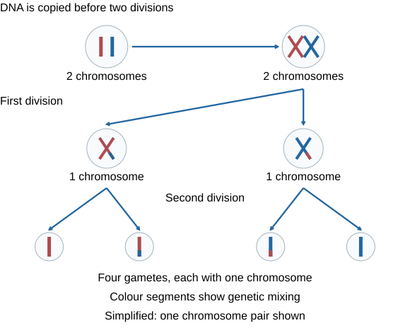
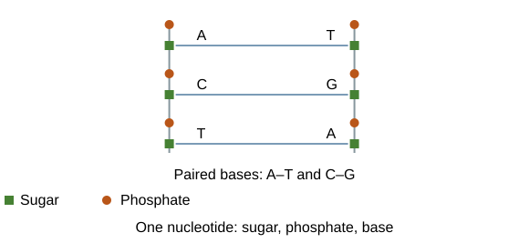
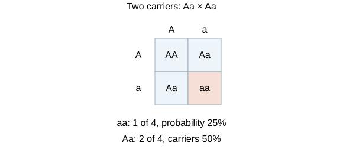
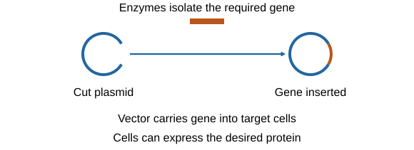
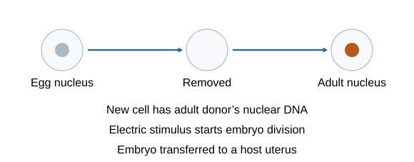
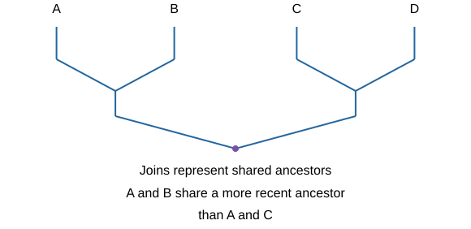

# Inheritance variation and evolution

## Sexual and asexual reproduction

Reproduction passes genetic information to a new generation. **Sexual reproduction** mixes information when two **gametes fuse**. **Asexual reproduction** uses one parent without gamete fusion, normally making genetically identical **clones**.

Think of sexual reproduction as combining cards from two decks, making new hands. Asexual reproduction is like copying an existing hand. Mutations can introduce changes, so a clone's DNA is copied rather than magically guaranteed never to change.

| Sexual | Asexual |
|---|---|
| Gametes formed by **meiosis**; fertilisation joins them | No gamete fusion; **mitosis** makes new cells |
| Produces genetic variation | Normally produces clones with no mixing from two parents |
| Variation may help some offspring survive environmental change | One parent is enough; often faster and uses less time and energy finding a mate |
| Finding a mate and producing gametes can cost time/energy | Many offspring can be produced in favourable conditions, but shared susceptibility can be a disadvantage |

In animals, sperm and egg fuse. In flowering plants, a male gamete carried in pollen fuses with an egg cell. Some organisms use both methods:

- **Malarial parasites:** asexual reproduction in humans, sexual reproduction in mosquitoes.
- **Many fungi:** asexual spores as well as sexual reproduction giving variation.
- **Plants:** sexual seed production; asexual runners in strawberries or bulb division in daffodils.

Choose an advantage that fits the situation. A stable environment may favour quick cloning; a changed environment can make variation valuable. Neither method guarantees survival.

## Meiosis, fertilisation and chromosome number

Ordinary human body cells usually contain **46 chromosomes in 23 pairs**. Gametes contain **23 chromosomes**, one set. **Meiosis halves chromosome number** so fertilisation can restore it without doubling it in every generation.

1. Genetic information is **copied before division**. A copied chromosome has two joined copies; it is still counted as one chromosome while joined.
2. The cell divides **twice**, producing **four gametes**, each with one set of chromosomes.
3. Gamete formation reshuffles genetic information, making different combinations. Chromosome sections can be exchanged and different parental chromosomes combined.
4. At fertilisation, 23 from sperm + 23 from egg = **46** in the new cell.
5. The fertilised cell divides by **mitosis** as the embryo grows; cells later **differentiate** for their jobs.

Compare the outcomes: **mitosis makes two genetically identical cells with the original chromosome number**; **meiosis makes four genetically varied gametes with half the number**. Copying doubles DNA amount, not the counted number of joined chromosomes. Fertilisation fuses gametes; mitosis increases cell number afterwards.

## DNA, chromosomes, genes and genome

**DNA** is the chemical carrying genetic information. In the nucleus it is packaged into **chromosomes**. A **gene** is a section of DNA coding for an amino-acid sequence used to make a protein. The **genome** is an organism's **entire genetic material**, including DNA beyond its protein-coding genes.

Imagine DNA as text, a gene as a particular set of instructions and the genome as the whole instruction library. Chromosomes are the packages holding long DNA molecules, not individual letters.

- DNA is a **polymer** of repeating **nucleotides**.
- Each nucleotide contains a **sugar, phosphate group and one base**.
- Four bases are **A, T, C and G**. Two strands form a **double helix**, like a twisted ladder.
- The backbone alternates **sugar and phosphate**; bases attach to sugars.
- Complementary pairing is **A with T** and **C with G**.
- A sequence of **three bases** specifies an amino acid. Base order determines amino-acid order.

If one strand reads **A C T G**, the paired bases are **T G A C**. Complementary does not mean the opposite strand repeats the same sequence.

Studying the **human genome** helps identify genes associated with disease, understand and treat inherited disorders, and trace past **human migration** using inherited patterns. Having a genome sequence does not mean every gene's effect is already fully understood.

## From base sequence to protein function

1. The gene's DNA sequence provides instructions for a **template** used in protein synthesis.
2. **Ribosomes** assemble the protein. **Carrier molecules bring specific amino acids** and add them in the order specified by the template.
3. The amino-acid chain **folds into a particular shape**.
4. Shape enables a function: an enzyme's active site binds a substrate, a hormone can bind a receptor, or a structural protein such as collagen provides strength.

Think of threading different beads in a particular order. Changing their order can change how the chain folds. The important chain is **base sequence → amino-acid sequence → folding/shape → function**.

A **mutation** is a change in DNA. Mutations occur continuously, but most have no effect on phenotype, or only a small effect. Some change a protein's amino-acid sequence and shape, affecting activity: an enzyme may no longer bind its substrate, or a structural protein may lose strength.

Not all DNA codes for proteins. Variants in **non-coding DNA** can change whether or how strongly a gene is expressed, altering the **amount of protein made**. Distinguish changing a protein's sequence from changing gene expression. Do not claim every mutation makes a harmful new protein.

## The language of inheritance

| Term | Meaning |
|---|---|
| **Allele** | A version of a gene |
| **Genotype** | The alleles present |
| **Phenotype** | The expressed characteristic, influenced by genotype and sometimes environment |
| **Homozygous** | Two matching alleles for the gene, such as AA or aa |
| **Heterozygous** | Two different alleles, such as Aa |
| **Dominant** | Expressed when present in the single-gene models used below |
| **Recessive** | Expressed in these paired-allele models when no dominant allele is present, as aa |

Use **one letter** for a gene: A for a dominant allele and a for its recessive form. A dominant allele is not necessarily more common, better or “stronger”. Different letters do not automatically mean different genes; define the symbols from the question.

Some characteristics follow single-gene patterns, such as certain mouse fur colours and inherited conditions. Genes can also lie on sex chromosomes, as in red-green colour blindness. **Most characteristics involve multiple genes**, often interacting with the environment; a one-gene square does not explain every human trait.

## Punnett squares and probabilities

For a cross **Aa × Aa**:

1. Each parent can produce a gamete carrying **A or a**. A gamete receives only one allele from this pair.
2. Put one parent's gametes across the top and the other's down the side.
3. Combine one allele from each parent in every box: **AA, Aa, Aa, aa**.
4. Count the outcomes asked for, then divide by **all equally likely outcomes**.

- Genotype ratio = **1 AA : 2 Aa : 1 aa**.
- Dominant phenotype probability = **3/4 = 75%**.
- Recessive phenotype probability = **1/4 = 25%**.
- Heterozygous probability = **2/4 = 50%**.

**1 in 4** is a probability; **1:3 affected:unaffected** is a ratio. Writing 1:4 affected:unaffected would mean one affected out of five, not one out of four. Expected numbers are probabilities multiplied by the number of offspring, but small families need not match the expected ratio exactly. Each conception is a new event; previous children do not use up outcomes.

## Inherited conditions and family trees

**Polydactyly** means extra fingers or toes. In the simple inheritance model it is caused by a **dominant allele**. With P as that allele, PP and Pp express the condition; pp does not. Pp × pp gives **50% Pp** and **50% pp**.

**Cystic fibrosis** is a disorder affecting cell membranes caused by a **recessive allele**. Using C for the usual allele and c for the disease allele:

- CC: does not have the condition and does not carry c.
- Cc: a **carrier**, usually without the condition.
- cc: has the condition.
- Two carriers, Cc × Cc, have a **25% probability of an affected child** and a **50% probability of a carrier** per conception.

For a pedigree, read its key and generation links. In a simple recessive model, **two unaffected parents can have an affected child** if both are carriers. “The condition skipped a generation” alone is not enough: identify the actual parent–child evidence. Work out possible genotypes before assuming every unaffected person is homozygous.

**Embryo screening** can identify particular alleles and help select an embryo without an inherited disorder. Potential benefits include reducing suffering and treatment burden. Economic, social and ethical issues include cost and access, decisions about embryos, accuracy/limitations and concerns about which traits are selected. Evaluate the information given without claiming a test checks every possible future illness.

## Sex-chromosome inheritance

Humans usually have 22 pairs of non-sex chromosomes and one pair of sex chromosomes. In the standard inheritance cross, **XX is female** and **XY is male**.

| Egg / sperm | X sperm | Y sperm |
|---|---|---|
| X egg | XX | XY |
| X egg | XX | XY |

Eggs contribute X; sperm contributes X or Y. This gives approximately **50% XX and 50% XY**, or a **1:1 ratio**. It predicts probabilities rather than requiring every family to contain equal numbers of each. The egg does not provide a Y chromosome in this model.

## Genetic and environmental variation

**Variation** is differences between individuals in a population.

- **Genetic:** different inherited alleles, such as blood group.
- **Environmental:** conditions during life, such as a scar.
- **Both:** height depends on inherited influences and conditions such as nutrition.

Mutations produce new genetic variants; sexual reproduction reshuffles existing alleles. Most variants have little or no effect on phenotype; some affect it and very few determine a major new phenotype. A mutation happens without an organism deliberately choosing what it needs.

If a rare beneficial variant becomes useful in a changed environment, natural selection can make it more common. Environmental changes can alter an individual's phenotype without changing inherited DNA, so not every acquired change is passed on.

## Natural selection and evolution

**Evolution** is a change in **inherited characteristics of a population over generations**. Natural selection explains how variants suited to an environment can become more common.

1. Individuals show **genetic variation**, partly arising from mutations.
2. They face a **selection pressure**, such as predation, limited food or an antibiotic.
3. Individuals with a useful inherited characteristic are more likely to **survive and reproduce**.
4. They **pass the relevant alleles to offspring**.
5. Over generations, those alleles become more common, changing the population.

Imagine a population of insects with inherited colours. If birds more often spot one colour on a changed background, better-camouflaged insects leave more offspring. They did not decide to change colour; selection changes how common existing inherited variants become.

Do not stop at “the strongest survive”. Survival matters because it allows **successful reproduction and inheritance**. Individuals do not deliberately evolve during their lifetime; populations change over generations.

## How new species arise

One route to **speciation** involves separated populations:

1. A barrier isolates parts of one population, reducing interbreeding.
2. Mutations and genetic variation exist in each group.
3. Different environments create different selection pressures.
4. Different advantageous alleles become common over many generations.
5. Differences become sufficient that the groups **can no longer interbreed to produce fertile offspring**. They are then different species in this definition.

Separation alone does not instantly produce a new species. Link it to accumulated inherited differences and **reproductive isolation**.

## Selective breeding

**Selective breeding (artificial selection)** means humans choose parents with desired **inherited characteristics**.

1. Choose suitable parents from a mixed population.
2. Breed them.
3. Select offspring with the desired characteristics and breed those.
4. Repeat over **many generations**.

Examples include disease-resistant crops, higher meat/milk production, gentle dogs and large flowers. If selecting two traits, such as egg number and growth, assess both rather than selecting just one. Repeatedly mating the original parents alone is not a multi-generation selection programme.

**Benefits:** useful yield, appearance or disease resistance. **Risks:** **inbreeding**, a reduced gene pool and increased chance of inherited defects or shared disease susceptibility. Consider welfare and environmental effects. Natural selection is driven by environmental pressures; artificial selection uses human choices.

## Genetic engineering

**Genetic engineering** modifies a genome by introducing a selected gene, potentially from another organism, to give a desired characteristic. It differs from choosing whole parents in selective breeding.

1. Use **enzymes to isolate the required gene** from donor DNA.
2. Insert it into a **vector**, such as a bacterial **plasmid** or a virus.
3. The vector carries the gene into the target cells.
4. In plants or animals, introduce genes early in development so the resulting organism develops with the characteristic.
5. Cells express the inserted gene, making the useful protein or characteristic.

Applications include bacteria producing **human insulin**, and crops with insect resistance, herbicide resistance, disease resistance or improved yield/fruit characteristics.

Evaluate a particular trait, not “all GM is good/bad”. Benefits may include reduced crop losses or a useful medicine. Potential environmental concerns include effects on wild plants and insects and gene spread. Distinguish **a proposed risk from evidence that it has occurred**. Consider health evidence, cost, access and ethical objections. Medical research may use genetic modification to address inherited disorders.

## Plant and embryo cloning

**Tissue culture:** take small groups of plant cells and grow them in a sterile nutrient medium with appropriate growth hormones. Many identical plants can be produced, useful for nurseries and conserving rare varieties.

**Cuttings:** take part of a parent plant and encourage it to form roots, often using rooting powder. The new plants are clones of the parent.

**Embryo transplants:** split cells from an early embryo **before they specialise**, then place the resulting embryos into host mothers. The offspring share the same genetic information from that original embryo; they are not automatically clones of the host mother.

Cloning preserves a desired genotype quickly. A uniform crop can also share susceptibility to a disease, so preserving many individuals is not the same as preserving broad genetic diversity.

## Adult-cell cloning and its evaluation

1. Remove the nucleus from an **unfertilised egg**.
2. Insert the **nucleus from an adult body cell**, such as a skin cell.
3. An **electrical stimulus** starts division, forming an embryo.
4. Transfer the embryo to a host's **uterus** for development.

The embryo has the **adult nucleus donor's nuclear genetic information**. The egg donor supplies the cell and the host carries the embryo; neither replaces the adult donor's nuclear genome. No sperm fertilisation is used in this procedure.

Potential benefits include copying valuable livestock or producing useful cells for research. Limitations include low success, developmental problems, costs, animal-welfare concerns and reduced genetic diversity. Genetic similarity does not guarantee identical appearance or behaviour because environments and development also influence phenotype.

## Darwin, Wallace and changing explanations

**Charles Darwin** built his natural-selection explanation from travel observations, experiments, discussion and evidence from geology and fossils. **Alfred Russel Wallace** independently proposed natural selection and gathered evidence worldwide, including warning coloration and speciation. Their work contributed jointly to the developing theory; it was not one sudden guess by one person.

Joint presentation of ideas in **1858** helped prompt Darwin's **1859** publication of *On the Origin of Species*. Acceptance was gradual because evidence was initially limited, the mechanism of inheritance was not yet understood, and the ideas challenged widely held beliefs about the origin of species.

**Lamarck's proposal** emphasised inheritance of changes acquired during an organism's life. For most characteristics, acquired changes are not inherited in that way. Compare it with natural selection: inherited variation already exists, and differential reproduction changes its frequency.

## Mendel and the gene theory

**Gregor Mendel** used plant-breeding experiments in the mid-19th century and inferred **units of inheritance** passed to descendants. His controlled crosses and counts revealed patterns that did not fit simple blending of every parental trait.

His work was not fully recognised in his lifetime because the significance and mechanism were not yet understood. Later observations of **chromosome behaviour** during division matched the inheritance patterns, linking units called **genes** to chromosomes. Discovery of **DNA structure and gene function** in the mid-20th century helped explain how information specifies proteins.

Modern genetics developed through many scientists' evidence. Mendel did not discover DNA's double-helix structure, and Darwin did not know the modern molecular explanation of inheritance.

## Fossils, evidence and extinction

**Fossils** are preserved remains or traces of past organisms, often in rocks.

- Remains can persist when conditions needed for decay are absent.
- Minerals can replace parts as the organism decays.
- Traces such as **footprints, burrows and root traces** can be preserved.

The fossil record shows organisms changing over time and reveals extinct forms. It is **incomplete**: many early organisms were soft-bodied, few suitable preservation events occurred, and geological activity has destroyed evidence. A gap does not show that no organism existed.

**Extinction** means no individuals of a species remain alive. Causes can include environmental change, new predators, disease, competition or catastrophic events. A species unable to survive and reproduce under new conditions may die out; an individual's death is not an extinction.

Evidence for evolution includes the **fossil record**, mechanisms of **genetic inheritance**, and observed changes such as **antibiotic resistance**. Use several lines of evidence and distinguish observations from explanations.

## Antibiotic resistance by natural selection

1. Mutations can produce bacterial variants resistant to an antibiotic.
2. The antibiotic kills susceptible bacteria, while resistant ones are more likely to survive.
3. Survivors reproduce rapidly and pass resistance to descendants.
4. The resistant strain becomes more common and can spread, making treatment harder.

**The bacteria evolve resistance, not the patient.** Antibiotics select among variants; bacteria do not deliberately mutate because they want to survive. MRSA is an example of an antibiotic-resistant bacterial strain.

Reduce selection and spread by **avoiding inappropriate antibiotics**, including for viral infections, following the **prescribed treatment correctly**, restricting unnecessary agricultural use, and controlling infection transmission. New antibiotics take time and money to develop, so discovery may not keep pace with resistance.

## Classification and evolutionary trees

**Linnaeus** grouped organisms using their structures and characteristics. The hierarchy is:

**Kingdom → phylum → class → order → family → genus → species.** Moving down the hierarchy narrows the group. The **binomial name** uses **genus and species**, for example *Homo sapiens*: capital genus, lower-case species.

Improved microscopes and biochemical evidence changed classification. **Carl Woese's three-domain system** distinguishes:

- **Archaea:** prokaryotes distinct from bacteria; many examples live in extreme environments.
- **Bacteria:** the bacterial domain.
- **Eukaryota:** organisms with eukaryotic cells, including protists, fungi, plants and animals.

Domains are not simply three kingdoms. Classification uses evidence, so a revised system can better reflect relationships.

An **evolutionary tree** represents inferred relationships using evidence from living organisms and fossils. Each branch join represents a **shared ancestor**. A more recent shared ancestor generally indicates closer relatedness. Do not judge from how close the names appear on the page or treat a modern species as necessarily the ancestor of the one beside it.

## Avoid these mistakes

- Meiosis halves chromosome number; fertilisation restores it. DNA copying does not double the number of joined chromosomes.
- A gamete receives one allele from each pair in the simple crosses, not both.
- Dominant does not mean common, beneficial or physically stronger.
- Genotype is the allele combination; phenotype is the expressed characteristic.
- A 25% probability is not a guarantee of exactly one affected child in every four births.
- Natural selection requires **reproduction and inherited alleles**, not just survival.
- Cloning copies genetic information; it does not guarantee identical environments or behaviour.
- Antibiotic resistance evolves in bacteria, not in a person's body as a whole.
- A fossil gap does not disprove all past life; classification and explanations develop with evidence.

## Sources

- [AQA Inheritance, variation and evolution](https://www.aqa.org.uk/subjects/biology/gcse/biology-8461/specification/subject-content/inheritance-variation-and-evolution)
- [NHS: antibiotics and resistance](https://www.nhs.uk/medicines/antibiotics/antibiotic-antimicrobial-resistance/)
