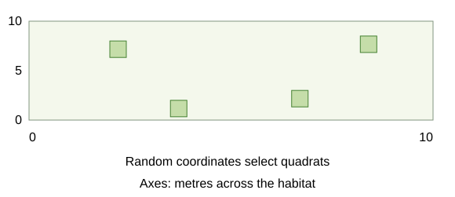
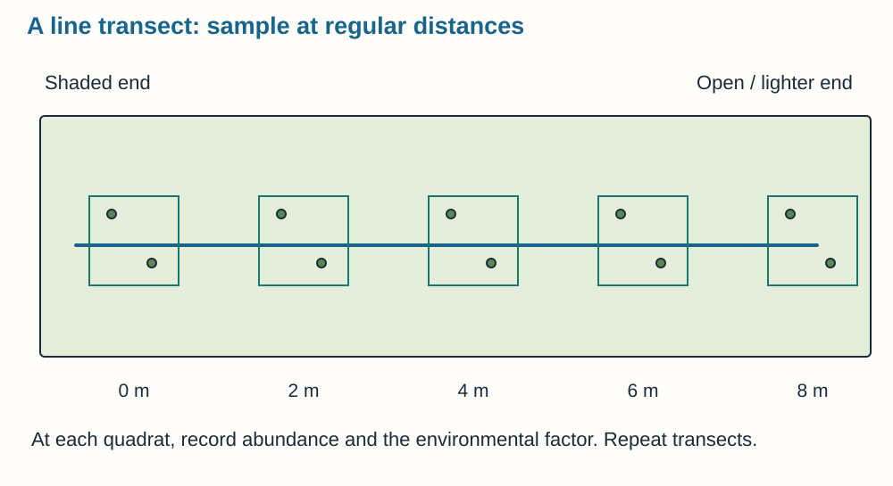
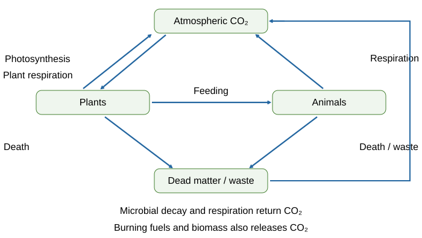
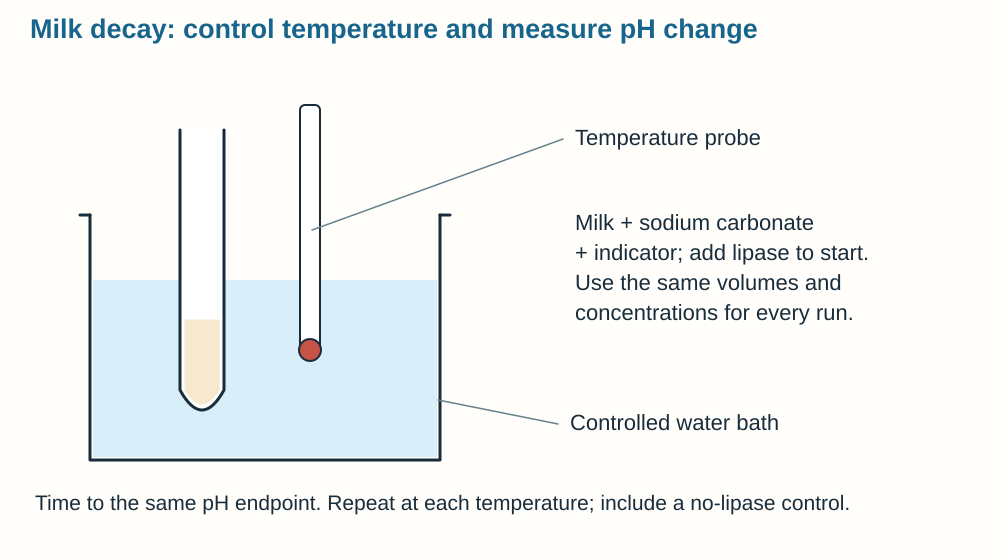
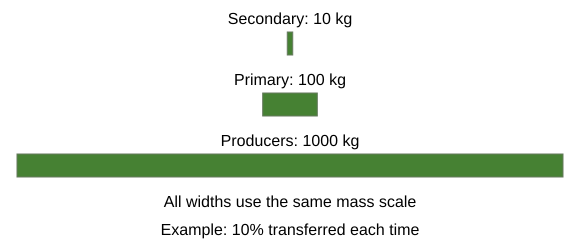

# Ecology

## Ecosystems and interdependence

An **ecosystem** is a community of organisms interacting with the **non-living environment**. Think of a neighbourhood: residents depend on each other and on water, space and suitable conditions. Changing one part can affect many others.

- **Individual:** one organism.
- **Population:** all organisms of one species in an area.
- **Community:** populations of different species living together.
- **Ecosystem:** community plus abiotic surroundings and their interactions.

**Interdependence** means species rely on others for food, shelter, pollination or seed dispersal. If insects decline, insect-eating birds may lose food and flowering plants may lose pollinators. A **stable community** has species and environmental factors in balance, so populations stay fairly constant overall, despite fluctuations.

**Competition** occurs when resources are limited. Plants compete for **light, space, water and mineral ions**. Animals compete for **food, mates and territory**. Name the actual resource rather than simply saying “survival”.

### Changes can travel through a food web

Suppose insect numbers fall. Insect-eating birds may have less food and produce fewer young. If some insects are pollinators, plants may set fewer seeds, affecting other animals later. These are different connections in the same community, so an effect can spread beyond the species directly affected.

A stable community is **dynamic**: births, deaths and seasonal changes continue. Stability means populations remain within broadly balanced ranges, not that every count stays identical.

## Living and non-living factors

**Abiotic factors** are non-living conditions:

- **Light intensity:** affects photosynthesis and plant distribution.
- **Temperature:** affects enzyme activity, growth and survival.
- **Moisture:** affects water availability and water loss.
- **Soil pH and mineral content:** affect suitable plant growth.
- **Wind intensity/direction:** affect exposure and water loss.
- **Carbon dioxide:** affects photosynthesis when limiting.
- **Dissolved oxygen:** affects aerobic respiration of aquatic animals.

**Biotic factors** are living influences: **food availability, new predators, pathogens and competition**. A competitor can reduce numbers so much that finding mates becomes difficult.

Use the context: “less dissolved oxygen restricts fish respiration” explains a mechanism. “The water is bad” does not. An apparent correlation between abundance and temperature does not prove temperature is the only cause.

## Adaptations and distribution

An **adaptation** helps an organism survive and reproduce in its usual environment.

| Type | Example | How it helps |
|---|---|---|
| Structural | Thick fur or small ears in a cold habitat | Reduces energy loss |
| Structural | Waxy leaves in dry habitats | Reduces water loss |
| Behavioural | Being active at night in a hot desert | Avoids the hottest conditions |
| Functional | Producing concentrated urine | Conserves water |

**Extremophiles** live under extreme temperature, pressure or salt conditions, such as bacteria near deep-sea vents. Explain the particular advantage using the information supplied.

Distribution changes seasonally, between geographical regions or following human activity. Changes in **temperature, water availability and atmospheric gases** can alter survival, migration, reproduction and competition. Evaluate several factors and the quality of the evidence, rather than assuming every species responds alike.

## Food chains and population cycles

**Producers**, usually plants or algae, use photosynthesis to make organic molecules and **biomass**. Food-chain arrows show transfer of material and energy **from the organism eaten to the eater**:

**Grass → rabbit → fox.**

- Producer: **trophic level 1**.
- Herbivore/primary consumer: **level 2**.
- Carnivore eating a herbivore/secondary consumer: **level 3**.
- Carnivore eating a secondary consumer/tertiary consumer: **level 4**.
- **Apex predator:** predator with no predators in that food web.

In predator–prey cycles, prey numbers usually rise first. More food then supports more predators. Increased predation reduces prey, so predators later decline as food becomes scarce. The **predator peak lags behind the prey peak**. Real populations are also influenced by disease, weather and other food sources.

## Random quadrats: estimating population size

A **quadrat** samples a known area. Random positions help avoid choosing only places where a species is obvious.

1. Measure the habitat dimensions and set up coordinate axes.
2. Generate **random coordinates** and place the same-sized quadrat at each position.
3. Count the target species using a consistent boundary rule. For overlapping plants, percentage cover may be more practical.
4. Use **many samples**, calculate mean count and record variation.
5. Scale the mean to the habitat area. This assumes samples represent the whole habitat.

**Estimated population = mean per quadrat × habitat area ÷ quadrat area.**

**Worked estimate:** five counts are 3, 7, 5, 4 and 6. The quadrat area is 0.25 m² and the habitat area is 100 m².

1. Mean per quadrat = (3 + 7 + 5 + 4 + 6) ÷ 5 = **5 plants**.
2. Number of quadrat-sized areas in the habitat = 100 ÷ 0.25 = **400**.
3. Estimated population = 5 × 400 = **2000 plants**.

This assumes that the sampled areas represent the habitat. More well-spread samples improve representativeness, but the result remains an estimate rather than an exact census. Quadrats suit plants and slow-moving organisms. They are unsuitable for animals constantly moving in and out of the sample area.

### Count, frequency and cover answer different questions

**Abundance** can be measured by counting individuals where they can be distinguished. **Frequency** is the proportion of sampled quadrats containing a species. **Percentage cover** estimates the fraction of ground covered, useful when individual plants overlap or cannot be separated easily.

Choose the measure before sampling and apply it consistently. A species can occur in every quadrat but cover little of each one, so high frequency does not necessarily mean high cover. Increasing the number of random samples helps a patchy habitat be represented; throwing a quadrat towards convenient-looking vegetation is not random selection.

## Transects: investigating distribution

A **transect** is a line across a habitat, for example from shade into open grassland. Place quadrats at **regular intervals**, then record abundance and a relevant factor such as light intensity at each site.

- Same quadrat size, species identification and counting rule.
- Measure the factor consistently at each position.
- Repeat parallel transects to check whether one route is representative.
- Plot abundance against distance or measured factor. Explain the pattern and consider other factors.

This is **systematic sampling**, whereas random coordinates suit an unbiased overall population estimate. Neither method automatically proves causation. Avoid trampling sensitive habitats, use safe access and wash hands after handling soil.

## The carbon cycle

Carbon is reused like building bricks: it moves between air, organisms and stores rather than being created by a plant.

1. **Photosynthesis** takes atmospheric carbon dioxide into plants and produces organic compounds.
2. **Feeding** passes carbon into animals.
3. **Respiration** by plants, animals and microorganisms releases carbon dioxide.
4. Death and waste provide material for **decomposers**.
5. Decomposers secrete enzymes, digest large molecules outside their cells and absorb soluble products. Their respiration returns carbon dioxide; mineral ions return to soil.
6. **Combustion** of fuels or biomass also releases carbon dioxide. Some carbon is stored long-term in fossil fuels or peat.

**Materials cycle; energy flows through and is transferred to the surroundings.** Energy is not recycled back into sunlight. Plants absorb mineral ions through roots, not whole pieces of dead material.

## The water cycle

- Sunlight supplies energy for **evaporation** from water surfaces; plants also release water vapour by **transpiration**.
- Water vapour cools and **condenses** into droplets forming clouds.
- **Precipitation** returns water as rain, snow or hail.
- Water enters soil, moves through groundwater or flows over land into rivers and seas.
- Plants absorb water through roots; animals obtain it from food and drinking. Fresh water supports life on land.

Condensation is gas to liquid, not liquid to gas. The water cycle recycles matter without making new water molecules from nothing.

## Decomposition, compost and biogas

Decay depends on microorganisms and their enzymes:

- **Temperature:** increasing temperature normally speeds activity up to a suitable optimum. Very high temperatures denature enzymes or kill microorganisms.
- **Water:** supports growth and reactions. Very dry conditions slow decay.
- **Oxygen:** supports aerobic respiration. Turning compost increases oxygen supply. Waterlogging can reduce oxygen availability.

**Composting:** suitable moisture, warmth and oxygen support rapid aerobic decay. The compost returns nutrients to the soil and can be used as a natural fertiliser.

**Biogas production:** anaerobic decomposition occurs **without oxygen** and can produce **methane**. A biogas generator collects this gas for fuel. It needs suitable moisture and temperature, but oxygen must be excluded for methane production.

Turning a compost heap adds oxygen. This is a different aim from operating an anaerobic digester.

## Milk-decay practical

Investigate temperature using fresh milk, suitable indicator and **lipase**. Lipase breaks down milk fat, releasing **fatty acids** that lower pH. This models a component of decay; the timed pH endpoint is not a direct count of every microorganism.

1. Put measured milk and indicator in a tube and add a consistent amount of sodium carbonate so it starts alkaline.
2. Use a water bath at the chosen temperature and allow solutions to equilibrate.
3. Add the same volume/concentration of lipase, mix consistently and start timing.
4. Record time for the indicator endpoint, or use a calibrated pH probe to follow change.
5. Repeat at several temperatures, maintaining volumes, concentrations and starting pH. Repeat each temperature and compare mean results.

For the same endpoint:

**Relative rate = 1/time**

Use s⁻¹ if time is in seconds.

| Endpoint time | Relative rate |
|---|---|
| 100 s | 0.010 s⁻¹ |
| 50 s | 0.020 s⁻¹ |

The second reaction is **twice as fast**. Do not say the 50 s reaction is slower because the time is smaller.

For a probe, define a comparable pH interval rather than changing the endpoint between tests.

Wear eye protection for alkaline solutions, handle hot water safely and do not taste milk or enzyme solutions. A no-enzyme control helps show the pH change is due to enzyme activity.

## Biodiversity and human impacts

**Biodiversity** is the variety of species on Earth or in an ecosystem. Greater diversity can make food webs more stable because organisms have alternative sources of food or shelter.

Growing population and higher living standards increase **resource use and waste**:

- **Water pollution:** sewage, fertilisers and toxic chemicals. Nutrient enrichment can cause excess algal growth; subsequent microbial decomposition uses oxygen and can kill aquatic animals.
- **Air pollution:** smoke and acidic gases damage organisms and habitats.
- **Land pollution:** landfill and toxic chemicals damage soil and habitats.

Building, quarrying, farming and waste disposal reduce available habitat. **Peat-bog destruction** removes a specialist habitat and biodiversity. Peat contains stored carbon: drainage encourages decay and burning releases carbon dioxide. Peat-free compost can reduce these impacts, although cost and availability matter.

### Why nutrient pollution can remove oxygen

1. Fertiliser runoff adds nutrients to water, allowing rapid **algal growth**.
2. The algae shade submerged plants, reducing their photosynthesis.
3. Plants and algae die, providing material for decomposers.
4. Microorganisms respire aerobically as they break down the material, using **dissolved oxygen**.
5. Fish and other animals may die when oxygen becomes insufficient for their respiration.

The fertiliser does not directly “use up” oxygen. The change occurs through a chain involving growth, death and microbial respiration.

## Deforestation and climate change

Tropical forests are cleared for **cattle, rice fields and biofuel crops**. Habitat loss reduces biodiversity. Burning and decomposition release carbon dioxide, while fewer trees remove less carbon dioxide by photosynthesis.

Increasing **carbon dioxide and methane** contribute to warming. Biological effects can include shifting species ranges, changing migration/breeding times, habitat loss and altered food availability. Some species gain suitable habitat while others lose it; effects differ by location and species.

The scientific consensus rests on systematic review of many peer-reviewed studies. Uncertainty about an exact local effect does not mean there is no evidence for the overall warming process. Evaluate supplied time series, scale, alternative influences and model assumptions.

## Maintaining biodiversity

- **Breeding programmes** support endangered populations.
- **Protect/regenerate rare habitats** and maintain connections between them.
- **Field margins and hedgerows** provide food and shelter around monoculture farmland.
- Reduce deforestation and greenhouse-gas emissions.
- **Recycle resources**, reducing extraction and landfill.

There are conflicts: land, jobs, food production and development are valuable too. A good evaluation links each measure to its biological benefit, compares costs and feasibility, and gives a justified conclusion from the context.

## Biomass pyramids and transfer efficiency

**Biomass** is mass of living biological material. Compare on the same basis, often **dry mass**, so different water contents do not distort results. A biomass pyramid has producers at its base, with bar widths proportional to biomass at each trophic level.

Producers transfer about **1% of incident light energy** through photosynthesis. Typically only about **10% of biomass** passes to the next level, but actual values vary:

- Some organisms/parts are not eaten.
- Some ingested material is not absorbed and is **egested as faeces**.
- Respiration uses organic molecules and releases **carbon dioxide and water**.
- Other material is lost in **urine**, including water and urea.
- Respiration transfers energy to surroundings, limiting energy available for building new biomass.

**Transfer efficiency = biomass gained at next level ÷ biomass available at previous level ×100.**

Example: 80 kg transferred from 1000 kg gives **8%**. More biomass is needed at lower levels to support upper levels, so long chains usually support fewer top predators. Numbers also depend on organism size; biomass and head count are different.

### Keep biomass and energy separate

Biomass is measured in a **mass unit**, such as g or kg. Energy is measured in **joules**, such as kJ. An energy value cannot simply be labelled as kilograms of biomass, even when both are used to describe feeding transfers.

Respiration uses organic molecules and transfers energy; it does not turn their atoms into energy. Carbon dioxide and water carry material away, while heating transfers energy to the surroundings. Both help explain why less consumed material remains as new biomass.

The approximate 10% transfer is a general pattern. If a question supplies measured masses, calculate the actual percentage rather than forcing the answer to 10%.

## Food security and farming

**Food security** means having enough food to feed a population. Threats include population growth, changing diets and global transport demands, pests/pathogens, failed rainfall, agricultural input costs and conflict affecting food/water access.

**Increasing useful biomass:** intensive farming can limit animal movement and maintain a suitable temperature. Animals then use less energy for movement or keeping warm, leaving more of the consumed material available for growth. High-protein feed can also support growth.

**Trade-offs:** confinement can cause welfare concerns, increase disease risk and create waste problems. Heating and feed also cost money and resources. Evaluate measured yield alongside animal health, costs and environmental effects.

### Increasing supply while maintaining access

Removing competing weeds and crop pests can increase yield. Fertilisers replace mineral ions, helping plants build new material. However, excess fertiliser can enter water, and pesticides can harm non-target organisms. Producing more food therefore needs to be considered alongside environmental effects.

Shortening a food chain can make more biomass available for people: eating a suitable crop directly avoids some losses associated with feeding it to livestock first. This is not a claim that all land can grow human food or that every food source has the same nutritional value.

Food can be available nationally while households cannot afford or reach it. Conflict, transport disruption and poverty can restrict access even when crops have been grown successfully.

## Sustainable fishing and biotechnology

Fishing must leave enough mature fish to **reproduce and maintain stocks**. **Quotas** limit catches. A suitable **mesh size** allows smaller young fish to escape and grow to breeding size. Monitoring and enforcement matter; quotas alone are ineffective if widely ignored.

Biotechnology can improve supply:

- **Fusarium** fungus grows on **glucose syrup in aerobic conditions**. Its harvested, purified biomass provides **mycoprotein**, a protein-rich food.
- Genetically modified bacteria produce **human insulin**, harvested and purified for treating diabetes.
- GM crops can improve yields or nutritional value, such as **golden rice** supplying beta-carotene, a precursor used to make vitamin A.

Assess benefits against cost, resource use, effects on ecosystems and local access. Insulin is a medical product, not a crop or food-security nutrient.

## Sources

- [AQA Ecology](https://www.aqa.org.uk/subjects/biology/gcse/biology-8461/specification/subject-content/ecology)

- [PMT: Detailed Notes](../Reference Materials/PMT - Ecology - AQA Biology.pdf). Unmodified reference; its original board is recorded in the review metadata.
- [Study Rocket: Availability Of Food](https://studyrocket.co.uk/revision/gcse-biology-triple-aqa/triple-ecology/availability-of-food). Cross-checked against the project specification.
- [Study Rocket: Changes In The Environment](https://studyrocket.co.uk/revision/gcse-biology-triple-aqa/triple-ecology/changes-in-the-environment). Cross-checked against the project specification.
- [Study Rocket: Ecosystem](https://studyrocket.co.uk/revision/gcse-biology-triple-aqa/triple-ecology/ecosystem). Cross-checked against the project specification.
- [Study Rocket: Pyramids Of Biomass](https://studyrocket.co.uk/revision/gcse-biology-triple-aqa/triple-ecology/pyramids-of-biomass). Cross-checked against the project specification.
- [Study Rocket: Recyling Materials](https://studyrocket.co.uk/revision/gcse-biology-triple-aqa/triple-ecology/recyling-materials). Cross-checked against the project specification.
