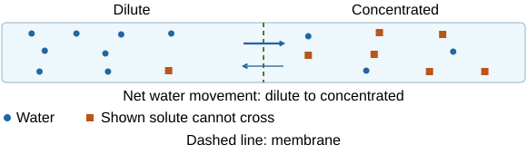
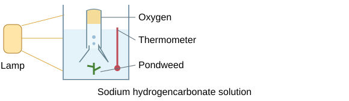

# Working scientifically and required practicals

## From question to fair investigation

A scientific investigation checks an explanation against evidence. Think of testing a recipe: changing the oven temperature and ingredients together makes it difficult to tell what caused the result.

- **Hypothesis:** a testable prediction with a scientific reason, such as warmer conditions increasing enzyme activity up to an optimum.
- **Independent variable:** what you change or select.
- **Dependent variable:** what you measure.
- **Control variables:** factors kept consistent so they do not provide an alternative explanation.
- **Control experiment:** a comparison, such as no enzyme, used to check the cause of a change. It is different from a control variable.

Choose a suitable range and intervals, enough repeats and an appropriate sample. Explain why each control matters: temperature changes enzyme activity, so keep it constant when investigating pH.

## Measurements, errors and improvements

Choose equipment appropriate to the quantity and required resolution: balance for mass, ruler for length, thermometer for temperature, measuring cylinder/pipette for volume, timer for time and calibrated probe for pH. Check zero, read scales at eye level and record units in table headings.

| Term | Meaning | Useful response |
|---|---|---|
| Accuracy | Close to the true value | Calibrate and correct systematic offsets |
| Precision | Repeated values close together | Improve measurement resolution and consistency |
| Repeatability | Same investigator/method gives similar results | Repeat under the same conditions |
| Reproducibility | Different investigators/equipment give similar results | Compare independent investigations |
| Random error | Unpredictable scatter | Repeat and calculate a mean |
| Systematic error | Consistent bias or offset | Find the cause and recalibrate/correct it |

**Systematic error:** a balance that always reads 0.2 g too high keeps that offset when readings are repeated. Check and correct its zero or calibration.

**Unexpected results:** investigate an **anomaly** and repeat the measurement. Exclude it only with a justified reason, rather than because it spoils a preferred pattern.

**Uncertainty:** report variation, such as the range of repeats. Consider both the instrument's resolution and the spread of the readings.

## Evidence, graphs and conclusions

Use bars for categories and scatter/line graphs for numerical variables. Label axes with quantities and units, use sensible scales and draw a suitable best-fit line/curve rather than forcing it through every point. A histogram represents numerical intervals using touching bars; interpret the frequency and class widths supplied.

Describe a pattern using values, then explain the biology. **Correlation does not prove causation**: another factor may influence both variables. Relate the conclusion to the hypothesis and uncertainty. Overlapping ranges can weaken an apparent difference, but do not automatically prove no effect.

Models simplify reality: a food chain omits many feeding links, and enzyme diagrams omit molecular detail. New evidence can change theories. **Peer review** checks methods, reasoning and evidence before publication; independent replication strengthens confidence. It reduces errors without guaranteeing perfection. News reports may simplify or omit uncertainty.

Evaluate benefits, costs, environmental/social effects and ethical issues using evidence. A **hazard** is a potential source of harm; **risk** concerns likelihood and consequence under the conditions. Public perceptions can differ from measured risk because unfamiliar or imposed hazards feel more threatening.

## Microscopy and biological drawings

**Aim:** observe, draw and label plant and animal cells, with a magnification scale.

1. Put a thin specimen on a slide with a suitable stain, such as iodine for onion tissue. Lower a coverslip at an angle to reduce bubbles.
2. Start at low power, bring the specimen into view with coarse focus, then sharpen with fine focus. Increase power and use fine focus carefully.
3. Draw clear single outlines in pencil, in proportion, with straight non-crossing label lines. Only draw structures actually observed.
4. Record total microscope magnification (**eyepiece × objective**) and an appropriate image scale/magnification.

**Image magnification = image size ÷ actual size**, with sizes in matching units.

Microscope power is not automatically the magnification of a resized drawing.

Thin tissue and stain improve visibility.

Handle glass carefully and avoid damaging a slide with the objective lens.

## Antibiotics and antiseptics on agar

**Aim:** compare effects on bacterial growth by measuring **zones of inhibition**.

1. Use sterile nutrient agar and sterile equipment. Inoculate consistently with a suitable harmless school culture using aseptic technique.
2. Place equal-sized discs carrying controlled volumes/concentrations of different agents, with adequate spacing and a solvent-only control.
3. Tape the lid at a few points, **not all the way round**. Incubate inverted at about **25°C** in school work, reducing the risk of culturing harmful human pathogens.
4. Keep agar depth, bacterial starting concentration, incubation time and temperature consistent. Repeat plates and compare zone measurements.

Measure zone diameters consistently.

**Area = πr²**

Use **half the diameter** as the radius.

If specifically asked for clear agar excluding the disc, subtract the disc area.

A larger zone suggests stronger inhibition **under these conditions**. Diffusion through agar also affects size, so it is not automatically proof of the best treatment in a patient.

Keep plates closed after incubation and use approved disposal. Sterilise equipment rather than merely wiping it; aseptic methods prevent contamination and improve validity.

## Osmosis in plant tissue

**Aim:** investigate solution concentration and change in plant-tissue mass.

1. Cut comparable cylinders from the same type of tissue, with equal dimensions. Measure initial masses.
2. Put them in a range of measured sugar/salt concentrations, using equal volumes and a water comparison.
3. Leave for the same time at the same temperature.
4. Remove, **blot consistently** and measure final mass. Repeat each concentration.
5. Calculate **percentage mass change = (final − initial)/initial ×100** and plot against concentration.

**Interpreting mass change:** water enters cells by osmosis in a sufficiently dilute external solution. It leaves in a more concentrated solution.

**The zero crossing:** where the best-fit graph crosses zero percentage change, there is **no net movement of water**. This estimates a concentration matching the tissue for osmosis. Water molecules still move in both directions.

**Making the comparison fair:** percentage change accounts for slightly different starting masses. Blotting removes surface solution, which would otherwise increase the measured mass. Blot consistently without squeezing water out of the cells.

Use a cutting board and handle sharp tools safely.

## Food tests

Use separate measured samples and clean equipment to avoid cross-contamination. Compare with known positive and negative samples where useful.

| Substance | Method | Positive result |
|---|---|---|
| Reducing sugar | Add Benedict’s solution and warm in a hot water bath | Green/yellow/orange/brick-red precipitate, depending on amount |
| Starch | Add iodine solution | Blue-black |
| Protein | Add Biuret reagent | Lilac/purple |
| Lipid | Add Sudan III, shake and allow layers to form | Red-stained oil layer |

An alternative lipid test mixes the sample with **ethanol**, then adds water: a **milky emulsion** is positive. Ethanol is flammable, so use it away from flames. Warm Benedict’s tubes safely in a water bath, point tubes away from people and wear eye protection for reagents. A colour test identifies a substance qualitatively; exact concentration needs a calibrated quantitative method.

## Amylase and pH

**Aim:** investigate the effect of pH on starch digestion using continuous sampling.

1. Put iodine drops into separate wells of a spotting tile.
2. Equilibrate starch, amylase and a chosen pH buffer in a controlled water bath.
3. Mix measured volumes, start timing and place a fresh sample onto iodine **every 30 seconds**.
4. Record the first sample that leaves iodine orange-brown: starch is no longer detected. Repeat across a pH range.
5. Keep temperature, concentrations/volumes and sample interval consistent; repeat and compare **1/time** for the same amount digested.

Use fresh wells rather than returning iodine to the reaction tube. Buffers control pH. Extreme pH can change active-site shape, reducing activity. A 30-second sampling interval limits endpoint precision; shorter intervals can improve it if carried out consistently. A no-amylase control checks that starch does not disappear for another reason.

## Photosynthesis and light intensity

**Aim:** measure photosynthesis rate in an aquatic plant as light intensity changes.

1. Use a suitable pondweed in sodium hydrogencarbonate solution, which supplies carbon dioxide.
2. Move a lamp to measured distances or use measured light intensities. Allow the plant to equilibrate at each setting.
3. Measure **oxygen volume per unit time**, or count bubbles for a fixed time when volume collection is unavailable.
4. Keep temperature, carbon dioxide supply, plant length/species and measurement time consistent. Use a water bath/heat shield and thermometer to limit lamp heating.
5. Repeat and compare means. Oxygen volume improves on bubble count because bubble sizes vary.

For an approximate point-source model, **light intensity ∝ 1/distance²**. Doubling distance gives one-quarter intensity, not half. Rate may plateau because carbon dioxide, temperature or chlorophyll becomes limiting. Avoid overheating and keep electrical equipment dry.

## Human reaction time

**Aim:** investigate a safe factor such as a defined distraction.

1. Start ruler zero level with the participant’s thumb/finger gap, with the same posture and hand.
2. Release unpredictably; record catch distance. Convert it to reaction time using an appropriate table.
3. Repeat with and without the factor. Use practice attempts, balanced order and sufficient repeats to reduce learning or fatigue bias.
4. Keep ruler, release position, hand and instructions consistent. Compare mean times and variation; include several participants when generalising.

The ruler distance is the measurement, not time itself. A longer fall generally means slower reaction. Participants should consent and know they can stop. Do not deliberately expose them to unsafe doses of caffeine or other substances. A small convenience sample may not represent everyone.

## Seedling responses to light or gravity

**Aim:** investigate newly germinated seedlings and record both **lengths and accurate labelled drawings**.

- Light investigation: expose comparable seedlings to **one-sided light**, with an appropriate all-round-light comparison.
- Gravity investigation: place seedlings horizontally in darkness, with a suitable vertical control, avoiding light as a competing directional stimulus.
- Keep species, age, starting size, water, temperature and growing medium consistent. Use several seedlings and the same growth interval.
- Measure root/shoot lengths and record bending direction with labelled drawings. Repeat and compare.

Shoot auxin promotes greater shaded-side elongation, bending towards light. In horizontal roots, more lower-side auxin **inhibits** elongation there, so the root bends down. Do not apply the shoot response unchanged to roots. A rotating clinostat can reduce a constant gravity direction relative to seedlings when appropriately used as an additional comparison.

## Ecology sampling

**Aim:** estimate a common species’ population and investigate a factor affecting distribution.

- Random coordinates and same-sized quadrats give an unbiased overall sample. Apply a consistent boundary/counting rule and use many samples.
- **Estimate = mean count × habitat area/quadrat area.** Keep area units consistent.
- A transect with quadrats at regular intervals investigates an environmental gradient. Measure abundance and the factor at each point.
- Repeat parallel transects and consider other factors, such as moisture changing alongside light. Correlation is not proof of a sole cause.

Identify organisms carefully and avoid damaging the habitat. Wash hands after soil contact and choose safe routes. More samples reduce uncertainty but do not correct consistently mistaken species identification.

## Milk decay and temperature

**Aim:** measure how temperature affects the pH change during milk-fat breakdown.

Lipase breaks down milk fat and releases **fatty acids**, lowering pH. This models one component of milk decay.

1. Measure the milk, indicator and sodium carbonate. Use the same amounts to give a consistent alkaline starting pH.
2. Place the mixture and lipase in a water bath at the chosen temperature. Allow them to reach that temperature.
3. Add the same volume and concentration of lipase, mix consistently and start timing.
4. Measure the time to a **common pH endpoint**. A calibrated probe can record pH continuously.
5. Repeat at a range of temperatures. Keep starting pH, volumes, concentrations and mixing consistent.
6. Include a **no-enzyme control**. Compare mean times or calculate **relative rate = 1/time** for the same endpoint.

Very high temperatures can denature lipase. The rate therefore does not increase indefinitely as temperature rises.

A colour endpoint can depend on the observer's judgement. Incomplete thermal equilibration can also affect the comparison. Explain which limitation an improvement addresses.

Do not taste the mixtures. Use eye protection for alkaline solutions and handle hot water baths safely.

## Applying methods to unfamiliar contexts

A strong method names the actual measurement, range, controls, repeat strategy and safe equipment. A useful improvement names a flaw and explains its effect: collecting gas volume avoids unequal bubble sizes, whereas “use better equipment” is vague.

When evaluating a result, distinguish **what was measured**, **what it suggests** and **what remains uncertain**. Use SI units and appropriate prefixes. Show calculations with units, retain extra figures until the final result and report a sensible number of significant figures.

## Sources

- [AQA Biology practical assessment](https://www.aqa.org.uk/subjects/biology/gcse/biology-8461/specification/practical-assessment)
- [AQA Working scientifically](https://www.aqa.org.uk/subjects/biology/gcse/biology-8461/specification/working-scientifically)
