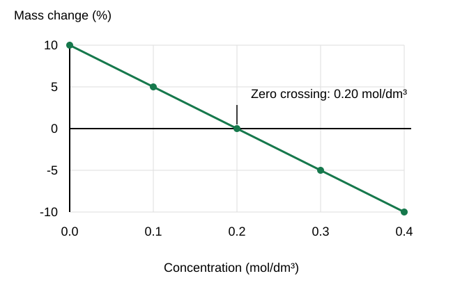

# Mathematical requirements questions & answers

## 1 mark

**1.** Convert 2 mm to micrometres.

**Answer:** 2000 µm.

**2.** Write 0.000004 m in standard form.

**Answer:** 4 ×10⁻⁶ m.

**3.** How many significant figures are in 0.00620?

**Answer:** Three.

**4.** What is the range of 5, 6, 8 and 12?

**Answer:** 7.

**5.** What is the probability of an impossible event?

**Answer:** Zero.

**6.** What does ∝ mean?

**Answer:** Proportional to.

**7.** Which graph shows paired numerical measurements to identify a correlation?

**Answer:** Scatter diagram.

**8.** Does magnification have a unit?

**Answer:** No.

**9.** A disease rate rises from 20% to 30%. What is the increase in percentage points? Choose one: A 10; B 20; C 30; D 50.

**Answer:** A: 10 percentage points.

## 2 marks

**10.** Convert 0.035 mm to µm and then nm.

**Answer:** - 0.035 ×1000 = **35 µm**.
- 35 ×1000 = **35 000 nm**.

**11.** Convert 3.2 cm² to mm², explaining the factor.

**Answer:** - Each linear dimension is multiplied by 10, so area is multiplied by **100**.
- 3.2 ×100 = **320 mm²**.

**12.** Calculate (6 ×10⁵)/(2 ×10²).

**Answer:** - Divide coefficients: 6/2 = 3. Subtract powers: 5−2 = 3.
- Answer = **3 ×10³**.

**13.** Round 0.03476 to two significant figures and explain where counting starts.

**Answer:** - Count from the first non-zero digit, 3.
- Rounded result = **0.035**.

**14.** Simplify 15:25 and express the first group as a fraction of the total.

**Answer:** - Ratio = **3:5**.
- Fraction = 3/(3+5) = **3/8**.

**15.** Calculate the percentage represented by 27 successful outcomes out of 90.

**Answer:** - Percentage = 27/90 ×100.
- Result = **30%**.

**16.** A microscope has ×10 eyepiece and ×40 objective. Determine its total power.

**Answer:** - Multiply eyepiece by objective: 10 ×40.
- Total = **×400**.

**17.** An image is 30 mm long at ×500 magnification. Calculate actual size in µm.

**Answer:** - Actual = 30/500 = **0.060 mm**.
- Convert: 0.060 ×1000 = **60 µm**.

**18.** A pondweed produces 18 cm³ oxygen in 6 minutes. Calculate rate per minute.

**Answer:** - Rate = volume/time = 18/6.
- Rate = **3 cm³ min⁻¹**.

**19.** A reaction reaches a fixed endpoint in 40 s. Calculate reciprocal-time rate.

**Answer:** - Rate proxy = 1/40.
- **0.025 s⁻¹**, for a comparable endpoint.

**20.** A distance doubles in an inverse-square light model. What happens to intensity?

**Answer:** - Intensity ∝ 1/d².
- New intensity = **1/4** of the original.

**21.** Explain why a positive correlation does not prove causation.

**Answer:** - Values tend to rise together in the data.
- Another variable may affect both, so a controlled comparison is needed to isolate a cause.

**22.** Distinguish interpolation from extrapolation.

**Answer:** - Interpolation estimates **within** the measured range.
- Extrapolation extends **outside** it, where the relationship may change.

**23.** A bacterium is 2 µm long and a cell is 20 µm long. Compare their linear scale.

**Answer:** - 20/2 = **10 times**.
- The cell is about **one order of magnitude** larger in length.

## 3 marks

**24.** Calculate percentage mass change from 2.50 g to 2.10 g.

**Answer:** - Change = 2.10−2.50 = **−0.40 g**.
- Percentage = −0.40/2.50 ×100.
- **−16%**, a 16% decrease.

**25.** A success rate rises from 20% to 30%. Calculate percentage-point change and relative percentage increase.

**Answer:** - Difference = **10 percentage points**.
- Relative increase = (30−20)/20 ×100.
- Relative increase = **50%**.

**26.** A 4 µm scale bar measures 8 mm on an image. A cell measures 30 mm. Calculate cell size.

**Answer:** - Cell/bar image-length ratio = 30/8 = 3.75.
- Actual cell size = 3.75 ×4.
- **15 µm**.

**27.** Calculate biomass-transfer efficiency if 45 kg is gained from 600 kg available.

**Answer:** - Efficiency = next/previous ×100.
- 45/600 ×100.
- **7.5%**, using matching mass units/basis.

**28.** For counts 1, 2, 2, 7, calculate mean, median and mode.

**Answer:** - Mean = 12/4 = **3**.
- Median = (2+2)/2 = **2**.
- Mode = **2**.

**29.** Counts 0, 1 and 2 occur with frequencies 3, 4 and 3. Calculate the mean.

**Answer:** - Total count = 0×3 +1×4 +2×3 = **10**.
- Total frequency = 3+4+3 = **10**.
- Mean = 10/10 = **1**.

**30.** A carrier cross predicts a 1/4 affected probability. Calculate expected affected count in 120 births and explain its limitation.

**Answer:** - Expected count = 120 ×1/4.
- **30** affected births expected.
- Random variation means an actual sample need not have exactly 30.

**31.** A line passes through (2, 6) and (8, 18). Find gradient and intercept.

**Answer:** - Gradient = (18−6)/(8−2) = **2**.
- Use y = 2x+c: 6 = 4+c, so **c = 2**.
- Equation: **y = 2x+2**.

**32.** A tangent to a pH-time curve passes through (1 day, pH 7) and (5 days, pH 5). Calculate slope and describe the change.

**Answer:** - Slope = (5−7)/(5−1).
- **−0.5 per day**.
- At the tangent point, pH decreases at magnitude **0.5 per day**.

**33.** A 12 mm circular inhibition zone includes its disc. Calculate area to three significant figures.

**Answer:** - Radius = **6 mm**.
- Area = π ×6² = 113.097…
- **113 mm²**.

## 4 marks

**34.** A 2 cm cube exchanges substances through its surface. Calculate surface area, volume and SA:V ratio.

**Answer:** - Surface area = 6 ×2² = **24 cm²**.
- Volume = 2³ = **8 cm³**.
- SA:V = 24:8 = **3:1**.
- It has less surface per unit volume than a 1 cm cube, making diffusion less effective for meeting internal demand.

**35.** Ten 0.25 m² quadrats contain a total of 30 plants. Estimate population in a 150 m² habitat and state a limitation.

**Answer:** - Mean = 30/10 = **3 per quadrat**.
- Density = 3/0.25 = **12 plants m⁻²**.
- Estimated population = 12 ×150 = **1800**.
- Patchy distribution or biased/limited sampling may make the estimate unrepresentative.

**36.** Explain how to calculate the rate at one instant on a curved biological graph.

**Answer:** - Draw a **tangent at the specified point**.
- Use two well-separated points on that tangent to form a large triangle.
- Calculate change in y divided by change in x using actual axis scales.
- State units/sign meaning; a chord across the curve gives an average rather than instantaneous rate.

**37.** A 10 mm inhibition zone contains a 4 mm disc. Calculate clear-agar area excluding the disc.

**Answer:** - Zone radius = 5 mm; total area = **25π mm²**.
- Disc radius = 2 mm; disc area = **4π mm²**.
- Clear area = (25−4)π = **21π mm²**.
- ≈ **66.0 mm²**, to three significant figures.

**38.** Two independent births each have affected probability 1/4. Find probabilities of both affected and exactly one affected.

**Answer:** - Both affected = 1/4 ×1/4 = **1/16**.
- First affected, second unaffected = 1/4 ×3/4 = **3/16**.
- First unaffected, second affected also **3/16**.
- Exactly one = 3/16+3/16 = **6/16 = 3/8**.

**39.** A rate rises linearly from 0 to 6 cm³ min⁻¹ over 4 minutes. Calculate total gas produced from the rate-time graph.

**Answer:** - Total change is the **area under the rate–time graph**.
- Region is a triangle: ½ ×base ×height.
- ½ ×4 ×6 = **12**.
- Units min ×cm³ min⁻¹ give **12 cm³**.

## 5 marks

**40.** Each potato piece starts at 2.00 g. Calculate its percentage change in mass using the final masses below. Plot percentage change against concentration and estimate the concentration giving no net mass change.

| Concentration (mol/dm³) | Final mass (g) |
|---|---|
| 0.00 | 2.20 |
| 0.10 | 2.10 |
| 0.20 | 2.00 |
| 0.30 | 1.90 |
| 0.40 | 1.80 |

**Answer:** Use **(final − initial)/initial × 100**. The percentage changes are **+10%, +5%, 0%, −5% and −10%** respectively.

Plot concentration on the **horizontal axis** and percentage mass change on the **vertical axis**, with units and suitable regular scales. Plot the five points and draw the best-fit straight line. It crosses 0% at **0.20 mol/dm³**, the estimate of no net mass change.

## 6 marks

**41.** A pupil moves a lamp from 20 cm to 10 cm from pondweed. Bubble counts in two minutes rise from 36 to 60, while water temperature rises from 20°C to 26°C. There are no repeat trials. The pupil concludes: “Halving distance doubles light intensity, and this proves the higher light intensity increases the photosynthesis rate by 67% in all plants.” Evaluate this conclusion using calculations and the method.

**Answer:** - Under the inverse-square model, intensity changes by (20/10)² = **4**, so it **quadruples**, rather than doubles.
- Bubble rates are 36 ÷ 2 = **18 bubbles/min** and 60 ÷ 2 = **30 bubbles/min**.
- Percentage increase = (30 − 18) ÷ 18 × 100 = **66.7%**, so the numerical claim is reasonable for the **observed bubble-rate change**.
- However, temperature also changed and affects enzyme activity. This comparison does not isolate light intensity. Use a water bath or suitable heat shield and monitor temperature.
- Bubble size can vary. Measuring oxygen volume per unit time is a better measure of gas production.
- Repeat each setting, compare means and use several suitable plants before generalising. One unreplicated, confounded comparison cannot establish the same effect in all plants.

## Past-paper sources

### Resource directory

- [AQA assessment resources](https://www.aqa.org.uk/subjects/biology/gcse/biology-8461/assessment-resources)

### Question selection

All questions use original values. June 2022 Paper 1 Higher Q03.3 verifies magnification/rearrangement/unit conversion as an assessed type; June 2023 Paper 2 Higher Q04.4 verifies tangent rate comparison. Other practice follows the current mathematical requirements and topic calculations. These examples do not support a frequency ranking.

These are original practice questions and tutor-written answers, informed by the linked papers. Mark allocations are practice allocations.

- June 2022, Paper 2 Higher: [question paper](../../00 - Past papers/Paper 2 Higher/AQA-84612H-QP-JUN22.pdf) · [mark scheme](../../00 - Past papers/Paper 2 Higher/AQA-84612H-MS-JUN22.pdf).

- June 2023, Paper 2 Higher: [question paper](../../00 - Past papers/Paper 2 Higher/AQA-84612H-QP-JUN23.pdf) · [mark scheme](../../00 - Past papers/Paper 2 Higher/AQA-84612H-MS-JUN23.pdf).
