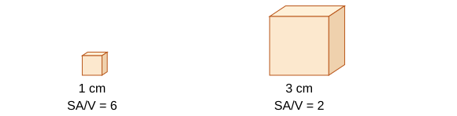

# Mathematical requirements

## Units, prefixes and standard form

A biological calculation is like comparing prices: both values must be expressed on the same basis. A millimetre and a micrometre are both lengths, but they are not the same-sized unit.

| Unit/prefix | Relationship |
|---|---|
| kilo, k | ×10³ |
| centi, c | ×10⁻² |
| milli, m | ×10⁻³ |
| micro, µ | ×10⁻⁶ |
| nano, n | ×10⁻⁹ |
| mega, M | ×10⁶ |
| giga, G | ×10⁹ |
| tera, T | ×10¹² |

**1 m = 100 cm = 1000 mm. 1 mm = 1000 µm. 1 µm = 1000 nm.** Multiply when converting into a smaller unit; divide when converting into a larger one. Example: **0.045 mm = 45 µm = 45 000 nm**.

For area and volume, square or cube the conversion factor: **1 cm² = 100 mm²**, and **1 cm³ = 1000 mm³**. A cm³ is also 1 mL; **1000 cm³ = 1 dm³**. Do not multiply an area by only 10 when converting cm² to mm².

**Standard form** is **a ×10ⁿ**, with **1 ≤ a <10** and integer n. Example: 0.0000062 m = **6.2 ×10⁻⁶ m**. Negative powers represent small fractions, not negative lengths. For multiplication, multiply coefficients and add powers. For division, divide coefficients and subtract powers.

## Estimates, scale and significant figures

Estimate first to spot impossible calculator outputs. Approximate 49.6/0.21 as 50/0.2 = **250**; an exact answer near 236 is plausible, whereas 2.36 is not.

**Order of magnitude** describes scale using powers of ten. A 10 µm cell is about **ten times** a 1 µm bacterium, one order larger. Compare lengths before comparing surface areas or volumes: doubling every length gives four times area and eight times volume.

Significant figures start at the first non-zero digit. **0.00450 has three significant figures**; the final zero records precision. Round only at the end: 0.02746 to two significant figures is **0.027**. Follow any requested precision and avoid claiming more precision than the measurements justify. Decimal places and significant figures are different.

## Ratios, fractions and percentages

- **Fraction = part/whole. Percentage = part/whole ×100.** For 18 of 60 successful treatments, success = **30%**.
- **Percentage change = (new − original)/original ×100.** From 40 to 50, increase = **25%**, not 20%, because the starting value is the denominator.
- Ratios compare quantities in matching units. 12:18 simplifies to **2:3**.
- Ratio 1:3 affected:unaffected gives affected fraction **1/(1+3) = 1/4**, not 1/3.
- **Percentage points** are the direct difference between percentages. From 20% to 30% is **10 percentage points**, but a **50% relative increase**.

For a negative tissue mass change, keep the sign: 2.5 g to 2.0 g gives (2.0−2.5)/2.5 ×100 = **−20%**, a 20% decrease.

## Magnification and scale bars

**Magnification = image size/actual size.** Rearrange:

- **Actual size = image size/magnification.**
- **Image size = actual size × magnification.**

Convert units first. A 36 mm image at ×600 gives **36/600 = 0.060 mm = 60 µm**. Magnification has **no unit**, because length/length cancels.

**A scale bar resizes with the image**, so it remains useful when both are enlarged or reduced together.

For a scale bar representing **5 µm**, its printed length is 10 mm. A cell on the same image measures 36 mm.

1. Compare image lengths: 36 ÷ 10 = **3.6 scale-bar lengths**.
2. Multiply by the real bar length: 3.6 × 5 = **18 µm**.
3. This is the cell's actual length. The printed bar length is not its actual biological size.

**Microscope magnification** is eyepiece magnification × objective magnification. A photograph or drawing resized afterwards needs its own image magnification.

## Rates, efficiency and inverse relationships

**Rate = change/time.** For 12 cm³ oxygen in 4 minutes, rate = **3 cm³ min⁻¹**, or 0.05 cm³ s⁻¹. Make the time unit match the requested answer.

For a common enzyme endpoint, **relative rate = 1/time**. A time of 25 s gives **0.040 s⁻¹**. Halving the endpoint time doubles the rate proxy. This only compares the same amount of change under comparable starting conditions.

**Biomass transfer efficiency = next-level biomass/previous-level biomass ×100.** Transfer of 40 kg from 500 kg gives **8%**. Use the same mass basis; a pyramid bar width represents mass, not simply number of organisms.

**Light intensity ∝ 1/distance²** for a suitable point-source model. If distance triples, intensity is **1/9** of its previous value. If a given intensity is 200 units at 10 cm, the model predicts **50 units at 20 cm**. This does not guarantee photosynthesis rate quarters: other limiting factors can affect rate.

## Probability in inheritance

Probability ranges from **0 to 1**. For a simple Aa × Aa cross, the four equally likely combinations are AA, Aa, Aa and aa. Probability of aa = **1/4 = 0.25 = 25%**. Probability of a carrier = **2/4 = 50%**.

**Expected number = probability × number of trials.** With an affected probability of 1/4 across 80 births, the expected affected count is 80 × 1/4 = **20**. This is an average expectation, not a guaranteed result.

**Each pregnancy is a new event.** For independent events, multiply probabilities. The probability that both children in a specified pair of births are affected is **1/4 × 1/4 = 1/16**.

Distinguish “both”, “at least one” and “exactly one” when interpreting a prompt. Do not turn a ratio of affected to unaffected into a probability without including both groups in the total.

## Averages, spread and frequency tables

- **Mean:** total/number of values.
- **Median:** middle of an ordered list; for an even count, average the two middle values.
- **Mode:** most frequent value; a dataset can have multiple modes or none.
- **Range:** maximum − minimum.

For 2, 3, 3, 8: mean = **4**, median = **3**, mode = **3**, range = **6**. Mean is influenced strongly by an extreme value. Investigate unusual measurements before removing them.

In a frequency table, use **sum(value × frequency)/sum(frequency)** for a mean of exact values. Counts 0, 1, 2 with frequencies 2, 3, 5 give mean **(0×2+1×3+2×5)/10 = 1.3**. Do not average only the three displayed counts. For grouped continuous data, class midpoints give an estimated mean; retain that it is an estimate.

## Sampling and population estimates

Random sampling limits selection bias, but enough representative samples are still needed. A transect with regular quadrats tests change across a gradient; it is systematic.

**Population estimate = mean per quadrat × total habitat area ÷ quadrat area.**

For a mean of six plants per 0.5 m² quadrat in a 200 m² habitat:

1. The habitat contains 200 ÷ 0.5 = **400 quadrat-sized areas**.
2. Estimated population = 6 × 400 = **2400 plants**.

Convert area units before scaling. Confidence depends on representative sampling. Patchy distribution, mistaken species identification and a small sample can all affect the estimate.

## Choosing and reading graphs

| Graph | Use | Main check |
|---|---|---|
| Bar chart | Categories, such as treatment types | Separate bars and labelled categories |
| Histogram | Numerical class intervals | Touching bars; with unequal widths, area represents frequency |
| Scatter diagram | Relationship between two numerical variables | Plot paired values and assess correlation |
| Line/curve | Ordered numerical variables, such as time/concentration | Appropriate best fit rather than invented point-to-point detail |

Use clearly labelled axes with units and even, sensible scales. Usually put independent variable on x and dependent on y. Describe **positive, negative or no correlation** and use values. Correlation alone is not proof of a causal mechanism.

Interpolate within the measured range more cautiously than reading a precise data point. **Extrapolation** extends beyond the observations and is less secure because the relationship may change. A graph need not start at zero unless it helps or the question requires it; inspect scales before comparing slopes or differences.

## Straight lines, gradients and curved rates

**y = mx + c** describes a straight line:

- **m = gradient = change in y/change in x**.
- **c = y-intercept**, where x = 0.
- A directly proportional relationship is a straight line through the origin, **y ∝ x**.

Choose a **large triangle on the best-fit line**, using two points far apart, not two noisy raw observations. A line through (2, 5) and (8, 17) has gradient **(17−5)/(8−2) = 2** and intercept **1**.

For a curve, draw a **tangent at the specified point** and calculate its gradient using a large triangle. This gives the instantaneous rate there. A chord across an interval gives an **average rate**, not the rate at one instant. For a decreasing pH curve the slope is negative; a stated magnitude of pH decline is positive. pH is unitless, so express the time basis clearly.

When given a rate–time graph, its area represents total change: **rate × time** for a rectangle; triangles use **½ base × height**. Confirm the axis quantities before assigning meaning to an area.

## Algebra and mathematical symbols

**=** equal, **<** less than, **>** greater than, **≪** much less than, **≫** much greater than, **∝** proportional to, **~** approximately/similar in an indicated context.

Rearrange using the same operation on both sides. If M = I/A, multiply by A to get MA = I, then divide by M: **A = I/M**. Substitute only after identifying what each symbol represents. A familiar formula with mismatched units still gives a wrong answer.

## Areas, volumes and exchange surfaces

- Rectangle area = **length × width**.
- Triangle area = **½ base × perpendicular height**.
- Cube surface area = **6 × side²**.
- Cube volume = **side³**.
- **Surface area to volume ratio = total surface area/volume**.
- Circular inhibition-zone area = **πr²**, where radius = diameter/2.

A 1 cm cube has surface area **6 cm²**, volume **1 cm³**, SA:V **6:1**. A 3 cm cube has **54 cm²**, **27 cm³**, ratio **2:1**. The larger cube has more total surface, but **less surface per unit volume**, increasing the difficulty of diffusion meeting all internal needs. Do not say its total surface is smaller.

For a 10 mm circular zone, r = 5 mm, so area = **25π ≈78.5 mm²**. If asked to exclude the disc, subtract the disc area. Keep the requested definition and unit clear.

## Calculation checks

1. Identify the quantity and choose the appropriate relationship.
2. Convert units and write substitution clearly.
3. Calculate while retaining extra figures.
4. Add the correct unit and requested precision.
5. Compare with an estimate and explain the result in its biological context.

## Sources

- [AQA Biology mathematical requirements](https://www.aqa.org.uk/subjects/biology/gcse/biology-8461/specification/mathematical-requirements)
