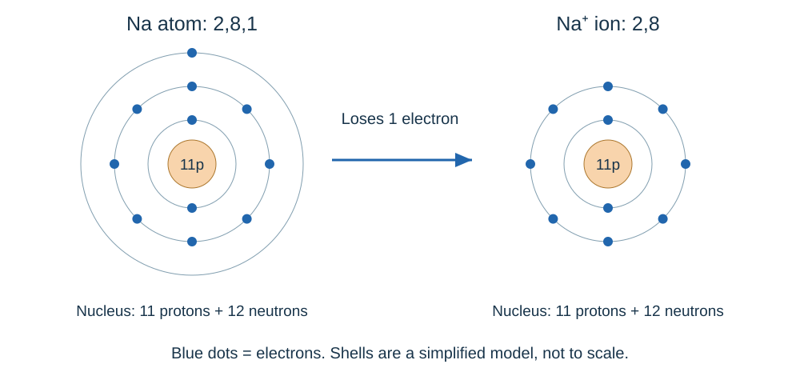
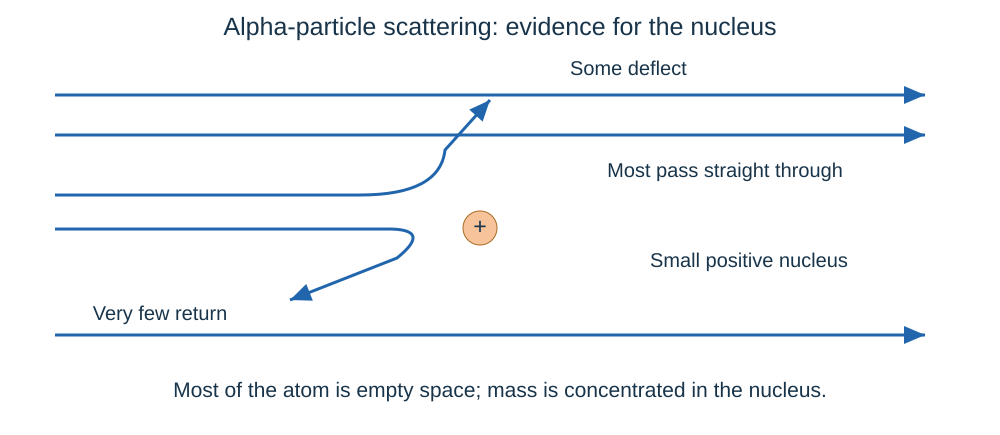

# Atomic structure and the periodic table

## Atoms, elements and compounds

Atoms are the tiny building blocks of matter. Think of elements as different types of building brick; a compound is a fixed design made from more than one type, joined chemically.

- An **atom** is the smallest part of an element that can exist.
- An **element** contains atoms with the same number of protons. Its symbol may have one or two letters: oxygen is **O**, sodium is **Na**. The second letter is lower case.
- A **compound** contains two or more elements **chemically combined in fixed proportions**. Water is H₂O: two hydrogen atoms for each oxygen atom.
- A **mixture** contains substances that are **not chemically combined**. Their chemical properties remain unchanged, and their proportions can vary.
- A chemical reaction forms **new substances** and often transfers energy. Compounds require chemical reactions to separate them into their elements; mixtures can be separated physically.

### Symbols and formulae
| Number | Symbol and element | Number | Symbol and element |
|---|---|---|---|
| 1 | H: hydrogen | 11 | Na: sodium |
| 2 | He: helium | 12 | Mg: magnesium |
| 3 | Li: lithium | 13 | Al: aluminium |
| 4 | Be: beryllium | 14 | Si: silicon |
| 5 | B: boron | 15 | P: phosphorus |
| 6 | C: carbon | 16 | S: sulfur |
| 7 | N: nitrogen | 17 | Cl: chlorine |
| 8 | O: oxygen | 18 | Ar: argon |
| 9 | F: fluorine | 19 | K: potassium |
| 10 | Ne: neon | 20 | Ca: calcium |

A periodic table is supplied. Also recognise **Br: bromine**, **I: iodine**, **Fe: iron**, **Cu: copper**, **Zn: zinc**, **Ag: silver** and **Pb: lead**.

A formula describes composition. **CO₂** contains one carbon atom for every two oxygen atoms. **Ca(OH)₂** has one calcium, two oxygen and two hydrogen atoms in its formula ratio: the 2 applies to everything inside the brackets.

Compounds containing two elements often have names ending in **-ide**, such as sodium chloride. **-ate** often indicates oxygen is also present, such as sodium sulfate.

**Word equation: magnesium + oxygen → magnesium oxide**

**Balanced symbol equation: 2Mg + O₂ → 2MgO**

The coefficient **2** before MgO multiplies the complete formula, giving two Mg atoms and two O atoms in total. Change coefficients to balance an equation; changing a small subscript would change the substance.

## Separating mixtures

Choose the method from the substances' **physical properties**. Separation does not create new substances.

| Method | When and how it works | Example |
|---|---|---|
| **Filtration** | An insoluble solid stays as the **residue**; liquid passes through as the **filtrate** | Sand from water |
| **Crystallisation** | Evaporate some solvent, then cool a concentrated solution so crystals form; filter and dry them | Copper sulfate crystals from solution |
| **Simple distillation** | A liquid evaporates, then cools and **condenses** in a condenser; collect the distillate | Pure water from salt solution |
| **Fractional distillation** | Separates miscible liquids with different boiling points; repeated evaporation/condensation in a column improves separation | Ethanol and water |
| **Chromatography** | Substances move at different speeds because they have different attractions to the solvent and stationary phase | Dyes in ink |

- To recover both salt and sand: add water to dissolve the salt, **filter** off the sand, then **crystallise** salt from the filtrate.
- In distillation, the lower-boiling liquid is usually collected first. The condenser removes thermal energy so vapour becomes liquid; cooling water enters at the lower end and leaves at the upper end.
- For chromatography, use a **pencil baseline above the solvent level**. Ink would dissolve, and a submerged sample could wash into the solvent. Mark the solvent front promptly.
- Do not use filtration to remove dissolved salt: dissolved particles pass through the filter.
- Wear goggles and handle hot glassware carefully. Keep flammable solvents away from flames.

### Choosing a sequence rather than one method

Suppose a mixture contains sand and dissolved salt in water. **Filtration** first removes sand, but the salt remains in the filtrate. To recover solid salt, concentrate the filtrate and cool it for **crystallisation**. To recover water instead, **distil** the filtrate and collect the condensed liquid.

Evaporation takes place at a liquid's surface and can occur below boiling point. Boiling occurs throughout the liquid at its boiling temperature for that pressure. Distillation uses evaporation and condensation; it does not rely on changing water into new substances.

## Inside an atom

| Particle | Location | Relative charge | Relative mass |
|---|---|---:|---:|
| **Proton** | Nucleus | +1 | 1 |
| **Neutron** | Nucleus | 0 | 1 |
| **Electron** | Shells around nucleus | −1 | Very small, about 1/1836 |

- **Atomic number = number of protons.** It identifies the element.
- **Mass number = protons + neutrons.** Therefore neutrons = mass number − atomic number.
- A neutral atom has equal numbers of protons and electrons, so their charges cancel.
- **Ions** form when atoms lose or gain electrons. The nucleus is unchanged: losing electrons makes a positive ion; gaining them makes a negative ion.

Example: sodium-23 has atomic number 11. It contains **11 protons, 12 neutrons and 11 electrons**. A Na⁺ ion still has 11 protons and 12 neutrons, but only **10 electrons**.

### Size and scale

- Typical atomic radius: about **0.1 nm = 1 × 10⁻¹⁰ m**.
- Nuclear radius: around **10⁻¹⁴ m**, roughly ten thousand times smaller or less. Almost all the atom's mass is in this tiny region.
- **1 nm = 10⁻⁹ m**. To convert nanometres to metres, multiply by 10⁻⁹.
- A shell drawing is a model: nuclei and electrons cannot both be drawn to true scale on a useful classroom diagram.

## Isotopes and relative atomic mass
**Isotopes** are atoms of the same element with **the same proton number but different neutron numbers**. Chlorine-35 and chlorine-37 both have 17 protons, with 18 and 20 neutrons respectively.

Neutral atoms of those isotopes have the same electron arrangement, explaining their very similar chemical reactions. Their different masses do not make them different elements.

**Relative atomic mass, Aᵣ**, is a weighted mean that accounts for isotope abundance. It has no unit and need not be a whole number. It is like a class average: the more common score has more influence.

**Aᵣ = sum of (isotope mass × percentage abundance) ÷ 100**

For 75% chlorine-35 and 25% chlorine-37:

1. Weight chlorine-35: **35 × 75 = 2,625**.
2. Weight chlorine-37: **37 × 25 = 925**.
3. Add and divide: **(2,625 + 925) ÷ 100 = 35.5**.

The result lies between 35 and 37, closer to the more abundant isotope. If abundances are given as counts rather than percentages, divide by **the total count**, not automatically by 100.

## Electrons and the periodic table

Electrons occupy the **lowest available energy levels first**. For the first 20 elements, fill shells using **2, 8, 8, then 2**.

- Oxygen: 8 electrons → **2,6**.
- Sodium: 11 electrons → **2,8,1**.
- Calcium: 20 electrons → **2,8,8,2**.

The modern periodic table puts elements in **increasing atomic number**.

**Period:** a horizontal row. The period number tells you how many electron shells are occupied in the neutral atom.

**Group:** a vertical column. Main-group elements have the same number of outer electrons, which explains their similar chemical reactions. Group 1 atoms have one outer electron and Group 7 atoms have seven. **Group 0 atoms have a full outer shell**: eight electrons, except helium, which has two.

**Metals and non-metals:** metals lie mainly on the left and in the centre of the table. They form **positive ions by losing electrons**. Non-metals lie mainly on the right and often gain electrons or share them in covalent bonds.

Metals usually conduct heat and electricity and can be bent or shaped. Non-metals generally conduct poorly, although graphite is an important exception.

## How scientific models changed

A scientific model is an explanation supported by evidence. New evidence can force it to change, like updating a map after discovering a road runs somewhere else.

| Evidence or idea | Change to the atomic model |
|---|---|
| Early ideas | Atoms were tiny, indivisible spheres. |
| Discovery of the electron | The **plum pudding model**: negative electrons embedded in a ball of positive charge. |
| Alpha-particle scattering | Most particles passed through; some deflected; a tiny number bounced back. This supported a small, dense, positive **nucleus** and mostly empty space. |
| Bohr's model | Electrons occupy **specific shells/energy levels** at particular distances from the nucleus. |
| Later nuclear experiments | Positive nuclear charge was assigned to **protons**. |
| Chadwick's experiments | Evidence showed **neutrons** exist in the nucleus. |

**Most alpha particles passed straight through:** most of the atom must be **empty space**.

**Some particles were deflected:** positive alpha particles were repelled by concentrated **positive charge**.

**Very few bounced back:** most of the atom's mass and positive charge must be concentrated in a **tiny, dense nucleus**. Positive charge spread throughout a plum pudding atom could not account for these rare, large deflections.

### Development of the periodic table
Early tables arranged elements by **atomic weight**. Newlands noticed repeated properties in his “law of octaves”, but a rigid repeating pattern did not work for all the known elements.

**Mendeleev** left gaps for undiscovered elements and sometimes reversed the strict mass order to keep similar properties together. He predicted properties of the missing elements. Later discoveries matching those predictions supported his arrangement.

The modern table follows **atomic number**, which counts protons. Isotopes explain why an average atomic mass is not a perfect way to order elements: it depends on both neutron numbers and relative abundances. A modern periodic-table box represents an **element**, not one particular isotope or a literal individual atom.

## Groups 0, 1 and 7

### Group 0: noble gases

- Examples: **helium, neon, argon**. Their outer electron shells are full and stable.
- They are **very unreactive** and exist as individual atoms, not ordinary diatomic molecules.
- **Boiling points increase down the group** as relative atomic mass increases. Use the trend to make predictions from data.

### Group 1: alkali metals

Lithium, sodium and potassium have **one outer electron** and form **+1 ions**. They are soft, low-density metals compared with most transition metals.

- With water: **metal + water → metal hydroxide + hydrogen**. The hydroxide solution is alkaline.
- Example: **2Na + 2H₂O → 2NaOH + H₂**.
- **Lithium:** fizzes and moves slowly.
- **Sodium:** reacts faster and can melt into a ball.
- **Potassium:** reacts more vigorously and may burn with a lilac flame.

These are teacher demonstrations, not home experiments.

- With oxygen they form oxides. For a specified simple oxide: **4Li + O₂ → 2Li₂O**.
- With chlorine they form white **metal chlorides**. For example: **2Na + Cl₂ → 2NaCl**.
**Why Group 1 reactivity increases down the group:** atoms have more occupied shells. The outer electron is farther from the nucleus and more shielded by inner electrons. Despite the greater nuclear charge, the attraction to that outer electron is weaker. It is **lost more easily**, so reactions become more vigorous.

### Group 7: halogens

Halogens have **seven outer electrons** and form **−1 ions** when they gain one electron. Their molecules are **diatomic**: F₂, Cl₂, Br₂ and I₂.

| Halogen at room temperature | Appearance |
|---|---|
| Chlorine | Green gas |
| Bromine | Red-brown liquid |
| Iodine | Grey-black solid; purple vapour when heated |

- **Melting and boiling points increase down the group**.
- **Reactivity decreases down Group 7.** Atoms have more occupied shells, so an incoming electron would be farther from the nucleus and more shielded by inner electrons. Despite the greater nuclear charge, the attraction is weaker. The atom **gains an electron less easily**.
- With metals, halogens form **ionic metal halides**. With non-metals they generally form **covalent compounds**, such as hydrogen chloride.
- A more reactive halogen **displaces a less reactive halogen** from its aqueous halide solution.
- **Cl₂ + 2KBr → 2KCl + Br₂**. Chlorine displaces bromine; iodine cannot displace chlorine from chloride solution.
- Ionic equation: **Cl₂ + 2Br⁻ → 2Cl⁻ + Br₂**. Potassium ions are unchanged spectator ions.

## Transition metals

Examples include **Cr chromium, Mn manganese, Fe iron, Co cobalt, Ni nickel and Cu copper**.

Compared with Group 1 metals, they are generally **harder, stronger and denser**, have **higher melting points**, and react **less vigorously** with oxygen, water and halogens. Iron reacts with oxygen slowly when rusting; copper does not react with cold water.

Many transition metals:

- Form ions with **different charges**, such as **Fe²⁺ and Fe³⁺**.
- Form **coloured compounds**, such as blue copper(II) sulfate and green iron(II) compounds.
- Act as **catalysts**, including iron in ammonia manufacture and nickel in hydrogenation.

These are general trends, not rules without exceptions. Use the particular element and evidence in the question.

## Sources

- [PMT: 1.1. A simple model of the atom, symbols, relative atomic mass, electronic charge and isotopes](../Reference Materials/PMT - Summary 1.1 - AQA Chemistry.pdf). Unmodified reference; its original board is recorded in the review metadata.
- [PMT: 1.2. The periodic table](../Reference Materials/PMT - Summary 1.2 - AQA Chemistry.pdf). Unmodified reference; its original board is recorded in the review metadata.
- [PMT: 1.3. Properties of transition metals (chemistry only)](../Reference Materials/PMT - Summary 1.3 - AQA Chemistry.pdf). Unmodified reference; its original board is recorded in the review metadata.
- [Study Rocket: Atoms And Elements](https://studyrocket.co.uk/revision/gcse-chemistry-combined-science-aqa/combined-science-atomic-structure/atoms-and-elements). Cross-checked against the project specification.
- [Study Rocket: Chemical Equations](https://studyrocket.co.uk/revision/gcse-chemistry-combined-science-aqa/combined-science-atomic-structure/chemical-equations). Cross-checked against the project specification.
- [Study Rocket: Compounds And Mixtures](https://studyrocket.co.uk/revision/gcse-chemistry-combined-science-aqa/combined-science-atomic-structure/compounds-and-mixtures). Cross-checked against the project specification.
- [Study Rocket: History Of Atomic Structure](https://studyrocket.co.uk/revision/gcse-chemistry-combined-science-aqa/combined-science-atomic-structure/history-of-atomic-structure). Cross-checked against the project specification.
- [Study Rocket: Separating Techniques](https://studyrocket.co.uk/revision/gcse-chemistry-combined-science-aqa/combined-science-atomic-structure/separating-techniques). Cross-checked against the project specification.
- [Study Rocket: Group 0 And Transition Elements](https://studyrocket.co.uk/revision/gcse-chemistry-combined-science-aqa/combined-science-the-periodic-table/group-0-and-transition-elements). Cross-checked against the project specification.
- [Study Rocket: Group 1](https://studyrocket.co.uk/revision/gcse-chemistry-combined-science-aqa/combined-science-the-periodic-table/group-1). Cross-checked against the project specification.
- [Study Rocket: Group 7](https://studyrocket.co.uk/revision/gcse-chemistry-combined-science-aqa/combined-science-the-periodic-table/group-7). Cross-checked against the project specification.
- [Study Rocket: History Of The Periodic Table](https://studyrocket.co.uk/revision/gcse-chemistry-combined-science-aqa/combined-science-the-periodic-table/history-of-the-periodic-table). Cross-checked against the project specification.
