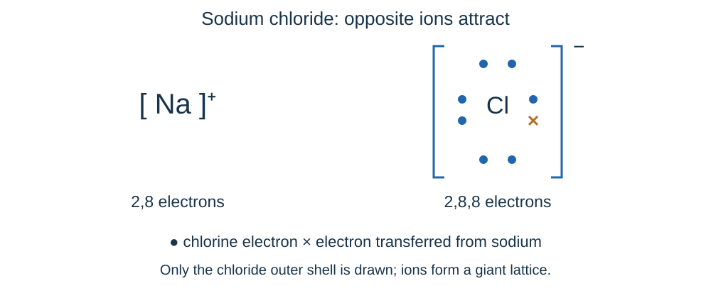
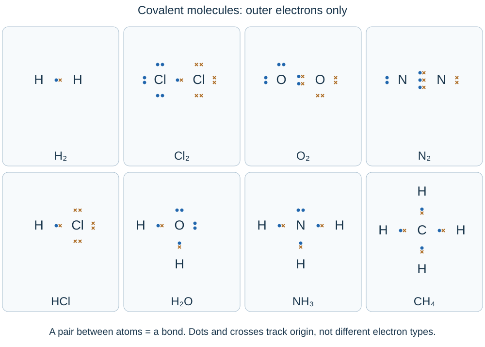

# Bonding, structure and properties of matter

## Three types of bonding

Chemical bonds hold particles together through **electrostatic attraction**. The important question is: which charged particles attract each other?

| Bond | What happens | What attracts? |
|---|---|---|
| **Ionic** | Electrons transfer from metal atoms to non-metal atoms, forming ions | Oppositely charged ions |
| **Covalent** | Non-metal atoms share pairs of electrons | Positive nuclei and the shared negative electrons |
| **Metallic** | Outer electrons become delocalised throughout a metal | Positive metal ions and delocalised electrons |

The bonds themselves are strong. A low boiling point does not automatically mean weak chemical bonds: it may mean weak forces **between separate molecules**.

## Ionic bonding and lattices

Imagine a three-dimensional crowd of alternating positive and negative charges, each attracted to neighbours in every direction. This is a **giant ionic lattice**, not a set of separate molecules.

- Group 1 metals lose one electron → **+1** ions. Group 2 metals lose two → **+2** ions.
- Group 7 non-metals gain one → **−1** ions. Group 6 non-metals gain two → **−2** ions.
- These ions have a **noble-gas electron arrangement**. Protons do not move between the atoms.
Sodium transfers one electron to chlorine:

- Sodium loses an electron: **Na → Na⁺ + e⁻**.
- Chlorine gains the electron: **Cl + e⁻ → Cl⁻**.
- Magnesium transfers two electrons to oxygen, forming **Mg²⁺ and O²⁻**.

The electron transfer **forms the ions**; the ionic bond is the **strong electrostatic attraction between oppositely charged ions**.

### Work out a formula

The total positive and negative charges must balance:

- Na⁺ and Cl⁻ → **NaCl**.
- Mg²⁺ and Cl⁻ → **MgCl₂**: two chloride ions balance one magnesium ion.
- Na⁺ and O²⁻ → **Na₂O**.
- Mg²⁺ and O²⁻ → **MgO**, the simplest whole-number ratio.

An ionic formula gives an **empirical ratio**, not the number of atoms in one molecule. When drawing ions, include square brackets, charges and the appropriate outer-shell electrons.

## Covalent molecules

A **covalent bond is a shared pair of electrons**. Think of two people holding the same handle: the shared electrons are attracted to both nuclei. This is an analogy for attraction, not a rigid physical stick.

- Hydrogen needs two electrons in its first shell; the other atoms in the examples below achieve eight in their outer shell.
- A single bond shares **one pair**, a double bond shares **two pairs**, and a triple bond shares **three pairs**.
- A line in a displayed formula represents one covalent bond, not one electron.

| Molecule | Bonding and non-bonding pairs |
|---|---|
| H₂ | One shared pair; no lone pairs |
| Cl₂ | One shared pair; three lone pairs on each Cl |
| O₂ | Two shared pairs; two lone pairs on each O |
| N₂ | Three shared pairs; one lone pair on each N |
| HCl | One shared pair; three lone pairs on Cl |
| H₂O | Two O–H bonds; two lone pairs on O |
| NH₃ | Three N–H bonds; one lone pair on N |
| CH₄ | Four C–H bonds; no lone pairs on C |

Dots and crosses show which atom contributed an electron; the electrons themselves are identical. Count the shared electrons for **both** bonded atoms when checking full shells. A molecular formula counts the atoms in one molecule; it does not show its shape.

## States and explaining properties

| State | Particle arrangement and movement |
|---|---|
| Solid | Close together; vibrate around fixed positions |
| Liquid | Close together but can move past one another |
| Gas | Far apart; move rapidly and randomly |

Heating transfers energy to particles. Melting and boiling require enough energy to overcome the forces holding particles in place or close together. Freezing and condensing transfer energy to the surroundings.

At the stated pressure:

- **Below the melting point:** the substance is solid.
- **Between melting and boiling points:** it is liquid.
- **Above the boiling point:** it is gas.

- During a state change, two states can coexist. **The particles do not themselves melt, grow or become liquid particles.**
- State symbols: **(s)** solid, **(l)** liquid, **(g)** gas, **(aq)** dissolved in water. Aqueous is not the same as molten.
- Sphere models leave out forces, internal structure and the real shapes of particles. They cannot fully explain why different substances change state at different temperatures.

### Structure → force → energy or movement

| Structure | Melting and boiling | Electrical conduction |
|---|---|---|
| Giant ionic | High: many strong attractions between opposite ions need much energy to overcome | Solid: no, ions fixed. **Molten or dissolved: yes, ions can move and carry charge** |
| Small molecules | Usually low: **weak intermolecular forces** need little energy to overcome | Usually no mobile charged particles |
| Giant covalent | Very high: many strong covalent bonds must be broken | Usually no free charged particles; graphite/graphene are exceptions |
| Metallic | Usually high: strong attraction between positive ions and delocalised electrons | **Delocalised electrons move through the structure** and carry charge |

For small molecular substances, **melting or boiling overcomes intermolecular forces, not covalent bonds inside the molecules**. Larger molecules generally have stronger intermolecular forces and higher boiling points.

## Polymers and giant structures

**Polymers** are very large molecules made from repeating units. Strong covalent bonds hold the atoms together within each chain. The forces **between the large molecules** are relatively strong, so polymers are usually solids at room temperature.

In a polymer drawing, brackets enclose the **repeating unit** and **n** shows that it repeats many times. Bonds extend through the brackets to show that the chain continues.

**A polymer is different from a giant covalent network.** Separate polymer chains can be pulled apart by overcoming intermolecular forces. In a giant covalent structure, atoms are joined by strong covalent bonds throughout the network.

**Silicon dioxide** is a giant covalent network. Its formula, SiO₂, gives the atom ratio; it does not describe separate SiO₂ molecules. Many strong covalent bonds must be overcome when it melts, so its melting point is very high.

**What models leave out:** dot-and-cross diagrams show electron sharing but not realistic scale or three-dimensional shape. Ball-and-stick models show connections and shape, but atoms are not coloured balls joined by literal sticks. A drawing of a small section cannot show the full extent of a giant structure.

## Carbon structures

The same element can form very different materials because its atoms join in different ways.

| Structure | Arrangement | Properties explained |
|---|---|---|
| **Diamond** | Each carbon forms **four covalent bonds** in a giant 3D network | Very hard and very high melting point; many strong bonds. No delocalised electrons, so no electrical conduction |
| **Graphite** | Each carbon forms **three bonds** in hexagonal layers; one electron per atom is delocalised | Conducts electricity. Layers slide because only weak forces act between them, making graphite soft/slippery. Strong bonds within layers give high melting point |
| **Graphene** | One layer of graphite, one atom thick | Strong, light and electrically conducting; useful in composites and electronics |
| **Fullerenes** | Hollow carbon molecules with rings, mainly hexagons but sometimes pentagons/heptagons | C₆₀ is approximately spherical. Hollow shapes can carry other molecules; large surface area can be useful in catalysts or drug delivery |
| **Carbon nanotubes** | Cylindrical fullerenes; very large length-to-diameter ratio | High tensile strength and electrical conductivity suit reinforcement and electronics |

Graphite is not held together by weak covalent bonds. The **covalent bonds within each layer are strong**; forces between layers are much weaker. Fullerenes are molecules, whereas diamond is an extended network.

## Metals and alloys

Metal atoms form a regular giant structure. Their outer electrons are **delocalised**, meaning they are free to move through the whole structure.

**Metallic bonding:** a strong electrostatic attraction between positive metal ions and delocalised electrons holds the structure together.

**Conducting electricity and heat:** the delocalised electrons can move through the structure. They carry electrical charge and transfer thermal energy.

**Changing shape:** in a pure metal, the regular layers can slide over one another while metallic bonding remains. The metal is therefore **malleable**, meaning it can be shaped, and **ductile**, meaning it can be drawn into a wire.

**Alloy hardness:** an alloy contains a metal mixed with other elements. Different-sized atoms distort the regular layers, so they cannot slide as easily. This usually makes an alloy **harder** than the pure metal.

Imagine stacking equal-sized marbles in neat rows, then replacing some with larger marbles: the rows no longer slide neatly. This models distortion, though real metal bonding involves charges and electrons.

For material choices, compare the properties needed for the job with **cost, density, strength, conductivity and resistance to corrosion**. The best conductor is not automatically the best material for a long overhead cable.

## Nanoparticles

**Nanoparticles are 1–100 nm in size.** Their small size gives them a large **surface area to volume ratio**, so a large fraction of their atoms are at the surface.

- Fine particles: about **100–2,500 nm** in diameter.
- Coarse particles/dust: about **2,500–10,000 nm**.
- **1 nm = 10⁻⁹ m**. A 20 nm particle is **2.0 × 10⁻⁸ m** across, much larger than a typical atom but far smaller than dust.

### Surface-area calculations

For a cube of side length **l**:

For a cube of side length l:

- **Surface area = 6l²**
- **Volume = l³**
- **SA:V = 6/l**

A 10 nm cube has area **600 nm²** and volume **1,000 nm³**: ratio **0.6 nm⁻¹**. A 1 nm cube has area **6 nm²** and volume **1 nm³**: ratio **6 nm⁻¹**. Reducing the side by ten makes SA:V **ten times greater**, even though each cube's total area is smaller.

### Uses and risks

Applications include **medicine, electronics, cosmetics, sun creams, deodorants and catalysts**. For the same effect, a smaller quantity of nanoparticle material may be needed because more surface is available.

Possible disadvantages depend on the material, dose and exposure: particles may enter the body or environment, and long-term effects may be uncertain. Evaluate supplied evidence rather than assuming all nanoparticles are harmful or all are safe. Compare benefit, exposure route, effectiveness, cost and evidence about toxicity.
