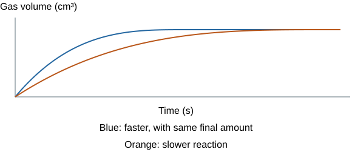
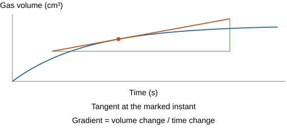
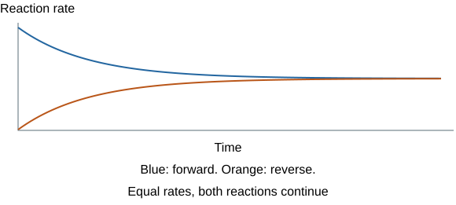

# Rate and extent of chemical change

## Reaction rates and measuring change

**Rate** tells you how quickly reactants are used or products are formed. Think of filling a bucket: total water tells you the amount, while litres per minute tells you the speed. A faster reaction does not necessarily make more product.

**Mean rate = quantity of reactant used ÷ time**

Alternatively:

**Mean rate = quantity of product formed ÷ time**

Choose the unit to match the quantity measured:

| Quantity measured | Rate unit |
|---|---|
| Mass in g | g s⁻¹ |
| Volume in cm³ | cm³ s⁻¹ |
| Amount in mol | mol s⁻¹ |

**Gas-volume example:** 48 cm³ of gas produced in 60 s gives a mean rate of 48 ÷ 60 = **0.80 cm³ s⁻¹**.

**Moles example:** consuming 0.015 mol in 30 s gives a mean rate of 0.015 ÷ 30 = **5.0 × 10⁻⁴ mol s⁻¹**.

A graph of reactant remaining slopes down because the quantity is decreasing. The **rate of consumption** is normally quoted as the positive amount used per second.

## Curves, tangents and final yield

A product–time graph starts low, rises and levels when no more product forms. The **gradient measures rate**:

- Steeper slope: faster reaction.
- Decreasing slope: reactants are being used, reducing collision frequency.
- Horizontal plateau: no further measured change, often because a limiting reactant has been used up.
- Final height: **total product amount**, not reaction rate.

For rate at a particular time, draw a **tangent at that point** and use a large triangle on the tangent: **change in product quantity/change in time**.

A tangent rise of 24 cm³ over 40 s gives **0.60 cm³ s⁻¹**.

A chord between two curve points gives an interval mean, not an instantaneous rate.

## Collision theory and activation energy

Particles must **collide with sufficient energy** to react. **Activation energy** is the minimum energy needed for a successful reaction. Many collisions do not have enough energy.

| Change | Particle explanation | Rate effect |
|---|---|---|
| Higher solution concentration | More reactant particles per unit volume | More frequent successful collisions |
| Higher reacting-gas pressure at constant temperature | Gas particles packed closer | More frequent successful collisions |
| Smaller solid pieces, same mass | Greater exposed surface area | More sites for collisions |
| Higher temperature | Particles move faster, collisions more frequent and energetic | More collisions exceed activation energy |
| Suitable catalyst | Alternative pathway with lower activation energy | Larger proportion of collisions succeeds |

Concentration and pressure do **not** make particles individually move faster at the same temperature. Surface area exposes particles; it does not increase the total mass if mass is controlled. Temperature changes both frequency and the fraction with enough energy.

## Catalysts

A **catalyst** increases reaction rate and is **not used up overall**. Different reactions need suitable catalysts; enzymes are biological catalysts. The reaction follows a **different pathway with lower activation energy**.

The catalyst does not increase the reactants’ energy or change reactant/product energy levels. On a reaction profile the catalysed peak is lower, but the **overall energy change stays the same**. A catalyst can participate in steps and be regenerated; “not used up” does not mean it never interacts.

For a reversible reaction it speeds both directions, reaching equilibrium sooner, but **does not change the equilibrium position or equilibrium yield**.

## Gas-volume rate practical

**Aim:** test how concentration affects reaction rate using gas production.

1. React a fixed mass and size distribution of marble chips with measured hydrochloric acid in a conical flask. Collect carbon dioxide in a gas syringe.
2. Use a range of known acid concentrations, maintaining total solution volume and temperature.
3. Add reactants, seal quickly and start the timer. Record gas volume at regular time intervals.
4. Keep chip mass/surface area, apparatus and measurement intervals consistent. Repeat each condition and compare means/curves or times to a common gas volume.

**Hypothesis:** increasing concentration increases successful collision frequency and therefore initial rate. Use dilute acid, eye protection and an unclogged collection system. A syringe that cannot move risks pressure buildup.

Leaks or delay before sealing lose gas and underestimate measured output. A suitable internal mixing arrangement can reduce start-up loss. For a fair comparison of slopes, use the same defined time interval. If acid remains in excess and the same carbonate amount limits reaction, the final gas volume is the same; if changing concentration changes which reagent limits, final volumes may differ. **Rate and yield are different questions.**

## Colour or turbidity rate practical

React **sodium thiosulfate with dilute hydrochloric acid**. Insoluble sulfur makes the mixture cloudy. Place the flask over a cross and time until it can no longer be seen.

1. Prepare a concentration range by diluting thiosulfate, keeping total thiosulfate-solution volume constant.
2. Use the same flask/cross, acid volume/concentration, viewing conditions and temperature.
3. Mix, start timing and use the same endpoint rule and observer where possible.
4. Repeat and compare **relative rate = 1/time** for the same turbidity endpoint.

A 50 s endpoint gives **0.020 s⁻¹**. Half the endpoint time doubles this rate proxy. It is not directly mol s⁻¹ unless the amount of change is known.

The endpoint is subjective; a light sensor/colorimeter and fixed threshold can improve consistency. Sulfur dioxide can be produced: use small quantities with suitable ventilation, eye protection and the school’s risk assessment. Do not deliberately inhale gases. This method and gas collection are **two distinct methods**, both worth knowing.

## Reversible reactions and energy

In a **reversible reaction**, products can react to reform reactants. Use **⇌** rather than a one-way arrow.

**Hydrated copper sulfate ⇌ anhydrous copper sulfate + water.** Heating removes water: blue crystals become white anhydrous material. Adding water restores the blue hydrated form. Heating dehydration is endothermic; hydration releases energy.

If forward change is **exothermic**, reverse is **endothermic**, with equal magnitude of energy transfer for the same quantities. Changing conditions can favour one direction; reversibility does not mean nothing happens overall.

## Dynamic equilibrium

In a **closed system**, neither reactants nor products escape. A reversible reaction can reach **dynamic equilibrium** when **forward and reverse rates are equal**.

- Both reactions continue.
- Amounts/concentrations remain constant under unchanged conditions.
- Reactant and product amounts do **not** have to be equal.
- Closing the system permits equilibrium; it does not mean it is reached instantly.

It is like two equally fast escalators moving people in opposite directions: numbers on each floor can stay steady even while people move. The floors need not contain equal numbers.

## Concentration changes at equilibrium

**Le Chatelier's principle** says that an equilibrium system responds to a change by **opposing that change**. It then establishes a new equilibrium.

| Change | Favoured direction | Why? |
|---|---|---|
| Add a reactant | Towards products | Some of the added reactant is used up. |
| Remove a product | Towards products | Some of the removed product is replaced. |
| Add a product | Towards reactants | Some of the added product is used up. |
| Remove a reactant | Towards reactants | Some of the removed reactant is replaced. |

For **A + B ⇌ C**, adding A initially increases its concentration. The forward reaction then forms more C until a new equilibrium is reached. The system does not necessarily use up every bit of the added A.

Explain the direction using the actual change. Saying that the reaction “balances things” does not identify which substance increases or why.

## Temperature and pressure changes

Treat heat as the transferred energy when reasoning:

- **Increase temperature:** favours the **endothermic direction**.
- **Decrease temperature:** favours the **exothermic direction**.

**Rate and equilibrium yield answer different questions.** For an exothermic forward reaction, cooling favours the products and increases their equilibrium yield. However, particles have less energy, so successful collisions occur less often and production is usually slower. Heating speeds the reactions but can reduce the equilibrium product yield.

Pressure rules apply to **gases**:

- Higher pressure favours the side with **fewer gas molecules/moles**.
- Lower pressure favours the side with **more gas molecules/moles**.
- Equal gas totals on both sides: no equilibrium-position shift from pressure alone.
- Count **equation coefficients**, not individual atoms, and do not count solids/liquids as gas moles.

**Ammonia example:** **N₂(g) + 3H₂(g) ⇌ 2NH₃(g)** has four gas moles on the left and two on the right. Increasing pressure favours the side with fewer gas moles, so it increases the equilibrium ammonia yield.

A catalyst speeds both directions and reaches the **same equilibrium sooner**. Industrial conditions must balance rate and yield with energy, cost and safety. The condition giving the highest theoretical yield may be too slow or expensive in practice.

## Common calculation and explanation traps

- Rate is gradient; plateau height is amount.
- Tangent belongs at the requested time, with coordinates read from the actual scales.
- A shorter common-endpoint time gives a larger reciprocal-time rate.
- Heating changes energy and collision frequency; concentration changes number per volume.
- Equilibrium is equal **rates**, not equal quantities or a stopped reaction.
- Pressure changes need gas-mole counts. A catalyst does not shift equilibrium.

## Sources

- [AQA Rate and extent of chemical change](https://www.aqa.org.uk/subjects/chemistry/gcse/chemistry-8462/specification/subject-content/the-rate-and-extent-of-chemical-change)
