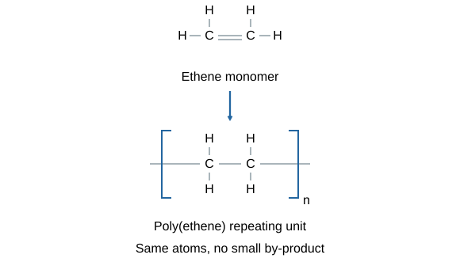

# Organic chemistry questions & answers

## 1 mark

**1.** What is a hydrocarbon?

**Answer:** A compound containing carbon and hydrogen only.

**2.** State the general formula of alkanes.

**Answer:** CₙH₂ₙ₊₂.

**3.** Name the alkane C₃H₈.

**Answer:** Propane.

**4.** State the functional group of alkenes.

**Answer:** C=C.

**5.** Name the alkene C₂H₄.

**Answer:** Ethene.

**6.** What colour change identifies an alkene using bromine water?

**Answer:** Orange to colourless.

**7.** State the functional group of alcohols.

**Answer:** –OH.

**8.** State the functional group of carboxylic acids.

**Answer:** –COOH.

**9.** Name the ester made from ethanol and ethanoic acid.

**Answer:** Ethyl ethanoate.

**10.** What is a monomer?

**Answer:** A small molecule that can join others to form a polymer.

**11.** Which small molecule is usually produced during condensation polymerisation?

**Answer:** Water.

**12.** What are DNA’s monomers?

**Answer:** Nucleotides.

**13.** What are protein’s monomers?

**Answer:** Amino acids.

## 2 marks

**14.** Why is crude oil a finite resource?

**Answer:**

- It forms over **millions of years** from buried ancient biomass.
- We use it much faster than it is replaced, so reserves are limited on human timescales.

**15.** Why is a crude-oil fraction usually not pure?

**Answer:**

- It contains **several hydrocarbons**.
- These have similar chain lengths and boiling ranges, rather than being one compound.

**16.** State how boiling point and viscosity change as hydrocarbon chain length increases.

**Answer:**

- **Boiling point increases**.
- **Viscosity increases**, so liquids flow less easily.

**17.** Give two useful product types from cracking.

**Answer:**

- Smaller **alkanes** used as fuels.
- **Alkenes** used as polymer monomers or chemical feedstocks.

**18.** Complete and balance C₁₂H₂₆ → C₈H₁₈ + _____.

**Answer:**

- Remaining atoms: 12−8 = 4 carbons; 26−18 = 8 hydrogens.
- **C₁₂H₂₆ → C₈H₁₈ + C₄H₈**.

**19.** Explain why an alkene is unsaturated.

**Answer:**

- It contains a **carbon–carbon double bond**.
- Atoms can add across it, giving greater hydrogen content than the starting alkene.

**20.** Describe hydrogen addition to ethene.

**Answer:**

- React with hydrogen using a **heated nickel catalyst**.
- C=C becomes C–C, producing **ethane**.

**21.** Describe water addition to ethene.

**Answer:**

- React with **steam**, using suitable acid catalyst, elevated temperature and pressure.
- Product is **ethanol**.

**22.** State the structural change when bromine adds to ethene.

**Answer:**

- C=C becomes a **single C–C bond**.
- One bromine attaches to each carbon: **CH₂BrCH₂Br**.

**23.** Describe the reaction of ethanol with sodium.

**Answer:**

- Sodium reacts to form the corresponding sodium compound.
- **Hydrogen gas** is released.

**24.** How can ethanol be changed into ethanoic acid?

**Answer:**

- React it with a suitable **oxidising agent**.
- Oxidation changes the primary alcohol into the **carboxylic acid**.

**25.** What products form when a carboxylic acid reacts with a carbonate?

**Answer:**

- A **salt**.
- **Water and carbon dioxide**.

**26.** Distinguish a weak acid from a dilute acid.

**Answer:**

- Weak means **partially ionised in water**.
- Dilute means a low amount of dissolved acid per volume; these are different properties.

**27.** Why does addition polymerisation produce no small by-product?

**Answer:**

- Alkene monomers join by opening their double bonds.
- All monomer atoms remain in the repeat units rather than being eliminated.

**28.** What two functional groups are present in an amino acid?

**Answer:** An amino group, –NH₂, and a carboxyl group, –COOH.

**29.** State DNA’s main shape and why it is important.

**Answer:**

- Most DNA has two polymer chains in a **double helix**.
- It carries **genetic instructions** for development and functioning.

**30.** Name the monomer of starch and cellulose and explain why their properties can differ.

**Answer:**

- Both use **glucose** monomers.
- Different arrangements/linking produce different structures and properties.

## 3 marks

**31.** Explain fractional distillation of crude oil.

**Answer:**

- Heat oil so hydrocarbons **evaporate**.
- Vapours rise through a column cooler at the top.
- They **condense at different heights** according to boiling ranges, separating fractions.

**32.** Explain why longer hydrocarbons have higher boiling points.

**Answer:**

- Their molecules generally have stronger **intermolecular attractions**.
- More energy is needed to separate the molecules.
- Boiling overcomes these attractions rather than breaking covalent bonds inside molecules.

**33.** Describe catalytic cracking and explain why it is useful.

**Answer:**

- Vaporise a large hydrocarbon.
- Pass vapour over a **hot catalyst** to break molecules into smaller ones.
- Products supply high-demand smaller fuels and reactive alkene feedstocks.

**34.** Balance complete combustion of butane, C₄H₁₀.

**Answer:**

- Match carbon and hydrogen: C₄H₁₀ → 4CO₂ +5H₂O.
- This needs 6½O₂; double all coefficients.
- **2C₄H₁₀ +13O₂ → 8CO₂ +10H₂O**.

**35.** Balance complete combustion of ethanol, C₂H₅OH.

**Answer:**

- Two carbons give 2CO₂; six hydrogens give 3H₂O.
- Products contain seven oxygen atoms, one already supplied by ethanol.
- **C₂H₅OH +3O₂ → 2CO₂ +3H₂O**.

**36.** Describe fermentation conditions and products.

**Answer:**

- Use **yeast and sugar solution**.
- Keep conditions **warm and anaerobic**, avoiding temperatures that denature enzymes.
- Products are **ethanol and carbon dioxide**.

**37.** Explain why equal-concentration ethanoic acid has a higher pH than hydrochloric acid.

**Answer:**

- Ethanoic acid is **weak**, so it only partially ionises.
- Hydrochloric acid ionises fully.
- Ethanoic acid therefore has fewer hydrogen ions per volume and a higher pH.

**38.** Describe ester formation from ethanol and ethanoic acid.

**Answer:**

- React the alcohol and carboxylic acid, commonly with an acid catalyst.
- They form **ethyl ethanoate and water**.
- This is **condensation**, with water eliminated; the process can be reversible.

**39.** Describe how to obtain the monomer from a displayed addition-polymer repeat unit.

**Answer:**

- Identify the two carbon atoms in the repeating backbone.
- Restore a **C=C double bond** between them and remove outward polymer links/brackets.
- Keep every side group attached to its original carbon.

**40.** Explain how a polyester forms from a diol and a dicarboxylic acid.

**Answer:**

- Each monomer has **two reactive functional groups**, allowing chain growth.
- –OH and –COOH groups form **ester links**.
- **Water is eliminated** as the monomers join.

**41.** Explain how amino acids form a polypeptide.

**Answer:**

- Amino acids each contain **amino and carboxyl groups**.
- These join by **condensation**, eliminating water.
- Repeated joining forms a chain; different amino acids can form a protein.

## 4 marks

**42.** Compare fractional distillation and cracking.

**Answer:**

- Distillation is **physical separation** based on boiling ranges.
- It uses evaporation and condensation without breaking hydrocarbon molecules.
- Cracking is a **chemical reaction** breaking larger molecules into smaller ones.
- High temperature with catalyst or steam produces useful smaller alkanes and alkenes.

**43.** Draw the poly(ethene) repeating-unit diagram and explain the essential features.

**Answer:** 

- A **single C–C backbone bond** replaces C=C.
- Each carbon retains two hydrogens.
- Outward single bonds pass through both brackets.
- **n** outside the brackets shows repetition; no atoms are lost.

**44.** A polymer has repeat unit –CH₂–CH(CH₃)–. Identify its monomer and explain your reasoning.

**Answer:**

- It is **propene**, CH₂=CHCH₃.
- Restore a double bond between the two backbone carbons.
- Retain the methyl side group on the second carbon.
- The repeat unit contains all three carbons and six hydrogens from the monomer.

**45.** Compare addition and condensation polymerisation.

**Answer:**

- Addition generally uses **alkene monomers** with double bonds.
- All atoms remain in the polymer, with **no small by-product**.
- Condensation uses monomers with **two functional groups**.
- Groups join while a small molecule, usually **water**, is eliminated.

## 6 marks

**46.** Evaluate making ethanol by fermentation compared with hydration of ethene.

**Answer:**

- Fermentation can use renewable crop sugars with yeast under warm anaerobic conditions.
- It is slower/batch-based and gives dilute ethanol needing separation; crop land can compete with food supply.
- Hydration reacts ethene with steam under high temperature/pressure and a suitable acid catalyst.
- It can be continuous and rapid, but usually uses finite petroleum feedstock and energy-intensive equipment.
- Compare measured energy, purity, yield, feedstock costs and land impacts, including separation energy.
- Choose a justified method for the stated situation rather than assuming renewable automatically means impact-free.

**47.** Explain how carbon compounds provide fuels and materials, using separation and chemical change.

**Answer:**

- Crude oil contains many hydrocarbons and is separated into similar-boiling fractions by fractional distillation.
- Smaller, less-viscous, more-flammable molecules are useful fuels.
- Complete combustion releases energy and produces carbon dioxide and water.
- Cracking converts less-demanded large hydrocarbons into smaller fuels and alkenes.
- Alkene addition reactions and polymerisation produce many useful materials; petrochemical feedstocks also support solvents, lubricants and detergents.
- Benefits must be balanced against finite supply, emissions and waste, using the context rather than treating all products as identical.

## Past-paper sources

### Resource directory

- [AQA assessment resources](https://www.aqa.org.uk/subjects/chemistry/gcse/chemistry-8462/assessment-resources)

### Question selection

Reviewed June 2022 and 2023 Paper 2 Higher. 2022 Q04.5–04.7 assesses hydrocarbon trends, cracking and alkene recognition; 2023 Q02.6–02.8 assesses alcohol oxidation, carboxyl structure and ester/carbonate products; 2023 Q08.1–08.9 assesses addition units, amino-acid condensation and natural polymers. These support question types, not a frequency prediction. All questions here are original practice.

These are original practice questions and tutor-written answers, informed by the linked papers. Mark allocations are practice allocations.

- June 2022, Paper 2 Higher: [question paper](../../00 - Past papers/Paper 2 Higher/AQA-84622H-QP-JUN22.pdf) · [mark scheme](../../00 - Past papers/Paper 2 Higher/AQA-84622H-MS-JUN22.pdf).

- June 2023, Paper 2 Higher: [question paper](../../00 - Past papers/Paper 2 Higher/AQA-84622H-QP-JUN23.pdf) · [mark scheme](../../00 - Past papers/Paper 2 Higher/AQA-84622H-MS-JUN23.pdf).
