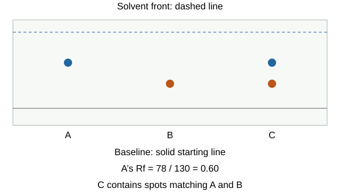

# Chemical analysis

## Purity and designed mixtures

In chemistry a **pure substance is a single element or compound**, without other substances mixed in. “Pure milk” in everyday language can mean nothing was added, but milk is still a mixture chemically.

At a stated pressure, a pure substance has a **specific melting/boiling temperature**. An impure solid often melts over a range, commonly at a lower temperature. Compare data with a known reference under comparable conditions; one temperature alone may not identify a substance uniquely.

A **formulation** is a mixture designed for a useful purpose, like a recipe whose quantities control the result. Paint can contain a pigment for colour, a binder for attachment and a solvent for application. Medicines, fuels, cleaners, fertilisers, alloys and foods can also be formulations. **Carefully measured proportions** give the required properties. An accidental mixture is not necessarily a designed formulation.

## How chromatography separates

**Chromatography** separates substances through their different distributions between two phases:

- **Stationary phase:** the part that remains in place, such as the paper in a school experiment.
- **Mobile phase:** the solvent moving through it.
- A substance spending more time in the mobile phase moves further.
- A substance more strongly attracted to the stationary phase moves less far.

Think of runners on a route who stop for different amounts of time: those spending less time stopped get further with the moving solvent. Different solubilities and attractions produce different spots. The same compound can have a different result with another solvent or stationary phase.

## Chromatography practical and Rf

1. Draw a **pencil baseline** near the bottom of chromatography paper. Pencil graphite does not dissolve like ink could.
2. Add small concentrated sample/reference spots and let them dry. Avoid large spreading spots.
3. Put paper in solvent with **solvent below the baseline**. The spots must not be submerged.
4. Let solvent rise through the paper, using a lid to reduce evaporation and comparable conditions.
5. Remove before solvent reaches the top and **mark the solvent front immediately** before it dries.
6. Measure from the baseline to **each spot centre**, and from baseline to solvent front.

**Rf = distance moved by substance/distance moved by solvent front.**

Both lengths must use the same units. Rf is a ratio with **no unit**, normally between 0 and 1. A spot travelling 3.6 cm with solvent front 6.0 cm gives **Rf = 0.60**.

**Comparing samples:** use the **same solvent, paper and conditions** when comparing Rf values. A spot matching a reference supports identification, but different substances can sometimes occupy the same position. Colour alone does not identify the chemical.

**Judging purity:** several separated spots show that a sample contains more than one component. However, **one spot does not always prove purity**. Components may overlap or may not dissolve in that solvent.

To test an uncertain conclusion, try a different solvent or another suitable analytical technique.

Keep flammable/toxic solvents away from flames and use appropriate ventilation and eye protection. Repeat measurements and keep spots small to reduce uncertainty in centre position.

## Gas tests

| Gas | Test | Positive result |
|---|---|---|
| Hydrogen | Burning splint at the open end of a tube of gas | **Squeaky pop** |
| Oxygen | Insert a glowing splint | **Splint relights** |
| Carbon dioxide | Bubble into or shake with limewater | **Milky/cloudy** limewater |
| Chlorine | Expose damp litmus paper | **Bleached white** |

**Limewater is calcium hydroxide solution**; cloudiness is solid calcium carbonate. Use a burning splint for hydrogen but a **glowing** splint for oxygen. Extinguishing a flame alone is not the specific test for carbon dioxide. Chlorine may redden blue litmus before bleaching, but the identifying result is white; **paper must be damp**. Do not smell gases to identify them.

## Flame tests for metal ions

Clean a suitable wire loop, commonly with hydrochloric acid and heating until no contaminating colour appears. Put a small sample on it and hold in a **blue, non-luminous Bunsen flame**. Use clean equipment/reference samples and record the observed flame, not the solid’s original colour.

| Metal ion | Flame colour |
|---|---|
| Lithium | **Crimson** |
| Sodium | **Yellow** |
| Potassium | **Lilac** |
| Calcium | **Orange-red** |
| Copper | **Green** |

Mixtures can mask colours, especially a strong sodium yellow. A clean loop prevents a previous sample giving a misleading result. Tie back hair, use eye protection, avoid touching hot wire and handle acids safely.

## Sodium hydroxide tests and precipitates

A **precipitate is an insoluble solid formed in solution**. Add sodium hydroxide solution **dropwise**, observe, then add **excess** where needed.

| Cation | First precipitate | Behaviour with excess sodium hydroxide |
|---|---|---|
| Aluminium, Al³⁺ | **White** | **Dissolves** |
| Calcium, Ca²⁺ | **White** | Remains |
| Magnesium, Mg²⁺ | **White** | Remains |
| Copper(II), Cu²⁺ | **Blue** | Remains |
| Iron(II), Fe²⁺ | **Green** | Remains initially |
| Iron(III), Fe³⁺ | **Brown** | Remains |

**A precipitate is a solid, not simply a colour change.** A colourless solution is not a white precipitate.

**White precipitates need further testing:** aluminium, calcium and magnesium all give white precipitates. Add **excess sodium hydroxide** to check for aluminium, whose precipitate dissolves. A flame test can help identify calcium.

Iron(II) hydroxide can oxidise on standing. Record the **initial green precipitate** rather than waiting until the sample changes.

Balanced ionic examples:

**Cu²⁺(aq) + 2OH⁻(aq) → Cu(OH)₂(s)**

**Fe³⁺(aq) + 3OH⁻(aq) → Fe(OH)₃(s)**

For a full equation: **CuSO₄(aq) + 2NaOH(aq) → Cu(OH)₂(s) + Na₂SO₄(aq)**. Balance atoms and charge; do not change the hydroxide formula to force balance. You do not need an extra equation for aluminium’s reaction with excess alkali.

## Carbonate, halide and sulfate tests

Use **fresh portions** of a dissolved sample for different tests so earlier reagents do not contaminate later ones.

| Ion | Reagents | Positive result |
|---|---|---|
| Carbonate, CO₃²⁻ | Dilute acid; test evolved gas with limewater | **Carbon dioxide**, turning limewater milky |
| Chloride, Cl⁻ | Dilute **nitric acid**, then silver nitrate | **White** silver chloride precipitate |
| Bromide, Br⁻ | Dilute **nitric acid**, then silver nitrate | **Cream** silver bromide precipitate |
| Iodide, I⁻ | Dilute **nitric acid**, then silver nitrate | **Yellow** silver iodide precipitate |
| Sulfate, SO₄²⁻ | Dilute **hydrochloric acid**, then barium chloride | **White** barium sulfate precipitate |

**Why add acid first?** It removes carbonate ions that could otherwise form an interfering precipitate.

**Choose an acid that does not add the ion being tested.** Hydrochloric acid adds chloride, so it could give a false silver-chloride result in a halide test. Sulfuric acid adds sulfate, so it is unsuitable before testing for sulfate.

Always link the precipitate to the **correct reagent sequence**. A white solid alone is not enough to identify an ion.

Example ionic equations:

**Ag⁺(aq) + Cl⁻(aq) → AgCl(s)**

**Ba²⁺(aq) + SO₄²⁻(aq) → BaSO₄(s)**

Wear eye protection and handle corrosive/irritant reagents and soluble barium salts according to the laboratory risk assessment. Never taste unknown salts; use small quantities and approved disposal.

## Identifying an unknown ionic compound

1. Dissolve a small sample in distilled water if needed.
2. Use separate portions for flame/hydroxide tests to identify the **cation**.
3. Use fresh portions for carbonate/halide/sulfate tests to identify the **anion**.
4. Record actual observations before naming ions. Use references and repeat uncertain results.
5. Combine the ion evidence, checking charge balance in any proposed formula.

Example: **lilac flame** and **cream precipitate after nitric acid/silver nitrate** support potassium and bromide, hence **KBr** in a single-compound task. A white precipitate from an unspecified reagent is not enough to name the compound. You may need a second test to distinguish possible ions.

## Instrumental analysis and flame emission

Instrumental methods can be **rapid, sensitive and accurate**. Sensitive means detecting small amounts, not being fragile. They can also provide quantitative concentrations and analyse mixtures more effectively, but equipment cost, calibration and reference data still matter.

In **flame emission spectroscopy**:

1. Place a sample into a flame.
2. Pass emitted light through a spectroscope.
3. Compare its **line spectrum** with reference spectra to identify metal ions.
4. Compare an appropriate signal with calibrated concentration data to measure concentration.

Match **line positions/patterns**, not just overall flame colour. In a mixture, lines from more than one ion can appear. Read supplied axes and reference data; a stronger calibrated signal can indicate greater concentration, but there is no universal conversion without calibration.

## Avoid these identification mistakes

- Pure means one element/compound, not simply “natural”.
- Measure both chromatography distances from the baseline, using the **spot centre**.
- Rf has no unit and cannot normally exceed 1.
- Burning hydrogen splint; glowing oxygen splint.
- Metal flame colour and hydroxide colour are different tests: copper green flame, blue precipitate.
- Halides require nitric acid; sulfate uses hydrochloric acid before barium chloride.
- State both **test and positive observation**, and use separate clean samples.

## Sources

- [AQA Chemical analysis](https://www.aqa.org.uk/subjects/chemistry/gcse/chemistry-8462/specification/subject-content/chemical-analysis)
