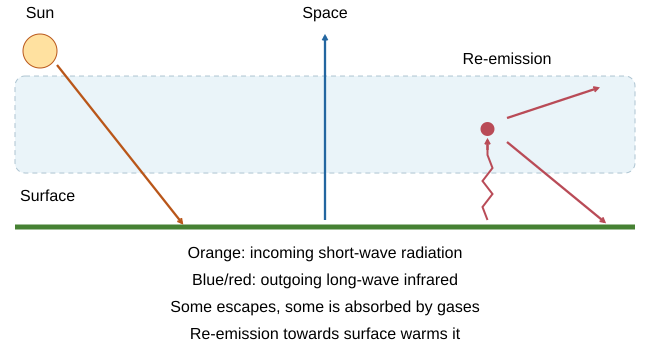

# Chemistry of the atmosphere

## Today’s atmosphere

The atmosphere is a mixture of gases. For **dry air**, useful approximate proportions are:

- **Nitrogen: 78%**.
- **Oxygen: 21%**.
- **Other gases: roughly 1%**, mainly argon with smaller amounts of carbon dioxide and other gases.

A simple estimate is **four-fifths nitrogen and one-fifth oxygen**.

Water vapour varies with conditions. Do not treat its proportion as one fixed value everywhere.

The broad proportions have remained fairly similar over about **200 million years**, while small gas components can still change significantly. “Carbon dioxide is a small percentage” does not mean it has no important effect.

## Early atmosphere and oceans

Earth formed about **4.6 billion years ago**, so direct evidence of its early atmosphere is limited. One supported model uses **intense volcanic activity** during its first billion years:

- Volcanoes released gases forming an early atmosphere rich in **carbon dioxide**, with **little or no oxygen**.
- They also released water vapour and nitrogen, with possible small amounts of methane/ammonia.
- As Earth cooled, **water vapour condensed into liquid oceans**.
- Carbon dioxide dissolved in oceans and formed carbonates/sediments, reducing atmospheric carbon dioxide.
- Nitrogen gradually accumulated.

The model has similarities to the carbon-dioxide-rich atmospheres of Mars and Venus. Similarity is supporting evidence, not proof of identical histories. Ancient rocks have been altered or destroyed, so evidence can be incomplete and interpretations change with new data.

### A change of state is different from a reaction

Cooling water vapour **condensed** to form liquid water. Its molecules were still H₂O: condensation did not split water into hydrogen and oxygen. Carbon dioxide then **dissolved** in the oceans, and reactions helped lock carbon into carbonate sediments. These are different steps, rather than one process called “the gases cooled”.

Oxygen built up as photosynthesis released it over a very long time. Nitrogen accumulated because it is relatively unreactive under ordinary conditions, so it was not removed as readily by processes that removed carbon dioxide.

## Photosynthesis changes the atmosphere

Early photosynthetic organisms, including algae, produced oxygen about **2.7 billion years ago**. Later plants increased oxygen levels further, supporting the evolution of animals.

**Carbon dioxide + water → glucose + oxygen**, using light energy.

**6CO₂ + 6H₂O → C₆H₁₂O₆ + 6O₂**.

Photosynthesis both **removes carbon dioxide** and **releases oxygen**. Do not say plants turned nitrogen into oxygen, or that evaporation made oxygen gas. Oxygen proportions changed over long periods, not instantly when the first algae appeared.

## Storing carbon in rocks and fuels

Carbon can leave the atmosphere and become stored over long timescales:

**Limestone:** carbonates form sediments, and shells and skeletons of marine organisms add calcium carbonate. These materials accumulate and become compacted, forming limestone.

**Coal:** dead vegetation accumulates in oxygen-poor conditions. It is buried and changed by heat and pressure over millions of years.

**Crude oil and natural gas:** dead marine biomass, such as plankton, becomes buried in sediments under oxygen-poor conditions. Heat and pressure transform it over millions of years.

These processes store carbon that once came from carbon dioxide. Burning fuels returns much of it rapidly to the atmosphere. Fossil fuels do not form from dinosaurs as their main source and are not replaced rapidly enough to be renewable.

## The greenhouse effect

The natural greenhouse effect keeps Earth warm enough for life. **Water vapour, carbon dioxide and methane** are greenhouse gases. Think of Earth’s energy balance as a bath: its level changes when incoming and outgoing flows differ. The effect concerns radiation transfer, not a literal solid lid.

1. **Short-wavelength radiation from the Sun** passes through the atmosphere and is absorbed by the surface, warming it.
2. The surface emits **long-wavelength infrared radiation**.
3. Greenhouse gases **absorb some infrared and re-emit radiation in different directions**, including towards the surface.
4. This reduces net energy loss from the surface at a given temperature, maintaining a warmer surface than without these gases. Some infrared still escapes into space.

The main explanation is **absorption and re-emission**, not reflection of all heat or trapping every ray. An enhanced greenhouse effect follows increased greenhouse-gas amounts; the natural effect itself is essential.

## Human sources of greenhouse gases

Two important **carbon-dioxide** sources:

- **Burning fossil fuels** for electricity, heating and transport.
- **Deforestation:** burning/decaying vegetation releases carbon dioxide and fewer trees remove it by photosynthesis.

Two important **methane** sources:

- **Agriculture**, including cattle digestion and flooded rice cultivation.
- **Anaerobic decomposition of organic waste**, such as landfill. Fossil-fuel extraction leaks can also contribute.

Growing population can raise demand for energy, food and land, linking to these emissions. A good explanation names the activity and the process producing the gas rather than saying “more people breathe”.

## Climate effects and evaluating evidence

An increase in average global temperature affects climate. Four useful potential effects are:

1. **Sea-level rise**, caused by warming-water expansion and melting land ice, increasing coastal flood risks.
2. Changes in **extreme weather** and rainfall patterns, including heatwaves or drought in some regions.
3. **Habitat/species-distribution changes**, affecting biodiversity and food webs.
4. Changes to **food production and water availability**, with different impacts between locations.

Melting floating sea ice is not the main direct source of sea-level rise; distinguish it from land ice. One rainy day or cold winter does not establish a long-term global trend.

**Evidence for a climate trend** comes from long datasets, many locations and different methods. Scientists combine these observations with physical explanations and models.

**Model uncertainty** arises because the atmosphere, oceans and clouds interact in complex ways. Future emissions and local responses are also uncertain. **Uncertainty about an effect's exact size or local timing does not erase the evidence for the overall process**.

Evaluate a report by checking duration, sample/geographical coverage, reliable measurements, alternative influences, whether all relevant data are shown and whether the work was **peer-reviewed**. Peer review and independent studies help check reasoning. Media reports can oversimplify or select evidence; communicate the trend and its uncertainty together.

### A forecast is not a measurement

Historical measurements show what has already happened. A model uses physical relationships and assumptions, including future emissions, to explore what may happen next. Different emissions assumptions can therefore give different future temperature changes without contradicting the measured historical trend.

When comparing reports, check whether they discuss **global averages or one region**, and **long-term climate or short-term weather**. A global average rise does not mean every place warms equally or every year is warmer than the previous year.

## Carbon footprints and reducing emissions

A **carbon footprint** is the total greenhouse-gas emissions over the **full life cycle of a product, service or event**, not just carbon dioxide released during use.

Include raw materials, manufacturing, transport, use and disposal. Compare equivalent services and units, such as equal transport distance or equal product lifetime. If emissions are expressed as carbon-dioxide equivalents, the supplied conversion puts different gases onto a comparable basis.

| Action | Why it can help | Possible limitation |
|---|---|---|
| Improve insulation and efficiency | Less fuel/energy needed | Upfront cost and building constraints |
| Use low-carbon electricity and transport | Reduces fossil-fuel burning | Infrastructure, cost and energy supply |
| Protect/restore forests | Retains carbon and supports uptake | Land demand, timescale and monitoring |
| Reduce organic waste, capture landfill methane | Cuts methane escape | Collection cost and leakage |
| Reduce/reuse/recycle materials | Less extraction and manufacturing | Transport, sorting and process energy |

Evaluate full-life-cycle data rather than claiming a product is zero-impact because it releases nothing locally. Actions can be limited by finance, consumer choices, food needs, technology, political cooperation and changing demand.

**Worked example:** a product emits 40 kg CO₂e during manufacture, 10 kg during transport, 80 kg during use and 5 kg during disposal.

1. Add all stages: 40 + 10 + 80 + 5 = **135 kg CO₂e**.
2. Reducing use emissions by 25% saves 0.25 × 80 = **20 kg CO₂e**.
3. The new footprint is 135 − 20 = **115 kg CO₂e**.
4. The whole-footprint reduction is 20 ÷ 135 × 100 = **14.8%**, not 25%, because only one stage was reduced.

### Compare like with like

Suppose two journeys each emit **10 kg CO₂e**. One carries one passenger; the other carries four. Their totals match, but the footprints per passenger are **10 kg** and **2.5 kg**. State whether you are comparing the entire journey, each passenger or each passenger-kilometre.

Carbon dioxide equivalent, **CO₂e**, allows the warming effects of different greenhouse gases to be compared. A total labelled “greenhouse gases” must not silently omit methane just because it is not carbon dioxide.

## Fuel combustion and pollutant formation

Predict pollutants from **fuel composition and combustion conditions**:

| Substance | How it forms | Main effect |
|---|---|---|
| Carbon dioxide | Complete combustion of carbon-containing fuels | Enhanced greenhouse effect |
| Water vapour | Combustion of hydrogen-containing fuels | Greenhouse gas |
| Carbon monoxide | **Incomplete combustion**, insufficient oxygen | Toxic, colourless and odourless |
| Soot/particulates | Incomplete burning and unburned material | Respiratory/health problems and **global dimming** |
| Sulfur dioxide | Sulfur impurities in fuel react with oxygen | **Acid rain and respiratory problems** |
| Nitrogen oxides | Nitrogen and oxygen in air react at **high temperature** | **Acid rain and respiratory problems** |

Nitrogen oxides can form even if the fuel contains no nitrogen, because air supplies it. A sulfur-free fuel does not generate sulfur dioxide from sulfur that is absent. Adequate oxygen reduces carbon monoxide/soot, but still allows carbon dioxide production.

Carbon monoxide reduces blood’s ability to transport oxygen by binding strongly to haemoglobin. It cannot be reliably detected by smell. This explains its toxicity without confusing it with carbon dioxide.

### Predict the products from the information given

For **pure hydrogen burning in pure oxygen**, the chemical product is water. There is no carbon or sulfur in these reactants, so carbon dioxide, carbon monoxide and sulfur dioxide cannot be made from them.

If hydrogen burns in **air at high temperature**, nitrogen and oxygen from the air can also form nitrogen oxides. A fuel can therefore avoid carbon emissions at the point of use while still causing another form of air pollution.

For methane with enough oxygen:

**CH₄ + 2O₂ → CO₂ + 2H₂O**

With insufficient oxygen, carbon monoxide and/or soot may form instead. The fuel's composition sets which atoms are available; the conditions help determine which products form.

## Acid rain, dimming and control choices

**Sulfur dioxide and nitrogen oxides** form acidic substances in atmospheric moisture. Acid rain can damage plants, aquatic ecosystems and buildings, while the gases also cause breathing problems.

**Particulates** scatter/reflect sunlight and reduce the light reaching the surface: **global dimming**. Small particles can harm health. This is different from greenhouse warming, which concerns absorption/re-emission of infrared. Both processes can occur together.

Measures include low-sulfur fuels/removing sulfur dioxide from waste gases, controlling engine conditions and using suitable exhaust treatments, particle filters and cleaner energy sources. Compare effectiveness, cost, upkeep and which pollutant is actually reduced. A particle filter is not automatically a carbon-dioxide remover.

## Keep these ideas separate

- Early atmosphere: mostly carbon dioxide, little oxygen. Current air: mostly nitrogen.
- Carbon stores and oxygen increase have different mechanisms.
- Greenhouse gases absorb/re-emit infrared; particulates cause dimming.
- Global warming, acid rain and ozone depletion are different processes.
- Carbon monoxide is toxic; carbon dioxide is a greenhouse gas.
- Climate conclusions require long-term, broad evidence, not a single weather event.

## Sources

- [AQA Chemistry of the atmosphere](https://www.aqa.org.uk/subjects/chemistry/gcse/chemistry-8462/specification/subject-content/chemistry-of-the-atmosphere)

- [PMT: 9.1. The composition and evolution of the Earth's atmosphere](../Reference Materials/PMT - Summary 9.1 - AQA Chemistry.pdf). Unmodified reference; its original board is recorded in the review metadata.
- [PMT: 9.2. Carbon dioxide and methane as greenhouse gases](../Reference Materials/PMT - Summary 9.2 - AQA Chemistry.pdf). Unmodified reference; its original board is recorded in the review metadata.
- [PMT: 9.3. Common atmospheric pollutants and their sources](../Reference Materials/PMT - Summary 9.3 - AQA Chemistry.pdf). Unmodified reference; its original board is recorded in the review metadata.
- [Study Rocket: Chemistry Of The Atmosphere](https://studyrocket.co.uk/revision/gcse-chemistry-combined-science-aqa/combined-science-atmospheric-chemistry/chemistry-of-the-atmosphere). Cross-checked against the project specification.
