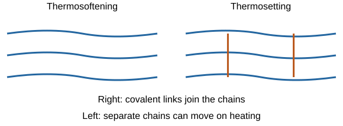
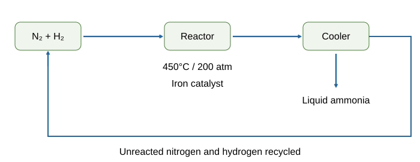

# Using resources

## Resources and sustainable development

**Sustainable development** meets present needs without compromising future generations’ ability to meet theirs. Think of a shared savings account: using it all today leaves others without the resources they need later.

People use natural resources for warmth, shelter, food and transport. Agriculture supplements food, timber, fibres and fuels; synthetic materials can supplement or replace natural products, such as synthetic rubber alongside natural rubber and manufactured fibres alongside cotton/wool.

- **Finite resources:** replaced far more slowly than used, such as metal ores and fossil fuels.
- **Renewable resources:** can be replenished on useful timescales, such as sustainably grown timber.
- Renewable does not mean unlimited or impact-free: harvesting faster than regrowth is unsustainable.
- Chemistry can improve processes to reduce energy, raw-material demand and waste.

Read resource graphs carefully, checking units and orders of magnitude. A large percentage saving on a tiny input may be smaller than a modest saving on a major one.

## Potable water and freshwater treatment

**Potable water is safe to drink**, with sufficiently low microbes and dissolved salts. It is usually **not chemically pure**, because dissolved substances remain.

For suitable freshwater sources:

1. Select an appropriate source, such as ground water, a river or reservoir.
2. **Filter** through suitable beds to remove suspended solids.
3. **Sterilise** using chlorine, ozone or ultraviolet light to kill microorganisms.

Filtration alone does not reliably remove all dissolved salts or kill all microbes. Groundwater may need less suspended-solid removal than muddy surface water, but source quality still determines treatment. Boiling can kill many microbes but does not remove dissolved salt.

## Desalination and water analysis

Where freshwater is scarce, **desalination** removes salts from seawater:

- **Distillation:** evaporate water, then cool vapour so it condenses; dissolved salts remain behind.
- **Reverse osmosis:** high pressure drives water through membranes while retaining most dissolved salts.
- Both use significant energy; choice depends on local supplies, energy, cost and environmental effects of concentrated waste.

**Water practical:** compare samples using pH, dissolved solids and distillation.

1. Measure **pH** using indicator or a calibrated probe.
2. Weigh a clean dry evaporating basin, add a known water volume and evaporate gently. Cool and reweigh; repeated heating/cooling to consistent mass improves residue measurement.
3. **Residue mass = basin+residue mass − empty-basin mass**. Divide by sample volume for a comparable dissolved-solids measure, after separating suspended solids where appropriate.
4. Distil a portion with suitable apparatus: heat, condense vapour and collect distilled water. Compare initial and distilled samples.

Use eye protection and safe heating, avoid boiling to dryness during distillation, keep the receiving system open to avoid pressure buildup and do not taste experimental samples. A normal pH or clear appearance alone cannot prove water is safe: harmful dissolved chemicals or microbes may remain. Small residue masses may approach the balance’s resolution, limiting comparisons.

## Wastewater treatment

Wastewater may contain organic matter, microorganisms and industrial chemicals. It needs treatment before environmental release:

1. **Screening/grit removal:** removes large objects and grit.
2. **Sedimentation:** solids settle as **sludge**, leaving liquid **effluent**.
3. **Anaerobic digestion of sludge:** microorganisms break down organic matter without oxygen, often yielding useful biogas.
4. **Aerobic biological treatment of effluent:** oxygen supports microorganisms breaking down remaining organic material.

Industrial effluent may require additional chemical removal. Wastewater treatment and making drinking water are not identical endpoints; a treated discharge is not automatically potable. Suitable freshwater generally needs fewer steps than salty or heavily contaminated water, but compare actual source composition and local conditions.

## Phytomining and bioleaching

**Low-grade ore** has a low metal-compound concentration. As rich copper ores become scarcer, biological methods can recover copper without excavating as much rock:

**Phytomining:** plants absorb metal compounds from the soil. The plants are harvested and burned. Their **ash contains metal compounds**, so burning does not directly produce pure metal.

**Bioleaching:** bacteria help produce a **leachate**, which is a solution containing dissolved metal compounds.

**Recovering the metal:** these compounds still need further processing. Copper can be obtained from a suitable solution by **displacement with scrap iron** or by **electrolysis**.

**Fe + CuSO₄ → FeSO₄ + Cu**. Iron is more reactive, so it displaces copper. Electrolysis supplies electrical energy for ion reduction.

Benefits can include use of lower-grade deposits and reduced rock movement/high-temperature demand. Limits include slow processes, land needs, control of growth conditions and potentially harmful leachate. Compare yield, time, energy, costs and pollution for the supplied situation, not “biological always means green”.

## Life-cycle assessments

A **life-cycle assessment (LCA)** considers environmental impacts throughout:

1. Raw-material extraction and processing.
2. Manufacturing and packaging.
3. Use throughout the useful lifetime.
4. Disposal, reuse or recycling.

Include **transport and distribution at each stage**, rather than counting only the final delivery.

Use reliable data to quantify energy, water, resources and waste. Some effects, such as harm caused by a pollutant, are harder to express as one number. Deciding how much importance to give different impacts involves **value judgements**. An LCA is therefore not completely objective just because it contains numerical tables.

Compare equal functions, such as carrying the same shopping load the same number of times. A paper bag may use renewable input but more processing water/energy; a plastic bag may use finite feedstock but be light or reusable. Use evidence about durability, manufacture, transport and disposal rather than declaring one material always best.

**Selective LCAs** can omit inconvenient stages to support advertising. Check scope, assumptions, data sources and the number of reuses. A reusable bottle’s production impact may be spread across many uses, but washing and return transport still matter.

## Reduce, reuse and recycle

- **Reduce:** use less material or avoid unnecessary products.
- **Reuse:** use the product again, such as refillable glass bottles.
- **Recycle:** recover material for remaking products, such as melting and recasting metals or crushing/melting glass.

These can reduce finite-resource use, extraction damage, energy use and waste. Recycling still needs collection, transport, sorting and processing. Separation depends on the required product properties: high-purity products need cleaner sorted inputs than uses able to accept mixtures. Some scrap steel can be combined with new iron to reduce ore demand.

Evaluate the whole system, including washing, breakage, travel and product lifetime. “Reusable” only delivers its expected benefits if it is actually reused sufficiently often.

## Corrosion, rusting and protective layers

**Corrosion** is damage caused by chemical reactions with the environment. **Iron rusts only when both oxygen and water are available**.

A comparison can use identical clean nails:

- Air and water: rust expected.
- Dry air with a drying agent: little/no rust because water is absent.
- Boiled water covered with oil: little/no rust because oxygen was removed and excluded.

Control nail type, time and temperature. Boiled water left uncovered can regain oxygen, weakening the test.

Paint, grease and electroplating form **barriers** against air/water. Scratches can expose metal. **Aluminium forms a protective oxide layer**, limiting further corrosion.

**Sacrificial protection** attaches a **more reactive metal** that oxidises preferentially. **Galvanising with zinc** provides both a barrier and sacrificial protection: even a scratch can remain protected while suitable zinc remains connected. Paint cannot sacrifice itself in the same way. A less-reactive copper coating protects as a barrier only while intact and does not sacrificially protect iron.

## Alloys and their uses

An **alloy is a mixture** containing a metal with other elements. Different-sized atoms distort layers and make sliding harder, so alloys are often harder than the pure metal.

| Alloy | Composition/property | Suitable use |
|---|---|---|
| Bronze | Copper + tin; hard and wear-resistant | Statues, bearings or medals |
| Brass | Copper + zinc; workable and corrosion-resistant | Musical instruments or fittings |
| Gold jewellery alloy | Gold with silver/copper/zinc; harder than pure gold | Jewellery |
| High-carbon steel | Iron with more carbon; strong but brittle | Cutting tools |
| Low-carbon steel | Softer, easier to shape | Car body panels |
| Stainless steel | Contains chromium/nickel; hard and corrosion-resistant | Cutlery or kitchen equipment |
| Aluminium alloy | Low density with useful strength | Aircraft structures |

**Gold purity**

- **24 carat:** pure gold.
- **18 carat:** 18/24 = **75% gold**.

**Example:** a 12 g sample of 18-carat alloy contains:

12 × 0.75 = **9 g gold**

Link a material's property to its use. “Good material” is too vague.

## Glass, ceramics and composites

- **Soda-lime glass:** heat **sand, sodium carbonate and limestone**.
- **Borosilicate glass:** sand and **boron trioxide**; higher melting temperature and useful heat resistance, for laboratory glassware.
- **Clay ceramics:** shape wet clay, then **heat in a furnace**; used for pottery and bricks. They are typically hard, durable and brittle.
- **Composite:** a **matrix/binder** surrounds and binds a **reinforcement** such as fibres or fragments. Examples include fibreglass, carbon-fibre composites and reinforced concrete.

Composites combine properties: fibres may provide tensile strength while the matrix holds and protects them. Use supplied density, strength, temperature resistance, corrosion and cost data to select a material. Compare equivalent amounts/functions and explain why each important property suits the application.

## Polymers: manufacturing conditions and heating

Polymer properties depend on **monomers and processing conditions**. LDPE and HDPE both come from **ethene**, but different conditions/catalysts produce different chain arrangements.

- **LDPE:** more branched chains pack less closely, giving lower density and greater flexibility.
- **HDPE:** less-branched chains pack more closely, with stronger intermolecular attractions and greater density/rigidity.

**Thermosoftening polymers** have separate chains held together by intermolecular attractions. Heating can overcome these attractions, allowing the chains to move past one another. The polymer melts and can be remoulded.

**Thermosetting polymers** have **covalent cross-links between chains**. The links prevent the chains from moving apart on heating, so the polymer does not melt. Strong heating can eventually decompose it.

Do not say heating ordinary thermosoftening plastic melts by breaking every covalent backbone bond. Cross-links and intermolecular attractions are different kinds of connection.

## The Haber process

The **Haber process makes ammonia**, a starting material for nitrogen fertilisers.

**N₂(g) + 3H₂(g) ⇌ 2NH₃(g)**, with an **exothermic forward reaction**.

Nitrogen comes from **air**. Hydrogen is commonly obtained from **natural gas**, though other sources can be used. Purified gases are supplied in the **1:3 nitrogen:hydrogen ratio** and passed over an **iron catalyst**, at about **450°C and 200 atmospheres**.

On cooling, **ammonia liquefies and is removed**. Unreacted nitrogen and hydrogen are **recycled**, improving overall use of the feedstock. The gases do not all convert in one pass because the reaction is reversible.

## Rate–yield compromise in ammonia production

- **Lower temperature:** favours exothermic ammonia formation, increasing equilibrium yield, but gives a slow rate.
- **Higher temperature:** speeds reaction but lowers equilibrium ammonia yield. About 450°C is a practical compromise.
- **Higher pressure:** favours ammonia because gas moles decrease **from four to two**; it also increases collision frequency. Very high pressure requires costly compression and strong safe equipment.
- **Iron catalyst:** provides lower activation energy, speeding both directions without changing equilibrium yield.
- **Remove ammonia/recycle reactants:** obtain useful product and improve overall production from raw materials.

Assess **product per unit time, equilibrium proportion, energy costs, plant costs and safety**. The highest yield percentage alone is not necessarily the most economical production condition. Count equation coefficients of gases, not nitrogen/hydrogen atoms.

## NPK fertilisers and integrated production

**NPK** refers to compounds supplying **nitrogen, phosphorus and potassium**, not elemental nitrogen gas or metal potassium sprinkled onto soil. Fertilisers are **formulations of salts** in appropriate proportions for plant needs.

- Ammonia can make **ammonium salts** and **nitric acid**.
- **Ammonia + nitric acid → ammonium nitrate**, supplying nitrogen.
- Potassium chloride and potassium sulfate are mined potassium sources.
- **Phosphate rock is poorly soluble**, so it is treated to make nutrients more available.

| Acid reacting with phosphate rock | Important products |
|---|---|
| Nitric acid | **Calcium nitrate** and phosphoric acid |
| Sulfuric acid | **Single superphosphate**, a mixture containing soluble calcium phosphate compounds and calcium sulfate |
| Phosphoric acid | **Triple superphosphate**, mainly calcium dihydrogenphosphate |

These soluble phosphate products differ from the poorly soluble starting rock. “Calcium phosphate” can be used broadly in simple course descriptions; **dihydrogenphosphate** makes the soluble product distinction clear. Do not claim the untreated rock is already a soluble fertiliser.

Several industrial stages integrate feedstock preparation, acid/salt manufacture and formulation. In the laboratory, an ammonium salt can be prepared by **neutralisation**, using measured acid/alkali quantities, a titration to find the endpoint, then a fresh indicator-free preparation and crystallisation. Industrial manufacture is larger-scale, often continuous and automated, with heat control, recycling and purity/yield requirements. Compare actual supplied procedures rather than assuming every industrial step is identical to a classroom method.

## Common traps

- Potable means safe, not chemically pure. Filtration does not remove all dissolved salts.
- Phytomining ash contains compounds; it still needs extraction.
- LCA includes transport and the useful lifetime, not just disposal.
- Rust needs oxygen **and** water. Zinc can protect sacrificially; paint is a barrier.
- Both LDPE and HDPE use ethene. Cross-links explain thermosetting behaviour.
- Haber catalyst improves rate, not equilibrium yield.
- Fertilisers supply nutrients as compounds; phosphate rock needs treatment.

## Sources

- [AQA Using resources](https://www.aqa.org.uk/subjects/chemistry/gcse/chemistry-8462/specification/subject-content/using-resources)
