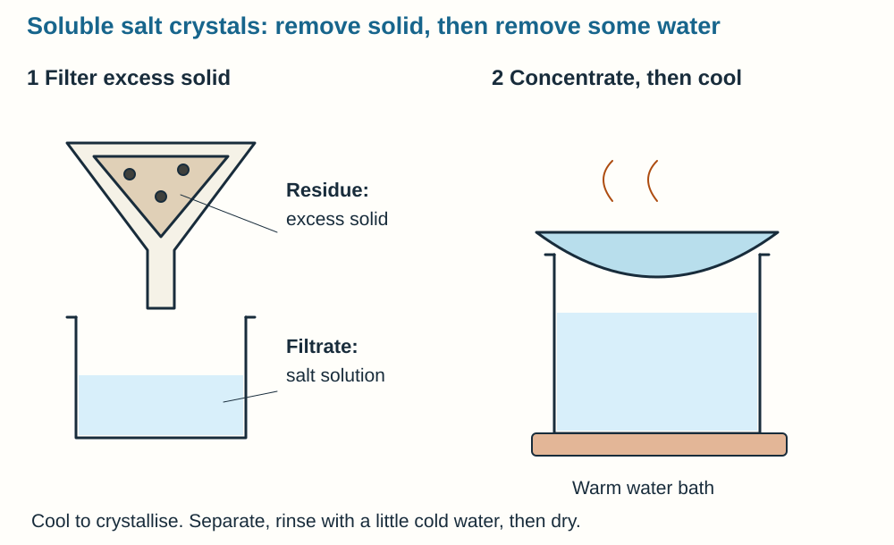
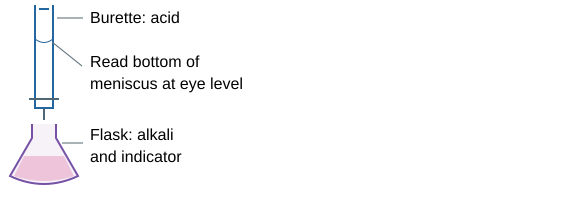
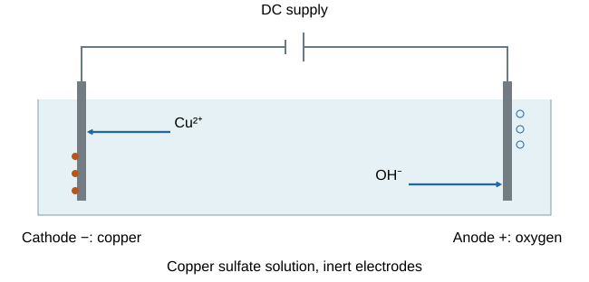
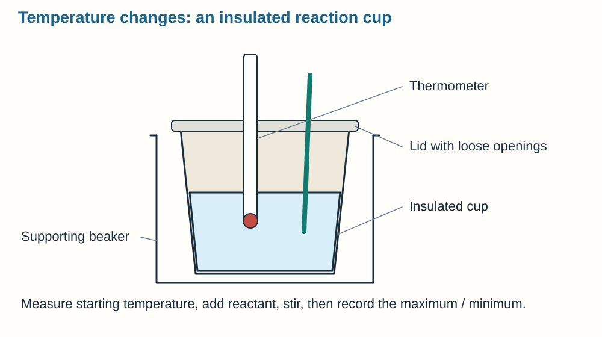
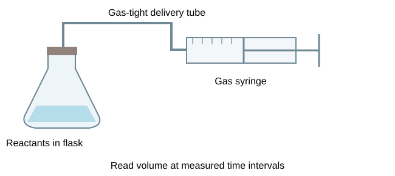
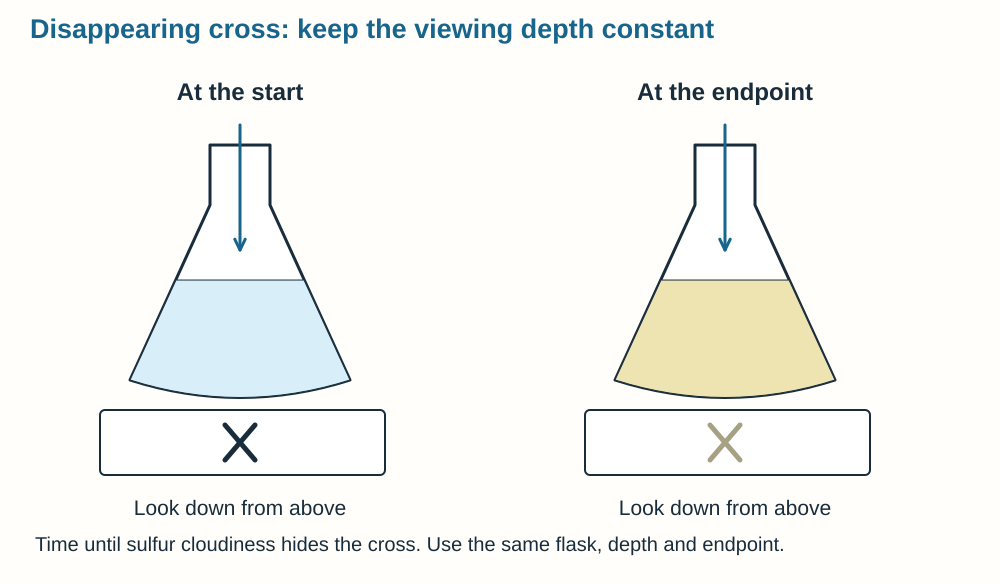
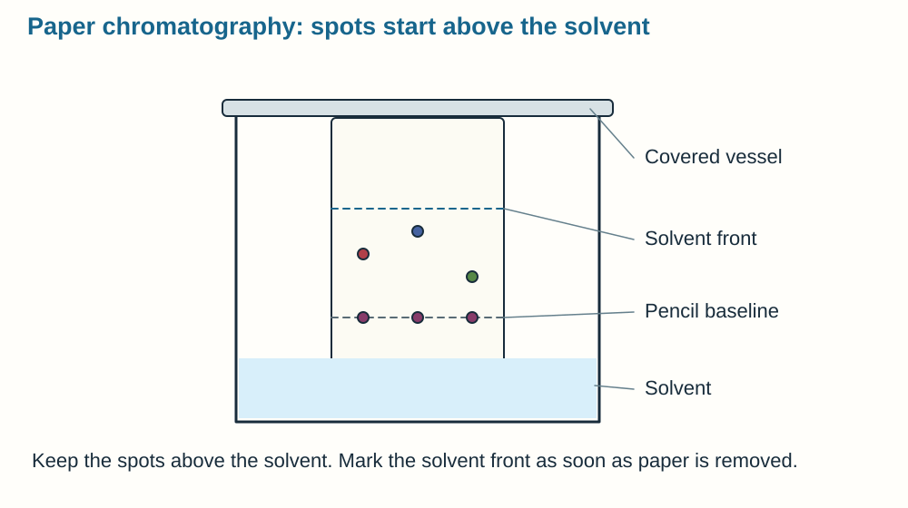
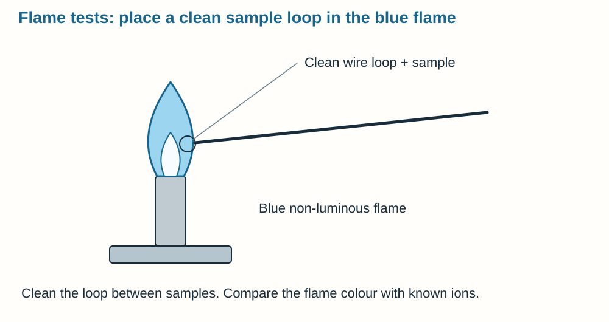
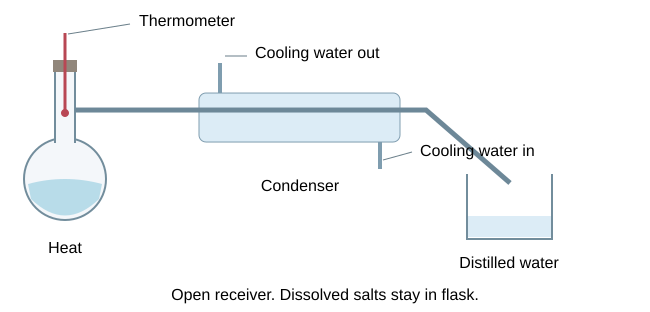

# Working scientifically and required practicals

## From question to fair investigation

A scientific investigation checks an explanation against evidence. Think of testing a recipe: changing the oven temperature and ingredients together makes it difficult to tell what caused the result.

- **Hypothesis:** a testable prediction with a scientific reason, such as higher concentration increasing successful collision frequency.
- **Independent variable:** what you change or select.
- **Dependent variable:** what you measure.
- **Control variables:** factors kept consistent so they do not provide an alternative explanation.
- **Control experiment:** a comparison, such as no enzyme, used to check the cause of a change. It is different from a control variable.

Choose a suitable range and intervals, enough repeats and an appropriate sample. Explain why each control matters: temperature changes reaction rate, so keep it constant when investigating concentration.

## Measurements, errors and improvements

Choose equipment appropriate to the quantity and required resolution: balance for mass, ruler for length, thermometer for temperature, measuring cylinder/pipette for volume, timer for time and calibrated probe for pH. Check zero, read scales at eye level and record units in table headings.

| Term | Meaning | Useful response |
|---|---|---|
| Accuracy | Close to the true value | Calibrate and correct systematic offsets |
| Precision | Repeated values close together | Improve measurement resolution and consistency |
| Repeatability | Same investigator/method gives similar results | Repeat under the same conditions |
| Reproducibility | Different investigators/equipment give similar results | Compare independent investigations |
| Random error | Unpredictable scatter | Repeat and calculate a mean |
| Systematic error | Consistent bias or offset | Find the cause and recalibrate/correct it |

**Systematic bias:** if a balance always reads 0.2 g too high, taking more readings does not remove that offset. Check and correct its zero or calibration.

**Anomalies:** investigate an unexpected result and repeat the measurement. Exclude it only with a justified reason, such as a recorded measurement failure.

**Uncertainty:** report how much the readings vary, for example using their range. Consider the instrument's resolution as well as the spread of repeated readings.

## Evidence, graphs and conclusions

Use bars for categories and scatter/line graphs for numerical variables. Label axes with quantities and units, use sensible scales and draw a suitable best-fit line/curve rather than forcing it through every point. A histogram represents numerical intervals using touching bars; interpret the frequency and class widths supplied.

**Describe the evidence first:** quote relevant measurements and units, then explain the chemical process that could produce the pattern.

**Correlation does not prove causation.** Another factor may affect both variables. Relate the conclusion to the hypothesis and consider uncertainty. Overlapping ranges can weaken an apparent difference, but do not automatically prove that there is no effect.

Models simplify reality: particle diagrams and reaction profiles omit some molecular detail. New evidence can change theories. **Peer review** checks methods, reasoning and evidence before publication; independent replication strengthens confidence. It reduces errors without guaranteeing perfection. News reports may simplify or omit uncertainty.

Evaluate benefits, costs, environmental/social effects and ethical issues using evidence. A **hazard** is a potential source of harm; **risk** concerns likelihood and consequence under the conditions. Public perceptions can differ from measured risk because unfamiliar or imposed hazards feel more threatening.

## Preparing a pure dry soluble salt

**Aim:** make a soluble salt from a dilute acid and an **insoluble oxide or carbonate**, such as copper sulfate from copper oxide and sulfuric acid.

1. Warm dilute acid gently. Add insoluble solid in small portions and stir until some remains unreacted, showing the acid has been used.
2. **Filter** to remove excess solid. The **filtrate** contains dissolved salt.
3. Heat gently in a water bath/electric heater to evaporate some water and **concentrate** the solution. Do not heat until all water is gone.
4. Cool so crystals form, then filter/separate them, wash with a small amount of cold distilled water and dry between filter papers or by a suitable gentle method.

**CuO + H₂SO₄ → CuSO₄ + H₂O.** An insoluble carbonate also produces carbon dioxide. Excess insoluble solid is removable by filtration; excess soluble alkali would remain dissolved, needing a different preparation strategy. Use eye protection and careful acid/hot-apparatus handling. Do not assume a blue solution is already a pure dry crystal sample.

## Acid–alkali titration

**Aim:** determine reacting volumes and an unknown strong acid/alkali concentration.

1. Rinse a pipette with the solution it will deliver, and use a **pipette filler** to transfer a known alkali volume into a conical flask.
2. Add a few drops of a suitable endpoint indicator, such as phenolphthalein or methyl orange.
3. Rinse/fill the **burette with acid**, ensure its tip is filled, remove the filling funnel and record the initial reading at the bottom of the meniscus at eye level.
4. Add acid while swirling over a white tile. Near the endpoint add **dropwise** until the first permanent expected colour change.
5. Record the final reading. **Titre = final − initial reading**.
6. Do a rough run, then repeat carefully to obtain **concordant titres**. Average only suitable concordant accurate runs, explaining any rejected result.

Rinse the conical flask with distilled water if needed; extra water there does **not** change the initial moles of alkali, whereas water left in a burette can dilute its acid. A burette scale increases downwards. Never pipette by mouth; use eye protection for acid/alkali.

**Worked calculation:** 25.0 cm³ of NaOH requires 20.0 cm³ of 0.100 mol/dm³ HCl.

1. Convert acid volume: 20.0 ÷ 1000 = **0.0200 dm³**.
2. Find acid moles: n = cV = 0.100 × 0.0200 = **0.00200 mol**.
3. **HCl + NaOH → NaCl + H₂O** gives a 1 : 1 ratio, so NaOH moles = **0.00200 mol**.
4. Divide by alkali volume: c = 0.00200 ÷ 0.0250 = **0.0800 mol/dm³**.
5. With a molar mass of 40 g/mol, mass concentration = 0.0800 × 40 = **3.20 g/dm³**.

Check the balanced equation each time. A different acid can require a different reaction ratio.

## Electrolysis of aqueous solutions

**Aim:** predict and identify products from aqueous electrolysis using **inert electrodes**.

1. Put a measured aqueous solution in a suitable vessel and immerse two graphite/inert electrodes separately.
2. Connect to a low-voltage **DC supply**, naming the negative **cathode** and positive **anode**.
3. Predict products using solution ions and the water-derived ions. Use comparable concentration, voltage, electrode immersion and time when comparing solutions.
4. Observe gas/metal formation, collect small gas samples appropriately and identify them with valid tests.

- **Cathode:** a metal less reactive than hydrogen is deposited; otherwise hydrogen commonly forms.
- **Anode:** halide solutions can form their halogen; otherwise oxygen commonly forms under GCSE aqueous/inert-electrode conditions. Follow supplied concentration/context where relevant.
- **Copper sulfate:** copper at cathode, oxygen at inert anode.
- Suitable sodium chloride solution: hydrogen at cathode and chlorine at anode under the stated school-test conditions.

Hydrogen: burning splint/pop. Oxygen: glowing splint relights. Chlorine: damp litmus bleached white. Test small quantities with proper ventilation; do not inhale gas. Avoid short circuits and keep electrical connections dry. **Ions move through the liquid; electrons move through external wires**, not through the electrolyte as free electrons.

## Temperature changes in reacting solutions

**Aim:** investigate a variable affecting temperature change in reactions, such as metal displacement, acid/metal, acid/carbonate or neutralisation.

1. Measure solution volumes/concentrations and put them in an **insulated cup** with suitable support and lid.
2. Measure initial temperature. Add a controlled amount of the second reactant, mix consistently and record temperature at fixed intervals until a maximum/minimum is established.
3. Change one chosen variable, keeping other relevant quantities, starting temperature, insulation and apparatus consistent.
4. Repeat and compare **ΔT = final − initial**, not just final temperature.

A positive ΔT normally indicates an **exothermic** reaction transferring energy to surroundings; a negative ΔT indicates **endothermic** uptake. Heat exchange with the room, delayed thermometer response and incomplete reaction affect results. Better insulation and consistent mixing reduce some errors. A temperature–time graph can help estimate the change at mixing by an appropriate extrapolation when the question supplies suitable data.

Do not compare different total liquid masses as if equal ΔT always means equal energy transferred. Where relevant data/formula are supplied, **Q = mcΔT** connects mass, heat capacity and temperature change. Use small safe quantities, eye protection, secure cups and appropriate control of gas-producing reactions; do not tightly seal them.

## Concentration and rate: gas volume

**Aim:** measure concentration’s effect using a gas-producing reaction.

Use equal masses/surface areas of a suitable solid, such as carbonate chips, with a range of known acid concentrations at **fixed total solution volume and temperature**. Mix and promptly seal to a connected gas syringe, then record gas volumes at fixed intervals. Repeat and compare mean curves/initial gradients or a common-interval mean rate.

Higher concentration gives more particles per unit volume, increasing successful collision frequency.

**Rate = gas volume/time** for an interval; a **tangent gradient** gives rate at an instant.

Final gas amount depends on the limiting reagent and is different from rate.

Check leaks and start-up delays; they can lose gas and underestimate output. Keep syringe movement free, use suitable dilute acid and eye protection, and never block a gas-producing system.

## Concentration and rate: turbidity or colour

Thiosulfate reacts with dilute acid to form **insoluble sulfur**. Time until cloudiness hides a fixed cross under the same flask.

- Change thiosulfate concentration by dilution, maintaining total solution volume and fixed acid amount.
- Same temperature, flask, cross, viewing conditions, mixing and endpoint rule.
- Repeat and compare **1/time**, a relative rate proxy for a common endpoint.
- A light sensor and fixed threshold can improve subjective judgement.

Keep the solution depth constant: a deeper column can hide the cross with a different amount of sulfur. Sulfur dioxide can be generated, so use suitable ventilation, small quantities, eye protection and the school’s risk assessment. Gas collection and turbidity are **both required approaches**, not interchangeable descriptions of one measurement.

## Paper chromatography

**Aim:** separate and compare coloured substances and calculate Rf.

Draw a **pencil baseline**, apply small dried spots and place the paper in solvent **below the baseline**. Use a covered vessel, let solvent rise, then remove before it reaches the top and immediately mark the solvent front.

**Rf = baseline-to-spot-centre distance/baseline-to-solvent-front distance.**

It has no unit.

Compare reference samples in the **same solvent/paper/conditions**.

Different partition between stationary and mobile phases causes separation.

Large spreading spots, ink baselines, submerged samples and an unmarked front undermine results. One spot may hide overlapping compounds; a different solvent can improve separation. Handle solvents safely, especially flammable ones, with suitable ventilation and no nearby flame.

## Identifying unknown ionic compounds

**Aim:** use chemical tests to identify cations and anions in unknown **single ionic compounds**. Dissolve where appropriate and use **fresh portions for different tests**.

| Test | Method | Main results |
|---|---|---|
| Flame | Clean loop, blue non-luminous flame | Li crimson; Na yellow; K lilac; Ca orange-red; Cu green |
| Hydroxide | Sodium hydroxide dropwise, then excess | Al/Ca/Mg white; only Al dissolves in excess here. Cu blue, Fe²⁺ green, Fe³⁺ brown |
| Carbonate | Dilute acid; test gas | Limewater milky from CO₂ |
| Halides | Nitric acid then silver nitrate | Cl white; Br cream; I yellow |
| Sulfate | Hydrochloric acid then barium chloride | White precipitate |

Record the **observation and inferred ion**. White alone is ambiguous without the reagent and excess test. Do not introduce chloride by using HCl in a halide test, or sulfate by using sulfuric acid before sulfate testing. Use clean reference samples, repeat uncertain observations and apply suitable eye/hot-wire/reagent precautions. Combine ion charges correctly when suggesting a formula.

## Water analysis and purification

**Aim:** compare water sources using **pH, dissolved solids and distillation**.

1. Collect suitable labelled samples and measure pH with indicator or a calibrated probe.
2. Add a known volume to a weighed dry basin, evaporate gently and cool before reweighing. Use repeated heating/cooling to a consistent residue mass.
3. Residue mass is the difference from the empty-basin mass. Compare equal volumes or calculate concentration with correct conversions.
4. Distil another portion: evaporate water and condense the vapour into an **open receiving vessel**, leaving dissolved solids behind.

Cooling water enters the condenser jacket at the lower/appropriate inlet and leaves at the upper outlet, keeping the jacket full. It does not mix with the vapour/distillate. Compare pH/residue before and after, but do not infer drinkability from clarity or pH alone. Keep heating controlled, avoid distilling dry, use eye protection and never taste samples. Small residue masses may be unreliable if close to balance resolution.

## Applying practical skills to new questions

Identify the actual chemical change and choose a measurement that follows it. A method should name variables, apparatus, range, controls, repeats, calculation and hazard-specific precautions.

Connect an improvement to the error it solves: checking leaks limits gas loss; dropwise addition reduces titration overshoot; insulating the cup limits heat exchange. “Be careful” or “repeat it” alone does not explain every limitation. A mean reduces random scatter, while a systematic bias requires correction.

Use labelled tables/graphs, SI units and appropriate precision. Support conclusions with data and uncertainty. Reproducible evidence and peer review strengthen claims, but models and experiments still have limits.

## Sources

- [AQA Chemistry practical assessment](https://www.aqa.org.uk/subjects/chemistry/gcse/chemistry-8462/specification/practical-assessment)
- [AQA Working scientifically](https://www.aqa.org.uk/subjects/chemistry/gcse/chemistry-8462/specification/working-scientifically)
