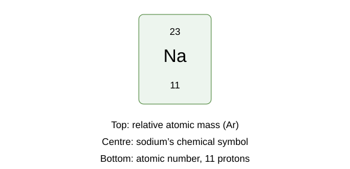

# Mathematical requirements and periodic table

## Units, standard form and estimates

Chemical quantities need matching units before a calculation. Think of comparing money: 50 pence is not £50. Similarly, **25 cm³ is 0.025 dm³**, not 25 dm³.

| Conversion | Relationship |
|---|---|
| Mass | 1 kg = 1000 g; 1 g = 1000 mg |
| Volume | 1 dm³ = 1000 cm³; 1 cm³ = 1 mL |
| Length | 1 m = 100 cm = 1000 mm |
| Small lengths | 1 mm = 1000 µm; 1 µm = 1000 nm |
| Energy | 1 kJ = 1000 J |
| Time | 1 minute = 60 seconds |

Prefixes: **tera 10¹², giga 10⁹, mega 10⁶, kilo 10³, centi 10⁻², milli 10⁻³, micro 10⁻⁶, nano 10⁻⁹**. Square/cube the conversion factor for areas/volumes: 1 cm² = **100 mm²**, 1 cm³ = **1000 mm³**.

**Standard form: a ×10ⁿ**, with 1 ≤a <10. For example 0.00025 = **2.5 ×10⁻⁴**. Multiply coefficients and add powers; divide coefficients and subtract powers. A negative exponent means a small fraction, not a negative quantity.

Estimate expected scale first. 0.048/24 is roughly 0.05/25 = **0.002**, so an answer near 0.002 mol is plausible. A tenfold difference is one **order of magnitude**. Check whether a small percentage change affects a large or small total.

## Ratios, percentages and precision

- Fraction = **part/whole**. Percentage = **part/whole ×100**.
- Percentage change = **(new−original)/original ×100**.
- Ratio 2:3 gives first fraction **2/5**, not 2/3.
- Keep ratio quantities in matching units and use balanced-equation coefficients for mole ratios.

From 40 g to 50 g is **25% increase**. From 20% to 30% is **10 percentage points**, or a **50% relative increase**.

Significant figures start at the first non-zero digit: **0.00340 has three**. Round only at the end; keep intermediate precision. Decimal places and significant figures differ. Follow requested precision and measurement quality: 0.02684 to two significant figures is **0.027**.

## Reading the periodic table

The periodic table arranges elements by increasing **atomic number**, with related properties in columns. Use the key on the actual table supplied.

- **Atomic number:** number of protons. A neutral atom has the same number of electrons.
- **Relative atomic mass, Ar:** weighted mean mass relative to the carbon-12 standard. It is **not generally an isotope’s mass number** and has no unit.
- **Mass number of an isotope:** protons + neutrons, a whole number for that isotope.
- **Ion:** electron gain/loss changes charge, not the number of protons.

For sodium-23, atomic number 11 gives **11 protons and 12 neutrons**. Neutral sodium has 11 electrons; Na⁺ has **10 electrons**, still 11 protons. You cannot generally subtract atomic number from a decimal Ar to obtain an isotope’s neutron count.

[Open the full AQA periodic table](../../00%20-%20Specification/AQA-8462-specification.pdf#page=109).

## First 20 elements and useful symbols

| Atomic number | Name | Symbol | Ar on the usual course table |
|---|---|---|---|
| 1 | Hydrogen | H | 1 |
| 2 | Helium | He | 4 |
| 3 | Lithium | Li | 7 |
| 4 | Beryllium | Be | 9 |
| 5 | Boron | B | 11 |
| 6 | Carbon | C | 12 |
| 7 | Nitrogen | N | 14 |
| 8 | Oxygen | O | 16 |
| 9 | Fluorine | F | 19 |
| 10 | Neon | Ne | 20 |
| 11 | Sodium | Na | 23 |
| 12 | Magnesium | Mg | 24 |
| 13 | Aluminium | Al | 27 |
| 14 | Silicon | Si | 28 |
| 15 | Phosphorus | P | 31 |
| 16 | Sulfur | S | 32 |
| 17 | Chlorine | Cl | 35.5 |
| 18 | Argon | Ar | 40 |
| 19 | Potassium | K | 39 |
| 20 | Calcium | Ca | 40 |

Use the value **actually supplied** if a question provides a different precision. Symbol capitalisation matters: **Co is cobalt**, while **CO is carbon monoxide**. Ar as an element symbol means argon; **Aᵣ** as a quantity means relative atomic mass.

Other useful course symbols include **Fe iron, Cu copper, Zn zinc, Ag silver, Au gold, Pb lead, Ba barium and Ni nickel**. Group 1 also includes **Rb rubidium, Cs caesium and Fr francium**; Group 7 includes **Br bromine, I iodine and At astatine**. Read less-familiar elements from the supplied table rather than guessing their symbols.

## Groups, periods and ion formulas

For the main groups in the GCSE layout, the **group** links to outer-shell electrons: Group 1 has one, Group 2 two, Group 7 seven. **Group 0/noble gases** have full outer shells; helium’s first shell holds two. The **period** links to occupied electron shells for the simple first-20 model.

**Magnesium example:** its atomic number is 12 and its electron arrangement is **2,8,2**. Three occupied shells place it in **Period 3**. Two outer electrons place it in **Group 2**, and losing those two electrons forms **Mg²⁺**.

**Chlorine example:** its electron arrangement is **2,8,7**. It gains one electron to form **Cl⁻**.

Group 1 elements tend to form +1 ions, Group 2 elements +2 ions and Group 7 elements −1 ions. Transition metals can have different ion charges, so use the name or charge information supplied.

Write a neutral ionic formula by balancing charge: Mg²⁺ and Cl⁻ give **MgCl₂**; Al³⁺ and O²⁻ give **Al₂O₃**. A polyatomic group stays together: Ca²⁺ and NO₃⁻ give **Ca(NO₃)₂**. Do not change the internal nitrate formula while balancing.

## Relative masses and isotope averages

**Relative formula mass, Mr = sum of all Ar values in the formula**. It has no unit. Subscripts multiply atoms; brackets multiply everything inside.

- H₂O: 2×1 +16 = **18**.
- Mg(OH)₂: 24 +2×(16+1) = **58**.
- Ca(NO₃)₂: 40 +2×(14+3×16) = **164**.

For isotope abundances, calculate a **weighted mean**. A sample with 75% chlorine-35 and 25% chlorine-37 gives **(75×35 +25×37)/100 = 35.5**. The mean does not mean an individual atom has half a neutron. Use supplied abundances rather than treating every isotope as equally common.

**Element mass percentage = total Ar contribution of that element/Mr ×100**. In CO₂, carbon percentage = 12/44 ×100 = **27.3%**. If there are two atoms of an element, include both in its numerator.

## Moles, particles and equation ratios

A **mole** is a counting unit, like a dozen but much larger. One mole contains **6.02 ×10²³ particles**, using the course value of the **Avogadro constant**.

**Moles n = mass m/Mr**, using mass in grams and molar mass numerically corresponding to Mr in g mol⁻¹. **Mass = n ×Mr**. For 5.6 g iron with Ar=56, n = **0.100 mol**.

**Number of particles = n ×6.02 ×10²³**. Always identify the particle: a mole of H₂ contains a mole of molecules but **two moles of hydrogen atoms**.

Equation coefficients give mole ratios. For **2Mg +O₂ →2MgO**, 0.10 mol Mg needs **0.050 mol O₂** and forms **0.10 mol MgO** if oxygen is sufficient. They are not equal masses.

To calculate a reacting mass:

1. Balance the equation.
2. Convert known mass to moles.
3. Apply the coefficient ratio.
4. Convert desired moles to mass.

For 4.8 g Mg, n = 4.8/24 =0.20 mol. It forms 0.20 mol MgO, Mr40, giving **8.0 g MgO**, with sufficient oxygen.

## Limiting reactants and empirical formulas

The **limiting reactant** runs out first according to the balanced equation. Comparing reactant masses alone does not show which one limits the product.

**Worked example:** for **2Mg + O₂ → 2MgO**, mix 0.30 mol of Mg with 0.10 mol of O₂.

1. Divide magnesium moles by its coefficient: 0.30 ÷ 2 = **0.15**.
2. Divide oxygen moles by its coefficient: 0.10 ÷ 1 = **0.10**.
3. Oxygen has the smaller value, so **oxygen is limiting**.
4. Its 0.10 mol reacts with **0.20 mol Mg**, leaving **0.10 mol Mg**.

An **empirical formula** gives the simplest whole-number ratio of atoms. To find it from composition data:

1. Divide each element's mass by its Aᵣ.
2. Divide all the resulting mole amounts by the smallest.
3. If needed, multiply every value to obtain whole numbers.

For 2.4 g of Mg and 1.6 g of O, the mole amounts are 2.4/24 = **0.10 mol** and 1.6/16 = **0.10 mol**. Their ratio is **1 : 1**, giving **MgO**.

If the ratio is 1 : 1.5, multiply both numbers by two to obtain **2 : 3**. Do not independently round 1.5 to 2.

A **molecular formula** is a whole-number multiple of the empirical formula. For CH₂, the empirical formula mass is 14. A molecular Mᵣ of 42 gives a multiplier of 42 ÷ 14 = **3**, so the molecular formula is **C₃H₆**.

## Solutions and titration calculations

**Mass concentration** tells you the mass of solute in a given volume of solution. Use **concentration = mass ÷ volume**, with grams and dm³ to obtain g/dm³.

**Molar concentration** tells you the number of moles in a given volume. Use **c = n/V**, or rearrange it to **n = cV**. Convert cm³ to dm³ before using mol/dm³.

**Worked example:** dissolve 2.0 g of NaOH to make 250 cm³ of solution. Its molar mass is 40 g/mol.

1. Convert volume: 250 ÷ 1000 = **0.250 dm³**.
2. Mass concentration = 2.0 ÷ 0.250 = **8.0 g/dm³**.
3. Moles of NaOH = 2.0 ÷ 40 = **0.050 mol**.
4. Molar concentration = 0.050 ÷ 0.250 = **0.200 mol/dm³**.

To convert from mol/dm³ to g/dm³, **multiply by the molar mass**. To go the other way, divide by it.

**Titration route:** calculate the known reactant's moles, use the balanced-equation ratio to find the unknown reactant's moles, then divide by the unknown solution's own volume in dm³.

For **H₂SO₄ + 2NaOH → Na₂SO₄ + 2H₂O**, each mole of sulfuric acid reacts with **two moles of NaOH**. Assuming a 1 : 1 ratio would give the wrong concentration.

A **titre** is the volume delivered from the burette: **final reading − initial reading**. It is not simply the final reading.

## Gases at room temperature and pressure

Using the course approximation, **one mole of gas occupies 24 dm³ at room temperature and pressure**, equal to **24 000 cm³**.

- n = **V/24** with V in dm³, or **V/24 000** with V in cm³.
- V = **n ×24 dm³**.
- Gas-volume ratios equal mole ratios at the **same temperature and pressure**.

Example: 120 cm³ is **120/24 000 =0.0050 mol**. For 2H₂+O₂ →2H₂O, 100 cm³ hydrogen needs **50 cm³ oxygen** under matching conditions. The 24 dm³ relationship is not valid at every pressure or temperature.

## Yield, atom economy and rates

**Percentage yield = actual yield/theoretical yield ×100**. Obtaining 4.2 g when theory predicts 5.6 g gives **75%**. Separation losses, incomplete reaction and side reactions can reduce yield.

**Atom economy = formula-mass contribution of desired product/total formula-mass contribution of products ×100**, including coefficients. Equivalently use the total balanced reactant mass. For CaCO₃ →CaO+CO₂, desired CaO gives **56/(56+44) ×100 =56%**. Yield measures how much you actually recover; atom economy measures how much reaction material goes into the desired product.

**Mean rate = quantity changed/time**, using mass, volume or moles. A **tangent gradient** gives instantaneous rate. A common fixed endpoint can use **1/time** as a relative rate proxy. Keep time units consistent and do not treat plateau amount as reaction speed.

**Rf = substance travel/solvent-front travel**, both from the chromatography baseline, with no unit. **Gold percentage =carats/24 ×100**. For life-cycle totals, sum comparable stages and include the same functional service/lifetime.

## Energy calculations and signs

**Reaction energy change = energy needed to break bonds − energy released forming bonds**. Breaking requires energy; forming releases it. A negative result is **exothermic**, a positive one **endothermic**. Count **every bond and equation coefficient** using supplied bond energies.

Example H₂+Cl₂ →2HCl with values H–H436, Cl–Cl243, H–Cl431 kJ mol⁻¹:

- Broken: 436+243 = **679**.
- Formed: 2×431 = **862**.
- Change: 679−862 = **−183 kJ mol⁻¹**, exothermic for the stated reaction quantities.

For a temperature measurement, **ΔT =final−initial**. Where a question supplies **Q =mcΔT**, use compatible mass/heat-capacity units and distinguish thermal energy gained by solution from reaction energy lost. A supplied calibration or specific heat capacity is needed for a numerical energy calculation; do not invent one.

## Data tables, means and graphs

**Mean =sum/count**. For 20.1, 20.2 and 20.3 cm³, mean=**20.2 cm³**. Average concordant accurate titres rather than including a rough overshoot indiscriminately. For a frequency table, mean = **Σ(value×frequency)/Σfrequency**. Grouped intervals use midpoints for an estimated mean.

Use **bar charts for categories**, **histograms for numerical intervals** and suitable scatter/line/curve plots for paired numerical data. Histogram bars touch; with unequal class widths their **area represents frequency**. Label axes with quantities and units and use sensible even scales. Best-fit lines/curves reflect trends rather than simply joining every measurement.

**y =mx+c**: m is gradient, c the y-intercept. A directly proportional relation passes through the origin. For a straight line, gradient = **Δy/Δx** using a large triangle on best fit. For a curved rate graph, draw a **tangent at the specified time** and calculate its gradient; a chord gives an interval mean.

Interpolation uses the measured range. Extrapolation beyond it is less reliable. Correlation does not prove causation. Where relevant, area under a rate–time graph represents total change: check units and axes before assigning meaning.

## Algebra, geometry and molecular representations

Rearrange by doing the same operation to both sides. From c=n/V, **V=n/c**. Mathematical signs include =, <, >, **≪ much less**, **≫ much greater**, **∝ proportional** and ~ for approximation/similarity in the stated context.

- Rectangle area = **length ×width**.
- Triangle area = **½base ×perpendicular height**.
- Cube surface area = **6a²**, volume = **a³**, SA:V = **6/a** for side a.
- For equal total volume, smaller pieces expose more surface; this increases possible collisions with a reacting solid.

A 2 cm cube has **24 cm² surface and 8 cm³ volume**. Cut it into eight 1 cm cubes: total volume remains 8 cm³, but surface becomes **8×6 =48 cm²**. It is doubled without increasing the amount of substance.

Molecules are three-dimensional even when displayed on paper. Interpret model keys: spheres represent atoms, sticks bonds, and colours distinguish elements only when a legend defines them. Diagrams are often not to physical scale. Maintain valency and connectivity when changing representations; do not infer a chemical bond just because two projected lines cross.

## Calculation routine

1. Read the requested quantity and conditions.
2. Use the supplied periodic-table values and balance any equation.
3. Convert units, write the relationship and substitute clearly.
4. Carry out coefficient ratios and arithmetic with intermediate precision.
5. Report units/significant figures and check scale and chemical meaning.

## Sources

- [AQA Chemistry mathematical requirements](https://www.aqa.org.uk/subjects/chemistry/gcse/chemistry-8462/specification/mathematical-requirements)
