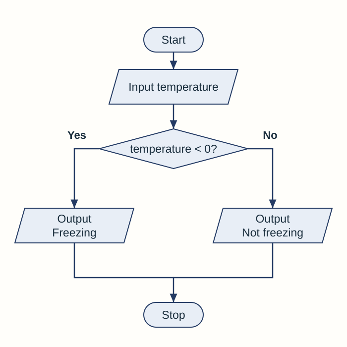
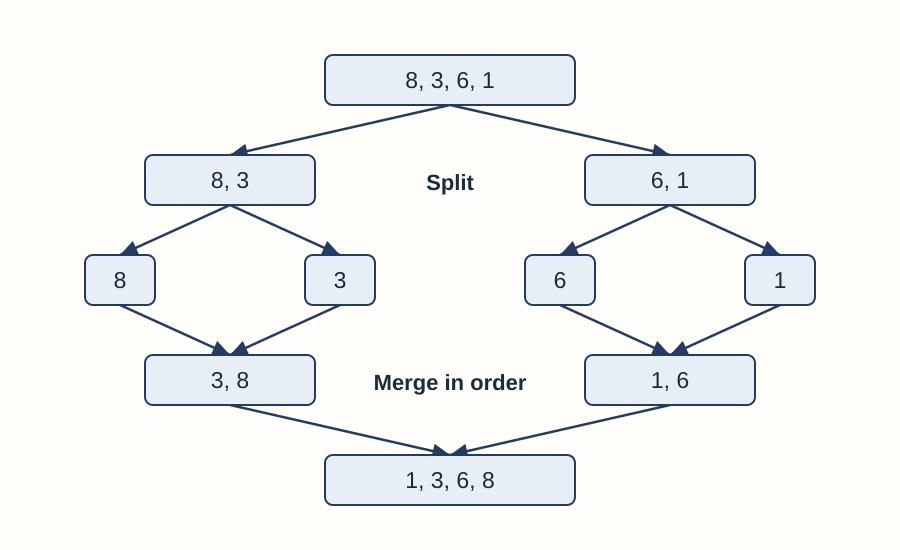

# Fundamentals of algorithms

## Algorithms and problem solving

An **algorithm** is a **sequence of steps that can be followed to complete a task**. Think of it as a precise recipe: the ingredients are the inputs, the method is the processing, and the finished dish is the output.

- A **program** is an implementation of an algorithm in a programming language.
- The same algorithm can be implemented in Python, another language or hardware.
- A good algorithm is unambiguous, finishes after a finite number of steps and produces the required output for valid inputs.

### Decomposition and abstraction

| Approach | What it does | School-booking example |
|---|---|---|
| **Decomposition** | Breaks a large problem into smaller sub-problems with identifiable jobs. | Separate login, room search and booking. |
| **Abstraction** | Removes detail that is not needed for the current problem. | Keep room availability; ignore the wall colour. |


Decomposition decides **which smaller problems to solve**. Abstraction decides **which details matter** when solving them.

### Why breaking a problem down helps

Each smaller task can be designed, tested and corrected separately. If room searching works but booking fails, the developer can investigate the booking part instead of treating the whole system as one unexplained problem. A team can also work on different tasks, provided the parts exchange the information they need.

Abstraction must keep the details that affect the answer. A route planner needs roads and connections, but usually does not need the colour of nearby buildings. Removing a road connection would change the possible routes, so that would remove an essential detail.

### Turning a problem into a solution

1. Identify the required **inputs**, expected **outputs** and any rules the solution must follow.
2. Break the problem into smaller tasks. Decide which information each task needs.
3. Plan the calculations, decisions and repetitions in a clear order.
4. Represent the solution using the requested form: pseudocode, program code or a flowchart.
5. Follow the steps with suitable test data. Compare the result with what should happen.
6. Correct a fault and test again. A solution must work for more than the first convenient example.

## Representing algorithms

You may be asked for **pseudocode**, **program code** or a **flowchart**. Follow the form named in the question.

### Pseudocode

Pseudocode expresses the logic without depending on one real programming language.

```text
OUTPUT "Enter a temperature"
temperature ← USERINPUT
IF temperature < 0 THEN
    OUTPUT "Freezing"
ELSE
    OUTPUT "Not freezing"
ENDIF
```

### Python

```python
temperature = float(input("Enter a temperature: "))
if temperature < 0:
    print("Freezing")
else:
    print("Not freezing")
```

### Flowcharts

| Shape | Meaning |
|---|---|
| Oval | Start or stop |
| Rectangle | Process or calculation |
| Parallelogram | Input or output |
| Diamond | Decision with labelled branches |
| Arrow | Direction of control flow |

Keep each decision as a question with clear outcomes such as **Yes/No**.

### Showing the same decision as a flowchart



The diamond asks a **condition**. Only one branch runs for a particular input, and both routes reach the end. At exactly 0, `temperature < 0` is false, so this algorithm outputs `Not freezing`.

Arrows must show a complete route through the chart. A repeating route must eventually have a way to leave when the stopping condition is met.

## Inputs, processing, outputs and trace tables

- **Input:** data supplied to an algorithm.
- **Processing:** calculations, comparisons or changes made to the data.
- **Output:** information produced by the algorithm.

A **trace table** records variable values as an algorithm runs. Work one instruction at a time and create a new row whenever a tracked value changes.

```text
total ← 0
FOR number ← 1 TO 3
    total ← total + number
ENDFOR
OUTPUT total
```

| number | total after addition |
|---:|---:|
| 1 | 1 |
| 2 | 3 |
| 3 | 6 |

The output is **6**. Do not guess the purpose from variable names; prove it from the instructions and trace.

### Following values accurately

The initial assignment sets `total` to **0** before the loop. After each addition, the new total replaces the previous value. At the end, `number` has taken the values 1, 2 and 3, and the output is the final total rather than every intermediate total.

When tracing a decision, evaluate its condition using the **current values**. Follow only the selected branch. When tracing a loop, return to the condition at the correct point instead of assuming the loop repeats a fixed number of times.

To explain a program's purpose, describe what it does with its data. For example, “adds the numbers 1 to 3 and displays their total” is more useful than “uses a FOR loop”.

### Separate stored values from displayed output

This algorithm keeps a running total, but displays it only when the current number is even:

```text
total ← 0
FOR number ← 1 TO 4
    total ← total + number
    IF number MOD 2 = 0 THEN
        OUTPUT total
    ENDIF
ENDFOR
```

| number | total after addition | Is the number even? | Output at this step |
|---|---|---|---|
| 1 | 1 | No. | No output. |
| 2 | 3 | Yes. | 3 |
| 3 | 6 | No. | No output. |
| 4 | 10 | Yes. | 10 |

The displayed values are **3, then 10**. The intermediate totals 1 and 6 are stored, but never displayed. A blank output cell means nothing was output; it does not mean the program printed a blank line.

The position of an instruction matters. Moving `OUTPUT total` outside the loop would display only the final total. Moving `total ← 0` inside the loop would reset the accumulated total on every repetition.

## Comparing efficiency

More than one algorithm may solve the same problem. For this course, compare **time efficiency**: how the number of steps or time taken changes for the same input.

- Compare algorithms using the **same task and data**.
- An algorithm that performs fewer operations will usually finish faster.
- Formal Big O notation is not required.
- A method may be fast for one kind of data but unsuitable for another.

### Why the data matters

A linear search finds an item at the beginning after one check. The same search may check every item when the target is absent. A claim about speed therefore needs a stated situation.

For a large sorted list, binary search usually saves many checks because each unsuccessful comparison removes about half of the remaining candidates. A list of about 1,000 values can be narrowed to one candidate in roughly ten such stages. Linear search may need about 1,000 checks.

Sorting a list first also takes time. If there is just one search in a small unsorted list, linear search may be a more sensible choice than sorting the list only to perform binary search.

## Linear search

A **linear search** checks items in order until the target is found or every item has been checked.

```text
found ← False
index ← 0
WHILE index < LENGTH(items) AND found = False
    IF items[index] = target THEN
        found ← True
    ELSE
        index ← index + 1
    ENDIF
ENDWHILE
```

- Works on **sorted or unsorted** data.
- Simple and suitable for small lists.
- In the worst case, it checks every item.

### A successful and an unsuccessful search

This example uses **zero-based indexing**, so the first position is 0. Search the list `11, 5, 14, 2, 9` for 14:

| Check | Index and value | What happens? |
|---|---|---|
| 1 | Index 0 holds 11. | It does not match, so continue. |
| 2 | Index 1 holds 5. | It does not match, so continue. |
| 3 | Index 2 holds 14. | The target is found, so stop. |

The target is at **index 2**, after **three checks**. Position and number of checks are different quantities.

If the target were 7, all five values would be checked and none would match. The algorithm must then report **not found**. A program might return `-1` or display a message; follow the behaviour specified in the question.

In the pseudocode above, `found` records whether a match has occurred. Increasing `index` moves to the next candidate. The length check prevents the algorithm from trying to read beyond the final item.

## Binary search

A **binary search** repeatedly checks the middle item and discards half of the remaining search area.

1. Check the middle item.
2. If it is the target, stop.
3. If the target is smaller, continue in the lower half.
4. If the target is larger, continue in the upper half.
5. Repeat until found or no items remain.

The data **must be sorted**. Binary search is usually much faster than linear search for a large sorted list because the search area halves each step.

### Tracking the search boundaries

Use the sorted list `2, 5, 9, 12, 16, 20, 24, 27`, indexed from 0 to 7. The lower middle index is calculated with **`(low + high) DIV 2`**.

| Stage | Current bounds | Middle value and decision |
|---|---|---|
| 1 | `low = 0`, `high = 7` | Index 3 holds 12. Since 24 is larger, set `low = 4`. |
| 2 | `low = 4`, `high = 7` | Index 5 holds 20. Since 24 is larger, set `low = 6`. |
| 3 | `low = 6`, `high = 7` | Index 6 holds 24. The target is found. |

The item is at **index 6**, but only **three middle values** were checked. Keep the original indices when narrowing the search; do not renumber the remaining items.

After an unsuccessful comparison, exclude the middle item as well as the impossible half:

- If the target is smaller, set **`high = middle − 1`**.
- If the target is larger, set **`low = middle + 1`**.

For target 23, the same first two checks leave indices 6 to 7. The value 24 is too large, so `high` becomes 5 while `low` is 6. Now **`low > high`**, which means no candidates remain and the target is absent.

### Python implementation

```python
def binary_search(items, target):
    low = 0
    high = len(items) - 1
    while low <= high:
        middle = (low + high) // 2
        if items[middle] == target:
            return middle
        elif target < items[middle]:
            high = middle - 1
        else:
            low = middle + 1
    return -1
```

The final `return -1` runs only when the loop ends without a match. The input list must already be sorted in ascending order for this version.

### Keeping the final candidate

If `low` and `high` are equal, **one candidate still remains**. Check that item before reporting failure. For the one-item list `[12]`, both boundaries begin at 0: target 12 must be found, while target 9 must be rejected after checking it.

Setting a boundary to `middle + 1` or `middle − 1` excludes an item already proved wrong. Leaving the boundary at `middle` can repeat the same unsuccessful check. For an empty list, `high` begins at −1, so the loop makes no array access and returns −1.

## Comparing searching methods

| Feature | Linear search | Binary search |
|---|---|---|
| Starting data | Works on sorted or unsorted data. | **Requires sorted data.** |
| Repeated action | Checks the next item in order. | Checks the middle item and discards the half that cannot contain the target. |
| Stopping point | Target found, or every item checked. | Target found, or no items remain in the search area. |
| Time efficiency | Can check every item; often suitable for a small or unsorted list. | Usually fewer checks for a large sorted list because the search area halves. |

## Bubble sort

A **bubble sort** repeatedly compares neighbouring items and swaps them when they are in the wrong order.

Example: `5, 2, 4`

- Compare 5 and 2 → swap: `2, 5, 4`
- Compare 5 and 4 → swap: `2, 4, 5`
- A pass with no swaps proves the list is sorted.

It is simple but can require many comparisons and swaps, especially for a large or reverse-ordered list.

### Passes and the sorted end of the list

In an ascending bubble sort, a full left-to-right pass moves the largest remaining value to the right-hand end. Later passes can leave that sorted end alone.

For the example `5, 2, 4`:

| Pass | End-of-pass list | Comparisons and swaps |
|---|---|---|
| 1 | `2, 4, 5` | Two comparisons cause two swaps. The largest value, 5, is now in place. |
| 2 | `2, 4, 5` | The remaining pair, 2 and 4, needs no swap. An early-stop version can finish. |

An efficient version resets a **swapped flag** before each pass. It sets the flag when a swap happens. A complete pass with no swaps shows that every compared pair is already in order.

To swap two stored values, preserve one before overwriting it. For example, save the left value in a temporary variable, copy the right value to the left, then copy the saved value to the right. Simply copying left to right and then right to left would lose one original value.

## Merge sort

A **merge sort** uses decomposition:

1. Repeatedly split the list into smaller lists until each contains one item.
2. Merge neighbouring lists while placing items into order.
3. Continue merging until one sorted list remains.

Merge sort is generally more time-efficient than bubble sort for large lists, but it needs extra memory to hold temporary lists.

### Splitting is followed by ordered merging



Splitting does not itself sort the values. A one-item list is already sorted, and the **merge** step builds larger sorted lists from these smaller ones.

To merge `3, 8` with `1, 6`, compare the first unused value in each list:

1. Compare 3 with 1. Take **1** because it is smaller.
2. Compare 3 with 6. Take **3**.
3. Compare 8 with 6. Take **6**.
4. The right list is empty, so append the remaining **8**.

The result is `1, 3, 6, 8`. Each selected value is removed from consideration, so it is not copied twice. If one list becomes empty, its partner's remaining values are already in order and can be appended.

### An odd number of items

The two parts do not have to contain exactly the same number of items. A list such as `7, 2, 5` can split into `7` and `2, 5`. Split the pair into single values, merge it as `2, 5`, then merge that with `7` to obtain **`2, 5, 7`**.

The essential rule is that the two lists being merged are **already sorted**. Their first unused items are therefore the next candidates for the smallest remaining value.

## Comparing sorting methods

| Feature | Bubble sort | Merge sort |
|---|---|---|
| Main method | Compares neighbouring items and swaps those in the wrong order. | Splits into smaller lists, then merges them in order. |
| Progress | After a full pass, another item is in its final position. A pass with no swaps shows completion. | One-item lists are merged into larger sorted lists until one remains. |
| Large lists | Can require many comparisons and swaps, especially for reverse-ordered data. | Generally more time-efficient for large lists. |
| Trade-off | Simple to understand and implement. | Needs extra memory for temporary lists. |


Compare the **same task and data**. Explain the checks, comparisons or swaps needed rather than saying only that one method is faster.

When explaining an algorithm, state the **starting condition**, the **repeated action**, how the search area or list changes, and the **stopping condition**.

## Sources

- AQA GCSE Computer Science 8525 specification, section 3.1.

- [PMT Education: original Summary Notes](../Reference Materials/PMT - Summary Notes.pdf). Unmodified source retained with its printed attribution and licence.
- [AQA specification for first exams in 2027](../../00 - Specification/AQA-8525-specification-2027.pdf).
- [Study Rocket: Fundamentals Of Algorithms](https://studyrocket.co.uk/revision/gcse-computer-science-aqa/computational-thinking-and-problem-solving/fundamentals-of-algorithms). Coverage reference; checked against the current AQA specification.
- [Study Rocket: Searching Algorithms](https://studyrocket.co.uk/revision/gcse-computer-science-aqa/computational-thinking-and-problem-solving/searching-algorithms). Coverage reference; checked against the current AQA specification.
- [Study Rocket: Sorting Algorithms](https://studyrocket.co.uk/revision/gcse-computer-science-aqa/computational-thinking-and-problem-solving/sorting-algorithms). Coverage reference; checked against the current AQA specification.
