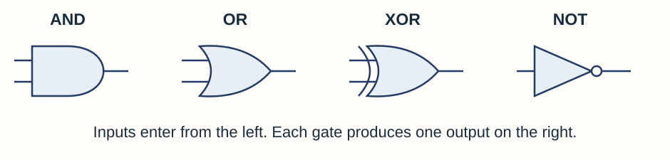
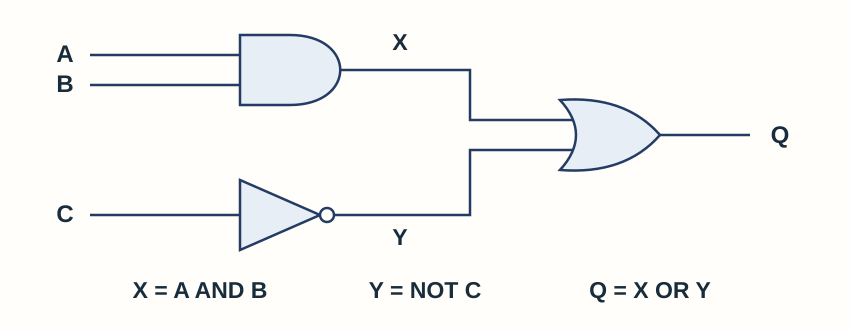

# Computer systems

## Hardware and software

- **Hardware** is the physical equipment in a computer system.
- **Software** is the programs and data that tell hardware what to do.
- Hardware needs software instructions; software needs hardware on which to run.

A keyboard is hardware because it is a physical device. A word processor is software because it contains instructions that run on the hardware. A powerful computer still needs the right program to carry out a task.

Software controls how the components work together. For example, a drawing program processes a mouse click, changes the picture data and asks the system to display the updated image.

## Boolean logic and circuits

Boolean logic uses values that are either 0/1 or False/True.

| A | B | AND | OR | XOR |
|---:|---:|---:|---:|---:|
| 0 | 0 | 0 | 0 | 0 |
| 0 | 1 | 0 | 1 | 1 |
| 1 | 0 | 0 | 1 | 1 |
| 1 | 1 | 1 | 1 | 0 |

`NOT` reverses one input. `XOR` is true when the two inputs are **different**.

For a circuit with several gates, calculate intermediate outputs one gate at a time. AQA notation may use `.` for AND, `+` for OR, `⊕` for XOR and an overbar for NOT.

### Recognising and drawing gates

The small circle on NOT means that the input is inverted. XOR resembles OR but has an extra curved line on its input side. For two true inputs, OR gives **1** while XOR gives **0**.

For a Boolean expression, brackets show which operation must be performed together. In **`A AND (B OR NOT C)`**, find `NOT C`, combine that with B using OR, and then combine the result with A using AND. Without brackets, NOT is applied before AND, and AND before OR.

In symbolic expressions, a dot means AND and a plus sign means OR; the plus is not ordinary addition. An overbar applies NOT to the part beneath the bar. Read the extent of that bar carefully.

### Working through a combined circuit

The circuit represents **`Q = (A AND B) OR (NOT C)`**. Its intermediate columns make every step visible:

| A | B | C | X = A AND B | Y = NOT C | Q = X OR Y |
|---|---|---|---|---|---|
| 0 | 0 | 0 | 0 | 1 | 1 |
| 0 | 0 | 1 | 0 | 0 | 0 |
| 0 | 1 | 0 | 0 | 1 | 1 |
| 0 | 1 | 1 | 0 | 0 | 0 |
| 1 | 0 | 0 | 0 | 1 | 1 |
| 1 | 0 | 1 | 0 | 0 | 0 |
| 1 | 1 | 0 | 1 | 1 | 1 |
| 1 | 1 | 1 | 1 | 0 | 1 |

With three independent inputs there are **2³ = 8 combinations**. List every combination once, then work across one row at a time. Q is true whenever C is false, or when both A and B are true.

To draw a circuit from an expression, create the inner operations first and connect their outputs to the outer operation. To write an expression from a circuit, label intermediate outputs and substitute them into the final gate. Changing OR to XOR changes the result for the row where both intermediate inputs are 1.

## System and application software

| Software | Main purpose | Examples |
|---|---|---|
| **System software** | Manages computer resources and provides a platform for applications. | Operating system, device drivers and utility programs. |
| **Application software** | Performs tasks for the end user. | Word processor or image editor. |

An **operating system** manages:

- processors and scheduling
- memory allocation
- input/output devices and drivers
- applications and files
- users, permissions and security

**Utility software** maintains, protects or configures a system. Examples include backup tools, anti-malware software, compression tools and disk-management utilities.

### What the operating system actually does

| Responsibility | Explanation |
|---|---|
| Processor management | It allocates processor time to running tasks, allowing several applications to make progress. |
| Memory management | It allocates memory to programs and tracks which areas are in use, helping keep their working data separate. |
| Input/output management | It coordinates communication with devices, using drivers to handle device-specific instructions. |
| Application management | It provides services that let applications start, run and use hardware without controlling every component themselves. |
| Security management | It manages accounts and permissions so users and programs can access only authorised resources. |

Think of the operating system as a school office coordinating shared rooms and equipment. Applications can request resources instead of each having to organise the entire school.

A utility has a more focused maintenance job. A backup utility copies data so it can be recovered after a failure; anti-malware software detects and deals with malicious files; compression software reduces storage or transfer requirements. These are system-support tasks rather than the end-user task of writing an essay.

## High-level and low-level languages

A high-level language expresses a problem in human-readable statements. Low-level languages work much closer to a processor’s instructions.

- **Machine code** is binary that a particular processor instruction set executes directly.
- **Assembly language** uses mnemonics, with roughly one assembly instruction for one machine-code instruction.

| Feature | High-level language | Low-level language |
|---|---|---|
| Readability | Human-readable statements and abstractions. | Machine code uses binary; assembly uses mnemonics close to machine instructions. |
| Development | Usually quicker to write, test and maintain. | Usually harder to create and maintain. |
| Portability | Usually portable between processor types after suitable translation. | Processor-specific instructions limit portability. |
| Hardware control | Less direct control over hardware. | Close control can be useful in embedded systems. |
| Efficiency | Convenient abstractions may add overhead. | Can be carefully tailored for efficient hardware use, but this is not automatic. |

A high-level statement can express a calculation or repetition that would need several machine instructions. This makes most programs quicker to develop and easier to maintain.

**Portability** means the source can be used on another suitable system with the necessary translator and support. It does not mean the same compiled machine-code file works on every processor.

Assembly mnemonics are short names for processor instructions, so they are easier to read than binary but remain tied to an instruction set. This control can be useful when programming dedicated hardware. Low-level code is not automatically faster: the programmer's design and the quality of translation also matter.

## Translators

Code written in a high-level or assembly language must be translated before the processor can execute it.

### Interpreter and compiler

| Feature | Interpreter | Compiler |
|---|---|---|
| **How it works** | Processes high-level statements as the program runs. | Translates the whole high-level program before the compiled program runs. |
| **Machine-code output** | Does **not directly generate a machine-code program**. It calls suitable machine-code routines to carry out statements. | Produces **machine code**, such as object code or an executable program. |
| **Error handling** | Can stop at the first error encountered while executing a path, making that problem easier to investigate. | Reports translation errors during compilation. Correct them, then compile again. |
| **Running again** | Needs the interpreter to carry out the statements each time the program runs. | Successfully compiled code can be reused without translating the source again. Users do not need the compiler to run it. |
| **Speed** | Processing statements during execution usually makes it slower than equivalent compiled code. | Compilation takes time first, but the resulting machine-code program usually runs faster. |
| **Suitable use** | Development, quick testing and interactive execution. | Distributing a finished program and running it repeatedly. |

Both need **testing for logic errors**. Successful translation or execution does not prove that the results are correct.

### Assembler

An **assembler** translates assembly language into machine code, normally one assembly instruction to one machine-code instruction. It is used for low-level code, including embedded systems and direct hardware control.

### Choosing and using a translator

During development, an interpreter can help a programmer try changes and investigate the path currently being executed. An error on a path that has not run may remain undiscovered, so more test cases are still needed.

A compiler produces machine code before that compiled program runs. After changing the source, compile it again to create an updated version. The user does not need the original source or compiler to run the resulting program, although the program may still depend on libraries or other runtime support.

A translator can detect language-rule errors, but it cannot generally decide whether the program solves the intended problem. A correctly translated calculation of `width + height` still gives the wrong rectangle area.

## CPU components

The **central processing unit (CPU)** executes program instructions.

- **Arithmetic logic unit (ALU):** calculations and logical comparisons.
- **Control unit (CU):** coordinates the fetch-decode-execute cycle and sends control signals.
- **Clock:** produces timing signals that synchronise operations.
- **Registers:** tiny, very fast storage locations inside the CPU.
- **Buses:** collections of wires carrying data or signals between components.
- **Main memory:** stores active instructions and data for direct CPU access.

The **ALU** performs operations such as adding two values or comparing a score with a limit. **Registers** hold the small immediate values and instructions the CPU is working on. The **control unit** sends signals so the appropriate parts act in the right order.

A **bus** carries information between components; it does not store the program by itself. The clock provides regular timing pulses. These parts cooperate: carrying a value, storing it temporarily and performing an operation are different jobs.

## Fetch-decode-execute cycle

Think of the CPU as repeatedly collecting and following instruction cards:

1. **Fetch:** get the next instruction from main memory into the CPU.
2. **Decode:** the control unit works out what the instruction means.
3. **Execute:** carry out the instruction, possibly reading or writing data.
4. Repeat continuously.

The clock keeps operations in step, while buses carry instructions, data and control signals.

Suppose the next instruction adds two stored values. The CPU fetches that instruction from memory, decodes it as an addition, obtains the required data and uses the ALU to add it. The result can then be stored for another instruction to use.

A program is a sequence of such instructions, not one operation performed by the CPU all at once. Some instructions change which instruction comes next, allowing selection and loops. Instructions and the data they use are held in memory, while registers hold immediate working information.

## CPU performance

| CPU change | Why it can improve performance | What limits the benefit? |
|---|---|---|
| Higher **clock speed** | More clock cycles each second. | Heat, architecture and other bottlenecks. |
| More **cores** | More instructions or tasks can be processed at the same time. | Software must be able to use the additional cores. |
| Larger **cache** | More frequently used data and instructions can be kept close to the CPU. | The benefit depends on how much slower main-memory access is avoided. |

Do not claim that doubling one feature always doubles performance. Workload, software, architecture and other bottlenecks matter.

Clock speed is measured in **hertz**, or cycles per second. A speed of 3 GHz means about **3 billion clock cycles per second**. It does not mean every instruction always takes exactly one cycle.

More cores can improve performance when work can be divided between them, such as independent tasks. A program with a largely sequential task may gain little from unused cores.

Cache holds frequently needed instructions and data so the CPU can obtain them faster than from RAM. A larger cache can reduce waiting if it holds more of the data the program actually needs; it does not increase the capacity of long-term file storage.

## Memory types

| Type | Volatile? | Purpose |
|---|---|---|
| Register | Yes | Immediate values and instructions inside the CPU |
| Cache | Yes | Frequently used data/instructions close to the CPU |
| RAM | Yes | Active programs and data in main memory |
| ROM | No | Instructions or data that must persist, such as startup firmware |

**Volatile** memory loses its contents without power. **Non-volatile** memory keeps them.

Main memory is directly accessible by the CPU, apart from cache and registers which are treated separately here. Secondary storage is non-volatile and not directly accessed by the CPU.

### Following a program from storage to processing

A saved program remains on secondary storage when power is off. When run, its instructions and working data are loaded into **RAM**. The processor can keep frequently used information in **cache**, and immediate operands or results in **registers**.

If a document has changed only in RAM, switching off without saving can lose those changes. Saving copies the updated file to non-volatile secondary storage.

ROM retains startup instructions when power is off and is not normally changed during ordinary use. RAM is designed for the changing instructions and data of active programs. Both have roles; non-volatile does not mean ROM is a substitute for all working memory.

## Secondary and cloud storage

Secondary storage keeps programs and data for the long term. Both magnetic and solid-state storage are **non-volatile**.

### Magnetic and solid-state storage

| Feature | Magnetic storage | Solid-state storage |
|---|---|---|
| How data is stored | Magnetises areas of a surface. | Uses electronic circuits. |
| Moving parts | Usually has moving parts. | No moving parts; quiet in operation. |
| Performance | Often slower to access data. | Usually faster and energy-efficient. |
| Physical durability | Moving parts can make it more vulnerable to shock. | Often more durable when a device is moved or knocked. |
| Cost and limits | Often high capacity at low cost per gigabyte. | Often costs more per gigabyte and has limited write endurance. |

### Local and cloud storage

Cloud storage uses **remote servers**, which contain magnetic and/or solid-state devices. Cloud is a location and service arrangement, rather than a third physical storage technology.

| Feature | Local storage | Cloud storage |
|---|---|---|
| Location | On a device or storage system at the user’s site. | On remote servers managed through a provider. |
| Access | Local files can be used without an internet connection. | Usually depends on a network/internet connection and the provider’s service. |
| Sharing | Users must arrange access or transfer copies. | Supports access from different locations, sharing and collaboration. |
| Capacity and cost | Capacity is limited by owned equipment; expansion may need new hardware. | Capacity can scale, but subscriptions or other ongoing costs may apply. |
| Backup and control | Users organise backups and protect their equipment. | Off-site copies can help recovery, but backup arrangements and permissions still matter. |
| Limitations | Loss, damage or theft at the site can affect local copies. | Outages, privacy/security concerns and slow transfers of large files can affect use. |

### How the physical methods work

A magnetic hard disk stores data using magnetised areas of rotating platters. A read/write head moves to the required track, and the rotation brings the required area beneath it. This mechanical movement contributes to access time and makes knocks a concern.

Solid-state storage uses electronic circuits to retain data without power. There is no spinning platter or moving head, so access is typically faster and a portable device is less vulnerable to mechanical damage. Solid-state devices can still fail, so important files still need backups.

### Choosing storage for a situation

For a laptop carried between lessons, low power use, fast access and resistance to movement may justify an SSD's higher cost per gigabyte. For a large archive, capacity and cost may favour magnetic storage. State which requirement matters instead of calling one method best for every task.

Cloud access can make the same files available on several devices and make sharing easier. Uploading or downloading large files still depends on connection speed. The provider stores the files on real hardware, and account security, permissions, outages and ongoing costs remain relevant.

Synchronisation is not automatically a complete backup: deleting a file may also delete its synchronised copies. Recovery depends on the service's version history, backup and retention arrangements.

## Embedded systems

An **embedded system** is a computer built into a larger device to perform a dedicated or limited set of functions.

| Feature | Embedded system | General-purpose computer |
|---|---|---|
| Purpose | Built into a larger device for a dedicated or limited set of functions. | Designed to run many user-selected applications. |
| Resources | Memory, power and processing are chosen around its specific job and may be limited. | Resources support a wider range of tasks. |
| Examples | Washing-machine controller, car engine-control unit or smart thermostat. | Laptop used for writing, programming and browsing. |

In a washing machine, an embedded controller can use sensor readings to control water temperature, the motor and cycle timing. Its resources and software are chosen around that dedicated job.

A general-purpose laptop can instead run unrelated user-selected applications. An embedded system may still contain a processor, memory, software and even a display or network connection. Being embedded describes its **dedicated role within a larger device**, not a rule that it must have no interface or cannot be updated.

## Sources

- AQA GCSE Computer Science 8525 specification, section 3.4.

- [PMT Education: original Summary Notes](../Reference Materials/PMT - Summary Notes.pdf). Unmodified source retained with its printed attribution and licence.
- [AQA specification for first exams in 2027](../../00 - Specification/AQA-8525-specification-2027.pdf).
