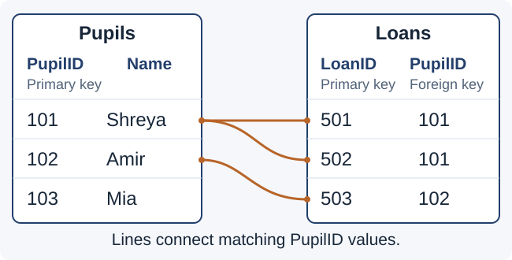

# Relational databases and SQL

## Tables, records and fields

A **database** is an organised collection of data that can be stored, searched and updated. A **relational database** stores data in tables that can be linked through shared key values.

Think of a school library. One list describes pupils; another records their loans. A pupil's ID connects the person to the books they borrowed, without copying their full details onto every loan.

| Term | Plain meaning | Library example |
|---|---|---|
| **Table** | A collection of records about one kind of item | Pupils |
| **Record** | One row describing one item | The row for pupil 101 |
| **Field** | One named piece of information; a column | Name |
| **Data type** | The kind of value a field stores | Integer for YearGroup; text for Name |

Each record has values for the table's fields. A table with three pupils has **three records**, regardless of how many fields describe each pupil.

Choose data types that suit the information. A number used for counting may be an integer; a phone number is often text because leading zeroes matter and arithmetic is not needed.

## Primary and foreign keys

| Feature | Primary key | Foreign key |
|---|---|---|
| Purpose | **Uniquely identifies** a record within its own table. | **Links** a record to a primary-key value in another table. |
| Repeated values | Must not be repeated or missing in that table. | May repeat because several records can link to the same record elsewhere. |
| Library example | `Pupils.PupilID` identifies each pupil. | `Loans.PupilID` identifies which pupil made each loan. |


`LoanID` is also a primary key: it distinguishes separate loans, even if the same pupil borrows the same title again. A person’s name is usually a poor primary key because names can repeat or change.



**Primary key:** identifies the row in this table. **Foreign key:** connects a row to another table. A field called `PupilID` can therefore be a primary key in Pupils and a foreign key in Loans.

## Reducing redundancy and inconsistency

**Data redundancy** means unnecessary duplication. **Data inconsistency** means different stored copies disagree.

Suppose every loan record stores the pupil's name and year group. When their year group changes, several rows need updating. Missing one leaves conflicting information.

With separate linked tables:

1. Store the pupil's name and year group **once in Pupils**.
2. Store their `PupilID` on each relevant loan.
3. Update the pupil's details in one record.
4. Retrieve those details when a query connects the tables.

This reduces repeated descriptive data and the risk of conflicting copies. Repeated **foreign-key values are intentional**: they provide the links. They are different from unnecessarily duplicating all of the pupil's details.

Good design supports consistency, but records must still be entered and updated correctly.

## Our example database

### Pupils

| PupilID | Name | YearGroup |
|---|---|---|
| 101 | Shreya | 10 |
| 102 | Amir | 11 |
| 103 | Mia | 10 |

`PupilID` is the primary key. The ID and year-group fields hold integers; Name holds text.

### Loans

| LoanID | PupilID | BookTitle | DaysLoaned |
|---|---|---|---|
| 501 | 101 | Macbeth | 14 |
| 502 | 101 | Geography | 21 |
| 503 | 102 | Atlas | 7 |

`LoanID` is the primary key. `PupilID` is a foreign key referencing Pupils. The query examples each start from these original tables.

## SELECT and FROM

**SQL** stands for **Structured Query Language**. It lets you retrieve and change database data.

| Clause | What it controls | Example |
|---|---|---|
| **SELECT** | Which fields/columns appear in the results. | `SELECT Name, YearGroup` |
| **FROM** | Which table or tables supply the data. | `FROM Pupils` |
| **WHERE** | Which records/rows meet the condition. | `WHERE YearGroup = 10` |
| **ORDER BY** | The order of the retrieved results. | `ORDER BY Name ASC` |


`SELECT *` means all fields. These clauses retrieve data; they do not change the stored records.

```sql
SELECT Name, YearGroup
FROM Pupils;
```

This retrieves each pupil's name and year group. It does not display PupilID because that field was not selected.

```sql
SELECT *
FROM Pupils;
```

This retrieves all three fields. Neither query changes the stored records.

**Keep the distinction clear:** SELECT chooses columns; a WHERE condition chooses which rows qualify.

## WHERE and combined conditions

**WHERE** filters records using a condition.

```sql
SELECT Name
FROM Pupils
WHERE YearGroup = 10;
```

**Result:** Shreya and Mia. Amir is excluded because his year group is 11.

### Comparisons and text values

- `=` means equal; `<>` means not equal.
- `<`, `>`, `<=` and `>=` compare values.
- Put text values in single quotes, such as `'Macbeth'`.
- Write numeric values without quotes, such as `10`.
- Use the table and field names from the question exactly.

SQL equality uses **`=`**, not Python's `==` or pseudocode's assignment arrow.

### AND and OR

```sql
SELECT Name
FROM Pupils
WHERE YearGroup >= 10 AND YearGroup <= 11;
```

**AND** requires both conditions to be true. All three pupils qualify because their year groups are within the inclusive range.

```sql
SELECT BookTitle
FROM Loans
WHERE DaysLoaned < 10 OR DaysLoaned > 20;
```

**OR** requires at least one condition to be true. Atlas qualifies through 7 days; Geography qualifies through 21 days. Macbeth, at 14 days, meets neither condition.

| Operator | When does a record qualify? | If only one condition is true |
|---|---|---|
| **AND** | Both conditions must be true. | The record is excluded. |
| **OR** | At least one condition must be true. | The record qualifies. |


Use brackets when combining AND and OR to make the intended grouping clear. Without ORDER BY, do not assume a particular result order.

## ORDER BY

**ORDER BY** sorts the retrieved results.

- **ASC:** ascending, such as A to Z or smallest to largest.
- **DESC:** descending, such as Z to A or largest to smallest.

```sql
SELECT Name
FROM Pupils
ORDER BY Name ASC;
```

**Result order:** Amir, Mia, Shreya.

```sql
SELECT BookTitle, DaysLoaned
FROM Loans
ORDER BY DaysLoaned DESC;
```

**Result order:** Geography — 21; Macbeth — 14; Atlas — 7.

Sorting changes the order of the query's results. It does not rewrite the original table's data. Put ORDER BY after WHERE when both are used.

## Retrieving from two tables

To display pupils' names beside their book titles, retrieve fields from both tables and match the relevant key values.

```sql
SELECT Pupils.Name, Loans.BookTitle
FROM Pupils, Loans
WHERE Pupils.PupilID = Loans.PupilID
    AND Pupils.YearGroup = 10
ORDER BY Loans.BookTitle ASC;
```

Follow the query in three steps:

1. **Match the pupil IDs.** Loans 501 and 502 belong to pupil 101; loan 503 belongs to pupil 102.
2. **Keep year group 10.** Shreya's two loans remain. Amir is excluded; Mia has no matching loan.
3. **Display and sort.** Show the pupil's name and each matching title, sorted by title.

| Name | BookTitle |
|---|---|
| Shreya | Geography |
| Shreya | Macbeth |

The dot in `Pupils.Name` identifies **the table and its field**. This is especially useful when both tables contain a field named PupilID.

**Include the linking condition.** Otherwise a query using two tables may combine unrelated rows, pairing a pupil with somebody else's loan.

## INSERT INTO and VALUES

**INSERT INTO** adds a new record. The field list and value list must correspond in the same order.

```sql
INSERT INTO Pupils (PupilID, Name, YearGroup)
VALUES (104, 'Lena', 11);
```

- A new pupil record is added; existing pupils remain.
- `104` is an unused primary-key value.
- `'Lena'` is text; `11` is an integer.
- There are three named fields and three matching values.

INSERT adds a record; it does not edit an existing record simply because the name is similar.

## UPDATE and SET

**UPDATE** changes existing records. **SET** specifies their new field values. **WHERE** restricts which records are changed.

```sql
UPDATE Pupils
SET YearGroup = 11
WHERE PupilID = 101;
```

Only Shreya's year group changes, from 10 to 11. Her name and primary key remain unchanged. The other pupils are unaffected.

Using a primary key in the condition is useful when exactly one record should change.

**Without WHERE, the change applies to every record in the table.**

## DELETE FROM

**DELETE FROM** removes records that match a condition.

```sql
DELETE FROM Loans
WHERE LoanID = 502;
```

The Geography loan is removed. Shreya's pupil record and her Macbeth loan remain because those records are in different rows or tables.

- DELETE removes whole qualifying rows, rather than just clearing one field.
- **Without WHERE, all records in the named table are deleted.**
- The table itself still exists; removing its records is different from removing the table structure.

## Planning and checking a query

Before writing, identify the operation:

| Need | Command | Effect on stored records |
|---|---|---|
| Retrieve information | **SELECT** | No stored records change; results are returned. |
| Add a record | **INSERT INTO … VALUES** | Creates a new record with the supplied values. |
| Change values | **UPDATE … SET** | Edits fields in matching existing records. Without WHERE, all records are affected. |
| Remove records | **DELETE FROM** | Removes whole matching rows. Without WHERE, all rows are removed; the table remains. |


Then check:

1. **Fields:** which columns must be displayed or changed?
2. **Tables:** where is the information stored?
3. **Conditions:** which rows should qualify? For two tables, what key values must match?
4. **Order:** is a particular sort required?
5. **Accuracy:** are names, operators, quotes and values correct?

Trace the query against a few records. A correct-looking query can still answer the wrong question if its filter or linking condition is wrong.
