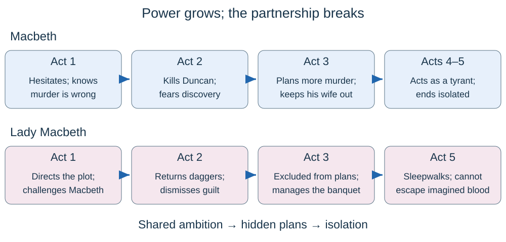

# Macbeth

## The story in five acts

Macbeth is a successful soldier who murders his king to gain the crown. Once he has power, he becomes afraid of losing it and commits more violence. **His attempt to control the future destroys his security, relationships and life.**

Imagine cheating to win a competition, then having to tell a new lie every time someone gets close to the truth. Macbeth's first crime starts a chain of concealment and fear. The consequences grow far beyond him, damaging Scotland itself.

| Act | Main events | Why it matters |
|---|---|---|
| **1: temptation and choice** | Witches predict Macbeth's rise; he becomes Thane of Cawdor. Duncan names Malcolm his heir. Lady Macbeth urges Macbeth to kill Duncan. | The prophecy tempts Macbeth, but he recognises the moral objections and chooses murder. |
| **2: murder and disorder** | Macbeth kills Duncan offstage. Lady Macbeth returns the daggers. Macduff discovers the body. Malcolm and Donalbain flee; Macbeth becomes king. | The crown is gained through betrayal. Blood, sleeplessness and unnatural events reveal the cost. |
| **3: fear and isolation** | Macbeth arranges Banquo and Fleance's murders. Banquo dies; Fleance escapes. Macbeth sees Banquo's ghost at a banquet. | Killing Duncan does not bring safety. Private guilt disrupts public kingship. |
| **4: false confidence and cruelty** | Apparitions give misleading assurances. Macbeth orders an attack on Macduff's family. In England, Malcolm tests Macduff before joining him. | Macbeth moves from fearful hesitation to impulsive tyranny. The victims' suffering becomes visible. |
| **5: collapse and resistance** | Lady Macbeth sleepwalks and later dies. Soldiers carry branches from Birnam Wood. Macduff reveals his unusual birth and kills Macbeth. Malcolm takes power. | The apparent guarantees fail. Order returns, but the human losses remain. |

**Key distinction:** the witches predict; Macbeth decides. They do not command him to murder Duncan.

## Act 1 — Temptation and choice

**What happens**

- The witches introduce a world of confusing appearances. Duncan hears that Macbeth has fought bravely for Scotland.
- They greet Macbeth as Thane of Glamis, Thane of Cawdor and future king. They predict that **Banquo's descendants** will be kings.
- Macbeth receives the title of Cawdor. One prediction coming true makes the promise of kingship seem believable. Duncan names **Malcolm** his heir, creating an obstacle to Macbeth's ambition.
- Lady Macbeth reads her husband's letter and plans Duncan's murder during his visit. Macbeth objects, but she challenges his courage and persuades him to agree.

**Why this act matters**

Shakespeare puts **temptation beside conscious choice**. Macbeth knows that killing Duncan would betray his king, relative and guest. His soliloquy exposes these objections before he commits himself, so the audience sees his responsibility rather than a man simply obeying fate.

Duncan trusts Macbeth just after being betrayed by the previous Cawdor. This creates **dramatic irony**: the audience knows the danger that Duncan cannot see. Public praise and private plotting pull in opposite directions.

**Important quotations**

| Quotation | Who and where | What to analyse |
|---|---|---|
| “Fair is foul, and foul is fair” | Witches, 1.1 | **Language — paradox and reversed word order:** The **paradox** mixes good and evil. It introduces deception before Macbeth appears. |
| “brave Macbeth” | Captain, 1.2 | **Language / structure — approving adjective establishing the tragic reversal:** This admiring description establishes the honour Macbeth will lose. His violence initially serves Scotland. |
| “Stars, hide your fires” | Macbeth, 1.4 | **Language / imagery — imperative and light-dark imagery:** The **imperative** asks for concealment. Light suggests exposure; he recognises that his desires are shameful. |
| “unsex me here” | Lady Macbeth, 1.5 | **Language / form — imperative in an appeal to spirits:** Her command to the spirits rejects the tenderness she associates with femininity. Needing to ask for cruelty also suggests effort and vulnerability. |
| “innocent flower” / “serpent” | Lady Macbeth, 1.5 | **Imagery — contrasting flower and serpent images:** The contrasting images turn hospitality into a disguise for danger. The serpent can also suggest temptation and betrayal. |
| “vaulting ambition” | Macbeth, 1.7 | **Imagery / form — riding metaphor within a soliloquy:** The **metaphor** of leaping too far suggests ambition that causes its own fall. Macbeth identifies his dangerous motive himself. |
| “The instruments of darkness tell us truths” | Banquo, 1.3 | **Imagery / structure — metaphor of evil agents and a warning before the crime:** The warning separates truth from good intentions. Banquo recognises the danger Macbeth increasingly ignores. |
| “To find the mind's construction in the face” | Duncan, 1.4 | **Structure — dramatic irony through the timing of Macbeth's entrance:** A face cannot reveal intention. Macbeth's entrance after this admission makes Duncan's renewed trust dramatically ironic. |
| “When you durst do it, then you were a man” | Lady Macbeth, 1.7 | **Language — conditional claim and manipulation of identity:** She makes masculinity conditional on murder, turning Macbeth's moral doubts into a supposed failure of courage. |

**Turning point:** Macbeth agrees to murder Duncan. A possible future becomes a deliberate plan.

## Act 2 — Murder and disorder

**What happens**

- Macbeth sees a dagger leading towards Duncan's room. A bell signals that the preparations are ready; he goes to kill Duncan **offstage**.
- He returns carrying the bloody daggers. He is distressed by imagined voices and cannot return to the room. Lady Macbeth takes the daggers back and smears the guards with blood.
- Knocking interrupts them. The Porter delays opening the gate; Macduff then discovers Duncan's body. Macbeth kills the guards, claiming that anger overwhelmed him.
- Malcolm and Donalbain flee because they fear for their lives. Their flight makes them appear suspicious. Unnatural events mirror the disorder, and Macbeth goes to Scone to be crowned.

**Why this act matters**

The crime brings **immediate psychological punishment**. Macbeth gains a route to power but loses peace of mind. Blood is both visible evidence and the beginning of a lasting **guilt motif**. Lady Macbeth treats washing as a practical solution; he fears a stain that water cannot remove.

Keeping Duncan's murder offstage concentrates attention on anticipation and aftermath. **Knocking** makes discovery feel close. The Porter's imagined role as a gatekeeper of hell mixes comedy with a disturbing suggestion that the castle has become a place of evil. Darkness and unnatural behaviour in the animal world echo the broken political order.

**Important quotations**

| Quotation | Who and where | What to analyse |
|---|---|---|
| “Is this a dagger which I see before me” | Macbeth, 2.1 | **Language / form — question within a soliloquy:** The **question** makes his senses uncertain. The vision can suggest a mind already consumed by the murder; it does not remove his choice. |
| “Macbeth does murder sleep” | Macbeth reporting a voice, 2.2 | **Imagery — personification of sleep:** Sleep represents innocence and rest. The image suggests that killing Duncan also destroys Macbeth's own peace. |
| “all great Neptune's ocean” | Macbeth, 2.2 | **Imagery / language — classical allusion and hyperbole:** The enormous scale is **hyperbole**: even an ocean seems unable to remove his guilt. |
| “A little water clears us of this deed” | Lady Macbeth, 2.2 | **Language / structure — minimising adjective and later reversal:** The **minimising adjective** “Little” downplays the crime. Her practical confidence contrasts with Macbeth's distress and prepares the later reversal in her sleepwalking. |
| “Wake Duncan with thy knocking. I would thou couldst.” | Macbeth, 2.2 | **Language — imperative followed by an impossible wish:** The impossible wish reveals regret. The knocking cannot reverse the irreversible act. |
| “My bosom franchised and allegiance clear” | Banquo, 2.1 | **Imagery / language — freedom metaphor and vocabulary of loyalty:** He wants conscience free and loyalty untainted. Advancement should not require moral compromise. |
| “My father as he slept” | Lady Macbeth, 2.2 | **Language / structure — personal kinship reference revealing a limit to cruelty:** Duncan's resemblance to her father stops her killing him herself. The memory reveals a limit to her performed ruthlessness. |
| “O horror, horror, horror!” | Macduff, 2.3 | **Language — repetition and exclamation:** Repetition and exclamation convey genuine shock, contrasting with Macbeth's attempt to hide responsibility. |

**Turning point:** Duncan's death makes Macbeth's ambition real, but kingship begins in fear and concealment.

## Act 3 — Fear and isolation

**What happens**

- Banquo suspects Macbeth. Macbeth fears the prediction about Banquo's descendants and hires murderers to kill Banquo and Fleance.
- Macbeth and Lady Macbeth are unhappy despite gaining the crown. He conceals the details of his new murder plot from her.
- Banquo is killed, but **Fleance escapes**. At the royal banquet Macbeth reacts to Banquo's ghost, which the guests cannot see. Lady Macbeth tries to cover for him, then dismisses the guests.
- Macbeth decides to return to the witches. Hecate plans to exploit his confidence, while Scottish nobles increasingly oppose his rule and Macduff seeks help in England.

**Why this act matters**

Macbeth's motive shifts from **gaining power to trying to secure it**. Each attempt at safety produces another threat. Fleance's escape exposes the limits of his control, while the banquet turns private fear into a public failure of leadership.

The ghost can be read as supernatural punishment, a visible expression of guilt, or both. Whatever the production emphasises, the guests see a king who cannot command himself. **The marriage also changes:** Macbeth now organises violence independently, leaving Lady Macbeth to protect a public image she can no longer manage.

**Important quotations**

| Quotation | Who and where | What to analyse |
|---|---|---|
| “To be thus is nothing” | Macbeth, 3.1 | **Language — absolute negative judgement:** Being king feels worthless without security. The absolute “nothing” reveals how little satisfaction success brings. |
| “fruitless crown” | Macbeth, 3.1 | **Imagery — metaphor of infertility:** The **metaphor** makes his kingship seem unable to produce a lasting dynasty. He fears that his crimes will benefit Banquo's family. |
| “Naught's had, all's spent” | Lady Macbeth, 3.2 | **Language / imagery — antithesis and the language of expenditure:** The balanced contrast between nothing gained and everything spent exposes the emptiness of their achievement. |
| “full of scorpions is my mind” | Macbeth, 3.2 | **Imagery — metaphor of poisonous creatures:** The **animal imagery** makes anxiety seem painful and poisonous. His thoughts torment him and encourage further violence. |
| “Thou canst not say I did it” | Macbeth to the ghost, 3.4 | **Language / dramatic form — denial addressed to the visible ghost:** His denial points towards the guilt he tries to escape. Hiring killers does not free him from responsibility. |
| “I am in blood” | Macbeth, 3.4 | **Imagery — extended metaphor of wading through blood:** The image of wading through blood presents violence as a condition he is trapped in. He uses this feeling to justify continuing rather than stopping. |
| “Thou played'st most foully for 't” | Banquo, 3.1 | **Language / dramatic form — moral judgement in a private soliloquy:** His private suspicion creates tension beneath public politeness. It is suspicion rather than certain proof. |
| “Be innocent of the knowledge, dearest chuck” | Macbeth, 3.2 | **Language / structure — imperative and changed marital power:** The command excludes Lady Macbeth from his new plot. Their earlier partnership becomes unequal knowledge and control. |
| “blood will have blood” | Macbeth, 3.4 | **Language / imagery — repetition within the blood motif:** Repetition suggests bloodshed producing retaliation and exposure. Macbeth recognises consequences but continues the violence. |

**Turning point:** Macbeth becomes an isolated ruler whose attempts to protect his crown expose his instability.

## Act 4 — False confidence and cruelty

**What happens**

- Macbeth demands answers from the witches. The apparitions warn him to beware Macduff, then appear to promise safety from anyone born of a woman and until Birnam Wood moves to Dunsinane.
- A procession of kings connected with Banquo challenges Macbeth's hopes for his own dynasty.
- Hearing that Macduff has fled, Macbeth orders an attack on his castle. Macduff's son is killed onstage; Lady Macduff flees pursued by the murderers. Their deaths are later reported to Macduff.
- In England, Malcolm tests Macduff by pretending to be unfit to rule. Macduff's distress for Scotland convinces him of his loyalty. News of the family's murder turns their resistance into a deeply personal struggle.

**Why this act matters**

The promises use **equivocation**: wording that encourages a misleading interpretation. Macbeth accepts what sounds comforting while ignoring reasons for caution. Shakespeare gives the audience apparently impossible conditions whose meaning will change in the final act.

The attack on Macduff's family shows how far Macbeth has moved from the soldier who defended Scotland. Bringing vulnerable victims onto the stage makes **the human cost of tyranny** immediate. In contrast, Malcolm considers the qualities of a good ruler, and Macduff combines grief with action. Courage can include compassion rather than suppressing it.

**Important quotations**

| Quotation | Who and where | What to analyse |
|---|---|---|
| “Something wicked this way comes” | Second Witch, 4.1 | **Language / structure — moral label reversing Macbeth's opening reputation:** Macbeth is now described as wicked even by a witch. This reverses the opening praise of “brave Macbeth”. |
| “none of woman born” | Second Apparition, 4.1 | **Language / structure — equivocation and delayed revelation:** The phrase seems to include everyone. Macbeth mistakes its deceptive reassurance for complete protection. |
| “The very firstlings of my heart” | Macbeth, 4.1 | **Imagery / structure — birth metaphor marking the move to impulsive action:** He decides to turn his first impulses directly into action. Compare this with his extended moral debate before Duncan's murder. |
| “All my pretty ones?” | Macduff, 4.3 | **Language — affectionate adjective and shocked question:** The affectionate phrase and shocked **question** expose a father's loss, making political violence personal. |
| “I must also feel it as a man” | Macduff, 4.3 | **Language / structure — inclusive adverb and contrast with earlier ideas of manhood:** “Also” joins feeling to action. His definition of masculinity challenges the idea that courage requires emotional hardness. |
| “Bleed, bleed, poor country!” | Macduff, 4.3 | **Imagery / language — personification, repetition and exclamation:** Scotland is personified as a wounded body. His concern reaches beyond private revenge to national suffering. |
| “king-becoming graces” | Malcolm, 4.3 | **Language — ethical vocabulary within a list of virtues:** While testing Macduff, he lists the virtues a ruler should possess. Kingship requires moral responsibility, not simply a crown. |
| “all my pretty chickens” | Macduff, 4.3 | **Imagery — vulnerable animal metaphor:** The vulnerable family image exposes the predatory nature of Macbeth's violence and makes grief intensely personal. |

**Turning point:** misleading reassurance makes Macbeth more reckless, while his cruelty strengthens the resistance against him.

## Act 5 — Collapse and restoration

**What happens**

- Lady Macbeth sleepwalks, rubbing her hands and revealing fragments of their crimes. A doctor and gentlewoman witness distress she can no longer conceal.
- Malcolm's forces advance. Soldiers cut branches from **Birnam Wood** to hide their numbers, making the wood appear to move towards Dunsinane.
- Macbeth hears that Lady Macbeth has died and speaks about life's emptiness. News of the moving wood begins to destroy his confidence.
- He continues fighting, but Macduff reveals that he was cut from his mother's womb. Macbeth's interpretation of the birth prophecy fails. Macduff kills him and Malcolm is acclaimed king.

**Why this act matters**

Earlier images return with changed meanings. Lady Macbeth's imagined bloodstain contradicts her claim that a little water could clear the crime. Her **fragmented prose and repeated hand-rubbing** reveal a loss of control very different from her earlier commands.

The prophecies are fulfilled through meanings Macbeth did not expect. His final resistance recalls the courage praised at the start, but bravery cannot cancel his cruelty. Malcolm's closing speech promises repair. His description of the couple is condemnatory; the audience has also witnessed their private fears and wasted potential. **Political order can be restored, but the dead cannot be brought back.**

**Important quotations**

| Quotation | Who and where | What to analyse |
|---|---|---|
| “Out, damned spot” | Lady Macbeth, 5.1 | **Language / dramatic form — failed imperative within fragmented sleepwalking prose:** The **imperative** fails to control an imagined stain. “Damned” gives guilt a moral and religious weight. |
| “Tomorrow and tomorrow and tomorrow” | Macbeth, 5.5 | **Language / structure — repetition in the late speech of despair:** **Repetition** makes time feel monotonous and empty. His pursuit of a glorious future has ended in exhaustion. |
| “Life's but a walking shadow” | Macbeth, 5.5 | **Imagery — metaphor of insubstantial existence:** The **metaphor** suggests something insubstantial and passing. It expresses his despair, rather than a fact the audience must accept about life. |
| “Untimely ripped” | Macduff, 5.8 | **Language / structure — violent verb resolving the deceptive prophecy:** The violent wording reveals the unexpected meaning of the prophecy and destroys Macbeth's confidence in it. |
| “I will not yield” | Macbeth, 5.8 | **Language — defiant negative statement:** The refusal shows continuing defiance after his assurances fail. It can preserve a trace of his soldierly courage without excusing him. |
| “dead butcher and his fiend-like queen” | Malcolm, final scene | **Imagery / structure — condemnatory labels in the closing judgement:** The brutal labels judge the pair by their destructive rule. Compare this public judgement with the complicated private lives Shakespeare has shown. |
| “the perfumes of Arabia” | Lady Macbeth, 5.1 | **Language / imagery — hyperbole and imagined fragrance:** The exaggerated scale of possible cleansing recalls Macbeth's ocean. Even imagined fragrance cannot remove her sense of guilt. |
| “Turn, hellhound, turn!” | Macduff, 5.8 | **Language / imagery — repeated imperatives and demonic animal metaphor:** Repeated imperatives demand confrontation, while animal and religious imagery condemn Macbeth's savagery. |
| “juggling fiends” | Macbeth, 5.8 | **Language / structure — deception metaphor and belated recognition:** He finally recognises the deceptive promises. Awareness comes too late to undo actions driven by false confidence. |

**Turning point:** Macbeth loses both the crown and the future he tried to force into existence. Lady Macbeth's death is reported rather than shown; Malcolm says she is thought to have taken her own life.

## Macbeth: from defender to tyrant

Macbeth's central conflict is between **ambition and conscience**. He knows murder is wrong but increasingly puts his own power and security ahead of other people's lives.

- **Brave but morally vulnerable:** his battlefield courage does not guarantee good judgement.
- **Ambitious and self-aware:** he recognises his dangerous motive before choosing to kill Duncan.
- **Fearful and controlling:** gaining the crown creates anxiety about losing it. He turns to further violence to secure it.
- **Isolated and despairing:** power damages his marriage and peace of mind. His suffering does not excuse the suffering he causes.

### Key quotations

- **“brave Macbeth” — Captain, 1.2:** the praise establishes the honour he later loses. His violence initially protects Scotland.
- **“vaulting ambition” — Macbeth, 1.7:** the metaphor suggests leaping too far and falling. He identifies the motive that will destroy him.
- **“fruitless crown” — Macbeth, 3.1:** the image of infertility reveals his fear of having no lasting dynasty. Power brings insecurity rather than fulfilment.
- **“full of scorpions is my mind” — Macbeth, 3.2:** poisonous animal imagery makes his anxiety seem painful and dangerous.
- **“I am in blood” — Macbeth, 3.4:** he imagines himself wading through violence and uses this to justify continuing. He still has responsibility for his choices.
- **“Tomorrow and tomorrow and tomorrow” — Macbeth, 5.5:** repetition makes the future seem monotonous and empty, reversing his earlier excitement about greatness.

**Relationships:** Lady Macbeth challenges his resolve; Banquo offers a different response to temptation; Macduff confronts his tyranny. The witches exploit his wishes without making his decisions for him.

**Central argument:** Macbeth's desire to control the future exposes his failure to control himself.

## Lady Macbeth and the marriage

Lady Macbeth links **power with suppressing compassion**. Her forceful language initially hides vulnerability; guilt later destroys the control she tries to maintain.

- **Ambitious and manipulative:** she wants greatness for the couple and attacks Macbeth's manhood to overcome his doubts.
- **Apparently practical:** she treats guilt as a problem of removing evidence, underestimating its emotional cost.
- **Not without feeling:** Duncan's resemblance to her father prevents her from killing him herself.
- **Overwhelmed by guilt:** sleepwalking and imagined bloodstains expose feelings she cannot permanently silence.

### Key quotations

- **“unsex me here” — Lady Macbeth, 1.5:** the imperative asks spirits to remove the tenderness she associates with femininity. Cruelty is something she must seek.
- **“innocent flower” / “serpent” — Lady Macbeth, 1.5:** contrasting images teach Macbeth to hide danger behind a harmless appearance.
- **“When you durst do it, then you were a man” — Lady Macbeth, 1.7:** she makes manhood depend on murder, turning a moral objection into a supposed failure of courage.
- **“A little water clears us of this deed” — Lady Macbeth, 2.2:** “little” minimises the crime. Her confidence contrasts with Macbeth's immediate horror.
- **“Naught's had, all's spent” — Lady Macbeth, 3.2:** the balanced contrast exposes the emptiness of their achievement: they have sacrificed everything without gaining happiness.
- **“Out, damned spot” — Lady Macbeth, 5.1:** the command fails against an imagined stain. “Damned” gives her guilt a moral and religious force.

**The marriage:** shared ambition initially binds them. Macbeth later plans violence independently, while she loses influence and emotional control. Her persuasion is powerful, but his choices remain his responsibility.

**Central argument:** her apparent strength depends on denying feelings that cannot be permanently silenced.

## The witches: temptation and deceptive promises

The witches make dangerous possibilities attractive. **They tempt Macbeth and encourage false confidence, but do not remove his responsibility.**

- **Deceptive:** a true prediction makes later promises seem trustworthy. Their language uses **equivocation**: more than one possible meaning.
- **Unsettling:** paradoxes, thunder, rhyme and chant-like rhythms introduce disorder and uncertainty.
- **Increasingly influential:** Macbeth first encounters them unexpectedly, then actively seeks their reassurance. They never command him to murder Duncan.

### Key quotations

- **“Fair is foul, and foul is fair” — witches, 1.1:** the paradox mixes good and evil, preparing the audience to distrust appearances.
- **“All hail, Macbeth, that shalt be king hereafter!” — Third Witch, 1.3:** the ceremonial greeting flatters him. It promises kingship without supplying a method or date.
- **“Double, double toil and trouble” — witches, 4.1:** repetition, rhyme and strong beats sound ritual-like. “Double” can suggest multiplying trouble.
- **“Something wicked this way comes” — Second Witch, 4.1:** describing Macbeth as “wicked” reverses his opening reputation and shows how far he has changed.
- **“none of woman born” — Second Apparition, 4.1:** the apparently universal protection hides an unexpected meaning. Attribute this to the apparition summoned in their scene.

**Relationships:** Banquo questions their motives; Macbeth increasingly accepts the interpretation he wants. Their influence can suggest supernatural evil or expose his desires, while the extent of their power remains uncertain.

**Central argument:** the witches make destructive choices seem promising and vulnerability feel like safety.

## Banquo: temptation, integrity and a threatening legacy

Banquo is Macbeth's fellow soldier and Fleance's father. He is a **foil**: his different response to temptation helps reveal Macbeth's moral failure.

- **Cautious and principled:** he doubts the witches' motives and wants advancement without sacrificing loyalty.
- **Tempted, not perfectly innocent:** he hopes their prediction for his descendants will come true, but does not murder to achieve it.
- **A threat to Macbeth:** his courage, judgement, suspicions and promised descendants deepen Macbeth's insecurity.

### Key quotations

- **“The instruments of darkness tell us truths” — Banquo, 1.3:** “darkness” suggests evil. He recognises that a true statement can still be part of a trap.
- **“My bosom franchised and allegiance clear” — Banquo, 2.1:** “franchised” means free. He insists on keeping his conscience and loyalty untainted.
- **“Thou played'st most foully for 't” — Banquo, 3.1:** his private speech reveals suspicion of Macbeth's dishonest rise. Suspicion is not proof.
- **“May they not be my oracles as well” — Banquo, 3.1:** the question reveals hope in the prophecies, complicating the idea that he is untouched by ambition.
- **“royalty of nature” — Macbeth about Banquo, 3.1:** Macbeth recognises natural nobility in a man without a crown. His admiration becomes fear.

**Relationships:** Fleance's escape leaves the future beyond Macbeth's control; the play does not show him becoming king. Banquo's ghost can suggest guilt, supernatural punishment or both. The guests cannot see it, but see Macbeth lose authority.

**Central argument:** Banquo exposes Macbeth's poor choices and shows that killing a perceived rival cannot remove fear or guilt.

## Macduff: loyalty, grief and resistance

Macduff resists Macbeth because he cares about Scotland and its people. **His courage includes compassion and grief**, offering an alternative to Macbeth's cruelty.

- **Loyal and independent:** his horror at Duncan's death is genuine. He seeks support for Scotland rather than a crown for himself.
- **Emotionally open:** his grief makes the human cost of tyranny visible and challenges the idea that manhood excludes feeling.
- **Morally conflicted:** leaving his family creates tension between public duty and responsibility at home. Macbeth is responsible for ordering their murders.

### Key quotations

- **“O horror, horror, horror!” — Macduff, 2.3:** repetition and exclamation convey shock at Duncan's murder, contrasting with Macbeth's concealment.
- **“Bleed, bleed, poor country!” — Macduff, 4.3:** personification makes Scotland a wounded body. His concern extends beyond personal gain.
- **“All my pretty ones?” — Macduff, 4.3:** the affectionate phrase and shocked question reveal a father's devastating loss.
- **“But I must also feel it as a man” — Macduff, 4.3:** “also” joins emotion with action. Compassion is compatible with courage.
- **“Turn, hellhound, turn!” — Macduff, 5.8:** repeated imperatives demand confrontation. Animal and religious imagery condemn Macbeth as a savage force of evil.
- **“Untimely ripped” — Macduff, 5.8:** his delivery by being cut from his mother's womb defeats Macbeth's interpretation of the prophecy. Macduff remains human.

**Relationships:** Malcolm tests his loyalty before trusting him. Lady Macduff questions his departure, and he later blames himself for the family's deaths. His final resistance serves Scotland as well as personal revenge.

**Central argument:** Macduff connects national suffering with personal grief and presents humane courage as an answer to tyranny.

## Duncan: generous kingship and misplaced trust

Duncan is Scotland's king and Malcolm's father. **He rewards loyalty and values service, but cannot reliably recognise betrayal.** His goodness makes Macbeth's murder more disturbing; his mistakes prevent him from being a flawless ruler.

- **Generous and appreciative:** he rewards Macbeth and Banquo rather than treating their success as a threat.
- **Trusting, with vulnerable judgement:** the old Thane of Cawdor betrays him; he then places confidence in Macbeth, repeating the danger.
- **A contrast to tyranny:** his nurturing language presents leadership as helping others flourish. Macbeth increasingly rules through fear.

### Key quotations

- **“noble Macbeth” — Duncan, 1.2:** **language — approving adjective:** he rewards the soldier he believes is loyal. Transferring Cawdor's title to another future traitor creates a **structural irony**.
- **“There's no art” — Duncan, 1.4:** **structure — dramatic irony:** he admits that faces cannot reveal intentions. Macbeth enters immediately afterwards, exposing the gap between Duncan's trust and the danger the audience knows.
- **“I have begun to plant thee” — Duncan, 1.4:** **imagery — gardening metaphor:** he treats Macbeth's advancement as growth he should nurture. Good kingship supports others, rather than destroying rivals.
- **“pleasant seat” — Duncan, 1.6:** **language / structure — reassuring adjective and dramatic irony:** Macbeth's castle seems welcoming, but the audience knows a murder is being planned. Apparent comfort conceals danger.
- **“plead like angels” — Macbeth about Duncan, 1.7:** **imagery / form — religious simile in Macbeth's soliloquy:** Duncan's virtues become a powerful argument against murder. Macbeth recognises his goodness before choosing to betray him.

**Relationships and role:** Duncan is Macbeth's king, relative and guest, so the murder breaks several duties at once. Naming Malcolm as his heir also creates an obstacle to Macbeth's ambition. His death is a **structural turning point**, replacing temptation with guilt and political disorder.

**Central argument:** Duncan represents benevolent authority whose vulnerability exposes both the danger of trusting appearances and the cruelty of Macbeth's choices.

## Other characters and the rulers

| Character | Main purpose | Evidence and interpretation |
|---|---|---|
| **Fleance** | A future Macbeth cannot control | His escape means killing Banquo has not removed the threat to Macbeth's dynasty. The play does not show Fleance becoming king. |
| **Lady Macduff and her son** | Innocent victims | Their domestic conversation and onstage danger expose how political violence destroys ordinary family life. Lady Macduff also questions her husband's departure. |
| **Malcolm** | A possible restoration of responsible rule | He tests Macduff's loyalty in 4.3 and contrasts a ruler's duties with Macbeth's self-interest. His final order offers a fresh start after damage. |

## Ambition / Power

**Ambition** is wanting to achieve something. **Power** is the ability to influence or control others. Macbeth's tragedy begins when he values gaining power more than the moral limits on how he should gain it.

Imagine winning a competition by cheating, then becoming more worried about being found out than enjoying the prize. Macbeth gains the crown but spends his reign trying to protect it. **Success brings fear instead of satisfaction.**

### How the theme develops

- **Desire:** the witches make kingship seem possible. Macbeth soon sees Malcolm as an obstacle and wants to hide his wishes.
- **Choice:** Lady Macbeth pressures him, but his own soliloquy shows that he knows murder is wrong. Ambition overcomes his conscience.
- **Insecurity:** after becoming king, he fears Banquo's descendants and acts independently to destroy perceived threats.
- **Emptiness:** gaining power damages his marriage, peace of mind and sense of purpose. His final despair exposes the cost of the future he pursued.

### Quotations to analyse

**“vaulting ambition” — Macbeth, 1.7**

**Imagery / form — riding metaphor within a soliloquy:** The **metaphor** suggests a rider leaping too far and falling. His ambition reaches beyond a safe or proper limit. Macbeth identifies the danger himself, making his later choice more blameworthy.

**“To be thus is nothing” — Macbeth, 3.1**

**Language — absolute negative judgement:** “Thus” means being king. The **absolute negative** “nothing” makes his achievement seem worthless unless he can feel secure. **Wanting power turns into wanting impossible certainty.**

**“fruitless crown” — Macbeth, 3.1**

**Imagery — metaphor of infertility:** The image of infertility suggests a crown that cannot produce a lasting dynasty. Macbeth fears that his crimes will benefit Banquo's descendants, rather than his own. Power does not give him ownership of the future.

**“Tomorrow and tomorrow and tomorrow” — Macbeth, 5.5**

**Language / structure — repetition in the late speech of despair:** **Repetition** makes time seem monotonous and empty. The future that once excited him now feels pointless. Shakespeare links the pursuit of greatness with the loss of meaning.

**Essay argument:** ambition becomes destructive when achievement matters more than conscience; power then deepens Macbeth's insecurity instead of solving it.

## Kingship

Kingship asks a different question from ambition: **what makes someone worthy to rule?** Shakespeare contrasts a ruler who serves the country with a tyrant who treats it as a possession.

Think of a team captain. Wearing the badge gives them authority, but good leadership depends on protecting the team, rewarding effort and earning trust. Macbeth holds the title while losing the qualities that justify it.

### Three rulers to compare

| Ruler | What his leadership reveals |
|---|---|
| **Duncan** | Rewards loyal service and inspires affection. His trusting nature also leaves him vulnerable: he misjudges the old Cawdor and then Macbeth. |
| **Macbeth** | Gains the crown through betrayal. He relies increasingly on fear, murder and surveillance, putting his own security ahead of Scotland. |
| **Malcolm** | Tests loyalty before trusting it. He considers the moral qualities of leadership and offers restoration, although the play ends before showing his reign. |

### Quotations to analyse

**Macbeth about Duncan, 1.7:**

> his virtues
> Will plead like angels

**Imagery — religious simile:** Duncan's goodness is presented as a powerful argument against murder. Macbeth recognises the king's virtues before betraying him. His awareness makes the betrayal deliberate.

**“royalty of nature” — Macbeth about Banquo, 3.1**

**Language / imagery — metaphor distinguishing inner nobility from rank:** Banquo has natural nobility despite not wearing a crown. This separates **moral authority from a royal title** and exposes Macbeth's fear of someone whose qualities he respects.

**“Bleed, bleed, poor country!” — Macduff, 4.3**

**Imagery / language — personification, repetition and exclamation:** Scotland is **personified** as a wounded body. A ruler's private wrongdoing becomes a national injury. Good leadership should heal this damage rather than create it.

**“mercy” and “courage” — Malcolm, 4.3**

**Language — paired virtues within a longer list:** These are among the qualities Malcolm lists while pretending to lack the virtues of a king. Their combination matters: leadership needs compassion as well as strength. Macduff's distress at Malcolm's supposed corruption helps Malcolm judge his loyalty.

**Essay argument:** Shakespeare distinguishes possessing power from deserving it. Malcolm's restoration promises repair, but it cannot undo the lives lost under Macbeth.

## Violence

Violence is not presented in the same way throughout the play. **Its purpose, victims and consequences change.** Macbeth's violence begins in defence of Scotland and ends in attacks on innocent people.

Like a tool that can protect someone or injure them, strength alone is not evidence of goodness. Shakespeare asks who uses force, whom it harms and what it is meant to achieve.

### Track the changing purpose

1. **Battlefield defence:** Macbeth's violence earns praise because he fights against Scotland's enemies.
2. **Betrayal:** murdering Duncan attacks a king, relative and guest whom Macbeth should protect.
3. **Political assassination:** he hires killers to attack Banquo and Fleance because he fears a rival dynasty.
4. **Terror:** the attack on Macduff's household targets vulnerable people who cannot threaten him in battle.
5. **Resistance:** Macduff's confrontation with Macbeth uses force to end tyranny and avenge its victims.

### Quotations and dramatic choices

**“brave Macbeth” — Captain, 1.2**

**Language / structure — approving adjective establishing the tragic reversal:** The approving adjective establishes a violent soldier as a national defender. This starting point makes his later brutality a **reversal**, rather than an unchanged trait.

**“blood will have blood” — Macbeth, 3.4**

**Language / imagery — repetition within the blood motif:** **Repetition** presents bloodshed as something that calls forth further bloodshed. Macbeth fears consequences, revenge and exposure, yet continues the actions that create them.

**“I am in blood” — Macbeth, 3.4**

**Imagery — extended metaphor of wading through blood:** The image of wading through blood makes violence seem to surround him. He argues that returning would be as difficult as going on. This is his justification for continuing, not proof that he has no choice.

**“All my pretty ones?” — Macduff, 4.3**

**Language — affectionate adjective and shocked question:** The affectionate phrase shifts attention from the murderer to the bereaved family. Shakespeare makes the cost of political violence personal and emotionally immediate.

**Stagecraft:** Duncan's murder occurs **offstage**, directing attention towards anticipation and guilt. Macduff's son is killed **onstage**, confronting the audience with a helpless victim. The final combat makes resistance visible. These choices shape how the audience judges different acts of violence.

**Essay argument:** Macbeth's increasing readiness to harm innocent people marks his decline from defender to tyrant; the play judges violence through its motives and effects.

## Guilt

Guilt is the distress caused by recognising wrongdoing. Macbeth and Lady Macbeth try to hide the evidence of murder, but **removing physical evidence cannot remove their knowledge of what they have done**.

Think of deleting a dishonest message: the screen may look clean, but the person who sent it still remembers it. Washing blood from their hands cannot simply restore the couple's peace of mind.

### Blood, sleep and washing

A **motif** is a repeated image or idea whose meaning develops.

| Motif | Earlier meaning | Later development |
|---|---|---|
| **Blood** | Evidence of military bravery, then murder | An imagined permanent moral stain |
| **Sleep** | Rest, innocence and vulnerability | Macbeth fears he has destroyed rest; Lady Macbeth's sleepwalking exposes distress |
| **Washing** | A practical way to remove evidence | Lady Macbeth cannot remove an imagined stain |

### Quotations to analyse

**“Macbeth does murder sleep” — Macbeth reporting a voice, 2.2**

**Imagery — personification of sleep:** **Personification** turns sleep into another victim of the crime. Killing Duncan seems to destroy Macbeth's own ability to rest. The voice reveals immediate mental disturbance, not a separate physical murder.

**“all great Neptune's ocean” — Macbeth, 2.2**

**Imagery / language — classical allusion and hyperbole:** The **hyperbole** makes guilt too large for an entire ocean to wash away. His next thought reverses the image: his blood could turn the sea red. The stain seems able to contaminate the world around him.

**“A little water clears us of this deed” — Lady Macbeth, 2.2**

**Language / structure — minimising adjective and later reversal:** The **minimising adjective** “Little” downplays the crime and treats guilt as a practical cleaning problem. Her confidence contrasts with Macbeth's horror and prepares the audience for her later collapse.

**“Out, damned spot” — Lady Macbeth, 5.1**

**Language / dramatic form — failed imperative within fragmented sleepwalking prose:** Her **imperative** cannot control an imagined stain. “Damned” gives guilt a moral and religious force. Hand-rubbing and fragmented prose turn private distress into visible stage action.

**Compare the couple:** Macbeth initially voices guilt while Lady Macbeth dismisses it. Later, she compulsively relives the crime while he increasingly responds to fear with further violence. They both suffer, but they do not react identically.

**Essay argument:** Shakespeare makes guilt a lasting consequence of deliberate wrongdoing. The repeated washing image changes from confidence to helplessness.

## Gender

Characters disagree about what makes someone a man or a woman. **The play offers competing definitions of courage**, rather than a simple rule that men are violent and women are weak.

Imagine someone being pressured with “prove you're brave” before doing something dangerous. Lady Macbeth uses this kind of challenge to make Macbeth's refusal seem shameful. Macduff later offers a different view: courage can include grief.

### Quotations and competing ideas

**“unsex me here” — Lady Macbeth, 1.5**

**Language / form — imperative in an appeal to spirits:** The **imperative** asks supernatural forces to remove qualities she associates with femininity, especially tenderness. She links cruelty with the power to act. Needing to request this change also suggests that ruthlessness is something she must work to achieve.

**“I dare do all that may become a man” — Macbeth, 1.7**

**Language — moral qualification of courage:** “Become” means be fitting or appropriate here. Macbeth initially gives manhood a moral limit: being brave does not mean committing any act. His objection shows an alternative to Lady Macbeth's definition.

**“When you durst do it, then you were a man” — Lady Macbeth, 1.7**

**Language — conditional claim and manipulation of identity:** She makes masculinity conditional on committing murder. This is **emotional manipulation**, turning a moral objection into a supposed failure of courage and identity. Macbeth later uses comparable challenges against the hired murderers.

**“But I must also feel it as a man” — Macduff, 4.3**

**Language / structure — inclusive adverb and contrast with earlier ideas of manhood:** The **adverb** “Also” joins emotion with action. Macduff refuses to treat grief for his family as incompatible with manhood. His response challenges the idea that compassion must be suppressed before someone can act bravely.

### What to compare

- Lady Macbeth has considerable influence early in the marriage, complicating an expectation of female obedience. Her influence later declines as Macbeth plans independently.
- Her own attachment to her father and later guilt complicate the hardness she tries to perform.
- Macduff combines feeling and resistance, although some of his other remarks still reflect conventional gender assumptions.

The Scottish setting and Shakespeare's early seventeenth-century stage audience are different contexts. Gender expectations can clarify the pressure characters use, but do not assume every member of the audience held identical beliefs.

**Essay argument:** Shakespeare exposes the danger of equating masculinity with cruelty and presents compassion as compatible with courage.

## The supernatural

The supernatural involves forces beyond ordinary nature: witches, apparitions and ghosts. Shakespeare uses them to raise questions about **temptation, fate and human choice**.

Think of someone relying on a prediction because it promises the result they want. The prediction may influence their decisions, but it does not explain away the decisions themselves. Macbeth increasingly lets supernatural reassurance replace careful judgement.

### Different supernatural experiences

- **The witches:** make predictions and create an atmosphere of disorder through thunder, paradoxes and ritual-like speech.
- **The apparitions:** supply warnings and deceptive reassurance, encouraging Macbeth to feel secure.
- **Banquo's ghost:** disrupts the banquet and makes Macbeth's hidden guilt or supernatural punishment visible onstage. Other guests cannot see it.
- **The dagger vision:** may be a hallucination expressing Macbeth's intention and fear. Do not automatically treat every disturbing vision as an independent supernatural being.

### Quotations to analyse

**“The instruments of darkness tell us truths” — Banquo, 1.3**

**Imagery / structure — metaphor of evil agents and a warning before the crime:** The warning shows that a correct prediction can still lead someone towards harm. Banquo's caution contrasts with Macbeth's growing dependence.

**“Is this a dagger which I see before me” — Macbeth, 2.1**

**Language / form — question within a soliloquy:** The **question** makes his perception uncertain. The apparent weapon gives visible form to the murder already occupying his mind. It does not remove his ability to choose.

**“Something wicked this way comes” — Second Witch, 4.1**

**Language / structure — moral label reversing Macbeth's opening reputation:** Macbeth has become the wicked presence approaching the witches. The description reverses his opening reputation and suggests increasing association with evil.

**“none of woman born” — Second Apparition, 4.1**

**Language / structure — equivocation and delayed revelation:** The apparently universal protection depends on an unexpected meaning. Macbeth trusts the comforting interpretation and becomes more reckless. Macduff's unusual birth later exposes his error.

**Dramatic effect:** sound, entrances, cauldron action and the ghost's appearance make uncertainty something the audience experiences. A production may stress supernatural power, psychological disturbance, or a combination; support the interpretation with what is said and staged.

**Essay argument:** supernatural promises tempt Macbeth and intensify his fear, while his repeated choices preserve his responsibility for the harm he causes.

## Appearance and reality

This theme asks whether the surface can be trusted. **Characters hide their intentions, and reassuring words conceal danger.** The gap between what others see and what the audience knows creates tension.

Think of a friendly-looking message that hides a scam. Its harmless appearance encourages trust. Duncan's welcoming hosts similarly hide a deadly intention, while Macbeth accepts comforting promises without examining their limits.

### Quotations to analyse

**“Fair is foul, and foul is fair” — witches, 1.1**

**Language — paradox and reversed word order:** The **paradox** introduces a world in which good and evil appearances become confused. It prepares the audience to look beneath attractive surfaces.

**“innocent flower” and “serpent” — Lady Macbeth, 1.5**

**Imagery — contrasting flower and serpent images:** The contrasting **images** separate harmless appearance from hidden threat. She teaches Macbeth to make hospitality a disguise. The serpent can also suggest temptation and betrayal.

**“There's no art” — Duncan, 1.4**

**Structure — dramatic irony created by the next entrance:** He says it is impossible to read a person's mind from their face. Macbeth enters just after Duncan admits that his trust in the previous Cawdor was misplaced. The placement creates **dramatic irony**: Duncan is about to repeat the mistake with another Cawdor.

### Three important gaps

| Appearance | Reality and dramatic effect |
|---|---|
| **Welcoming hosts** | Macbeth and Lady Macbeth plan Duncan's murder. The audience's knowledge makes Duncan's trust painful to watch. |
| **Secure, commanding king** | Macbeth's reactions to Banquo's ghost expose fear and disorder during a public banquet. |
| **Promises of safety** | Birnam Wood appears to move when soldiers carry branches. Macduff's unusual delivery defeats Macbeth's interpretation of the birth prophecy. |

The apparitions use **equivocation**: words that can be fulfilled in a way Macbeth does not expect. They do not need to make an openly false promise to mislead him. He mistakes partial information for complete protection.

**Connect the themes:** appearance and reality concerns the gap between surface and truth. The supernatural is one source of that gap; the couple's deliberate deception is another.

**Essay argument:** Shakespeare shows that trusting appearances without examining motives or meanings leaves people vulnerable to betrayal, including Macbeth himself.

[Read Macbeth's moral debate](https://www.folger.edu/explore/shakespeares-works/macbeth/read/1/7/) · [The banquet's aftermath](https://www.folger.edu/explore/shakespeares-works/macbeth/read/3/4/) · [Malcolm and Macduff on leadership](https://www.folger.edu/explore/shakespeares-works/macbeth/read/4/3/)

## How Shakespeare makes the drama work

| Method | Meaning | Useful example and effect |
|---|---|---|
| **Soliloquy** | A speech presenting a character's private thoughts | Macbeth weighs murder in 1.7; the audience sees his knowledge and responsibility |
| **Aside** | Words shared with the audience but not other characters onstage | Macbeth's private reaction to the prophecy reveals thoughts he hides from others |
| **Dramatic irony** | Audience knows more than a character | Duncan's confidence in his hosts makes the coming betrayal tense |
| **Contrast** | Placing differences together | Macbeth and Banquo respond differently to the same prediction |
| **Imagery and metaphor** | Describing one thing through another | Clothing can suggest a role that does not fit; blood makes guilt visible |
| **Verse and prose** | Different speech patterns | Lady Macbeth's fragmented sleepwalking prose contrasts with her earlier controlled speeches |
| **Rhythm and rhyme** | Patterned sound | The witches' chants and recurring rhymes can sound ritual-like and separate them from ordinary conversation |
| **Stage action and sound** | What an audience sees and hears | Knocking after Duncan's murder interrupts private horror with the threat of discovery |

Much of the play uses **blank verse**, usually unrhymed iambic pentameter. Do not claim every line is perfectly regular or that prose always means madness: explain the particular passage.

Duncan's murder happens **offstage**, focusing attention on anticipation and aftermath. The attack on Macduff's family is brought onto the stage, confronting the audience with innocent suffering. Those choices are part of **dramatic structure**, not merely plot information.

## A small quotation bank with many uses

| Evidence | Speaker and location | Flexible uses |
|---|---|---|
| “brave Macbeth” | Captain, 1.2 | Reputation; violence; tragic change |
| “instruments of darkness” | Banquo, 1.3 | Temptation; caution; contrast |
| “Stars, hide your fires” | Macbeth, 1.4 | Secret desire; darkness; conscience |
| “unsex me here” | Lady Macbeth, 1.5 | Gender; ambition; suppression of compassion |
| “innocent flower” / “serpent” | Lady Macbeth, 1.5 | Deception; appearance and reality |
| “vaulting ambition” | Macbeth, 1.7 | Self-knowledge; excess; downfall |
| “Macbeth does murder sleep” | Macbeth reporting a voice, 2.2 | Guilt; innocence; psychological damage |
| “A little water clears us of this deed” | Lady Macbeth, 2.2 | Concealment; dramatic reversal; guilt |
| “fruitless crown” | Macbeth, 3.1 | Insecurity; inheritance; empty power |
| “full of scorpions is my mind” | Macbeth, 3.2 | Anxiety; violent thoughts; loss of peace |
| “I must also feel it as a man” | Macduff, 4.3 | Grief; masculinity; humane resistance |
| “Out, damned spot” | Lady Macbeth, 5.1 | Guilt; failed control; religious fear |
| “Life's but a walking shadow” | Macbeth, 5.5 | Despair; emptiness; tragic ending |

Learn what each phrase **means in its moment**, then use it to develop an argument. A precise reference to an event can also support a point; do not invent quotation wording.

## Writing about an extract

The extract question is worth **15 marks**. Aim for about **20 minutes**. Stay close to the printed passage and its changes in mood, language and behaviour.

- Begin with a direct overview: what is happening emotionally or dramatically?
- Follow the passage through its main shifts; use evidence from different parts.
- Explain a specific word, image, action or speech pattern.
- Connect the choice to character, meaning and a possible **audience response**.
- Use enough context to locate the moment, without retelling the whole play.

**Point → evidence → close analysis → effect → question.** Treat this as a thinking route, not a compulsory sentence formula.

For example: Lady Macbeth's command **“Out, damned spot”** suggests that she tries to use the same forceful language that once directed her husband. Yet the stain is imagined, so the command achieves nothing. The word **“damned”** gives the mark a moral and religious weight. An audience may feel horror or pity at the gap between her earlier confidence and her present helplessness.

## Building a whole-play argument

The essay question is worth **25 marks: 20 for the literary response and 5 for spelling, punctuation, vocabulary and sentence control**. Aim for about **40 minutes**, including a short plan and final check.

1. Decide your answer to the exact question. For Lady Macbeth's change: **she moves from directing others to being unable to control herself**.
2. Choose three or four moments that develop the argument across the play.
3. Explain **how Shakespeare presents** the character or theme, not just what happens.
4. Link the stages: initially, however, increasingly, by the end.
5. Finish with the significance of the change, rather than a list of repeated points.

Write connected paragraphs in the exam. A useful paragraph does more than name a technique: it explains why that choice matters here. **An interpretation, evidence and a developed explanation** work together.

For Shakespeare, the assessed focus is your understanding, analysis and writing accuracy. Context can illuminate a reading, but a detached history paragraph takes space away from close analysis. Avoid diagnosing a character or stating Shakespeare's purpose as a proven fact when it is an interpretation.
