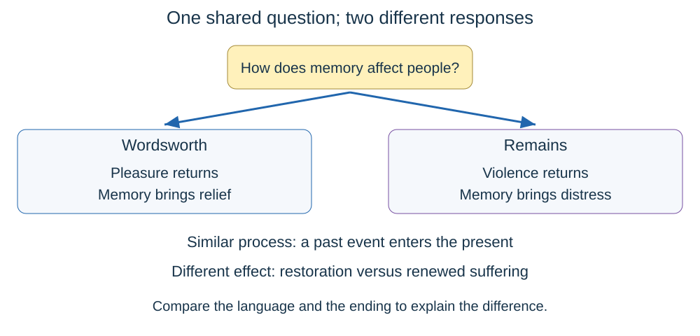

# Poetry anthology

## The Schoolboy — William Blake

**Themes:** Nature · Childhood · Power

A child loves the freedom of a summer morning but feels miserable at school. Imagine trying to make a bird sing by locking it in a small cage: the method destroys the joy it needs.

**Main idea:** learning that relies on fear can damage a child's natural curiosity and future growth.

### Poet context

Blake was an English poet and artist associated with Romanticism. He valued imagination and challenged institutions that suppressed freedom, especially the freedom of children.

### Poem context

The poem belongs to Songs of Innocence and of Experience. A child's voice questions fearful schooling and asks parents to consider its consequences; the target is damaging education, not learning itself.

### The poem content

- A summer morning offers birdsong, companionship and enjoyment.
- School replaces this pleasure with anxiety and confinement.
- Bird and plant comparisons lead to questions about how damaged childhood affects adult life.

### Key quotations

- **“sweet company”:** The affectionate phrase makes nature a welcoming community. The child belongs in this lively world before school removes that pleasure.
- **“cruel eye”:** The threatening gaze reduces authority to surveillance. Being watched produces fear rather than curiosity.
- **“drooping sit”:** The verb suggests a wilting plant or lowered wing. The child's physical posture expresses the loss of energy.
- **“Sit in a cage and sing”:** The bird comparison makes the contradiction clear: confinement prevents the natural expression that education should nurture.
- **“youthful spring”:** Spring becomes a metaphor for childhood's potential. Restriction threatens growth before it reaches maturity.
- **“buds are nip’d”:** Damaged buds represent injured young lives. The passive construction foregrounds what is done to children and anticipates a lost harvest.

### Language and imagery

- **Extended metaphors:** the caged bird and damaged plants connect freedom with healthy development.
- **Rhetorical questions:** adults are challenged to justify a system that destroys the joy it should protect.
- **Seasonal imagery:** spring, summer and winter turn one unhappy school day into a warning about a whole lifetime.

### Form and structure

six five-line stanzas, patterned rhyme and a songlike voice contrast with the experience of restriction. Repeated questions demand an answer from adults.

### Example quotation analysis

Blake presents fearful education as a threat to growth through **‘youthful spring’**. Spring normally brings new life, so the **seasonal metaphor** makes childhood a time of possibility. Losing that spring suggests more than temporary unhappiness: adult restrictions may damage the child's future. The later questions about fruit develop this idea by asking how maturity can flourish when its beginnings have been harmed.

**Compare:** Blackberry Picking also uses nature to explore childhood, but disappointment comes through decay. Catrin shows a child's wish for freedom from a parent's viewpoint.

## I Wandered Lonely as a Cloud — William Wordsworth

**Themes:** Nature · Loneliness

A solitary walker sees daffodils. Later, remembering them brings pleasure. Nature works like a favourite photograph you can replay in your mind, even when the real scene is far away.

**Main idea:** an ordinary encounter with nature can become a lasting inner resource.

### Poet context

Wordsworth was a Romantic poet closely connected with the Lake District. His work values nature, individual feeling and the way remembered experiences shape the imagination.

### Poem context

The poem grew from a walk with Dorothy Wordsworth near Ullswater in 1802. Its solitary speaker is a poetic presentation: the real walk was shared. Recollection matters as much as the original sight.

### The poem content

- A solitary walker discovers a large, lively group of daffodils beside a lake.
- Flowers and waves seem to dance, bringing immediate pleasure.
- Later, the memory returns at home and turns being alone into a rewarding experience.

### Key quotations

- **“lonely as a cloud”:** The opening simile suggests distance and drifting. It establishes the solitude that the flowers will transform.
- **“crowd”:** A word normally applied to people gives the flowers a social presence. Nature supplies companionship.
- **“Continuous as the stars”:** The simile enlarges the scene beyond an ordinary flowerbed, creating wonder through apparently limitless abundance.
- **“Ten thousand”:** The hyperbole conveys overwhelming plenty rather than a literal count. The scale makes the encounter memorable.
- **“inward eye”:** The metaphor describes imagination and memory. An external sight becomes a lasting inner resource.
- **“bliss of solitude”:** The positive noun changes the meaning of being alone. Solitude at the end is pleasurable rather than a repetition of initial loneliness.

### Language and imagery

- **Personification:** dancing flowers and waves make the landscape lively and companionable.
- **Social vocabulary:** nature offers company without requiring other people to be physically present.
- **Movement and scale:** floating, dancing and the star comparison connect a local encounter with a wider sense of wonder.

### Form and structure

four six-line stanzas with ABABCC rhyme. The final stanza shifts from the remembered walk to repeated experiences at home. Its closing couplet offers satisfaction.

### Example quotation analysis

Wordsworth makes memory a source of comfort through **‘inward eye’**. An eye normally looks outwards, but the adjective **‘inward’** redirects sight into the mind. The **metaphor** suggests that imagination can recover the flowers when they are physically absent. Because the final stanza happens later at home, the image shows nature's lasting emotional value rather than just the enjoyment of one walk.

**Compare:** I Shall Return also connects natural beauty with emotional restoration, but its return remains a hope. Blackberry Picking shows pleasure that cannot be preserved physically.

**Remember:** solitude at the end is rewarding; it is not simply the same as loneliness at the beginning.

## Blackberry Picking — Seamus Heaney

**Themes:** Nature · Childhood · Negative emotions

Children collect berries enthusiastically, but their stored fruit rots. It is like trying to keep a perfect summer day in a box: wanting it to last does not stop time.

**Main idea:** desire repeatedly meets the limits of nature. Growing older means recognising loss without necessarily stopping hope.

### Poet context

Heaney grew up in rural Northern Ireland. His early collection Death of a Naturalist, published in 1966, draws on childhood experiences through precise physical and sensory detail.

### Poem context

An older voice looks back on a repeated childhood activity. Familiar farm objects make the memory concrete, while the berries' decay develops a wider idea about pleasure, disappointment and growing understanding.

### The poem content

- Ripening berries provoke excited, increasingly greedy collecting.
- The children store their harvest, hoping to keep its sweetness.
- Rot replaces pleasure with disappointment; every year's hope clashes with knowledge of what will happen.

### Key quotations

- **“glossy purple clot”:** The rich colour and shine attract the senses, but the blood-related noun introduces a disturbing note within the pleasure.
- **“lust”:** The intense noun makes collecting seem driven by appetite rather than simple enjoyment. Desire becomes difficult to control.
- **“rat-grey fungus”:** Dull colour and the rat association make decay repulsive, sharply reversing the attractive opening.
- **“It wasn’t fair”:** The plain, childlike protest exposes a wish for nature to obey human expectations. Disappointment feels personal.
- **“Each year I hoped”:** The recurring time phrase shows that desire survives repeated failure. This is a pattern of experience, not one unfortunate harvest.
- **“knew”:** The final certainty conflicts with hope. Intellectual understanding does not automatically overcome emotional desire.

### Language and imagery

- **Sensory contrast:** sweet taste, rich colour and sticky touch give way to foul smell and rot.
- **Blood and fairy-tale imagery:** the fruit and the Bluebeard reference mix innocent collecting with greed and unease.
- **Opposing verbs:** hoping and knowing expose the conflict between wanting pleasure to last and understanding that it cannot.

### Form and structure

a long first stanza builds the excitement; a shorter second stanza overturns it. Mostly pentameter lines and paired rhymes/half-rhymes give shape to a memory whose outcome remains disappointing.

### Example quotation analysis

Heaney makes decay feel like a betrayal through **‘rat-grey fungus’**. Grey replaces the berries' earlier rich colours, while the rat association suggests something invasive and unpleasant. This **visual image** reverses the excitement of collecting: the saved fruit now disgusts the children. The change supports the poem's wider argument that hoarding something pleasurable cannot protect it from time.

**Compare:** Wordsworth preserves happiness through memory; Heaney cannot preserve the berries themselves. The Schoolboy also links childhood with natural growth, but blames human restriction.

**Remember:** the fruit's decay can suggest a wider loss of innocence, but start with what actually happens before developing that interpretation.

## Sonnet 29 — Elizabeth Barrett Browning

**Themes:** Love · Relationship

The speaker thinks intensely about an absent lover, then insists that being with the real person is better than imagining them. Think of vines hiding a tree: thoughts about somebody can grow so large that they obscure the person.

**Main idea:** love seeks real presence, not a substitute made from fantasy.

### Poet context

Barrett Browning was a Victorian poet who wrote confidently about love and women's experience. Sonnets from the Portuguese, published in 1850, is associated with her love for Robert Browning.

### Poem context

This is Barrett Browning's Sonnet 29, not Shakespeare's. The speaker addresses an absent beloved, then imagines the closeness that would make thinking about him unnecessary.

### The poem content

- Thoughts about the lover grow like vines around a tree.
- The speaker rejects imagination as a replacement for the actual person.
- She calls for renewed presence and imagines release through direct, physical closeness.

### Key quotations

- **“thoughts do twine and bud”:** Growing verbs make thought energetic and fertile. Longing seems alive rather than static.
- **“wild vines”:** The extended metaphor gives imagination uncontrolled growth. Its abundance can become an obstruction.
- **“hides the wood”:** The beloved is concealed by thoughts about him. Fantasy threatens to replace the person it is meant to celebrate.
- **“Renew thy presence”:** The imperative makes the speaker active and demanding. She wants real closeness, not endless private imagining.
- **“burst, shattered”:** Forceful verbs make the imagined release sudden and physical. Presence breaks through the enclosing thoughts.
- **“I am too near thee”:** The ending reverses the opening emphasis on thought. Intimacy is imagined as a richer experience than longing from a distance.

### Language and imagery

- **Extended metaphor:** thoughts are vines and the lover is their supporting tree, making affection both fertile and potentially obscuring.
- **Imperatives and energetic verbs:** the speaker openly directs the reunion she desires.
- **Sensory language:** seeing, hearing and breathing make imagined closeness bodily rather than purely mental.

### Form and structure

a 14-line Petrarchan sonnet. The turn begins early with “Yet”, developing across the poem rather than waiting neatly for line nine. The ending reverses the opening claim about thinking.

### Example quotation analysis

The command **‘Renew thy presence’** shows that the speaker refuses to accept fantasy as sufficient. **‘Renew’** implies that closeness has existed before and must be restored. The **imperative** gives her an assertive voice within a traditional love-poem form. This develops the poem's argument: thoughts may express affection, but the beloved's actual presence is more valuable than thoughts alone.

**Compare:** Dusting the Phone also explores absence, but ends without reassuring contact. I Shall Return uses a sonnet for longing directed towards a homeland.

**Remember:** this is Barrett Browning's Sonnet 29, beginning “I think of thee!”, not Shakespeare's poem with the same number.

## Cousin Kate — Christina Rossetti

**Themes:** Love · Family · Relationship · Conflict · Power

An abandoned woman addresses the cousin who married the lord who rejected her. She seems powerless, then reveals a son whom the wealthy household wants as an heir. It resembles somebody finally answering back after others have told the story for them.

**Main idea:** status and public respectability do not reliably reveal love or moral worth.

### Poet context

Rossetti was a Victorian poet whose work often examines love, moral judgement and women's vulnerability. Her writing gives serious attention to people constrained by social expectations.

### Poem context

A dramatic speaker addresses the cousin who married the lord who rejected her. Victorian class divisions, inheritance and unequal sexual judgement help explain why the women face different consequences from the wealthy man.

### The poem content

- A previously contented young woman is attracted into a lord's household, then discarded.
- She contrasts Kate's marriage and public respectability with her own rejection.
- Revealing her son challenges the apparent balance of power: he brings affection and the possibility of an heir.

### Key quotations

- **“cottage maiden”:** The modest setting establishes the speaker's earlier life and the class difference the lord can exploit.
- **“plaything”:** The noun reduces her to something used for another person's pleasure, exposing unequal power.
- **“changed me like a glove”:** The simile makes her replaceable. The lord treats a person as a disposable possession.
- **“outcast thing”:** Social condemnation strips away individuality. The label exposes how respectability can become a means of exclusion.
- **“My shame, my pride”:** The balanced contrast joins society's judgement to maternal affection. Her son cannot be understood through disgrace alone.
- **“To wear his coronet”:** The symbol of noble status makes the son important to inheritance, complicating who finally possesses something valuable.

### Language and imagery

- **Object imagery:** clothing and possessions expose the lord's treatment of women as things he can choose or replace.
- **Direct address and contrasts:** the speaker confronts Kate and repeatedly compares their unequal positions.
- **Reversal:** motherhood gives the marginalised speaker a source of pride and possible social leverage.

### Form and structure

six eight-line stanzas with recurring rhyme. The balladlike storytelling leads towards the delayed revelation of the son, which forces readers to reassess power.

### Example quotation analysis

Rossetti exposes the lord's power through **‘changed me like a glove’**. A glove is a possession easily removed and replaced, so the **simile** denies the speaker the permanence she expected from love. **‘Changed’** makes his decision seem casual despite its devastating consequences. The image helps reveal the inequality of a relationship in which his status protects him while she bears the social damage.

**Compare:** Origin Story also finds value in the child of a relationship that does not last. Kamikaze shows a community enforcing shame through exclusion.

**Remember:** the speaker asserts that her love was truer than Kate's; treat this as her claim and explore how she persuades us.

## Catrin — Gillian Clarke

**Themes:** Love · Family · Relationship · Conflict · Identity

A mother recalls giving birth, then describes a later disagreement about her daughter's freedom. The relationship resembles a tug of war in which both people still want to stay connected.

**Main idea:** love and conflict can coexist. Becoming a separate person does not erase the emotional bond.

### Poet context

Clarke is a Welsh poet whose work often draws on family life, memory and the physical world. Her experience of motherhood informs this exploration of attachment and independence.

### Poem context

A mother addresses her daughter, Catrin, recalling childbirth and a later disagreement. The two moments show that physical separation at birth does not end the emotional struggle to become independent people.

### The poem content

- The mother remembers a hot hospital room and the intense struggle of childbirth.
- The birth becomes an image of two people seeking separate identities.
- A later request to skate after dark revives the tension between parental protection and a daughter's freedom.

### Key quotations

- **“Red rope of love”:** The umbilical-cord image becomes a metaphor for continuing attachment. Red connects bodily pain with strong feeling.
- **“We want”:** The shared pronoun makes independence a need on both sides, rather than a simple battle between a loving mother and an uncaring daughter.
- **“to be ourselves”:** The phrase makes the struggle about identity. Loving someone does not remove the need for a separate self.
- **“Neither won nor lost”:** The balanced statement resists a clear victor. Their bond changes both people rather than ending in one person's defeat.
- **“Trailing love and conflict”:** Placing affection beside disagreement makes the central idea explicit: tension can exist inside love.

### Language and imagery

- **Extended metaphor:** the cord becomes a rope that continues to pull mother and daughter together.
- **Contrasting shapes:** clean squares suggest the hospital's order; coloured circles suggest the mother's intense, less orderly feelings.
- **Pronouns and direct address:** movement between a shared ‘we’ and an addressed ‘you’ holds connection and separation together.

### Form and structure

two unequal stanzas connect two moments years apart. Free verse and enjambment let the feelings move across line boundaries. The ending lands on an ordinary request, making the larger struggle recognisable.

### Example quotation analysis

Clarke presents love as both a bond and a source of tension through **‘Red rope of love’**. A rope can hold people together but can also become tight or restrictive. Its physical association with the umbilical cord links childbirth to the later argument about freedom. The **extended metaphor** therefore suggests that separation is necessary, yet emotionally difficult; conflict does not mean their affection has disappeared.

**Compare:** The Schoolboy presents restricted freedom through a child; Catrin lets us hear the protective adult too. Origin Story examines family bonds from the next generation's perspective.

**Remember:** conflict here does not prove a lack of love.

## Dusting the Phone — Jackie Kay

**Themes:** Love · Relationship · Loneliness · Negative emotions

A person waits anxiously for a lover to call and becomes absorbed by the telephone. Imagine repeatedly checking for a message until the device seems to control your whole day.

**Main idea:** uncertainty can turn affection into dependence, fear and frustrated attempts at control.

### Poet context

Kay is a Scottish poet whose writing explores identity, love and belonging. She often uses intimate, conversational voices, mixing emotional intensity with humour without reducing people to their biographies.

### Poem context

An anxious speaker waits for contact from an absent lover. A domestic telephone becomes the centre of the speaker's life. Neither the lover's gender nor a precise reason for the silence is established.

### The poem content

- The speaker imagines disaster whether the telephone rings or remains silent.
- Possible futures multiply, and waiting becomes a ritual of service to the phone.
- Loneliness turns into anger, but the attempted final threat collapses because the speaker cannot decide what to do.

### Key quotations

- **“Sirens”:** An emergency sound intrudes into ordinary communication. Both ringing and silence produce alarm, leaving no reassuring outcome.
- **“Silver service”:** The pun turns waiting for a call into waiting on the phone like a servant. Affection becomes dependence.
- **“lonely cotton sheets”:** Ordinary bedroom detail gives absence a physical setting. The imagined voice cannot provide lasting companionship.
- **“I am trapped”:** The direct statement makes emotional attachment feel like confinement. The speaker recognises dependence but cannot simply escape it.
- **“Or else. What?”:** The abrupt question breaks the threat's confidence. Anger produces no convincing plan, exposing helplessness beneath the comic tone.

### Language and imagery

- **Personification:** polishing and dressing for the phone make it seem capable of rewarding devotion.
- **Exaggeration and short sentences:** disaster language makes ordinary waiting feel overwhelming while allowing uneasy humour.
- **Questions and competing futures:** imagination increases uncertainty instead of resolving it; the speaker's thoughts repeatedly return to the absent person.

### Form and structure

free verse, recurring three-line stanzas and an isolated final line. Short sentences and questions interrupt longer thoughts. The ending deflates the attempted ultimatum.

### Example quotation analysis

Kay exposes unequal emotional power through **‘Silver service’**. The speaker's waiting has become service offered to an object, as if the phone could be persuaded to deliver love. The **pun** changes an ordinary delay into a relationship of dependence. Its humour makes the behaviour recognisable, but the effort also reveals how little control the speaker has over the desired contact.

**Compare:** Sonnet 29 also replaces an absent person with intense thought, but imagines release through presence. Cousin Kate gives a rejected speaker a much more assertive final position.

**Remember:** the comic exaggeration can make the speaker relatable without making the loneliness trivial.

## Drummer Hodge — Thomas Hardy

**Themes:** Nature · Youth · Isolation · War

A young drummer is buried far from his English home. The strange land will permanently contain him. Think of a name placed in a landscape that the person never had time to understand.

**Main idea:** war removes an ordinary young person from home; the poem gives lasting attention to a life treated hurriedly in death.

### Poet context

Hardy was an English novelist and poet strongly associated with Dorset and the fictional region of Wessex. His writing often attends to ordinary people whose lives are shaped by forces beyond their control.

### Poem context

The poem responds to the Second Boer War in southern Africa, not the First World War. A young English drummer is buried far from home. It concentrates on the human cost of imperial warfare rather than military triumph.

### The poem content

- Hodge receives a hurried burial without a coffin in an unfamiliar landscape.
- The poem remembers his youth and his Wessex origins.
- His body becomes permanently part of the foreign land, creating natural continuity while making return impossible.

### Key quotations

- **“throw”:** The abrupt verb makes the burial impersonal. Death brings little visible ceremony or individual care.
- **“Uncoffined”:** The missing coffin exposes an undignified burial, challenging the promise that military sacrifice receives honour.
- **“Young Hodge”:** Naming him and emphasising youth resist treating him as just one anonymous casualty.
- **“Wessex home”:** The familiar English place contrasts with the distant landscape. Geographical separation becomes an emotional loss.
- **“strange-eyed constellations”:** The personification makes even the stars seem unfamiliar watchers. Hodge is surrounded by a world he never understood.
- **“for ever”:** The time phrase makes separation permanent. Becoming part of nature cannot undo the loss of his life or home.

### Language and imagery

- **Local landscape vocabulary:** southern African terms make the place specific while emphasising Hodge's unfamiliarity.
- **Scale:** the small burial mound sits beneath an immense sky, setting an ordinary life against an indifferent universe.
- **Nature and permanence:** the future tree offers continuity, but its foreign location prevents an uncomplicated consoling ending.

### Form and structure

three six-line stanzas with alternating rhyme. Present burial, past origins and future transformation organise the poem's movement through time. Its regularity gives dignity to an undignified death.

### Example quotation analysis

Hardy questions the dignity of military death through **‘throw’**. The abrupt **verb** suggests hurried disposal instead of a careful funeral. Beginning with this action makes Hodge seem powerless before the reader learns about his youth and home. The poem's attention to his individual life then supplies a kind of remembrance that the burial itself appears to lack.

**Compare:** Disabled also challenges glamorous ideas of war through a young person's loss. I Shall Return longs for home; Hodge cannot return.

**Remember:** this is a Boer War poem, not a First World War poem.

## Disabled — Wilfred Owen

**Themes:** Youth · Isolation · War · Identity · Negative emotions

A young veteran compares his dependent present with the energetic life he had before war. It is like cutting between two versions of the same place: others still enjoy it, but his access to it has changed.

**Main idea:** the promises surrounding recruitment contrast cruelly with injury, isolation and inadequate care afterwards.

### Poet context

Owen served in the First World War and wrote about its suffering rather than celebrating heroic sacrifice. His military experience informs the poem, but the injured veteran is a constructed character, not a literal description of Owen.

### Poem context

A young veteran waits in institutional care after devastating injuries. Memories of recruitment, sport and attraction contrast with his present treatment. The poem questions the promises that encouraged enlistment and society's care afterwards.

### The poem content

- The veteran sits alone while other young people enjoy the evening.
- Memories reveal the youth, admiration and hopes that helped draw him into the army.
- An inadequate homecoming leads to dependence, exclusion and an unresolved wait for care.

### Key quotations

- **“ghastly suit of grey”:** Colour and the deathlike adjective make the present bleak, contrasting with the lively remembered world.
- **“Now he is old”:** A compressed judgement suggests that war has aged him beyond his years. The change is emotional as well as physical.
- **“bloodsmear”:** The sporting injury once attracted admiration. Its later contrast with wartime blood exposes the gap between imagined and actual danger.
- **“Smiling they wrote his lie”:** The cheerful recruiters accept an age claim that should have raised concern, exposing inadequate protection behind the welcome.
- **“some queer disease”:** The comparison presents other people's recoil from him. It criticises social rejection rather than proving that disability makes him less human.
- **“Why don’t they come?”:** The repeated question leaves him dependent and waiting. The lack of an answer denies a comforting resolution.

### Language and imagery

- **Colour contrast:** the grey present clashes with bright, attractive memories, intensifying a sense of exclusion.
- **Changing blood imagery:** applause after sport becomes catastrophic loss in war.
- **Questions and shifts in time:** remembered excitement repeatedly interrupts neglect, exposing the difference between society's promises and its response.

### Form and structure

shifts between past and present keep interrupting the account. Uneven stanza lengths and the repeated final question leave him waiting instead of giving a comforting resolution.

### Example quotation analysis

Owen exposes neglect through **‘Why don’t they come?’**. The **repeated question** conveys both a practical need for help and emotional abandonment. Because it closes the poem without an answer, the reader is left inside the veteran's waiting. This makes the problem extend beyond the original injury: the society that welcomed his enlistment now fails to provide the care he needs.

**Compare:** Kamikaze also shows society rejecting someone after military service. Remains presents continuing psychological harm rather than the same physical injuries.

**Remember:** analyse the speaker's perception and society's treatment without assuming that all disabled lives must resemble this character's experience.

## Kamikaze — Beatrice Garland

**Themes:** Family · Nature · Isolation · War · Conflict

A pilot returns from a suicide mission and is treated as absent by his family. His daughter later imagines why he turned back. He survives physically but loses his place among the people he loves.

**Main idea:** public ideas of honour can conflict with the value of an individual life and family connection.

### Poet context

Garland is an English poet who also worked in psychological medicine. Her publisher describes her collection's interest in life, death and the natural world; this helps connect human choices with the vivid landscape in the poem.

### Poem context

Japanese kamikaze pilots in the Second World War were expected to die on their missions. A daughter reconstructs her father's return and exclusion. The fictional family's response should not be generalised to every Japanese family.

### The poem content

- A pilot sets out on a suicide mission, carrying the symbols and expectations of duty.
- His daughter imagines that sea life and childhood memories helped him choose to return.
- Family and neighbours reject him, leaving an unresolved question about whether survival or death would have been better.

### Key quotations

- **“one-way”:** The ordinary travel description makes the intended death stark. The expected destination is history, not a safe homecoming.
- **“green-blue translucent sea”:** Rich colour and clarity make ordinary life attractive, challenging the death demanded by military duty.
- **“pearl-grey pebbles”:** The precious association gives childhood play value. Remembered family life offers an alternative to public honour.
- **“no longer existed”:** The family's treatment turns a living person into a social absence. Physical survival does not restore belonging.
- **“better way to die”:** The ending compares literal death with exclusion. Its uncertainty prevents a simple judgement that the return solved his problem.

### Language and imagery

- **Colour, movement and natural abundance:** the sea and fish provide a powerful counterweight to the planned death.
- **Qualified narration:** the daughter imagines motives rather than reporting her father's thoughts with certainty.
- **Silence and absence:** learned rejection breaks the connection between survival and a welcome home.

### Form and structure

seven six-line stanzas; fluid enjambment contrasts with the later broken family connection. Shifts in voice let the daughter's memory emerge through an outer narrator.

### Example quotation analysis

Garland presents exclusion through **‘no longer existed’**. The father has physically returned, so the phrase describes how the community treats him rather than his actual death. This **contrast** makes silence a form of punishment: he survives the mission but loses recognition within his own home. The ending therefore questions a model of honour that values military obedience above a living family member.

**Compare:** Disabled contrasts military expectation with a rejected homecoming. I Shall Return imagines home as relief, whereas this return brings isolation.

**Remember:** the final judgement remains imagined and unresolved; the poem does not show the pilot dying after his return.

## War Photographer — Carol Ann Duffy

**Themes:** War · Conflict · Negative emotions

A photographer develops images of suffering at home while remembering what he witnessed. Readers will see only a few pictures before returning to comfortable routines. The darkroom is like an attempt to organise a box of memories that refuse to stay neatly filed.

**Main idea:** recording suffering has a lasting personal cost, while distant spectators may respond only briefly.

### Poet context

Duffy is a Scottish poet known for dramatic voices and moral questions. Her friendships with war photographers informed this poem's interest in the responsibility and personal cost of witnessing suffering.

### Poem context

Published in Standing Female Nude in 1985, the poem presents film development and newspaper publication. A photographer returns to safe rural England while memories of conflict continue to disturb him.

### The poem content

- The photographer carefully develops film in a quiet darkroom.
- The emerging images bring back memories and delayed distress.
- Editors and readers give only limited attention to the suffering, before the photographer leaves for another assignment.

### Key quotations

- **“spools of suffering”:** The alliteration connects rolls of film with human pain. Recording is inseparable from the lives represented.
- **“ordered rows”:** Neat arrangement suggests professional control and an attempt to contain experiences that are emotionally disorderly.
- **“priest”:** The religious comparison makes the work solemn and gives it the weight of a moral responsibility.
- **“half-formed ghost”:** The developing image becomes a haunting presence. Physical emergence on the film overlaps with returning memory.
- **“A hundred agonies”:** The large number and pain-focused noun expose the scale of suffering reduced to a few selected pictures.
- **“they do not care”:** The blunt judgement ends the poem with alienation. The photographer sees a gap between public viewing and lasting concern.

### Language and imagery

- **Religious imagery:** the darkroom resembles a place of serious ritual, contrasting with casual newspaper consumption.
- **Double meanings:** developing chemicals and emerging images also suggest memory and emotional disturbance.
- **Contrasts:** safe home and dangerous foreign ground expose unequal security, while professional composure conceals delayed distress.

### Form and structure

four six-line stanzas with ABBCDD rhyme. The controlled pattern contrasts with distress that cannot be tidied away. The return journey suggests a recurring cycle.

### Example quotation analysis

Duffy connects photographic work with trauma through **‘half-formed ghost’**. The image is still developing, so **‘half-formed’** describes its physical appearance. Yet a **‘ghost’** also suggests a memory that haunts the photographer. The **metaphor** joins technical process to emotional experience, showing that arranging photographs cannot neatly contain the suffering he has witnessed.

**Compare:** Decomposition questions a photographer's responsibility to a vulnerable subject. Remains shows traumatic memories persisting at home, but its speaker helped cause the death.

**Remember:** the photographer's professional composure does not prove that he feels nothing; the poem shows delayed emotional effects.

## Remains — Simon Armitage

**Themes:** War · Conflict · Negative emotions

A soldier recounts shooting a suspected looter, then discovers that leaving the war zone does not leave the event behind. Memory works like an unwanted replay that restarts without permission.

**Main idea:** uncertain responsibility and violent memory can continue long after an incident appears finished.

### Poet context

Armitage is an English poet associated with Yorkshire and conversational voices. The Not Dead draws on veterans' testimonies, giving attention to experiences that had often gone unheard.

### Poem context

The speaker is a soldier recounting a shooting and its aftermath, not Armitage reporting his own combat experience. The documentary-based project explores how warfare can continue psychologically after someone returns home.

### The poem content

- Several soldiers shoot a fleeing suspected looter whose weapon is uncertain.
- The speaker describes severe injury and a trace left on the street.
- Back home, the event returns through memory and dreams; attempts to escape it fail.

### Key quotations

- **“probably armed, possibly not”:** The balanced uncertainty prevents a secure justification for the shooting. Its return keeps doubt alive.
- **“blood-shadow”:** The compound image joins a physical stain to a haunting memory. Removing the body does not remove the event.
- **“End of story”:** The apparent closure is immediately challenged by what follows. The incident continues inside the speaker.
- **“enemy lines”:** Military imagery moves into the mind. Homecoming changes the location of the conflict without ending it.
- **“my bloody hands”:** The possessive concentrates responsibility in one voice after the group's shared action. Blood becomes moral as well as physical.

### Language and imagery

- **Colloquial dramatic monologue:** a casual storytelling voice clashes with graphic violence and later distress.
- **Military metaphors:** the remembered victim occupies the speaker's mind like a continuing enemy presence.
- **Pronoun change and repetition:** a collective action becomes an individual's burden, while recurring uncertainty prevents resolution.

### Form and structure

a dramatic monologue in colloquial free verse. Enjambment carries the story forward; the short final couplet concentrates attention on personal responsibility. Shared pronouns early on give way to a more isolated voice.

### Example quotation analysis

Armitage presents unresolved guilt through **‘probably armed, possibly not’**. Both alternatives remain open, so the speaker cannot settle whether the killing was justified. The balanced phrasing sounds like an attempt to weigh evidence, but its **repetition** later in dreams shows that reasoning has failed to bring peace. Violence continues through doubt as well as through remembered physical images.

**Compare:** War Photographer also returns physically home without psychological safety. Disabled reveals the difference between wartime promises and the realities of survival.

**Remember:** the poem does not establish whether the man was armed. Do not resolve the uncertainty that drives the poem.

## I Shall Return — Claude McKay

**Themes:** Nature · Isolation · Identity

A speaker separated from home imagines going back to its sights, sounds and community. Home is like an anchor carried in memory, even when the person is physically far away.

**Main idea:** belonging to a place and culture can sustain hope during painful separation.

### Poet context

McKay was a Jamaican-born poet who migrated to the United States and became associated with the Harlem Renaissance. His writing explores cultural belonging, racial inequality and attachment to a homeland.

### Poem context

The sonnet appears in Harlem Shadows, published in 1922. A voice separated from home imagines recovering its landscape and community. The poem promises return but does not show it taking place.

### The poem content

- The speaker repeatedly promises to return to a remembered homeland.
- Rich natural scenes give way to village music and shared culture.
- The closing admission of long-lasting pain explains why the imagined return matters so deeply.

### Key quotations

- **“I shall return”:** Repetition sounds determined but can also be self-reassurance. The speaker keeps asserting what has not yet happened.
- **“wonder-eyes”:** The compound expression imagines a renewed, delighted way of seeing home.
- **“golden noon”:** Precious colour makes the remembered landscape valuable as well as beautiful.
- **“dear delicious tunes”:** Taste language applied to music blends the senses and suggests that remembered culture is emotionally nourishing.
- **“native life”:** The phrase makes belonging cultural and communal, extending beyond attractive scenery.
- **“long, long years of pain”:** Repeated duration exposes distress beneath the confident promises. The final line explains the longing developed earlier.

### Language and imagery

- **Rich colours and flowing water:** remembered home is presented as a source of life and renewal.
- **Refrain and future tense:** determination coexists with distance; the hoped-for reunion remains unfinished.
- **Blended senses:** music becomes nourishing, connecting personal comfort with shared cultural experience.

### Form and structure

a Shakespearean sonnet: three quatrains followed by a closing couplet. Nature gives way to community before the final emotional explanation. The promise is not shown being fulfilled.

### Example quotation analysis

McKay complicates confidence through **‘I shall return’**. The future tense sounds definite, but the repeated promise may also be needed because the speaker remains far away. This **refrain** holds hope and uncertainty together. The closing reference to years of pain reveals the emotional need behind the assertion, so the sonnet presents return as a desired source of healing rather than an accomplished event.

**Compare:** Wordsworth already gains comfort through recollection; McKay longs for actual return. Drummer Hodge presents separation made permanent by death.

**Remember:** a sonnet can express love for a homeland, not only romantic love for a person.

## Decomposition — Zulfikar Ghose

**Themes:** Isolation · Power · Negative emotions

A photographer looks again at a picture of a sleeping beggar and questions the pride he once took in it. Imagine realising that the striking photograph you admired contains somebody's actual hardship, not simply an interesting pattern.

**Main idea:** looking carefully at a person should challenge, rather than merely decorate, our way of seeing.

### Poet context

Ghose grew up in Bombay and later lived in Britain and the United States. His experience across cultures helps situate this poem's interest in looking, representation and the limits of an observer's judgement.

### Poem context

A speaker reconsiders a photograph of a beggar in Bombay, now Mumbai. Urban poverty and unequal power between image-maker and subject matter directly. The man is described as sleeping, not as dead.

### The poem content

- The photograph initially turns the beggar's body into patterns resembling stone and a fossil.
- A passing crowd notices entertainment but shows little concern for him.
- The speaker moves from pride in an artistic composition to shame about using another person's suffering.

### Key quotations

- **“fossil man”:** The metaphor merges the person with stone, suggesting neglect while exposing how the observer turns him into a visual object.
- **“indifferent”:** The adjective identifies a lack of concern rather than a lack of visibility. People can see hardship without responding to it.
- **“good composition”:** The speaker's earlier judgement values the photograph's appearance. The later reassessment questions that priority.
- **“glibly”:** The self-critical adverb admits that the original caption was superficial, not a sufficient understanding of the person's life.
- **“hunger and solitude”:** The ending restores attention to human needs. Artistic satisfaction is challenged by ethical responsibility.

### Language and imagery

- **Stone and fossil imagery:** apparent lifelessness exposes neglect, but does not establish that the sleeping man has died.
- **Changing judgement:** self-critical vocabulary shifts focus from the pictured person to the photographer's conduct.
- **Title and wordplay:** decomposition questions the earlier composition, dismantling a satisfying artistic arrangement through awareness of suffering.

### Form and structure

five quatrains in free verse. The shift from describing the picture to judging the act of taking it changes the reader's focus. The ending replaces aesthetic satisfaction with responsibility.

### Example quotation analysis

Ghose reveals the speaker's changing values through **‘glibly’**. The **adverb** suggests a remark made too easily, without enough care. It undermines the earlier pleasure in producing a clever caption and makes the photographer question his own authority. The shift moves the reader from admiring an image towards recognising the ethical problem of treating a hungry person mainly as material for art.

**Compare:** War Photographer also asks what images of suffering do to viewers. Disabled shows another vulnerable figure whom other people fail to treat with full care.

**Remember:** the man is described as asleep. The title and stone imagery do not prove that he is dead.

## Origin Story — Eve L. Ewing

**Themes:** Love · Family · Relationship · Identity

A speaker tells how her parents met through a comic book, then uses comics to think about their relationship. A comic can be carefully preserved or worn out through being loved and used: those are different kinds of value.

**Main idea:** a relationship can end yet still leave something worthwhile. Family identity does not require a perfect, permanent romance.

### Poet context

Ewing is an American writer and scholar from Chicago whose work includes poetry and comics. Her writing gives imaginative and cultural value to everyday Black experience and personal histories.

### Poem context

The poem, from Electric Arches, tells a family origin through a meeting in 1980s Chicago. Comic-book language provides a way to reconsider a relationship that did not last without dismissing its value.

### The poem content

- The speaker describes the parents as distinctive young people whose lives meet through a comic book.
- Advice about preserving comics becomes an extended comparison for protecting love.
- The worn comic represents a relationship lived intensely; its ending can be good because it helped create the speaker.

### Key quotations

- **“my mother and my father”:** The possessives make the account a personal origin rather than a detached romance. The speaker's existence already connects the two people.
- **“love is like a comic book”:** The simile joins affection to the object that brought the parents together, rooting the larger idea in concrete family detail.
- **“love is paper”:** The compressed metaphor makes love fragile and physical. Lasting affection requires care, but preserving it untouched is not its only value.
- **“worn thin”:** Wear can suggest damage, but the surrounding handling also suggests enjoyment and intimacy. Use and preservation are competing forms of value.
- **“a good ending”:** The unexpected positive judgement changes how a broken relationship is understood. Its outcome can include a worthwhile new life.

### Language and imagery

- **Comic-book title and extended comparison:** an ordinary family receives the imaginative significance of a superhero's origin.
- **Lists of handling and protection:** carefully stored objects contrast with things valued through repeated use.
- **Informal voice and final reversal:** domestic detail creates intimacy before the ending challenges the assumption that lasting forever is the only successful outcome.

### Form and structure

two unequal free-verse stanzas move from narrative into reflection. Informal details and the largely lower-case presentation give the account an intimate voice. The final **“good ending”** invites us to connect the love story with the speaker's own existence.

### Example quotation analysis

Ewing redefines a successful relationship through **‘a good ending’**. An ending usually suggests loss in a love poem, but **‘good’** refuses that automatic judgement. The comic-book frame makes an ending part of a story with consequences beyond the romance itself. Because the speaker has described her own parents, the **structural reversal** suggests that her existence can give value to a relationship that did not survive.

**Compare:** Cousin Kate also finds value in a child after a broken relationship, but its voice is much more confrontational. Catrin presents love through a bond that changes rather than disappears.

## Comparing poems and writing answers

A comparison is like putting two photographs beside each other: notice the shared subject, then explain what each photographer chose to show differently.

**For a single-poem answer:** state the poem's central response to the question, follow its development, and analyse selected details. Link **language, form, structure and relevant context** to meaning. About 20 minutes is advised for the 15-mark task.

**For the comparison:** choose another anthology poem that genuinely fits the given focus. About 40 minutes is advised for the 25-mark task. The first poem is printed; you need to recall the second. You cannot bring the anthology into the exam.

| Focus | Useful pair | A difference worth arguing |
| --- | --- | --- |
| Nature and memory | Wordsworth + Blackberry Picking | Remembered pleasure lasts; collected fruit decays. |
| Longing | Sonnet 29 + Dusting the Phone | Imagined closeness offers release; waiting ends unresolved. |
| Childhood and freedom | The Schoolboy + Catrin | Child challenges authority; mother explores both attachment and separation. |
| War and exclusion | Disabled + Kamikaze | Injury and social neglect; survival followed by deliberate silence. |
| Lasting trauma | Remains + War Photographer | A participant's doubt; a witness's duty and distress. |
| Images of suffering | Decomposition + War Photographer | Self-criticism about making art; frustration with spectators and publication. |
| Home and belonging | I Shall Return + Drummer Hodge | Future return is hoped for; death makes return impossible. |
| Family after broken love | Cousin Kate + Origin Story | Defiant resistance to judgement; affectionate reassessment of an imperfect past. |

**Build a linked paragraph:** shared idea → detail from poem A → explain a word, image or structural choice → compare with poem B's detail and method → explain why the difference matters.

For example: both Wordsworth and McKay connect landscape with relief. Wordsworth's movement from the lake to the couch shows memory already changing his mood. McKay's repeated future promise makes relief something still desired. Their natural imagery is attractive in both cases, but its position in time gives it a different emotional function.

**Useful terms, with a purpose:**

- **Speaker:** the voice in the poem; do not automatically equate it with the poet.
- **Dramatic monologue:** one constructed voice reveals a person's experience and attitudes.
- **Metaphor / simile:** a comparison that helps create an idea, not just a technique to label.
- **Enjambment:** a sentence runs across a line ending. Explain the particular connection, delay or momentum it creates.
- **Caesura:** a pause within a line; it may interrupt thought, isolate words or change pace.
- **Volta:** a turn in the poem's thought or feeling.
- **Form:** the overall kind and pattern, such as a sonnet or free verse. Free verse does not mean there is no structure.
- **Context:** a relevant setting, belief, experience or literary tradition that helps explain a specific detail.

**Must know:** compare meanings and methods throughout. Two separate mini-essays joined by one final sentence rarely show the relationships clearly. Avoid automatic claims such as “enjambment makes it fast” or “regular rhyme means happiness”; test the effect against the words around it.

Read the poems in the [official anthology](../../00 - Specification/Eduqas-poetry-anthology-first-assessment-2027.pdf).
