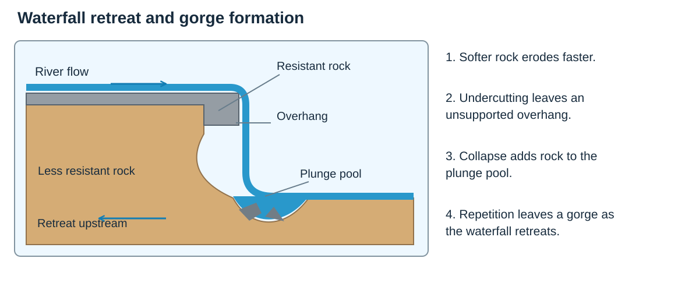
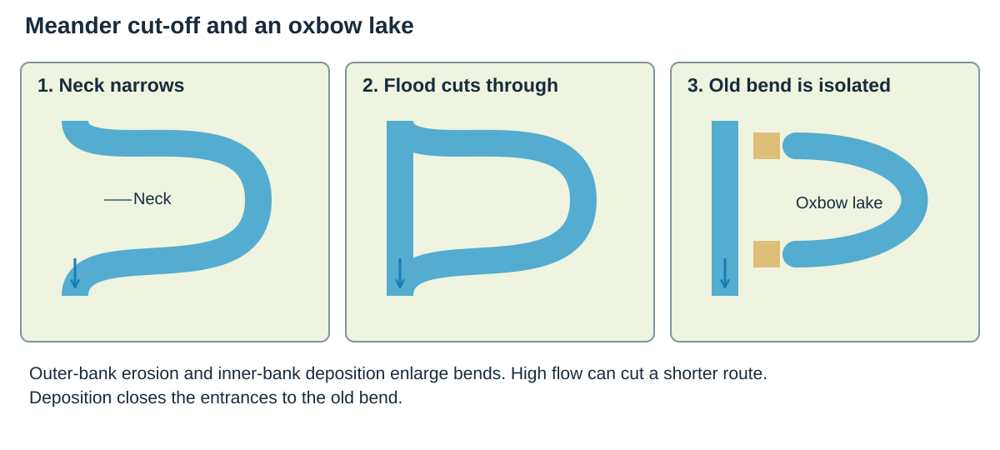
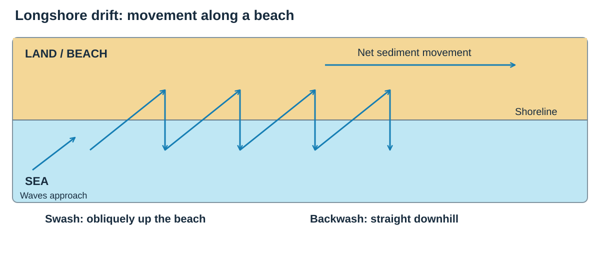

# Landscapes of the UK

## The UK landscape

### The big pattern

Think of Britain as a tilted table. The **north and west** are generally higher, steeper and wetter. The **south and east** are generally lower, flatter and drier.

- **Upland landscapes** have high relief, steep slopes and exposed rock. They are common in Scotland, Wales and northern England.
- **Lowland landscapes** have gentler relief and wider valleys. They are common in southern and eastern England.
- **Glaciated landscapes** were shaped by ice. They often contain steep-sided valleys, lakes and deposited material.
- **Geology** matters because resistant rock erodes more slowly than softer rock.
- **Climate** affects weathering, river discharge, waves and vegetation.
- **Human activity** changes landscapes through farming, building, quarrying and management.

**Must know:** A landscape is produced by an interaction between **geology, climate, geomorphic processes and people**.

### Compare the landscape types

| Type and example | Relief and geology | Climate and use |
|---|---|---|
| **Upland: Dartmoor** | High relief and exposed, resistant granite; steep local slopes. | Cooler, wetter conditions favour grazing, moorland and recreation. |
| **Lowland: the Fens** | Very low relief; drainage, peat and sedimentary deposits shape the landscape. | Generally drier eastern conditions; drained, fertile land supports arable farming. |
| **Glaciated: Cairngorms** | Ice has modified an upland landscape, leaving corries and steep-sided glacial valleys. | Cold upland conditions; conservation and tourism, including walking and winter sports. |

**Glaciated** describes a landscape’s history, not a third height category: an upland area can also be glaciated.

## Processes that shape landscapes

### Weathering and mass movement

**Weathering** breaks rock down **in place**. It does not move the material.

| Process | Plain-English meaning |
|---|---|
| **Mechanical weathering** | Rock is physically broken, for example by repeated freezing and thawing. |
| **Chemical weathering** | Minerals in rock react and dissolve or change. |
| **Biological weathering** | Living things break rock, for example roots widening cracks. |
| **Sliding** | Material moves downhill along a flat surface. |
| **Slumping** | Saturated material rotates downhill along a curved surface. |

### Keep the process groups separate

| Process group | What happens | Key examples |
|---|---|---|
| **Weathering** | Rock breaks down in place. | Freeze–thaw, chemical solution and root action. |
| **Mass movement** | Gravity moves material downslope. | Sliding on a flat failure surface; rotational slumping on a curved one. |
| **Erosion** | Moving water removes and wears material. | Hydraulic action, abrasion, attrition and solution. |
| **Transport** | Material is carried to another place. | Traction rolls, saltation bounces, suspension carries fine particles, solution carries dissolved material. |
| **Deposition** | Carried sediment is laid down. | A river or wave loses the energy needed to transport its load. |

### Erosion, transport and deposition

- **Hydraulic action:** water or air forces into cracks and breaks material away.
- **Abrasion:** carried sediment scrapes the bed, banks or cliff.
- **Attrition:** carried rocks collide, becoming smaller and rounder.
- **Solution:** soluble minerals dissolve in water.
- **Traction:** large stones roll along a river bed.
- **Saltation:** small stones bounce along the bed.
- **Suspension:** fine particles are carried within the water.
- **Deposition:** sediment is dropped when water or wind loses energy.

## River landscapes

### From source to mouth

Upstream, a river usually has a steep gradient, a narrow channel and more vertical erosion. Downstream, tributaries add water, the channel becomes wider and deeper, and transport and deposition become more important.

### V-shaped valleys

1. The river cuts down by **vertical erosion**.
2. Weathering weakens the valley sides.
3. Material moves downhill by mass movement.
4. The river removes it, leaving a narrow **V-shaped valley**.

### Waterfalls and gorges

1. Resistant rock lies above softer rock.
2. Softer rock erodes faster, creating a step.
3. Hydraulic action and abrasion deepen a **plunge pool**.
4. An overhang forms and collapses.
5. Repeated collapse moves the waterfall upstream and leaves a **gorge**.

**Read the sequence:** differential erosion creates the step; undercutting and collapse move it upstream.

### Meanders and oxbow lakes

- Faster water on the outside bend causes **erosion** and forms a river cliff.
- Slower water on the inside bend causes **deposition** and forms a slip-off slope.
- The neck becomes narrower. During high flow, the river may cut through it.
- Deposition seals the old bend, producing an **oxbow lake**.

**Formation:** erosion narrows the neck, high flow cuts across it, then deposition seals the old bend.

### Floodplains and levees

- During floods, water spreads across the valley floor and loses energy.
- Fine alluvium is deposited, gradually building a flat **floodplain**.
- Coarser material is dropped first beside the channel. Repeated floods build raised banks called **levees**.

## River Wye case study

### Place and context

The **River Wye** is about **251 km long**. It rises on **Plynlimon** in the Cambrian Mountains of mid-Wales, flows through places including Hay-on-Wye, Hereford and Monmouth, and joins the Severn Estuary near Chepstow.

This is a useful whole-river case study because its landscape changes from wet uplands to broad lowlands and then to a deeply cut lower valley.

### Geology and relief

**Main point:** geology controls resistance, valley shape and drainage.

- Much of the catchment is underlain by **Old Red Sandstone**.
- The lower Wye cuts through more resistant **Carboniferous Limestone**, helping form steep wooded gorges around places such as **Symonds Yat**.
- Softer alluvium on lower floodplains is easier to erode and deposit.
- Steep upland slopes encourage rapid runoff. Gentler downstream relief allows wider floodplains and meanders to develop.

### River processes and landforms

**Upper course:** high rainfall, steep gradients and coarse load give the river energy for vertical erosion. Weathering and mass movement steepen valley sides.

**Middle course:** tributaries increase discharge. Lateral erosion and deposition create meanders, river cliffs and slip-off slopes.

**Lower course:** a larger channel carries more water. Repeated floods deposit alluvium across floodplains, while the river has also cut a dramatic gorge through resistant limestone.

The Wye shows that a textbook downstream pattern is useful, but local geology can create steep scenery even in the lower course.

| Part of the river | Landscape and process | Human connection |
|---|---|---|
| **Upper Wye: Plynlimon** | Wet uplands, steep gradients and comparatively narrow valleys encourage rapid runoff and vertical erosion. | Grazing and changes in vegetation affect how quickly rainfall reaches the channel. |
| **Middle Wye: Hereford area** | A larger discharge and broader valley support meandering, lateral erosion and floodplain deposition. | Farming uses fertile alluvium; settlement and roads create assets exposed to flooding. |
| **Lower Wye: Symonds Yat–Tintern** | Incision through limestone produces a steep gorge, so downstream does not always mean a wide, open valley. | Woodland, tourism, former quarries and riverside settlements shape land use. |

### Human use and pressure

About **58% of the Wye Valley National Landscape is farmland** and about **27% is woodland**. Farming shapes field patterns and can compact soil or add sediment and nutrients to water. Settlements, roads, tourism, canoeing and walking bring income but add pressure to habitats and river access.

Built surfaces speed runoff. Removing vegetation or compacting soils reduces interception and infiltration, so water reaches channels faster.

**Livox Quarry, south of Tintern**, is a named example of limestone extraction in the lower Wye. Quarrying removes rock and vegetation, changes slopes and creates access and transport demands. It also provides useful stone and employment. Restoration can create exposed geological features and wildlife habitats, so the long-term effect depends on how the site is managed.

The physical change can be explained as a chain: **rock extraction → altered relief and vegetation → different habitats, runoff and land use**.

### Flood risk and management

Communities such as Hereford and Monmouth can flood after prolonged rainfall. Warnings and local defences reduce immediate risk, but hard defences may be costly and can move water downstream.

The **Herefordshire Natural Flood Management pilot (2018–2021)** worked with more than **140 landowners**. Measures included restoring ponds, planting trees or hedges and using barriers that slow runoff. These store water in the landscape before it reaches the river.

### Evaluation

Natural flood management can reduce peak flow, improve habitats and trap sediment. It needs many landowners and a large area, and it cannot prevent every flood during exceptional rainfall. The strongest strategy combines upstream slowing and storage with warnings and targeted protection for settlements.

### Exam pointer

Build the chain **upland rainfall and steep slopes → rapid runoff and energetic flow → erosion**, then show how **tributaries, gentler relief and deposition** change the landscape downstream. Add the limestone gorge as evidence that geology can interrupt the simple pattern.

## Coastal landscapes

### Waves and longshore drift

- **Destructive waves** have a strong backwash and remove beach material.
- **Constructive waves** have a strong swash and build beaches.
- In **longshore drift**, swash carries sediment up the beach at the angle of the prevailing wind. Backwash returns straight downhill. The repeated zigzag moves material along the coast.

**Two directions:** swash follows the approaching wave; gravity brings backwash straight down the beach.

### Headlands, bays, caves, arches and stacks

- Softer rock erodes faster to form a **bay**; harder rock remains as a **headland**.
- Wave refraction concentrates energy on headlands.
- A crack is enlarged into a **cave**, then an **arch**.
- The arch roof collapses, leaving a **stack**.

### Beaches and spits

- A **beach** forms where deposition is greater than removal.
- A **spit** forms when longshore drift carries sediment beyond a bend or river mouth.
- The end may curve as wind or wave direction changes.
- Sheltered water behind the spit can develop mudflats and salt marsh.

## North Norfolk coast case study

### Place and context

The North Norfolk coast faces the North Sea. Named places include **Cromer**, **Happisburgh**, **Blakeney Point** and low-lying land beside the Wash. The coast contains cliffs, beaches, spits, salt marsh and areas at risk from both erosion and flooding.

### Why the coast is vulnerable

**Main point:** weak geology and powerful marine conditions produce rapid change.

- Many cliffs contain weak **sands, silts, clays and gravels** deposited during the last two million years.
- Rainwater saturates the cliffs, increasing slumping and landslides.
- Destructive waves use hydraulic action and abrasion at the cliff foot.
- North Sea storms and high tides can sharply increase erosion and flood risk.

At **Happisburgh**, soft cliffs retreat as waves remove the base and saturated material collapses. At **Cromer**, the seafront and valuable infrastructure justify stronger protection.

On **5–6 December 2013**, a North Sea storm surge affected the east coast. Low pressure and strong winds raised sea level; when this coincides with high tide, water can overtop low coastal land. This is **flooding**, while cliff retreat is **erosion**. One event can cause both, but they are different processes.

### Sediment movement and depositional landforms

Eroded cliff material enters the coastal sediment system. **Longshore drift** moves it westwards along parts of the coast. Where wave energy falls, sediment builds beaches and depositional features.

**Blakeney Point** is a long shingle spit. Its sheltered side contains mudflats and salt marsh. The spit depends on a continuing sediment supply, so management that traps material in one place may change another place further along the coast.

### Management at Cromer

Cromer uses a **sea wall, groynes and beach management**. The wall protects the promenade, town and infrastructure; groynes retain beach sediment so the wider beach absorbs wave energy.

These defences protect a high-value settlement and tourism economy. They are expensive to maintain, can look intrusive and may reduce sediment moving along the coast.

### Adaptation at Happisburgh

Continuous hard defence is harder to justify where the coast is long, weak and less densely developed. Happisburgh has experienced defence removal and adaptation to continuing retreat. Property, roads and community identity remain at risk.

This creates conflict: national policy considers cost and sustainability, while residents experience direct loss. Compensation, planning controls, warning and help with relocation can reduce harm but do not stop erosion.

### Shoreline planning and evaluation

Shoreline Management Plans look ahead for roughly **100 years** and select approaches such as **hold the line**, **managed realignment** or **no active intervention**.

Hard engineering is most defensible where many people, services and economic assets are concentrated. Allowing change elsewhere preserves sediment movement and avoids ever-rising defence costs, but the social cost to smaller communities can be severe. Management should therefore be judged by effectiveness, cost, environmental effects and fairness.

**Holkham’s beach and dunes** show how deposition and vegetation create a natural buffer. Wind moves dry sand inland; plants such as marram trap sand, and their roots help bind it. The dunes absorb some storm energy and support specialist habitats.

Visitors bring spending but trampling can damage vegetation, exposing loose sand to erosion. **Boardwalks and steps** concentrate access onto durable routes. This is a softer management approach than a sea wall: it supports natural processes, but needs visitor cooperation and cannot guarantee protection from every storm.

### Exam pointer

Use named contrasts: **Cromer—hold and protect**; **Happisburgh—adapt to retreat**; **Blakeney Point—deposition and habitat**. Explain that all three are connected by sediment movement.

### Case-study sources

- [Environment Agency: River Wye management catchment](https://environment.data.gov.uk/catchment-planning/v/c3-plan/ManagementCatchment/3117)
- [Wye Valley National Landscape: special qualities and land use](https://www.wyevalley-nl.org.uk/what-makes-the-wye-valley-aonb-special/)
- [Herefordshire Council: Natural Flood Management pilot](https://www.herefordshire.gov.uk/community/flooding/herefordshire-natural-flood-management-nfm-project/natural-flood-management-nfm-pilot-project/)
- [North Norfolk District Council: the changing coast](https://www.north-norfolk.gov.uk/tasks/coastal-management/find-out-more-about-the-north-norfolk-coast/)
- [North Norfolk District Council: Shoreline Management Plans](https://www.north-norfolk.gov.uk/tasks/coastal-management/view-shoreline-management-plans/)

- [Holkham: dunes and visitor access](https://www.holkham.co.uk/visit/holkham-beach-nature-reserve/dunes/)
- [Met Office: storm surges](https://weather.metoffice.gov.uk/learn-about/weather/types-of-weather/storms/storm-surge)
- [Wye Valley: quarry restoration and management](https://www.wyevalley-nl.org.uk/wp-content/uploads/Public-consultation-DRAFT-Wye-Valley-AONB-Management-Plan-2020-25-changes-v2015-20.pdf)

## High-yield checklist

- Define each process precisely.
- Learn the formation sequence for every named river and coastal landform.
- Use **because**, **therefore** and **this leads to** to build explanations.
- For each case study, link **place + process + landscape feature + human influence**.
- When evaluating management, consider effectiveness, cost, people, environment and effects elsewhere.
