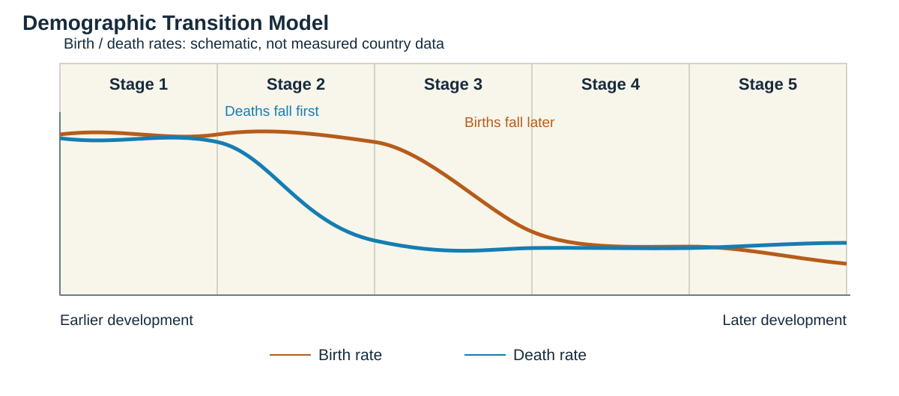
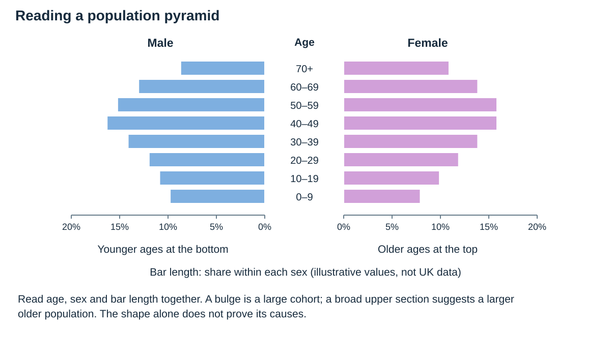

# People of the UK

## The UK in the wider world

### Trade and connections

The UK is connected to other countries through trade, investment, migration, transport and communication.

- **Exports** are goods and services sold to other countries.
- **Imports** are goods and services bought from other countries.
- Important exports include services, medicines, machinery and vehicles.
- Important imports include manufactured goods, food, fuels and raw materials.
- Trade patterns change with price, demand, transport costs, political agreements and specialised skills.

**Analogy:** Trade is like a huge swap system. The UK sells what it can produce competitively and buys products that other places supply more cheaply or in greater quantities.

### Measuring development within the UK

One indicator never tells the whole story. Use several:

- **Employment:** the number and type of jobs available.
- **Income:** earnings and household wealth.
- **Life expectancy:** average length of life.
- **Educational attainment:** qualifications and achievement.
- **Ethnicity:** the cultural diversity of a population.
- **Broadband access:** connection to digital services and opportunities.

### Why development is uneven

- **Location:** accessibility and distance from major markets affect investment.
- **Economic change:** the decline of an industry can remove many linked jobs.
- **Infrastructure:** good transport and broadband attract firms and workers.
- **Government policy:** investment, tax decisions and regeneration can help selected areas.

## Economic change: Salford Quays

### Place and industrial background

Salford Quays lies beside the Manchester Ship Canal, west of central Manchester. The former Manchester Docks handled imported and exported goods and supported warehouses, engineering and transport employment.

### Why the docks declined

**Main point:** technology and changing trade geography made the old docks less competitive.

- Container ships became larger and needed different handling facilities.
- Coastal ports offered easier access than an inland canal port.
- Manufacturing decline reduced linked trade and employment.
- The docks closed in **1982**, leaving unemployment, polluted water, derelict land and an unattractive image.

Decline became a negative cycle: fewer jobs reduced spending, dereliction discouraged investment, and the local tax base weakened.

### Regeneration strategy

Salford Council bought much of the dockland and published a development plan in **1985**. Public investment cleaned water, reclaimed land, improved roads and public space, and prepared sites for private development.

Key projects included:

- new housing, offices and leisure facilities;
- Metrolink connections and improved accessibility;
- **The Lowry**, opened in **2000**, as a cultural anchor;
- **MediaCity**, opened in **2011**, attracting the BBC, ITV, education and creative businesses.

MediaCity now hosts major broadcasters and more than **250 creative and technology businesses**, helping replace the old dock economy with a more varied service economy.

### How regeneration generates further activity

**MediaCity’s broadcasters and education sites** act as anchor organisations. They attract specialist suppliers, skilled workers and students. Those people spend in shops, cafés, transport and housing, supporting further activity: a **multiplier effect**. Metrolink improves access between the Quays and the wider city region.

However, an office occupied by a firm moving from elsewhere in Greater Manchester is not necessarily a completely new regional job. Judge **additional employment and access for existing residents**, not just the number of new buildings.

### Economic effects

New firms, visitors and residents created jobs, spending and investment. Offices, television production, digital businesses and education widened the employment base. Better transport connected the Quays to the wider city region.

Some work is highly skilled or insecure, so nearby residents do not automatically gain. Training and affordable access are needed if regeneration is to reduce local deprivation.

### Social effects

New homes, cultural venues and public spaces improved opportunities and the area's image. However, rising land and housing values can exclude lower-income households. Regeneration may produce visible success while inequality remains in surrounding neighbourhoods.

### Environmental effects

Brownfield land was reused rather than leaving derelict sites or building only on greenfield land. Water and public-space improvements created a more attractive waterfront. Construction, traffic and high resource use create continuing environmental costs.

### Evaluation

Salford Quays is a strong example of physical and economic regeneration: abandoned docks became a nationally important media and cultural district. Its social success is less complete because benefits depend on affordable housing, transport, training and whether jobs are accessible to existing communities.

### Exam pointer

Use the sequence **dock closure in 1982 → dereliction and job loss → public land and infrastructure investment → Lowry and MediaCity → economic gains but uneven social benefits**.

## Population change

### Population structure

A **population pyramid** shows age and sex structure. A broad base suggests many young people; a larger upper section suggests an ageing population.

Since 1900, death rates have fallen and people generally live longer. Birth rates later fell, so older age groups now make up a larger share of the UK population.

**Natural change:** population grows when births exceed deaths. The model does not include migration.

### Demographic Transition Model

| Stage | Birth rate | Death rate | Population change |
|---|---|---|---|
| 1 | High | High | Small, fluctuating growth |
| 2 | High | Falls rapidly | Rapid growth |
| 3 | Falls | Low | Growth slows |
| 4 | Low | Low | Stable or slow growth |
| 5 | Very low | Low | Possible natural decrease |

The model is useful for showing a broad pattern, but countries do not all change at the same speed.

**Read the shape:** identify the age group and side, then use bar length. This model illustrates the skill; it is not a UK census dataset.

### Ageing population

Causes include lower birth rates, longer life expectancy and the ageing of large generations.

- **Benefits:** experienced workers, volunteering, spending by retired people and family support.
- **Challenges:** greater demand for healthcare, pensions and social care; fewer workers per dependent person.
- **Responses:** later retirement, workplace pensions, adapting homes and services, and encouraging working-age migration.

## Migration and ways of life

**Immigration** means moving into a country. **Emigration** means moving out. **Net migration** is immigration minus emigration.

People migrate because of **push factors** such as unemployment or conflict and **pull factors** such as jobs, education, family and safety.

### Impacts of immigration

- Workers fill skills gaps and pay taxes.
- Migrants can start businesses and add cultural diversity.
- Population growth can support local services.
- Rapid growth can put pressure on housing, schools, healthcare and transport if capacity does not keep pace.
- Effects vary by place, time and the age and skills of migrants.

Avoid one-sided claims. A strong answer considers **social and economic benefits and challenges**.

## Urban change

- **Suburbanisation:** people and activities move from the inner city to the urban edge.
- **Counter-urbanisation:** people move from cities to smaller settlements or rural areas.
- **Re-urbanisation:** people and investment return to inner-city areas.

These movements affect housing demand, traffic, land values, services and the character of communities.

### Compare the three urban trends

| Trend | Why it happens | Possible consequences |
|---|---|---|
| **Suburbanisation** | Households seek space; land at the edge may be cheaper, and transport allows commuting. | Urban sprawl, greenfield development, longer journeys and greater demand for roads and services. |
| **Counter-urbanisation** | Some households leave cities for smaller settlements, seeking environment, space or remote-working opportunities. | Commuting villages, higher house prices and changed local services; access differs by income. |
| **Re-urbanisation** | Regeneration, new homes, jobs and amenities attract people back to inner areas. | Brownfield reuse and city-centre spending, but possible higher rents and displacement. |

## Leeds city case study

### Place, population and importance

Leeds is the largest city in West Yorkshire and a major centre for finance, business services, retail, healthcare, education and culture. Rail and motorway links connect it to northern England and the rest of the UK.

The city's population was about **812,000 in 2021**, an increase of **8.1%** since 2011. Around **471,000 people work in Leeds**, showing its regional employment role.

### Migration and changing character

Universities attract students from the UK and abroad. National and international migrants add workers, skills, languages, food, religion and businesses. The 2021 population included about **9.7% Asian**, **5.6% Black** and **3.4% mixed ethnic groups**.

Population growth supports services and the economy, but benefits and pressures vary by neighbourhood. New arrivals and natural increase add demand for housing, schools, healthcare and transport.

### Culture, students and consumption

**Leeds West Indian Carnival** shows how migration can shape leisure, music, food and the use of public space. Universities attract people from across the UK and overseas, supporting rental housing, cafés and entertainment. These are cultural and economic changes together, rather than simply a change in population size.

Demand can raise rents in popular neighbourhoods and create seasonal pressure on services. Effects differ between places, so one lively student area cannot represent the living conditions of every Leeds resident.

### Housing challenge

Leeds had about **362,780 homes**, and private renting accounted for roughly **21.8%**. The median house price rose from about **£175,000 in 2015 to £225,000 in 2022**. The city also contains about **19,500 pre-1919 back-to-back homes**, some needing improvements in energy efficiency and condition.

Responses include new affordable housing, brownfield redevelopment and upgrading older homes. Around **595 affordable homes were delivered in 2021**, but demand, construction cost and rising prices mean the shortage cannot be solved quickly.

### Inequality challenge

About **175,000 residents** were estimated to live in relative poverty. Lower income affects housing quality, health, education and access to opportunities. Growth in the city centre does not automatically remove deprivation elsewhere.

Successful regeneration must connect disadvantaged communities to skills, jobs and services, rather than concentrating only on high-value buildings.

### Transport challenge

Large commuter flows cause congestion, air pollution and unreliable journeys. People without good public transport may struggle to reach jobs or education.

Leeds promotes buses, park-and-ride, walking and cycling through the **Connecting Leeds** programme. These can reduce car dependence, but routes, price, reliability and safe connections determine whether people actually change travel behaviour.

### Waste and low-carbon living

The city aims to reduce waste, reuse materials and improve recycling. Collection and processing must keep pace with population and business growth.

The **Leeds PIPES** heat network uses heat recovered from the Recycling and Energy Recovery Facility. By 2026 it extended for more than **30 km**, served about **4,100 properties** including **2,000 council flats**, and supplied around **30 public and commercial buildings**. It saved more than **7,000 tonnes of carbon in 2025**.

### Evaluation

Leeds combines transport, housing, waste and low-carbon heat measures, so it addresses several parts of sustainability. PIPES turns waste heat into lower-carbon energy and directly serves homes. Yet high housing costs, poverty and unequal transport access show that environmental projects alone do not make a city socially sustainable.

### Exam pointer

Organise a developed answer as **challenge → named response → number showing scale → limitation**. For example: housing prices rose, affordable homes were built, but output remains small compared with total need.

### Case-study sources

- [Salford City Council: MediaCity and Salford Quays regeneration](https://www.salford.gov.uk/planning-building-and-regeneration/regeneration/mediacity-and-salford-quays/)
- [Salford Local List: heritage of the former docks](https://www.salford.gov.uk/lp-heritage)
- [Leeds City Council: Leeds Housing Strategy](https://www.leeds.gov.uk/housing/housing-strategy/leeds-housing-strategy)
- [Leeds City Council: transport policy and Connecting Leeds](https://www.leeds.gov.uk/parking-roads-and-travel/connecting-leeds-and-transforming-travel/transport-policy)
- [Leeds City Council: Leeds PIPES expansion](https://news.leeds.gov.uk/news/next-phase-of-low-carbon-heat-network-set-to-reach-thousands-more-residents)

## High-yield checklist

- Compare several development indicators.
- Explain uneven development using a chain: **cause → change → consequence**.
- Know the causes, effects and responses to an ageing population.
- Give balanced migration impacts.
- Use Salford Quays for economic change and Leeds for the major-city case study.
- Evaluate whether improvements are sustainable and fairly shared.

### Further case-study reading

- [Leeds West Indian Carnival: its history](https://leedscarnival.co.uk/press-room/)
- [Salford Council: MediaCity and the Quays](https://www.salford.gov.uk/planning-building-and-regeneration/regeneration/mediacity-and-salford-quays/)
