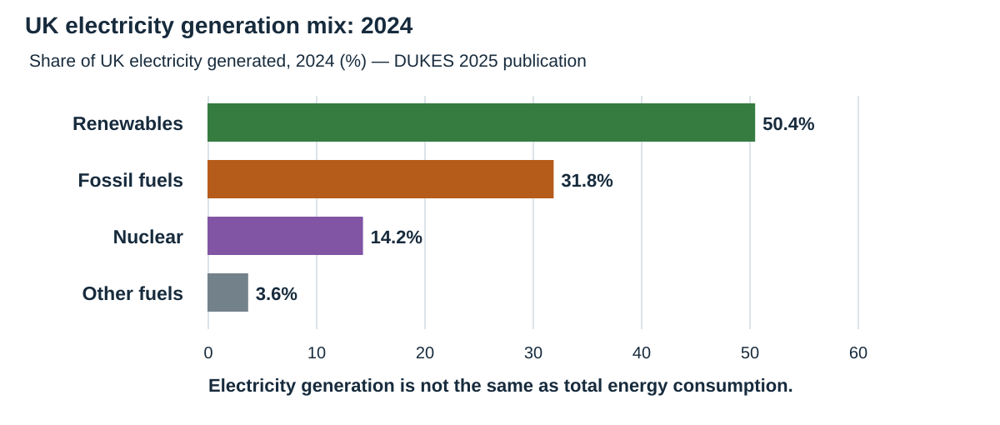
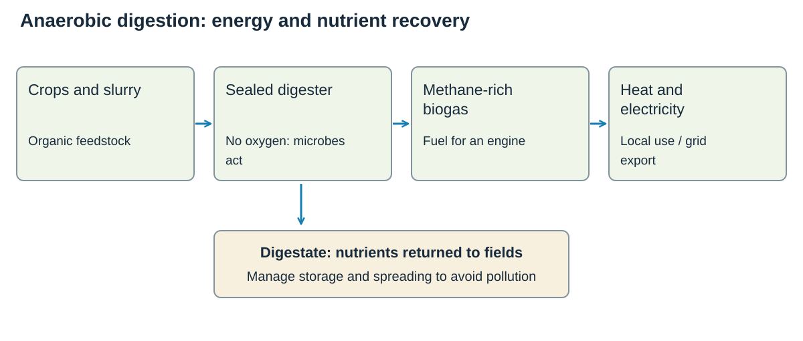

# UK environmental challenges

## The UK's climate

### Why the weather changes

The UK lies where different air masses meet. An **air mass** is a large body of air with similar temperature and moisture.

| Air mass | Usual source and weather |
|---|---|
| **Tropical maritime** | Atlantic Ocean; mild and wet |
| **Polar maritime** | North Atlantic; cool and showery |
| **Tropical continental** | Continental Europe or North Africa; hot and dry in summer |
| **Polar continental** | Eastern Europe; cold and dry, sometimes snowy after crossing the North Sea |
| **Arctic maritime** | Arctic; very cold, often with wintry showers |

- Prevailing south-westerly winds often bring moist Atlantic air.
- The **North Atlantic Drift** transfers warm water towards north-west Europe and helps keep UK winters milder than places at similar latitude.
- **Continentality** means land heats and cools faster than sea. Inland areas usually have a greater temperature range than coastal areas.
- Relief makes western uplands wetter: air rises, cools and condenses, producing relief rainfall.

### Extreme weather

UK extremes include strong winds, heatwaves, cold spells, drought and intense rainfall. An event becomes hazardous when it affects people, property, infrastructure or ecosystems.

## Flooding: Somerset Levels

### Place and physical setting

The Somerset Levels and Moors are a broad, flat wetland landscape between the Mendip, Blackdown and Quantock Hills. Rivers including the **Parrett** and **Tone** cross land drained by channels known as rhynes.

About **18% of Somerset lies below the average high-tide level**, and the Levels and Moors cover more than **60,000 hectares**. This makes drainage slow and allows a small rise in water level to spread over a large area.

### Causes of the 2013–14 flooding

**Main point:** exceptional rainfall acted on an already vulnerable landscape.

- Repeated Atlantic storms brought prolonged heavy rain.
- Saturated soil could absorb little more water, increasing surface runoff.
- River discharge exceeded channel and pumping capacity.
- High tides and high river levels slowed drainage towards the Bristol Channel.
- Silt in parts of the Parrett and Tone reduced channel capacity, although dredging alone could not remove the underlying lowland risk.

### Scale and effects

In early 2014, about **100 million m³ of floodwater** covered roughly **65 km²**. Around **172 properties** were flooded. **Northmoor** was evacuated, and communities including **Muchelney** were cut off by road.

**Social:** homes were damaged, journeys and services were disrupted, and residents experienced stress and isolation.

**Economic:** farmland remained underwater, livestock had to be moved, roads and businesses were affected, and clean-up costs continued after water levels fell.

**Environmental:** floodwater moved sediment and pollutants, damaged some farmland and habitats, but also restored wet conditions in parts of the floodplain.

### Immediate response

Emergency services and volunteers used boats, supported evacuation and delivered supplies. Temporary and permanent pumps removed water when river and tidal conditions allowed. Road closures and warnings reduced danger.

These actions protected life but could not quickly empty such a large, low-lying area while surrounding water levels remained high.

### Compare the scales of response

| Scale | Named action | What it achieves and what limits it |
|---|---|---|
| **Local** | Evacuation, supplies and access support for places such as Muchelney. | Protects life and keeps isolated communities supplied; it does not remove the floodwater source. |
| **Catchment and regional** | Dredging the Parrett and Tone, pumping and upstream water storage. | Improves conveyance and storage, but needs maintenance and can shift water or risk elsewhere. |
| **National with local delivery** | Funding and coordination through the 20-Year Flood Action Plan. | Supports major works and long-term resilience; success depends on sustained funding and cooperation. |

### Long-term management

- Sections of the **Parrett and Tone were dredged**. Dredging programmes in 2014, 2016 and 2018 removed about **270,500 m³ of silt**.
- The Muchelney–Drayton road was raised and structures at **Beer Wall** were improved to maintain access and move water.
- **21 permanent pumping stations** help manage water levels.
- The Somerset Rivers Authority coordinates maintenance, drainage, road resilience and natural flood management.
- Upstream measures such as soil management, tree planting and temporary storage slow water before it reaches the Levels.

### Evaluation

Dredging and pumping improve channel flow and reduce the duration of some floods. Raised roads protect access even when land floods. Natural flood management adds storage upstream and may improve habitats.

No measure removes risk from land below high-tide level during exceptional rainfall. Pumping costs energy, channels need repeated maintenance, and moving water faster can transfer risk. The strongest strategy combines maintenance, storage, resilient infrastructure, warnings and acceptance that some floodplain land will still hold water.

### Exam pointer

Use evidence in a chain: **saturated low-lying land + prolonged rain + restricted drainage → 65 km² flooded and communities cut off → dredging, pumping, raised roads and upstream storage**.

## Food, water and energy

### Food production

- **Mechanisation** uses machinery to raise output and reduce labour needs.
- Intensive farming can increase yields but may cause soil damage, pollution or habitat loss.
- **Commercial fishing** supplies food and jobs, but overfishing can reduce stocks and disrupt food webs.
- Sustainable approaches include quotas, protected areas, careful fertiliser use and restoring soils and habitats.

### Water supply

- **Reservoirs** store water but flood land and alter river ecosystems.
- **Water transfer** moves water from areas of surplus to areas of demand, but it is costly and can affect donor areas.
- Reducing leakage and demand may avoid some environmental impacts of new supply schemes.

### Energy choices

**Renewable sources** are naturally replenished, such as wind, solar, hydroelectric, tidal and biomass. **Non-renewable sources** are finite, such as coal, oil, natural gas and uranium.

| Resource | Renewable? | How it is used / strengths | Limitations |
|---|---|---|---|
| **Coal** | No; finite fossil fuel. | Energy-dense fuel; historically important in UK power and industry. | High carbon emissions and air pollution. UK coal-fired power ended in September 2024. |
| **Natural gas** | No; finite fossil fuel. | Heating and flexible electricity generation; power stations can respond to demand. | Carbon dioxide on combustion, methane leakage and exposure to import prices. |
| **Oil** | No; finite fossil fuel. | Especially important for transport fuels and chemical feedstocks. | Emissions, spill risk and insecure or costly supplies. |
| **Nuclear: uranium** | No; uranium is finite. | Large, dependable electricity output with low operational carbon emissions. | Long construction, high capital cost, radioactive waste and decommissioning. |
| **Wind** | Yes. | Onshore and offshore turbines generate low-operational-carbon electricity. | Output varies with wind; grid links, storage and suitable locations matter. |
| **Solar** | Yes. | Panels use sunlight; rooftops can generate near consumers. | No solar output at night and lower winter output; large farms use land. |
| **Hydroelectricity** | Yes, through the water cycle. | Stored water can provide controllable power. | Dams flood land and alter river habitats; suitable sites are limited. |
| **Tidal and wave** | Yes. | Tides are predictable; waves offer energy around exposed coasts. | High engineering costs, marine maintenance and effects on habitats or navigation. |
| **Biomass and biogas** | Renewable if feedstock is replenished sustainably. | Organic material can provide controllable heat and electricity, including from waste. | Land, transport, combustion emissions and methane leakage affect sustainability. |

### Compare demand and supply decisions

**Renewable** describes whether a resource is replenished. **Low carbon** describes its emissions. They are different tests: nuclear is low carbon during operation but its uranium fuel is non-renewable. Biomass regrowth can replace feedstock, but production and transport can still cause emissions.

Insulating a home reduces the energy it needs; building a power station increases supply. Comparing both avoids assuming that every future shortage must be solved by producing more energy.

## Changing UK energy supply

Since 1950, the UK's energy mix has shifted as coal declined, oil and gas expanded, nuclear developed and renewable electricity grew.

Changes are influenced by:

- resource availability and price;
- technology and infrastructure;
- energy security;
- climate targets and environmental rules;
- government subsidies, planning and international agreements;
- public acceptance.

Demand also changes with population, industry, transport, household technology and energy efficiency.

### Read a dated electricity mix

**DUKES 2025 figures for 2024:** renewables generated 50.4% of UK electricity, compared with 31.8% from fossil fuels. This is a snapshot of **electricity generation**, not all the energy used for heating, transport and industry.

| Generation group | 2024 share |
|---|---|
| Renewables | 50.4% |
| Fossil fuels | 31.8% |
| Nuclear | 14.2% |
| Other fuels: remainder of rounded shares | 3.6% |

The long-term pattern is a move away from coal and towards renewable electricity. Gas still matters because it can provide flexible generation when weather-dependent output is low.

## Energy case studies

### Hinkley Point C, Somerset

#### Place, purpose and scale

Hinkley Point C is being built on the Somerset coast beside earlier nuclear stations. It will use **two reactors** and is designed to supply electricity for about **six million homes** for around **60 years**, equal to roughly **7% of UK electricity demand**.

The project received its Development Consent Order in **March 2013**. Its national purpose is to provide dependable, low-operational-carbon electricity and improve energy security.

#### Economic and social benefits

- Construction was expected to support about **25,000 employment opportunities** and around **1,000 apprenticeships**.
- Project estimates suggested about **£1.5 billion** could enter the local economy through wages and contracts.
- Long-term operation creates skilled employment and supports local supply businesses.
- A planned output can balance periods when wind and solar generation are low.

#### Local and environmental costs

Construction increases traffic, demand for temporary accommodation and pressure on local services. A very large coastal site changes the landscape and can disturb habitats. Agreements with local authorities fund transport, housing and community mitigation.

Nuclear generation produces low carbon emissions during operation, but construction has embodied emissions. Radioactive waste needs secure long-term management, and decommissioning adds future cost.

#### Evaluation

Hinkley Point C offers very large, dependable low-carbon output and substantial employment. Its drawbacks are high cost, long construction, local disruption and responsibility for nuclear waste. It is strongest as one part of a diverse low-carbon system rather than the only solution.

### Hinkley Point C: proposed benefits and present disruption

Hinkley Point C is **under construction**, so its planned generation is a future benefit, not electricity already being supplied. EDF describes output sufficient for around **six million homes** once operating. The local costs of construction occur before that output begins.

The geographical issue is a difference in **scale and time**. National consumers may gain long-term energy security, while nearby communities face current traffic, accommodation demand and landscape change. Construction jobs and supply contracts benefit some people, but do not remove the need to manage those local impacts.

### Dryholme Farm, Silloth, Cumbria

#### Place and scheme

Dryholme Farm near Silloth developed a farm-based **anaerobic digestion** plant. Planning documents described a site of about **1.97 hectares**, designed to use roughly **15,000–16,000 tonnes of crops each year** plus farm slurry.

Feedstock included maize and grass silage, triticale, vegetables and wheat. At least **70% of crop feedstock** was intended to come from the farm's own **368 acres**, with other local farms supplying additional material.

#### How it works

1. Crops and slurry enter a sealed digester without oxygen.
2. Microorganisms break the material down and release methane-rich **biogas**.
3. A combined heat and power engine burns the gas.
4. The plant exports electricity to the grid and can use heat locally.
5. **Digestate** returns nutrients to farmland as fertiliser.

The plant has a capacity of about **1 MW**, enough in planning estimates for roughly **1,200 homes**, and became operational in **2011**.

**Two useful outputs:** biogas supplies energy; digestate returns nutrients to farmland. They follow different routes.

#### Benefits

- It supplies controllable renewable electricity rather than depending on wind or sunshine.
- Farm slurry and crops become useful energy and digestate.
- Digestate may reduce use of manufactured fertiliser.
- Electricity sales diversify farm income.
- Local sourcing limits some transport distance.

#### Costs and limitations

- Growing energy crops uses land that could produce food and may reduce biodiversity if farming is intensive.
- Feedstock deliveries create traffic, noise and emissions.
- Poor control can cause odour, water pollution or methane leakage.
- The scheme's roughly 1 MW output is useful locally but tiny compared with national electricity demand.

#### Evaluation

Dryholme is most sustainable when it uses nearby wastes and residues, prevents methane leakage and manages digestate safely. Heavy reliance on purpose-grown crops weakens the benefit because land, fertiliser and transport are required. It is a valuable local energy strategy, but cannot replace national-scale supply.

### Case-study sources

- [Environment Agency: Somerset Levels and Moors flood-risk reduction](https://www.gov.uk/government/publications/somerset-levels-and-moors-reducing-the-risk-of-flooding/somerset-levels-and-moors-reducing-the-risk-of-flooding)
- [Somerset Rivers Authority: dredging and silt monitoring](https://www.somersetriversauthority.org.uk/flood-risk-work/sra-annual-report-2020-21/pioneer-dredging-silt-monitoring/)
- [Somerset Council: Hinkley Point C](https://www.somerset.gov.uk/business-economy-and-licences/major-developments/hinkley-point-c/)
- [Cumberland Council planning record: Dryholme anaerobic digestion](https://cumberland.moderngov.co.uk/Data/ABC%20Development%20Panel/201002091215/Agenda/Development%20Panel%20-%202%202009%200864.pdf)
- [Environment Agency public register: Dryholme Farm](https://environment.data.gov.uk/public-register/waste-operations/registration/EB3800HM?__pageState=result-waste-operations)

## Evaluating a strategy

Use four tests:

- **Environmental:** emissions, habitats, land and waste.
- **Economic:** construction, running cost, jobs and energy price.
- **Social:** reliability, health, disruption and public acceptance.
- **Scale and time:** local impacts may differ from national benefits; short-term costs may support long-term supply.

## High-yield checklist

- Link UK weather to air masses, ocean influence, relief and continentality.
- Build a flood answer as **physical cause + human influence + effects + management**.
- Compare supply schemes with demand reduction.
- Know how the UK energy mix has changed and why.
- Use Hinkley Point C and Dryholme Farm to evaluate contrasting energy strategies.

### Further case-study reading

- [DESNZ: DUKES 2025, electricity statistics for 2024](https://www.gov.uk/government/statistics/digest-of-uk-energy-statistics-dukes-2025)
- [EDF: Hinkley Point C project](https://www.edfenergy.com/energy/nuclear-new-build-projects/hinkley-point-c)
- [Somerset Council: the 2014 floods and long-term response](https://www.somerset.gov.uk/news/flood-anniversary-flood-resilience-and-adaptation-a-key-part-of-somersets-future/)
