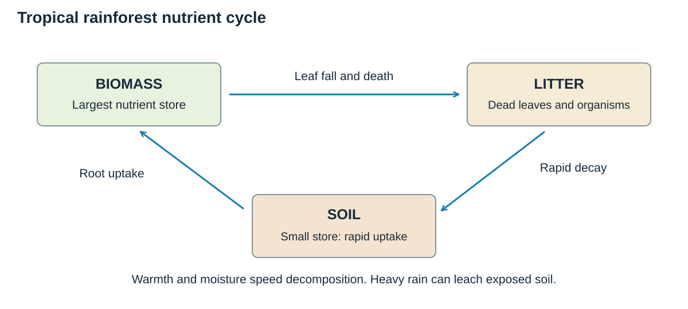
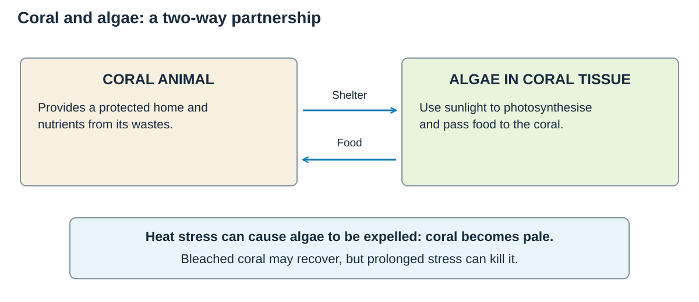

# Ecosystems of the planet

## How ecosystems work

An **ecosystem** is a community of living organisms interacting with each other and with the non-living environment. Think of it as a web: changing one strand can affect the whole system.

- **Biotic components** are living: plants, animals, decomposers and microorganisms.
- **Abiotic components** are non-living: climate, water, soil, sunlight and rocks.
- **Producers** use sunlight to make food.
- **Consumers** gain energy by eating plants or animals.
- **Decomposers** break down dead material and return nutrients to the soil.
- A **food chain** shows one feeding route; a **food web** shows connected routes.

**Interdependence** means that parts of an ecosystem rely on one another. For example, less rainfall may reduce plant growth, leaving herbivores with less food and predators with fewer prey.

## The world's major ecosystems

Climate is the main control. Temperature and rainfall affect vegetation, and vegetation affects soil and animal life.

| Ecosystem | Distribution | Climate | Plants / producers | Animals |
|---|---|---|---|---|
| **Coral reef** | Warm tropical and subtropical seas, including Andros in The Bahamas. | Warm, clear, sunlit shallow water; reef-building corals are sensitive to heat stress. | Algae within coral tissues photosynthesise; nearby seagrass beds are also productive habitats. | Coral polyps, reef fish, crustaceans and sea turtles. Coral is an animal, not a plant. |
| **Tropical rainforest** | Near the Equator: Amazon, Congo and South-East Asia, with other named regions. | Hot and humid throughout the year, commonly with more than 2,000 mm annual rain. | Evergreen layered forest, lianas and epiphytes; many broad leaves shed water. | Very diverse insects, birds, reptiles and mammals; examples include toucans, monkeys and jaguars in the Americas. |
| **Polar** | High latitudes in the Arctic and Antarctica. | Long cold winters, brief cool summers and generally low precipitation. | Sparse vegetation; mosses, lichens and small plants occur where conditions permit. | Polar bears occur in the Arctic; penguins in the Southern Hemisphere. Marine life includes seals and whales. |
| **Tropical grassland: savanna** | Seasonally wet tropics, such as East Africa and northern Australia. | Hot all year, with a marked wet and dry season. | Grasses with scattered drought-adapted trees, such as acacias and baobabs in Africa. | African examples include zebras, elephants and lions; species differ between continents. |
| **Temperate grassland** | Mid-latitude continental interiors, such as the North American prairies and Eurasian steppes. | Warm or hot summers, cold winters; too little rainfall for continuous forest. | Grasses dominate; many survive grazing, fire and seasonal cold. | Bison on North American prairies, burrowing mammals and grassland birds. |
| **Temperate forest** | Mid-latitudes, including western Europe, eastern North America and eastern Asia. | Distinct seasons; rainfall supports woodland. | Broad-leaved deciduous trees, shrubs and seasonal ground plants; evergreen types also occur. | Deer, foxes, woodland birds, insects and many decomposers. |
| **Hot desert** | Often near 20–30° north and south, including the Sahara and Australian deserts. | Usually less than 250 mm rain a year; large daily temperature ranges are common. | Sparse drought-adapted shrubs; cacti in parts of the Americas store water in stems. | Reptiles and nocturnal mammals; camels store fat, not water, in their humps. |

Major rainforest areas include the **Amazon Basin**, **Central America**, the **Congo Basin**, **Madagascar**, **South-East Asia** and **Australasia**. Major warm-water reefs include the **Great Barrier Reef**, **Red Sea reefs**, **New Caledonia**, the **Mesoamerican Reef**, **Florida Reef** and **Andros Barrier Reef**.

## Tropical rainforest processes

### Structure and adaptations

- **Emergents** rise above the forest and receive the most sunlight.
- The **canopy** forms a dense roof where much rainforest life is concentrated.
- The **understorey** is darker, warm and humid.
- The **forest floor** receives little light, so vegetation is sparse.
- **Drip-tip leaves** shed heavy rain; **buttress roots** support tall trees in shallow soil.
- Lianas climb trees to reach sunlight. Epiphytes grow on branches without rooting in the soil.

### Nutrient and water cycles

The rainforest stores most nutrients in its **biomass**, rather than its thin soil. Heat and moisture cause rapid decomposition. Roots absorb released nutrients quickly, so clearing vegetation breaks the cycle and rain can leach nutrients from exposed soil.

The forest also recycles water. Trees take up water and release vapour through **transpiration**. This adds moisture to the atmosphere, helping clouds and rainfall to form. Clearing trees reduces this recycling and increases surface runoff.

**Follow the nutrients:** leaf fall adds litter, decomposition releases nutrients and roots take them up. Heavy rain can remove nutrients quickly when soil is exposed.

## Case study: Peruvian Amazon rainforest

### Place and importance

The Peruvian Amazon lies east of the Andes and forms part of the much larger Amazon Basin. It contains immense biodiversity, stores carbon, regulates water and supports Indigenous communities. Forest products, tourism, farming and mining also create income.

### Interdependence

**Climate and vegetation:** Heavy rainfall and year-round warmth support rapid plant growth. Dense vegetation provides food and habitats, while roots help protect the soil.

**Nutrients and water:** Decomposers rapidly break down dead material, and shallow roots absorb the released nutrients. Trees return water to the atmosphere through **transpiration**, helping maintain rainfall. Plants therefore depend on the climate while also influencing it.

### Threats and consequences

**Forest clearance:** Commercial and small-scale farming clear land for crops and cattle. Logging removes valuable trees and fragments habitats. Road building opens remote forest to settlement and further extraction, while coca cultivation and fires add pressure.

**Mining and river pollution:** Mining, including illegal gold mining, removes forest and may pollute rivers. The effects extend beyond the cleared land because people and wildlife downstream depend on river water.

**Scale and carbon loss:** From **2005 to 2015**, Peru lost more than **134,000 hectares of forest per year on average**. The World Bank reported that land-use change produced **more than half of Peru's greenhouse-gas emissions**. Clearing forest releases stored carbon as well as destroying habitats.

**Soil and water changes:** Removing trees takes away the main nutrient store and reduces the supply of leaf litter. Fewer roots absorb and retain nutrients, while exposed soil suffers greater raindrop impact, erosion and leaching. Reduced interception increases rapid runoff, and lower transpiration returns less moisture to the atmosphere. These linked effects show **interdependence**: changing vegetation also changes soil, water and wildlife.

**Camisea: benefits and risks:** The **Camisea natural gas project**, operating since **2004**, supplies energy and can create employment and revenue. However, extraction sites and pipelines introduce infrastructure into sensitive forest and raise concerns about habitats and Indigenous communities. Its impact depends on access routes, safeguards, consultation and monitoring, so different types of forest use should not be treated as equally damaging.

### Sustainable management

**Indigenous land rights:** Legal recognition and secure land title strengthen communities' ability to protect forest from illegal use. Between **2015 and 2021**, a World Bank-supported programme helped recognise **253 native communities** and title **58 communities covering about 230,000 hectares**.

**Sustainable farming:** Peru's **FOLUR** project, running from **2023 to 2029**, supports **deforestation-free coffee and cocoa** across **17 provinces**. Improving production on existing farmland can provide income without further forest clearance.

**Protected forests and connected habitats:** **Manu National Park** protects a named forest area. The wider **Purús–Manu conservation corridor** connects protected and community-managed areas, allowing wildlife to move between habitats. Restoring damaged land and maintaining corridors can reduce the isolation caused by fragmentation.

**Enforcement and evaluation:** Satellite monitoring can identify clearance, but controls on illegal mining and logging still need enforcement. Secure land rights, community support and reliable sustainable incomes make conservation more practical. Rules alone may fail where enforcement is weak or illegal extraction remains profitable.

## Coral reef processes

Coral polyps build hard limestone skeletons. Tiny algae living inside the coral provide food through photosynthesis, while coral gives the algae shelter. This **mutual relationship** explains why reefs need clear, sunlit water.

Reefs have a tight nutrient cycle. Nutrients released by waste and decomposition are reused quickly by coral, algae and other organisms. There are few spare nutrients in the surrounding water.

- Reef structures provide habitats and nursery grounds.
- Fish control algae and move nutrients around the reef.
- Mangroves and seagrass trap sediment and provide connected habitats.
- If water becomes too warm, coral may expel its algae and turn white: **coral bleaching**.

**The partnership:** algae supply food; coral provides shelter and nutrients. Bleaching can be reversible if stress ends, but prolonged stress can kill coral.

## Case study: Andros Barrier Reef, The Bahamas

### Place and importance

Andros is the largest island in The Bahamas. Its barrier reef stretches for about **190 miles (306 km)** and is commonly described by the Bahamian government as the world's third-largest barrier reef. It supports fisheries, tourism, biodiversity and coastal protection.

### Interdependence and value

**Connected habitats:** Coral provides shelter and feeding grounds for fish and invertebrates. Reef fish graze algae that could otherwise smother coral. Nearby seagrass beds, mangroves and creeks provide further feeding and nursery areas, and young fish may move between them as they grow. Clearing nursery vegetation can therefore affect fisheries beyond the damaged site.

**Coastal protection and livelihoods:** The reef absorbs wave energy, reducing coastal erosion and storm damage. Healthy habitats also support fishing, diving and nature tourism, creating jobs and income. Protecting the ecosystem helps protect both the coast and the local economy.

### Threats

**Heat and storms:** Marine heat can cause **coral bleaching** and, if stress continues, coral death. Strong storms can break reef structures. Local visitor rules cannot remove the wider threat from warming seas.

**Water quality and habitat damage:** Pollution and sediment reduce water quality and the light available to coral's algae. Dredging and coastal development can damage connected habitats, while anchors and careless visitor contact can harm the reef itself. This also threatens tourism income because visitors depend on attractive, living habitats.

**Disrupted food webs:** Overfishing removes important species, while invasive lionfish disturb food webs. These changes can weaken the relationships that help keep the reef healthy.

### Protection and sustainable use

**Marine parks:** **North Marine Park** protects about **5,000 acres**, and **South Marine Park** about **3,500 acres**. Protected areas can limit damaging activities and allow fish stocks and habitats to recover. Sustainable fishing rules help protect breeding populations, while monitoring tracks bleaching, disease and changes in coral or fish numbers.

**Protecting the habitat network:** **West Side National Park** protects tidal flats and mangrove creeks on western Andros, including nursery habitat for bonefish and tarpon. It complements protection of the eastern barrier reef but is a different location. The **Crab Replenishment Reserve** protects land-crab habitat and breeding stocks.

**Tourism and evaluation:** Eco-tourism creates income and gives businesses a reason to conserve the reef. Success still depends on understood boundaries, enforcement, responsible visitors and control of nearby pollution and overfishing. Local protection improves resilience, but wider greenhouse-gas reductions are needed to limit marine heat stress.

## Exam links to remember

- Start an ecosystem answer with the named link: **climate → vegetation → soil/animals**.
- For each case study learn **place, process, value, threat, management and limitation**.
- Use a developed chain: “Trees are cleared, **so** interception falls, **therefore** runoff and soil erosion increase.”
- Do not say every management strategy is fully successful. Add a supported judgement.

## Sources for the named case studies

- [World Bank: Indigenous leadership and sustainable forest management in Peru](https://www.worldbank.org/en/results/2021/11/08/recognizing-indigenous-peoples-leadership-in-climate-action-land-security-and-sustainable-forest-management-in-the-peruv)
- [Peruvian environment ministry: FOLUR deforestation-free value chains](https://www.gob.pe/institucion/minam/campa%C3%B1as/74899-cadenas-de-valor-libres-de-deforestacion-en-la-amazonia-peruana-proyecto-folur)
- [Government of The Bahamas: About Andros](https://www.bahamas.com/the-islands/andros/about-andros)
- [Bahamas Protected Areas Register](https://bahamasprotected.com/protected-areas/register/)
- [The Nature Conservancy: Bahamas coral reef report card](https://www.nature.org/media/bahamas/bahamas-coral-reef-report-card.pdf)

- [SERNANP: Manu National Park](https://visitaareasnaturales.sernanp.gob.pe/anps/parque-nacional-del-manu/)
- [IDB: Camisea economic and ecological study](https://publications.iadb.org/en/economic-and-ecological-impact-natural-resource-extraction-case-camisea-gas-project-peru)
- [Bahamas National Trust: West Side National Park](https://bnt.bs/explore/andros/west-side-national-park/)
- [The Bahamas: Crab Replenishment Reserve](https://www.bahamas.com/vendor/crab-replenishment-reserve)
