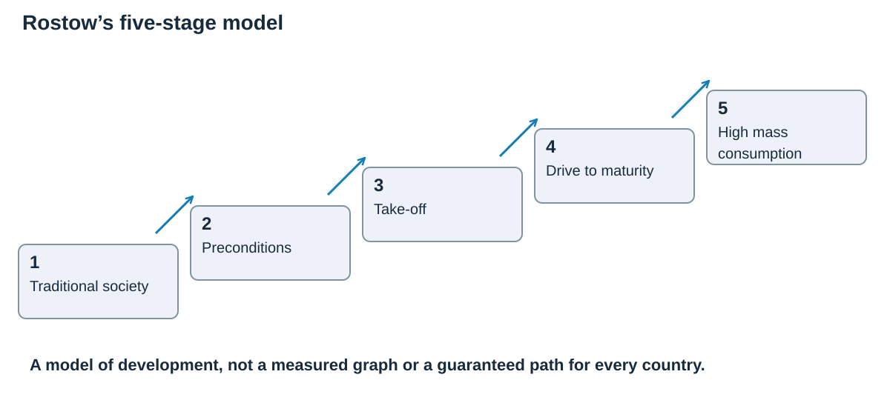

# People of the planet

## Understanding development

**Development** means improvement in people's quality of life. It has three connected parts:

- **Economic:** income, jobs, trade and infrastructure.
- **Social:** health, education, equality and access to services.
- **Environmental:** safe water, clean air and using resources without damaging the future.

Countries are often described as **ACs** (advanced countries), **EDCs** (emerging and developing countries) or **LIDCs** (low-income developing countries). These are broad groups; inequality within a country means an average never describes everyone.

### Measuring development
An indicator is like one reading on a dashboard. Income tells us something useful, but it cannot tell us by itself whether people are healthy, educated or safe.

| Indicator | What it measures | Strength | Limitation |
|---|---|---|---|
| **GNI per person** | Income earned by a country's residents, including net income from abroad, divided by population. | It helps compare average economic resources. Purchasing-power adjustments allow for different price levels. | A high average can conceal very unequal incomes. It does not directly measure health or education. |
| **Human Development Index (HDI)** | A combined index from 0 to 1 using life expectancy, education and GNI per person. | It combines social and economic dimensions instead of relying on income alone. | It is still an average. HDI does not directly measure inequality or environmental sustainability. |
| **Internet use** | The proportion of people using the internet. | It indicates access to communication, information and some economic opportunities. | It does not show connection quality, affordability or digital skills. |

HDI's education dimension uses **mean years of schooling for adults** and **expected years of schooling for children**. Its health measure is **life expectancy at birth**. Its income measure is **GNI per person**, rather than simply total GDP.

Use indicators together and compare their dates and definitions. A rise in national income can occur while some regions remain poor. Improvements in safe water or vaccination may raise quality of life before large income increases appear.

### Why development is uneven
**Historical links:** Colonial economies often supplied raw materials to overseas markets. Transport routes and ownership could favour exports rather than connections between local communities. These legacies can affect later opportunities, but colonialism does not give every country the same history or future.

**Trade and resources:** A country depending on a few primary exports is exposed to changing prices, harvests and demand. Manufacturing and processing can add value, but require power, skills and investment. Valuable minerals can fund services, yet profits may leave the country or be captured by a small group.

**Location and physical conditions:** A landlocked country can trade through neighbouring countries, but longer journeys, border procedures and dependence on another country's port can raise costs. Drought, difficult relief and disease can affect livelihoods. Their effects depend partly on infrastructure and the ability to adapt.

**Politics and investment:** Conflict can destroy roads and interrupt schooling. Debt repayments may reduce money available for services. Stable institutions, education and reliable infrastructure can help firms invest and create jobs. Investment is more beneficial when local people gain skills and income.

These factors can reinforce one another. Low household income may limit education and healthcare, reducing employment opportunities and keeping income low. Breaking this cycle needs more than one isolated project.

### How aid can help or hinder development

**Aid** is assistance intended to meet needs or support development. Different labels describe different features of the same project.

| Type | Meaning and example | Benefit and possible limitation |
|---|---|---|
| **Emergency aid** | Food, shelter or medical support following a crisis. | It can save lives quickly, but does not by itself remove the causes of vulnerability. |
| **Development aid** | Longer-term support, such as training, water systems or livelihood projects. | It can strengthen future independence, but needs maintenance, local skills and continuing access. |
| **Bilateral aid** | One government provides assistance to another country. | It can fund large programmes, but donor political or commercial interests may influence priorities. |
| **Multilateral aid** | Countries contribute through an international organisation. | It pools expertise and funding, although coordination and administration can be complex. |
| **NGO support** | A non-governmental organisation works with communities or local partners. | Local participation can make projects appropriate, but funding and geographical reach may be limited. |

**Top-down projects** are mainly planned by large organisations or authorities. They can provide major infrastructure but may overlook local needs. **Bottom-up projects** involve communities in identifying needs and making decisions. They can fit local conditions, but may be too small to provide national networks.

A **grant** does not need repayment; a **loan** does. **Tied aid** imposes conditions, such as buying goods from the donor. These are separate distinctions from emergency versus development aid. Assess who benefits, whether skills are transferred, and whether benefits continue after outside funding ends.

## Country case study: Ethiopia

### Location, environment and resources

Ethiopia is a landlocked country in the **Horn of Africa**. Its varied relief includes highlands and the low-lying Rift Valley. Rain-fed farming supports many rural households, so drought and unreliable rainfall can damage crops, livestock, food supply and income.

Resources and opportunities include fertile highland areas, coffee, livestock, **gold, platinum and copper**, rivers with hydroelectric potential and a large working-age population. Highlands rise above **4,500 m**, while lowland areas include semi-arid landscapes and the **Danakil Depression**, including **Dallol**. This variety helps explain why farming opportunities and drought exposure differ within the country. Difficult terrain, drought, soil erosion and lack of direct sea access raise transport and production costs.

### Political and historical influences

Ethiopia was not colonised for a long period, although Italy occupied it from 1936 to 1941. Later conflict, authoritarian rule and regional tensions disrupted development. Investment in roads, energy and public services supported growth, but conflict, debt, inflation and restrictions on private business created new pressures.

### Trade and foreign investment

**Exports and imports:** Major goods exports include **coffee**, cut flowers, sesame, pulses and livestock products. Ethiopia imports machinery, vehicles, fuel, medicines and manufactured goods. Depending on a small range of agricultural exports leaves earnings vulnerable to drought and changing world prices.

**Landlocked location:** Exports must reach an overseas port through another country. Long routes, border procedures and disruption can raise costs. Roads, rail and cooperation with neighbours therefore affect how successfully coffee, flowers and manufactured goods reach customers.

**Investment and jobs:** Foreign investment in factories and industrial parks can bring jobs, skills, tax income and export growth. **Afriflora/Sher Ethiopia** provides a named flower-growing example: roses are grown near **Lake Ziway**, packed and flown through **Addis Ababa** to European markets. The company reports around **12,500 employees** across its farms. This links local employment with transport, overseas demand and foreign currency earnings.

**Limits and vulnerability:** Low pay, poor conditions, pollution and profits leaving the country can reduce the benefits of foreign investment. Drought can lower farm output just as households need more food, cutting exports while adding pressure to buy imports. Diversifying production and improving transport can reduce these risks, but both need reliable services and investment.

### Population, employment and services

Ethiopia has a large and rapidly growing population. Agriculture remains important, while manufacturing, construction and services are expanding. Rapid growth creates a large labour supply but also strong demand for schools, healthcare, housing and jobs.

World Bank evidence shows both progress and limits. Between **2004 and 2016**, the national poverty rate fell from **39% to 24%**. Infrastructure programmes extended nearby safe-water access to **60 million more people**, doubled electricity access and increased child vaccinations. Yet income per person remains low, many rural livelihoods depend on rainfall and conflict has reversed some gains.

UNDP reported that Ethiopia's HDI rose from **0.283 in 2000 to 0.470 in 2018**, but remained in the low human-development group. School access and health improved, while educational quality, adult literacy and rural–urban differences remained challenges.

### Technology

Mobile phones, digital payments, improved seeds, irrigation and better transport can connect farmers to prices, finance and markets. However, electricity, internet coverage, cost and skills are uneven, particularly in rural areas.

A phone connection can help a farmer compare prices or receive payment. It is much less useful without affordable service, reliable electricity, literacy and a route to the market. Technology therefore works best alongside **education, infrastructure and functioning markets**.

This explains why investment may improve national indicators while remote communities see less change. Development must be assessed through access and quality, not just the arrival of a new company or network.

### Rostow's model
Rostow proposed a five-stage development model. Think of it as a suggested staircase rather than a compulsory route every country must follow.

| Stage | Main idea |
|---|---|
| **Traditional society** | Many people depend on agriculture, with limited industrial production and infrastructure. |
| **Preconditions for take-off** | Investment, transport, education and commercial activity develop, supporting wider economic change. |
| **Take-off** | Some industries grow rapidly, investment increases and more people move into industrial employment. |
| **Drive to maturity** | Industry and services become more diverse, with wider use of technology and skills. |
| **High mass consumption** | Higher incomes support widespread purchase of goods and services, although inequality can remain. |

Ethiopia's infrastructure and industrial investment illustrate features associated with **preconditions and take-off**. Its dependence on farming and uneven access to services show why assigning the entire country one simple stage is difficult. Different regions and sectors change at different rates.

The model draws heavily on Western industrial history. It gives too little attention to unequal trade, colonial relationships, conflict and environmental limits. Countries do not necessarily move through all stages in the same order or at the same speed.

### Aid project: Oxfam goat aid

**Place and approach:** In **Kanbi, southern Ethiopia**, Oxfam America's partner **DUBAF** used the traditional **hirbaa-dabaree** sharing system to rebuild herds after drought. The programme initially targeted **220 households**. Each first-round household received **seven goats**, then passed offspring to another family.

**Food and income:** Goat milk improves nutrition, while offspring can be sold to generate income. Manure can fertilise crops. A goat is a **productive asset**: it can continue providing benefits, rather than being used up like a single food parcel.

**Community and sustainability:** Passing on young goats spreads benefits without buying a completely new herd for each household. Locally suitable animals, existing knowledge and community responsibility help the project fit established ways of life. Success still depends on families having enough resources to care for the animals.

**Limitations:** Goats need water, grazing and veterinary care. Severe drought or disease can kill them, and extra animals can increase pressure on scarce pasture. The scheme can strengthen livelihoods but cannot replace roads, education, healthcare or emergency relief.

## A changing urban world
### Size, influence and growth

| Term | Meaning | Important distinction |
|---|---|---|
| **City** | A large, densely populated urban settlement with varied functions. | Official definitions and boundaries differ between countries. |
| **Megacity** | An urban area with more than 10 million people. | This describes population size, rather than its global influence. |
| **World city** | A city with major international influence through finance, business, culture or politics. | A world city does not have to be a megacity. |
| **Urbanisation** | An increase in the proportion of a population living in urban areas. | This is a percentage, not simply an increase in city population. |
| **Urban growth** | An increase in the number of people living in urban areas. | Numbers can rise without the urban share increasing. |

Many ACs already have a high urban share and relatively slow urban growth. Many LIDCs and EDCs have faster growth as migration and births add to city populations. Many of the world's largest cities are in Asia, while rapid growth also occurs across parts of Africa. A fast-growing country is not necessarily the most urbanised one.

### Why people move to cities

**Push factors** make rural life difficult. Low farm incomes, fewer jobs, unreliable rainfall and limited services may encourage people to leave. Mechanisation can reduce the number of farm workers needed.

**Pull factors** make cities attractive. People may expect paid work, further education, healthcare or support from relatives. These opportunities are not guaranteed: a move can lead to insecure work or poor housing.

**Natural increase** occurs when births exceed deaths. A youthful city population can produce many births, while improvements in healthcare reduce deaths. This increases urban numbers, but does not on its own prove that the country's urban proportion rose.

### Opportunities and pressures

Businesses gain workers and customers when cities grow. A concentrated population can support hospitals, universities, public transport and cultural activities. Workers and firms can exchange ideas, helping new services and industries develop.

If housing and infrastructure grow more slowly than population, informal settlements and overcrowding may expand. Limited drainage, sanitation and waste collection can increase pollution and disease risks. Congestion wastes time, while insecure incomes make services harder to afford.

**Formal employment** is registered and subject to official regulation and taxation. **Informal employment** operates partly or wholly outside these arrangements, often without secure contracts or protection. Self-employment is not automatically informal. Informal work can provide essential livelihoods, but earnings and conditions may be insecure.

The important question is how opportunities and services are shared. A prosperous central district can exist beside poorly serviced settlements, so city averages conceal inequality.

## Major-city case study: Rosario, Argentina

### Location and role

Rosario lies on the **Paraná River** in Santa Fe Province, about 300 km north-west of Buenos Aires. The river port links a productive agricultural region to world markets. Food processing, grain and oilseed exports, manufacturing, logistics, commerce, education and culture give Rosario regional and national importance.

Argentina's 2022 census recorded **1,030,069 people**, **402,085 households** and **456,040 dwellings** in the municipality's **178.69 km²**. Municipal material says Rosario generates more than **half of Santa Fe Province's gross product** with its surrounding agri-industrial area.

### Migration and ways of life

People have moved to Rosario from rural areas and neighbouring provinces for work, education and services. A city migration profile found that **63.8% of internal migrants** came from adjoining provinces. Migration adds workers, skills and cultural diversity, but rapid growth can increase pressure on jobs and housing.

Living conditions vary sharply. Central and riverside districts have formal housing, services and cultural attractions, while lower-income households may have insecure work and poorer access to services. More than **80 migrant community associations** reflect the city's diversity.

Rosario’s **National Flag Memorial** connects the riverfront to the city’s role in Argentina’s national history. Italian and Spanish migration influenced food, architecture and community life. **Rosario Central** and **Newell's Old Boys** give football a strong place in local identity; **Lionel Messi** was born in the city. Migrant communities add associations, food traditions and cultural activities. These features help explain how a trading city develops a distinctive identity, rather than treating culture as a list of famous residents.

Culture also uses space and services: festivals, public waterfront areas and leisure venues attract visitors and spending, while residents still need affordable housing and transport. An attractive city centre therefore does not by itself prove that living conditions are good everywhere.

### Housing

A historic city survey identified **91 informal settlements**, about **10% of the urban area**, housing roughly **115,000 people**. Poor housing is linked to insecure tenure and limited access to infrastructure and services.

The IDB-backed **Rosario Hábitat** operation was approved in **2001**. The programme targeted **11 settlements and about 5,200 families**. It combined housing and infrastructure with legal land ownership, community participation, social support, employment support and some relocation. Improvements included drainage, sanitation and streets, alongside education and employment training for young people. This tackles several causes of inequality rather than treating poor housing as only a building problem.

**Secure tenure** gives households greater confidence that improvements will not be lost through eviction. Drainage, sanitation, streets and services tackle problems that a new house alone cannot solve. Resident involvement can make the changes more suitable for the community.

However, relocation may disrupt support networks. Citywide housing need is larger than one programme, and land, funding and population change can slow progress. Judge the improvements alongside the number of people still beyond the programme’s reach.

### Transport

Buses are central to public transport, while walking and cycling schemes provide alternatives to cars. Rosario's 2018 greenhouse-gas inventory attributed **34.3% of emissions** to transport, showing why cleaner buses and active travel matter. Congestion, cost, safety and unequal route access remain challenges.

### Waste

Waste collection and separation are necessary to prevent pollution and health risks. Large commercial and industrial generators produce about **20% of the city's waste**, so Rosario requires them to manage waste separately. Success depends on participation, reliable collection and markets for recycled materials.

### Sustainable strategy: urban agriculture and the Green Belt

Rosario began its **Urban Agriculture Programme in 2002**, turning unused land into productive gardens. The **Green Belt Project**, launched in 2016, supports agroecological food production near the city.

By 2021 the wider programme involved about **25 hectares**, **155 growers**, **nine productive garden spaces** and **seven garden parks**. It creates income, supplies local food, reuses urban land, shortens supply chains and adds green space.

Vegetation can also provide shade and help water soak into soil. Productive green space may be compatible with allowing some land to flood, but crops can still be damaged. Growers need safe soil as well as suitable water and markets. Access to land, seeds and training helps lower-income households take part. Women can gain skills and an independent income, while sales to local markets and businesses connect the gardens to the wider city economy.

**Evaluation:** The scheme joins social, economic and environmental aims, making it a strong example of sustainable urban living. Its scale is still small beside the needs of a million-person city, and long-term success depends on secure land, training, water, markets and funding. Urban farming complements drainage, safe housing and the wider food system; it cannot replace them.

## Exam links to remember

- When using an indicator, always give **one strength and one limitation**.
- For Ethiopia, connect a factor to a consequence: “Landlocked → longer route to a port → higher export costs.”
- For Rosario, structure a developed answer as **challenge → named strategy → evidence → limitation**.
- A judgement should compare how far a strategy improves lives with the size of the remaining problem.

## Sources for the named case studies

- [World Bank: Ethiopia overview](https://www.worldbank.org/ext/en/country/ethiopia)
- [UNDP: Ethiopia Human Development Report 2019](https://www.undp.org/ethiopia/publications/human-development-report-2019)
- [WTO: Ethiopia trade profile](https://ttd.wto.org/en/profiles/ethiopia)
- [Oxfam: traditional herd rebuilding in Ethiopia](https://www.oxfamamerica.org/explore/stories/a-traditional-form-of-help-allows-families-to-rebuild-herds-in-ethiopia/)
- [Rosario municipality: city information](https://www.rosario.gob.ar/inicio/rosario-city)
- [IOM: Migration Profile of Rosario](https://repository.iom.int/handle/20.500.11788/2393)
- [Inter-American Development Bank: Rosario Hábitat](https://www.iadb.org/en/project/AR0262)
- [FAO: Rosario urban agriculture and Green Belt](https://www.fao.org/platforms/green-cities/green-cities-initiatives/rosario/en)

- [Oxfam: the Kanbi goat-sharing project](https://www.oxfamamerica.org/explore/stories/a-traditional-form-of-help-allows-families-to-rebuild-herds-in-ethiopia/)
- [IDB: Rosario neighbourhood improvement, approved 2001](https://www.iadb.org/en/project/AR0262)
- [Rosario municipality: National Flag Memorial](https://www.rosario.gob.ar/inicio/index.php/node/514)

- [Sher Ethiopia: farms, employment and export routes](https://sherethiopia.com/about-us-sher/our-company/)

- [Afriflora: its Ethiopian rose-growing operations](https://afriflora.nl/over-ons/)

## Sources

- [UNDP: HDI dimensions and limitations](https://hdr.undp.org/data-center/human-development-index).

- [PMT: Detailed Notes](../Reference Materials/PMT - Global development - Edexcel A.pdf). Unmodified reference; its original board is recorded in the review metadata.
- [Study Rocket: Megacities](https://studyrocket.co.uk/revision/gcse-geography-b-edexcel/an-urbanising-world/megacities). Cross-checked against the project specification.
- [Study Rocket: Urbanisation](https://studyrocket.co.uk/revision/gcse-geography-b-edexcel/an-urbanising-world/urbanisation). Cross-checked against the project specification.
- [Study Rocket: Bottom Up Development](https://studyrocket.co.uk/revision/gcse-geography-b-edexcel/development-dynamics/bottom-up-development). Cross-checked against the project specification.
- [Study Rocket: Defining Development](https://studyrocket.co.uk/revision/gcse-geography-b-edexcel/development-dynamics/defining-development). Cross-checked against the project specification.
- [Study Rocket: Measuring Development](https://studyrocket.co.uk/revision/gcse-geography-b-edexcel/development-dynamics/measuring-development). Cross-checked against the project specification.
- [Study Rocket: Theories Of Development](https://studyrocket.co.uk/revision/gcse-geography-b-edexcel/development-dynamics/theories-of-development). Cross-checked against the project specification.
