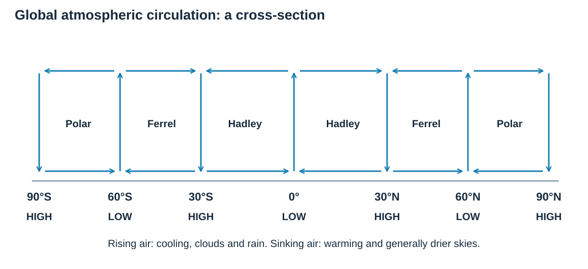
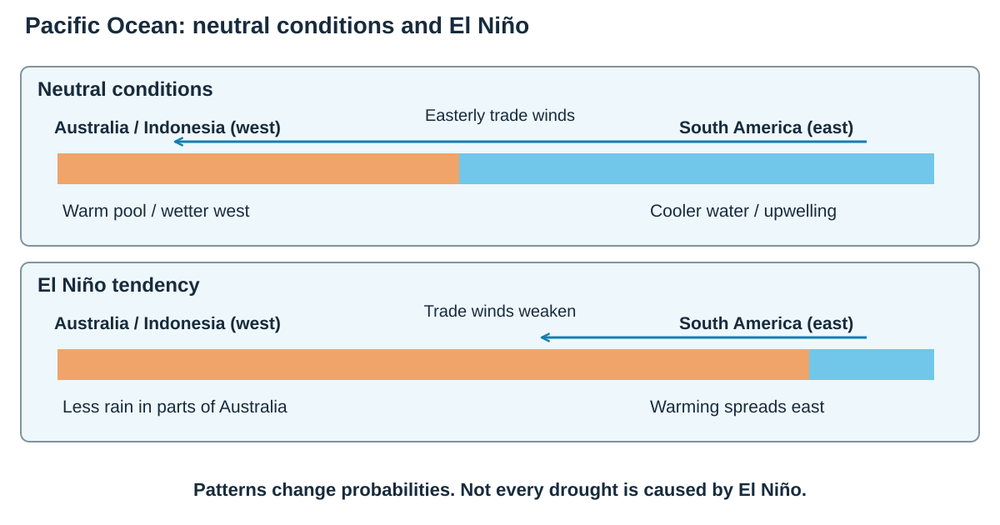

# Environmental threats to our planet

## Climate change through time

Earth's climate has always changed. **Climate change** is a long-term shift in average conditions; it is different from one unusual weather event.

### The Quaternary period

The **Quaternary** began about 2.6 million years ago. It contains repeated cold **glacial periods** and warmer **interglacial periods**. We live in a warm interglacial, but recent warming is unusually rapid.

- The **Medieval Warm Period** brought relatively warm conditions to parts of the Northern Hemisphere, roughly between AD 900 and 1300.
- The **Little Ice Age**, roughly AD 1300–1850, brought cooler conditions in many Northern Hemisphere regions.
- Since the late nineteenth century, global average temperature has risen strongly, with the fastest warming occurring in recent decades.

### Evidence of past climate
A climate record is like a collection of clues. Some are direct measurements; others are **proxies**, which record a response to climate rather than temperature itself.

| Evidence | What it can show | Limitation |
|---|---|---|
| **Thermometer records** | Instrumental observations show recent temperature change. Long records allow averages and trends to be compared. | Coverage is shorter than geological history, and instruments, sites and methods need checking. |
| **Ice cores** | Trapped bubbles preserve samples of past air, including greenhouse gases. Isotopes in the ice help reconstruct past temperature. | Dating and interpretation introduce uncertainty. A polar record is not a direct global thermometer. |
| **Tree rings** | Ring width and density can indicate growing conditions; overlapping records extend the sequence. | Growth also depends on rainfall, species, soil, pests and competition. A wide ring does not always mean a warmer year. |
| **Diaries and harvest records** | Accounts may identify frost, floods or growing seasons at a known place and time. | They are local, incomplete and influenced by what observers chose to record. |
| **Paintings** | They can support evidence of particular conditions, such as a frozen river. | Artistic choices and unusual events may be overrepresented. One painting does not establish a long-term trend. |

Look for agreement between independent sources and distinguish local change from global averages. The Medieval Warm Period and Little Ice Age describe regional patterns that were not identical everywhere.

## Why climate changes

### Natural causes
| Cause | How it changes climate | Important qualification |
|---|---|---|
| **Orbital changes** | Changes in the shape of Earth's orbit, its tilt and the direction of its axis alter the seasonal and geographical distribution of sunlight. | They act over thousands of years and help explain glacial cycles, rather than the rapid warming of recent decades. |
| **Solar variation** | Changes in the Sun's energy output slightly alter the energy received by Earth. | The approximately 11-year sunspot cycle is a small variation; it does not explain the modern warming trend on its own. |
| **Major volcanic eruptions** | Sulphur dioxide reaching the stratosphere forms reflective aerosols, reducing incoming sunlight and causing temporary cooling. | Not every eruption has this effect. Ash tends to settle faster, while aerosols can persist longer. |

**Tilt** changes the contrast between seasons. **Precession** is the slow wobble of the axis, which changes the timing of seasons relative to Earth's position in its orbit. It does not mean Earth's daily rotation stops or reverses.

### Human causes and the enhanced greenhouse effect

The natural greenhouse effect keeps Earth warm enough for life. Human activity adds more greenhouse gases, strengthening it.

1. Short-wave solar energy passes through the atmosphere.
2. Earth absorbs it and gives out long-wave heat radiation.
3. Greenhouse gases absorb and re-radiate some heat.
4. More greenhouse gas means more heat is retained.

- Burning fossil fuels and making cement add **carbon dioxide**.
- Deforestation releases carbon and removes a carbon store.
- Cattle, rice farming and landfill add **methane**.
- Fertilisers add **nitrous oxide**.

Natural factors explain earlier changes, but the rapid modern rise is mainly caused by human greenhouse-gas emissions.

### Current and future consequences

- Melting land ice and warmer expanding seawater raise **sea level**.
- Heatwaves and some heavy-rainfall events become more likely or intense.
- Rainfall patterns shift, increasing drought risk in some places and flood risk in others.
- Habitats move or disappear; coral bleaching and species loss increase.
- Food, water, health, homes and infrastructure face greater pressure.
- Impacts are unequal: poorer communities often have fewer resources to adapt.

### Feedback and unequal consequences

Melting reflective snow or ice exposes darker surfaces that absorb more solar energy. This can cause further warming and melting: a **positive feedback** amplifies the initial change.

Rising sea level has two major causes: warming seawater **expands**, and melting **land ice** adds water to the ocean. Floating sea ice does not raise sea level in the same way when it melts.

Longer growing seasons may benefit some cooler regions, but heat stress, water shortage and pests can offset this. Low-lying coasts face flooding and saltwater intrusion. The severity of damage depends on exposure, vulnerability and resources for adaptation, so the same physical change does not affect every community equally.

## Global circulation and extreme weather

The Equator receives concentrated solar energy while the poles receive less. This unequal heating drives global atmospheric circulation.

- Warm air rises near the Equator, creating low pressure and heavy rainfall.
- Higher in the atmosphere it moves poleward, cools and sinks around 30°, creating dry high-pressure zones where many hot deserts occur.
- Air rises again around 60°, where warmer and colder air meet, then sinks over the poles.
- Earth's rotation deflects winds through the **Coriolis effect**.

These circulation cells and pressure belts help create climatic regions and steer weather systems.

**Read from Equator to pole:** air generally rises at 0° and 60°, and sinks at 30° and 90°. These broad belts help explain wet and dry climates.

### Tropical storms

Tropical storms usually form between about 5° and 30° north and south where:

- sea surface temperature is at least about **27°C**;
- warm water is deep enough to supply energy;
- rising moist air creates low pressure and thunderstorms;
- there is enough Coriolis force for rotation;
- wind shear is low, so the storm structure is not torn apart.

Condensation releases heat, powering more uplift. Storms weaken over land or cooler water because their energy and moisture supply is cut off. Climate change may not make every basin produce more storms, but warmer seas and higher sea level can increase intense rainfall and storm-surge damage.

### Drought

A **drought** is an extended period when water supply is below normal need.

- **Meteorological drought:** unusually low rainfall.
- **Agricultural drought:** insufficient soil moisture for crops and grazing.
- **Hydrological drought:** low river, reservoir and groundwater levels.

Drought can develop because pressure systems block rain, sea-temperature patterns shift rainfall, temperatures increase evaporation, or demand exceeds supply. It often develops slowly, so effects build over months or years.

### Pacific conditions: neutral, El Niño and La Niña

| Feature | Neutral conditions | El Niño | La Niña |
|---|---|---|---|
| **Trade winds** | Usually blow westwards across the equatorial Pacific. | Weaken; the warm surface-water pool spreads eastwards. | Usually strengthen, pushing warm water farther west. |
| **Eastern Pacific** | Cooler water rises near South America through upwelling. | Surface water becomes warmer than usual and upwelling is reduced. | Surface water is cooler than usual and upwelling strengthens. |
| **Rainfall pattern** | Rising warm, moist air supports rainfall in the western Pacific. | Tropical rainfall tends to shift east; parts of Australia are more likely to be dry. | More rising moist air and rainfall often occur in the western Pacific, raising flood risk in some Australian regions. |
| **What it means** | A reference condition, not a guarantee of normal weather everywhere. | Raises the probability of some drought conditions; does not cause every drought. | Raises the probability of some wet conditions; does not cause every flood. |

**Link ocean to atmosphere:** the location of warm water affects where moist air rises and rainfall develops. Patterns change risks rather than determine every event.

### Distribution and changing frequency of hazards

**Tropical storms** occur mainly over warm oceans away from the Equator, including the North Atlantic, Pacific and Indian Ocean basins. They are called hurricanes in the Atlantic and north-east Pacific, typhoons in the north-west Pacific and tropical cyclones in the Indian Ocean and South Pacific. The sea supplies energy, while Earth’s rotation helps provide spin.

**Drought** can occur in many climates when rainfall is unusually low for that place and demand exceeds available water. Dry regions and places with strongly seasonal rain can be especially vulnerable. A dry climate alone does not identify a drought: the comparison is with expected conditions and needs.

Compare frequency using the **same definition, location and time period**. Counts of reported disasters also reflect population, exposure and reporting, so they are not simply counts of weather events. Warming can increase the intensity of heavy rain and strong tropical cyclones, but it does not mean storm numbers rise everywhere. Drought trends differ by region and by whether rainfall, soil moisture or river flow is being measured.

### How the circulation model explains rainfall

As air rises it expands and cools. Water vapour can condense into clouds, making rainfall more likely. As air sinks it warms, making condensation less likely. This helps explain wet equatorial belts and dry subtropical belts.

At the surface, air generally moves from **higher towards lower pressure**. Earth's rotation deflects it to the right in the Northern Hemisphere and left in the Southern Hemisphere. The **Hadley, Ferrel and Polar cells** transfer energy, while their associated winds help redistribute moisture. The model is simplified: continents, mountains, oceans and seasonal shifts alter local weather.

### Storm structure and different hazards

The **eye** has sinking air and relatively calm conditions. The surrounding **eyewall** has strong uplift, the most intense rain and very strong winds. Spiral rain bands extend farther out. A calm eye does not mean the storm has ended; the other side of the eyewall may follow.

Strong winds can damage buildings directly. A **storm surge** is an abnormal rise in sea level, driven mainly by winds pushing water towards the coast, with low pressure contributing. Heavy rainfall can flood rivers and trigger landslides. Damage therefore depends on more than wind speed alone.

Do not confuse drought with permanent aridity. A desert is normally dry; a normally wet region can experience drought when rain stays unusually low. Pollution or unaffordable water can cause water insecurity without being a meteorological drought.

## Drought case study: Australia, 2002–2009

### Development and causes

**Timing and rainfall:** The **2002–2009** case study covers severe phases of the longer **Millennium Drought**, which affected southern Australia from the late 1990s to **2009–10**. During the **2002–03 El Niño**, reduced rainfall in the western Pacific helped produce drought in Australia. Rainfall deficiency from March **2002** to January **2003** rivalled the country's most severe recorded droughts. In **2002**, national rainfall averaged **339 mm**, compared with a long-term average of **472 mm**; it was then the fourth-driest year since **1900**.

**Repeated dry periods and heat:** A further **El Niño in 2006–07** brought very low rainfall across southern and coastal areas. Declining cool-season rainfall meant occasional wet months did not fully restore soil moisture, rivers and reservoirs. High temperatures increased evaporation and dried vegetation and water stores. The whole drought was **not one continuous El Niño**: several climate influences combined with repeated dry seasons.

**Water demand:** The **Murray–Darling Basin** supplies irrigated farms, towns and ecosystems. Around the drought period it supported more than **2 million people** and about **40% of Australia's agricultural production by value**. These figures describe the whole basin, rather than only settlements directly on the Murray River. Taking water during low flows increases competition between users, so demand and management make the rainfall shortage more severe.

### Effects on people and the economy

**Farms and rural communities:** Lower crop yields and livestock production reduced farm income. Some farmers sold animals they could no longer feed, affecting associated businesses and employment. Reduced irrigation allocations in the **Murray–Darling Basin** intensified competition between farms, towns and environmental needs. Financial pressure and uncertainty increased stress in rural communities.

**Cities and industry:** Water restrictions affected households and businesses. Melbourne's water storage fell from **97.5% in October 1996 to 33.0% in June 2010**, showing the cumulative effects of the wider drought. Hydroelectric generation and other water-dependent industries faced reduced supply. Lower agricultural production could also raise food costs and disrupt tourism dependent on rivers and lakes.

**Fire risk:** Dry vegetation and heat increased bushfire danger. The **2006–07 Great Divide fires** were the longest-running bushfires in Victoria's recorded history, adding danger and disruption to already stressed communities.

### Environmental effects

**Rivers and wetlands:** Reduced river flows meant fewer wetland floods and shrinking aquatic habitats. Low water levels could worsen water quality, including conditions favouring harmful algal blooms. Fish and other wildlife lost suitable habitat, and stressed river red gums showed how plants also depend on regular flows.

**Vegetation and soil:** Heat and lack of water dried vegetation and reduced habitat quality. Bare, dry soil was more vulnerable to wind erosion, while reduced flushing and low flows could worsen salinity problems. These changes weakened the whole ecosystem, rather than affecting water supplies alone.

### Responses and adaptation

**Saving water:** Restrictions reduced garden watering, car washing and other non-essential use. Rainwater tanks and reuse of suitable household water helped reduce demand on public supplies. Irrigation improvements, including lined channels and better scheduling, aimed to produce more crops from each unit of water.

**Diversifying supplies:** Cities invested in recycled water, linked supply systems and **desalination**. **Sydney's Kurnell desalination plant** was built in response to the drought and began supplying water in **2010**. It can provide up to **15% of Sydney's drinking water**, adding a source that does not depend on local rainfall. This was a longer-term response, rather than a plant supplying water throughout **2002–2009**.

**Supporting farms and sharing water:** Farmers changed crops, reduced herds, stored fodder and used seasonal forecasts. Drought relief helped households cope financially. Water allocation rules and trading redistributed scarce supplies, while government purchases of some water rights supported environmental flows in the **Murray–Darling system**. These approaches involve choices between competing users.

| Response | How it helps | Main trade-off |
|---|---|---|
| **Restrictions and conservation** | Cut non-essential use quickly and encourage habits that save water. | Affects households, gardens and some businesses; cannot restore missing rainfall. |
| **More efficient irrigation** | More crop output may be obtained from each unit supplied. | New equipment costs money, and efficiency does not guarantee more water stays in the river. |
| **Recycling and rainwater storage** | Use water again or capture rainfall near the user. | Treatment, safe use and storage cost money; rainfall tanks still depend on rain. |
| **Desalination** | Adds a source less dependent on local rainfall. | Energy-intensive and expensive; coastal disposal of concentrated brine needs management. |
| **Water allocation and trading** | Distributes scarce water between uses under agreed rules. | Smaller farms and ecosystems may lose unless access and environmental flows are protected. |

### How successful were the responses?

Demand controls can work quickly and conservation habits may last. Diverse supplies make cities less dependent on rainfall. Efficient irrigation produces more value per litre.

However, desalination is expensive and energy-intensive, water trading may disadvantage smaller farms, and new infrastructure cannot create water for every user. Very heavy La Niña rainfall in 2010–11 ended the worst hydrological drought, so policy alone did not end it.

## Exam links to remember

- Keep **weather** and **climate** separate.
- For evidence, explain what the record shows and one limitation.
- For a storm, write the energy chain: **warm sea → evaporation → condensation → heat release → falling pressure and stronger winds**.
- For Australia, learn a chain with evidence: **El Niño and cool-season rainfall failure → low storage and farm water → restrictions and supply investment**.
- Evaluate by comparing immediate relief, long-term resilience, cost and who may lose.

## Sources for the named case study

- [Australian Bureau of Meteorology: El Niño and La Niña history](https://www.bom.gov.au/climate/history/enso/)
- [Bureau of Meteorology: Annual climate statement 2002](https://www.bom.gov.au/climate/current/annual/aus/2002/)
- [Bureau of Meteorology: southern rainfall decline and the Millennium Drought](https://www.bom.gov.au/climate/updates/articles/a010-southern-rainfall-decline.html)
- [CSIRO: water-resource impacts of the 1997–2009 drought](https://www.csiro.au/-/media/About/Files/Impact-case-studies/Full-Reports/ACIL-Allen_CSIROs-Impact-and-Value_Integrated-Water-Resource-Asessments_2014.pdf)

- [NOAA: ENSO patterns across the Pacific](https://www.noaa.gov/jetstream/tropical/enso/enso-patterns)
- [Australian Bureau of Meteorology: ENSO history](https://www.bom.gov.au/climate/history/enso/)
- [Bureau of Meteorology: the 2002 annual climate statement](https://www.bom.gov.au/climate/current/annual/aus/2002/)
- [IPCC AR6: weather and climate extremes](https://www.ipcc.ch/report/ar6/wg1/chapter/chapter-11/)

- [Murray–Darling Basin Authority annual report 2011–12: population and agriculture](https://www.parliament.nsw.gov.au/tp/files/1382/MDBA-annual-report-2011-12-web.pdf)

- [Sydney Desalination Plant: purpose, completion and supply](https://sydneydesal.com.au/education/our-role-in-supplying-sydneys-water/)

## Sources

- [PMT: Detailed Notes](../Reference Materials/PMT - Weather hazards and climate change - Edexcel A.pdf). Unmodified reference; its original board is recorded in the review metadata.
- [Study Rocket: Characteristics Of Cyclones](https://studyrocket.co.uk/revision/gcse-geography-b-edexcel/hazardous-earth/characteristics-of-cyclones). Cross-checked against the project specification.
- [Study Rocket: Human Causes Climate Change](https://studyrocket.co.uk/revision/gcse-geography-b-edexcel/hazardous-earth/human-causes-climate-change). Cross-checked against the project specification.
- [Study Rocket: Impactof Cyclones](https://studyrocket.co.uk/revision/gcse-geography-b-edexcel/hazardous-earth/impactof-cyclones). Cross-checked against the project specification.
- [Study Rocket: Natural Climate Change](https://studyrocket.co.uk/revision/gcse-geography-b-edexcel/hazardous-earth/natural-climate-change). Cross-checked against the project specification.
- [Study Rocket: The Global Atmospheric System](https://studyrocket.co.uk/revision/gcse-geography-b-edexcel/hazardous-earth/the-global-atmospheric-system). Cross-checked against the project specification.
- [Study Rocket: Theories Of Natural Climate Change](https://studyrocket.co.uk/revision/gcse-geography-b-edexcel/hazardous-earth/theories-of-natural-climate-change). Cross-checked against the project specification.
