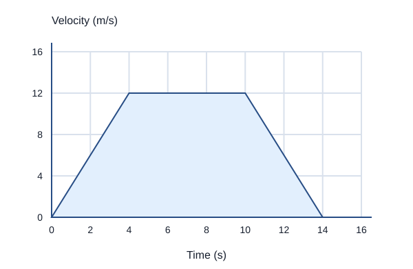
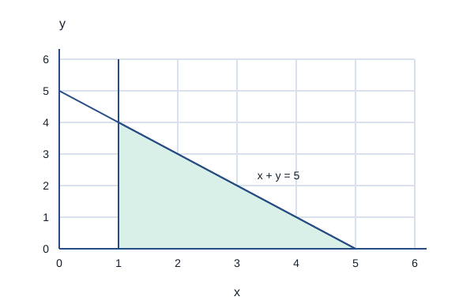

# Algebra: questions and answers

## 1 mark

**1.** In 7x² − 3x + 5, state the coefficient of x and the constant term.

**Answer:** The coefficient of x is −3, and the constant term is 5.

**2.** Find 3a² − 2b when a = −2 and b = 5.

**Answer:** 3(−2)² − 2(5) = 12 − 10 = 2.

**3.** Find the midpoint of (−4, 3) and (2, −5).

**Answer:** ((−4 + 2)/2, (3 − 5)/2) = (−1, −1).

**4.** State the gradient and y-intercept of y = −3x + 7.

**Answer:** Gradient = −3; y-intercept = 7, at the point (0,7).

## 2 marks

**5.** Simplify 3x − 2(4 − x) + 5.

**Answer:**

- Expand the bracket: 3x − 8 + 2x + 5.
- Collect like terms to obtain 5x − 3.

**6.** Factorise fully 6x² − 15x.

**Answer:**

- The highest common factor is 3x.
- 6x² − 15x = 3x(2x − 5).

**7.** Factorise 6x² + 11x + 3.

**Answer:**

- Split 11x into 9x + 2x.
- 6x² + 9x + 2x + 3 = (3x + 1)(2x + 3).

**8.** Simplify (x² − 9)/(x² + x − 6), and state the excluded values of x.

**Answer:**

- Factorise: (x − 3)(x + 3)/[(x + 3)(x − 2)].
- The simplified expression is (x − 3)/(x − 2), with x ≠ −3 and x ≠ 2 from the original denominator.

**9.** Make x the subject of y = (3x − 4)/5.

**Answer:**

- Multiply by 5: 5y = 3x − 4.
- Add 4 and divide by 3: x = (5y + 4)/3.

**10.** f(x) = 2x + 3 and g(x) = x². Find f(g(−2)) and g(f(−2)).

**Answer:**

- g(−2) = 4, so f(g(−2)) = 2(4) + 3 = 11.
- f(−2) = −1, so g(f(−2)) = (−1)² = 1. The order matters.

**11.** Find f⁻¹(x) for f(x) = 3x − 7.

**Answer:**

- Reverse the operations: add 7, then divide by 3.
- f⁻¹(x) = (x + 7)/3.

**12.** The graph y = f(x) is translated to y = f(x − 3) + 2. Describe the translation.

**Answer:**

- It moves 3 units to the right and 2 units upwards.
- The translation vector has horizontal component 3 and vertical component 2.

**13.** Match each description to y = x³, y = 1/x or y = 2ˣ: passes through (0,1); has two separate branches and excludes x = 0; passes through the origin with an S-shaped curve.

**Answer:**

- Passing through (0,1): y = 2ˣ. Two branches with x ≠ 0: y = 1/x.
- The S-shaped curve through the origin is y = x³.

**14.** Solve 4(2x − 3) = 3x + 13.

**Answer:**

- 8x − 12 = 3x + 13, so 5x = 25.
- x = 5.

**15.** Solve −3x + 5 ≤ 17.

**Answer:**

- −3x ≤ 12.
- Dividing by a negative reverses the inequality, giving x ≥ −4.

**16.** A sequence starts at 5. Each next term is twice the previous term minus 1. Find the next three terms.

**Answer:**

- 2(5) − 1 = 9, then 2(9) − 1 = 17.
- The next term is 2(17) − 1 = 33. The terms are 9, 17, 33.

**17.** Find the nth term of 7, 11, 15, 19, … .

**Answer:**

- The common difference is 4, so start with 4n.
- The first term of 4n is 4; add 3. The nth term is 4n + 3.

## 3 marks

**18.** Find the equation of the line through (2,5) and (6,13).

**Answer:**

- Gradient = (13 − 5)/(6 − 2) = 2.
- Substitute (2,5) into y = 2x + c: 5 = 4 + c.
- c = 1, so y = 2x + 1.

**19.** Find the equation of the line through (4,1) perpendicular to y = 2x − 5.

**Answer:**

- The given gradient is 2. A perpendicular gradient is −1/2.
- Use y = −x/2 + c. Substituting (4,1) gives c = 3.
- The required line is y = −x/2 + 3.

**20.** Write x² − 6x + 11 in completed-square form. Hence state the turning point and whether the graph has real roots.

**Answer:**

- x² − 6x + 11 = (x − 3)² + 2.
- The turning point is the minimum (3,2).
- The expression is always at least 2, so the graph has no real roots.

**21.** Solve 2x² + 3x − 4 = 0. Give answers to 3 significant figures.

**Answer:**

- Use x = [−b ± √(b² − 4ac)]/(2a), with a = 2, b = 3 and c = −4.
- x = (−3 ± √41)/4.
- x = 0.851 or x = −2.35, to 3 significant figures.

**22.** Solve 2x + 3y = 13 and 3x − 2y = 0.

**Answer:**

- Multiply the first equation by 2 and the second by 3: 4x + 6y = 26; 9x − 6y = 0.
- Adding gives 13x = 26, so x = 2.
- Substitute back: 4 + 3y = 13, so y = 3.

**23.** Solve x² − x − 6 < 0.

**Answer:**

- Factorise to (x − 3)(x + 2) < 0.
- The roots are −2 and 3. The upward-opening quadratic is negative between them.
- Therefore −2 < x < 3.

**24.** Find the nth term of 3, 8, 15, 24, 35, … .

**Answer:**

- First differences are 5, 7, 9, 11. The second difference is 2, giving a leading term n².
- Subtract n² from each term: 2, 4, 6, 8, 10, which is 2n.
- The nth term is n² + 2n.

**25.** Expand and simplify (x + 1)(x − 2)(x + 3).

**Answer:**

- First, (x + 1)(x − 2) = x² − x − 2.
- Multiply by x + 3: x³ + 3x² − x² − 3x − 2x − 6.
- Collect terms: x³ + 2x² − 5x − 6.

**26.** Prove algebraically that the sum of any three consecutive integers is a multiple of 3.

**Answer:**

- Let the integers be n, n + 1 and n + 2, where n is an integer.
- Their sum is 3n + 3 = 3(n + 1).
- Since n + 1 is an integer, the sum is a multiple of 3. One numerical example would not prove the general claim.

**27.** For 0° ≤ x ≤ 360°, solve sin x = 1/2 and state the maximum value of y = cos x.

**Answer:**

- sin 30° = 1/2, and sine is also positive in the second quadrant.
- The solutions are x = 30° and x = 150°.
- The maximum value of cos x is 1.

## 4 marks

**28.** The circle x² + y² = 25 contains P(3,4). Find the equation of the tangent at P.

**Answer:**

- The centre is (0,0), and the radius to P has gradient 4/3.
- A tangent is perpendicular to the radius, so its gradient is −3/4.
- y − 4 = (−3/4)(x − 3).
- An equivalent equation is 3x + 4y = 25.

**29.** Solve y = x + 1 and x² + y² = 25 simultaneously.

**Answer:**

- Substitute y = x + 1: x² + (x + 1)² = 25.
- This gives 2x² + 2x − 24 = 0, or x² + x − 12 = 0.
- (x + 4)(x − 3) = 0, so x = −4 or 3.
- The solutions are (−4,−3) and (3,4). Keep each x paired with its matching y.

**30.** Use xₙ₊₁ = √(5xₙ + 2), starting with x₀ = 5. Find x₁, x₂ and x₃ to 3 decimal places. State the equation a fixed point satisfies.

**Answer:**

- x₁ = √27 = 5.196152423…, reported as 5.196.
- Using the unrounded previous value gives x₂ = 5.289684500… and x₃ = 5.333706263….
- To 3 decimal places: x₂ = 5.290 and x₃ = 5.334.
- At a fixed point, x = √(5x + 2), so x² − 5x − 2 = 0. Reaching apparent agreement is not a general proof of convergence.

**31.** A velocity-time graph has straight segments joining (0,0), (4,12), (10,12) and (14,0), with time in seconds and velocity in m/s. Find the total distance and the acceleration during the first 4 seconds.

**Answer:**

- Distance is the area under this non-negative velocity graph.
- The two triangular areas are each 1/2 × 4 × 12 = 24 m.
- The rectangular area is 6 × 12 = 72 m, so the total distance is 120 m.
- Initial acceleration = gradient = (12 − 0)/(4 − 0) = 3 m/s².

**32.** Describe the region satisfying x ≥ 1, y ≥ 0 and x + y ≤ 5. State its vertices and whether the boundaries are included.

**Answer:**

- The region is right of x = 1, above y = 0, and below y = 5 − x.
- Intersecting boundaries gives (1,0), (5,0) and (1,4).
- All three inequalities include equality, so draw solid boundary lines.
- The required region is the triangle including its edges.

**33.** Make x the subject of y = (x + 3)/(x − 2). State the restriction on y.

**Answer:**

- Multiply: y(x − 2) = x + 3.
- Collect the x terms: xy − x = 2y + 3.
- Factorise: x(y − 1) = 2y + 3, giving x = (2y + 3)/(y − 1).
- y ≠ 1. The original formula also requires x ≠ 2.

**34.** Solve 2/(x − 1) + 1/(x + 1) = 1.

**Answer:**

- The excluded values are x = 1 and x = −1.
- Multiply by (x − 1)(x + 1): 2(x + 1) + (x − 1) = x² − 1.
- Rearrange to x² − 3x − 2 = 0.
- x = (3 ± √17)/2. Neither solution is an excluded value.

## 5 marks

**35.** A rectangle has width x cm and length (x + 5) cm. Its area is 84 cm². Find its dimensions and perimeter.

**Answer:**

- Form x(x + 5) = 84.
- x² + 5x − 84 = 0.
- (x + 12)(x − 7) = 0, giving x = −12 or 7.
- Reject −12 because a length must be positive. The dimensions are 7 cm and 12 cm.
- Perimeter = 2(7 + 12) = 38 cm.

**36.** Prove that the difference between the squares of two consecutive odd positive integers is a multiple of 8.

**Answer:**

- Write the odd integers as 2n + 1 and 2n + 3, where n is a non-negative integer.
- The difference of their squares is (2n + 3)² − (2n + 1)².
- Expanding gives (4n² + 12n + 9) − (4n² + 4n + 1).
- This simplifies to 8n + 8 = 8(n + 1).
- Since n + 1 is an integer, the difference is a multiple of 8.

**37.** The height of a ball is h = −t² + 6t + 7 metres, where t is the time in seconds after release. Find its greatest height, the time when it occurs and when the ball first reaches the ground.

**Answer:**

- Complete the square: h = −(t − 3)² + 16.
- The maximum is 16 m at t = 3 s.
- At ground level, −t² + 6t + 7 = 0.
- This gives (t − 7)(t + 1) = 0.
- Reject the negative time. The ball first reaches the ground at t = 7 s.

## 6 marks

**38.** A vehicle’s speed follows a smooth curve. The table gives speeds at equal time intervals. Estimate the distance travelled in the first 6 seconds using three trapezia. A tangent to the speed-time curve at t = 4 passes through (2,8) and (6,16). Estimate the acceleration at t = 4, and explain why the distance is an estimate.

| Time (s) | 0 | 2 | 4 | 6 |
|---|---:|---:|---:|---:|
| Speed (m/s) | 0 | 6 | 12 | 14 |

**Answer:**

- Distance is represented by area under the speed-time curve.
- Each interval is 2 seconds wide.
- First trapezium: (0 + 6) × 2/2 = 6 m.
- Second trapezium: (6 + 12) × 2/2 = 18 m.
- Third trapezium: (12 + 14) × 2/2 = 26 m.
- Estimated distance = 6 + 18 + 26 = 50 m.
- The tangent gradient gives instantaneous acceleration.
- Acceleration ≈ (16 − 8)/(6 − 2) = 2 m/s².
- Straight trapezia approximate curved sections. The exact speeds between the readings are not known from this table.

## 7 marks

**39.** The nth term of a sequence is n² + 3n − 2. Prove that every term is even. Find the position of the term 106 and explain why the term 100 cannot occur.

**Answer:**

- n² + 3n − 2 = n(n + 3) − 2.
- One of n and n + 3 is even and the other is odd, so their product is even. Subtracting 2 keeps it even.
- For 106: n² + 3n − 108 = 0.
- (n + 12)(n − 9) = 0. The valid positive position is n = 9.
- For 100: n² + 3n − 102 = 0. Its discriminant is 3² + 4 × 102 = 417.
- 417 is not a perfect square, so the equation has no integer solution.
- A sequence position must be a positive integer, so 100 is not a term.

## Past-paper sources

- [Pearson Edexcel GCSE Mathematics: qualification and specification](https://qualifications.pearson.com/en/qualifications/edexcel-gcses/mathematics-2015.html).
- [PMT: Edexcel topic questions](https://www.physicsandmathstutor.com/maths-revision/gcse-questions-edexcel/).
- [PMT: Higher Paper 1 papers and mark schemes](https://www.physicsandmathstutor.com/past-papers/gcse-maths/edexcel-paper-1/).
- [PMT: Higher Paper 2 papers and mark schemes](https://www.physicsandmathstutor.com/past-papers/gcse-maths/edexcel-paper-2/).
- [PMT: Higher Paper 3 papers and mark schemes](https://www.physicsandmathstutor.com/past-papers/gcse-maths/edexcel-paper-3/).
- [Corbettmaths: topic video directory](https://corbettmaths.com/contents/).
