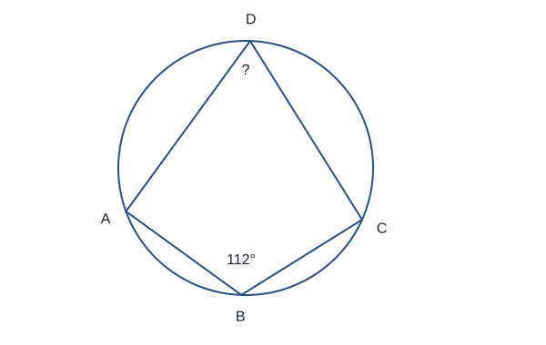
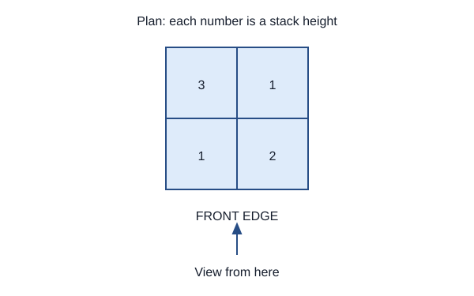
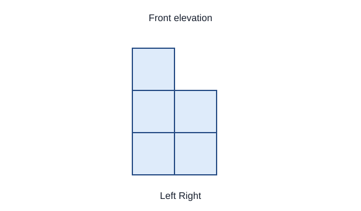
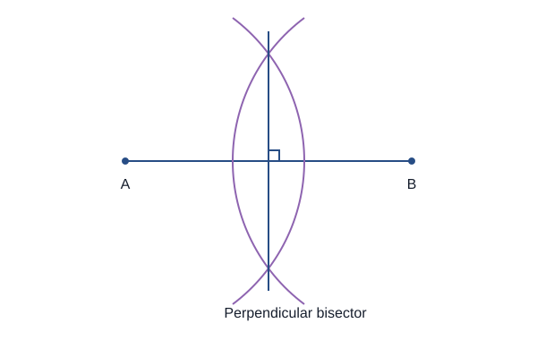
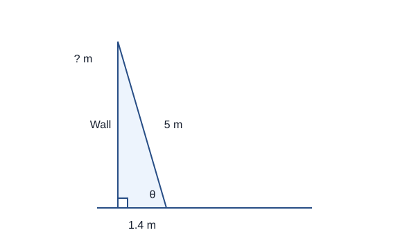
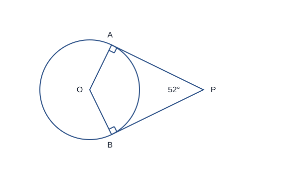
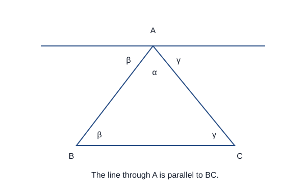
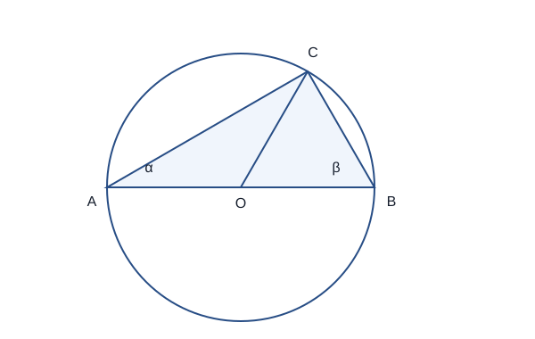
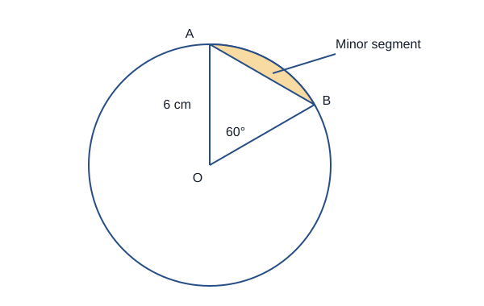

# Geometry and measures: questions and answers

## 1 mark

**1.** State the number of faces, edges and vertices of a triangular prism.

**Answer:** 5 faces, 9 edges and 6 vertices.

**2.** Name a quadrilateral whose diagonals bisect each other at right angles but need not be equal.

**Answer:** A rhombus. Its diagonals need not have equal lengths.

**3.** What is the difference between a chord and a tangent?

**Answer:** A chord joins two points on the circle. A tangent touches the circle at one point.

**4.** Give the exact values of sin 30° and tan 45°.

**Answer:** sin 30° = 1/2 and tan 45° = 1.

## 2 marks

**5.** Each exterior angle of a regular polygon is 24°. Find its number of sides and an interior angle.

**Answer:**

- The number of sides is 360/24 = 15.
- An interior angle is 180° − 24° = 156°.

**6.** Two co-interior angles between parallel lines are (3x + 10)° and (2x + 20)°. Find x.

**Answer:**

- Co-interior angles sum to 180°: 3x + 10 + 2x + 20 = 180.
- 5x = 150, so x = 30.

**7.** Two triangles each have sides of lengths 5 cm and 7 cm. Their included angle is 40°. Explain why they are congruent.

**Answer:**

- They have two corresponding sides and the included angle equal.
- This is the SAS congruence criterion. An angle not included between the sides would not establish SAS.

**8.** A point P(−2,3) is translated by a vector with horizontal component 5 and vertical component −4. Find its image.

**Answer:**

- Add the vector components to the coordinates.
- P maps to (−2 + 5, 3 − 4) = (3,−1).

**9.** Enlarge A(2,−1) by scale factor −2 about the origin. Find its image and explain the negative sign.

**Answer:**

- Multiply both coordinates by −2 to obtain A′(−4,2).
- The image lies on the opposite side of the centre, twice as far from it.

**10.** ABCD is a cyclic quadrilateral. Angle ABC is 112°. Find angle ADC and give a reason.

**Answer:**

- Opposite angles of a cyclic quadrilateral sum to 180°.
- Angle ADC = 180° − 112° = 68°.

**11.** Points A, B and C lie on a circle with centre O. C lies on the major arc AB. The smaller angle AOB is 126°. Find angle ACB.

**Answer:**

- The angle at the centre is twice the angle at the circumference standing on the same arc.
- Angle ACB = 126°/2 = 63°.

**12.** The bearing of B from A is 074°. Find the bearing of A from B.

**Answer:**

- Reverse bearings differ by 180°.
- 074° + 180° = 254°.

**13.** A trapezium has parallel sides 8 cm and 14 cm and perpendicular height 5 cm. Find its area.

**Answer:**

- Area = 1/2 × (8 + 14) × 5.
- The area is 55 cm². Use perpendicular height, not a sloping side.

**14.** A right prism has cross-sectional area 18 cm² and length 7 cm. Find its volume.

**Answer:**

- Volume = cross-sectional area × length.
- 18 × 7 = 126 cm³.

**15.** A circle has radius 5 cm. Find its exact circumference and area.

**Answer:**

- Circumference = 2πr = 10π cm.
- Area = πr² = 25π cm².

**16.** Find the distance between (−1,2) and (5,10).

**Answer:**

- The horizontal and vertical differences are 6 and 8.
- Distance = √(6² + 8²) = √100 = 10 units.

**17.** Four stacks of unit cubes have heights shown in the plan. Find the heights of the two columns in the front elevation, viewed from the marked front edge.

**Answer:**

- For each left-to-right column, use the greatest height along the viewing direction.
- The front elevation has heights 3 and 2 from left to right.

**18.** Rotate P(3,−2) by 90° anticlockwise about the origin. Give its image.

**Answer:**

- A 90° anticlockwise rotation maps (x,y) to (−y,x).
- The image is P′(2,3).

## 3 marks

**19.** Describe a ruler-and-compass construction of the perpendicular bisector of a line segment AB. Explain what points on it have in common.

**Answer:**

- Open the compasses to more than half of AB. Draw arcs above and below the segment from A.
- Using the same radius, draw arcs from B that cross the first arcs. Join the two intersection points.
- Every point on this perpendicular bisector is equidistant from A and B.

**20.** A garden plan has points A and B. Describe the region that is within 4 m of A and closer to A than to B. State how the boundaries are constructed.

**Answer:**

- Draw a circle centred at A with radius representing 4 m. The required points are inside or on it.
- Construct the perpendicular bisector of AB and choose the side containing A.
- Take the overlap of these regions. The bisector itself is excluded because points on it are equally close, not closer to A.

**21.** Reflect a shape in the y-axis, then in the x-axis. Describe the equivalent single transformation and name two properties it preserves.

**Answer:**

- The coordinates change (x,y) to (−x,y), then to (−x,−y).
- This is a rotation of 180° about the origin.
- It preserves lengths and angles, so the image is congruent to the original.

**22.** A sector has radius 9 cm and angle 80°. Find its exact area and arc length.

**Answer:**

- Area = (80/360) × π × 9² = 18π cm².
- Arc length = (80/360) × 2π × 9 = 4π cm.
- If its perimeter were needed, add both radii to the arc length.

**23.** A ladder is 5 m long and its foot is 1.4 m from a vertical wall. Find the height it reaches and its angle with the horizontal, to 1 decimal place.

**Answer:**

- Height = √(5² − 1.4²) = √23.04 = 4.8 m.
- cos θ = 1.4/5, so θ = cos⁻¹(0.28).
- θ = 73.7° to 1 decimal place.

**24.** In triangle ABC, A = 35°, B = 70° and side a = 8 cm. Find side b to 3 significant figures.

**Answer:**

- a and b are opposite angles A and B respectively.
- b/sin 70° = 8/sin 35°, so b = 8 sin 70°/sin 35°.
- b = 13.1 cm to 3 significant figures.

**25.** Two sides of a triangle are 7 cm and 9 cm and their included angle is 60°. Find the third side exactly.

**Answer:**

- Use the cosine rule with the unknown side opposite the known angle.
- a² = 7² + 9² − 2(7)(9)cos 60° = 49 + 81 − 63 = 67.
- a = √67 cm.

**26.** A triangle has sides 10 cm and 8 cm enclosing an angle of 30°. Find its area.

**Answer:**

- Use area = 1/2 ab sin C.
- Area = 1/2 × 10 × 8 × sin 30°.
- The area is 20 cm².

**27.** Let a = (2,−1) and b = (−3,4), where the components are horizontal then vertical. Find 2a − b and its magnitude.

**Answer:**

- 2a = (4,−2).
- 2a − b = (4 − (−3), −2 − 4) = (7,−6).
- Magnitude = √(7² + (−6)²) = √85.

**28.** Two similar triangles have areas 36 cm² and 81 cm². A side of the smaller triangle is 8 cm. Find the corresponding larger side.

**Answer:**

- Area factor = 81/36 = 9/4.
- Length factor = √(9/4) = 3/2.
- The larger side is 8 × 3/2 = 12 cm.

## 4 marks

**29.** PA and PB are tangents to a circle with centre O. Angle APB is 52°. Find angle AOB and explain why triangle OAP is congruent to triangle OBP.

**Answer:**

- OA is perpendicular to PA, and OB is perpendicular to PB.
- Angles of quadrilateral OAPB sum to 360°, so AOB = 360° − 90° − 90° − 52° = 128°.
- The two triangles are right-angled, have common hypotenuse OP and equal radii OA = OB.
- They are congruent by RHS; consequently PA = PB.

**30.** A cone has radius 3 cm and perpendicular height 4 cm. Find its exact total surface area.

**Answer:**

- Slant height l = √(3² + 4²) = 5 cm.
- Curved area = πrl = 15π cm².
- The circular base has area 9π cm².
- Total surface area = 24π cm². The perpendicular height is not the slant height.

**31.** A solid sphere has radius 3 cm and density 2.5 g/cm³. Find its mass to 3 significant figures.

**Answer:**

- Volume = (4/3)πr³ = 36π cm³.
- Mass = density × volume = 2.5 × 36π = 90π g.
- 90π = 282.743… g.
- The mass is 283 g to 3 significant figures.

**32.** A cuboid is 6 cm long, 8 cm wide and 12 cm tall. Find its space diagonal and the angle the diagonal makes with the horizontal base. Give both to 1 decimal place.

**Answer:**

- The diagonal of the horizontal base is √(6² + 8²) = 10 cm.
- Space diagonal = √(10² + 12²) = √244 = 15.6 cm to 1 decimal place.
- The angle θ uses the right triangle with horizontal length 10 and vertical height 12.
- tan θ = 12/10, so θ = 50.2° to 1 decimal place.

**33.** Prove that a triangle has interior angles summing to 180°, using a line through one vertex parallel to the opposite side.

**Answer:**

- Through vertex A draw a line parallel to BC.
- The angle between AB and that parallel equals angle ABC, using alternate angles.
- The angle between AC and the parallel equals angle ACB for the same reason.
- These two angles and angle BAC form a straight angle at A. They therefore sum to 180°.

**34.** In triangle OAB, OA = a and OB = b. M is the midpoint of AB. P lies on OM with OP = 2OM/3. Q lies on OB with OQ = 2OB/3. Prove that PQ is parallel to AB and find the ratio PQ:AB.

**Answer:**

- OM = (a + b)/2, so OP = (a + b)/3.
- OQ = 2b/3. Hence PQ = OQ − OP = (b − a)/3.
- AB = b − a, so PQ = AB/3. One direction vector is a scalar multiple of the other, proving that the segments are parallel.
- The length ratio PQ:AB is 1:3.

**35.** AB is a diameter of a circle with centre O. C is a different point on the circle. Prove that angle ACB is 90°.

**Answer:**

- Join O to C. Let angle OAC = α and angle OBC = β.
- OA = OC and OB = OC because they are radii. The two isosceles triangles therefore have angles ACO = α and BCO = β.
- Angle ACB = α + β. The three angles of triangle ABC sum to 180°, so α + β + (α + β) = 180°.
- Therefore 2(α + β) = 180° and angle ACB = 90°.

## 5 marks

**36.** From A, B is 8 km due east and C is 6 km due north. Find BC and the bearing of C from B, to the nearest degree.

**Answer:**

- BC = √(8² + 6²) = 10 km.
- From B to C, the movement is 8 km west and 6 km north.
- The angle west of north is tan⁻¹(8/6) = 53.130…°.
- A bearing is measured clockwise from north, so the bearing is 360° − 53.130…° = 306.869…°.
- The bearing is 307°.

## 6 marks

**37.** A solid consists of a cylinder of radius 3 cm and length 8 cm with a hemisphere of radius 3 cm attached at one end. Find its exact volume and external surface area.

**Answer:**

- Cylinder volume = π × 3² × 8 = 72π cm³.
- Hemisphere volume = 1/2 × (4/3)π × 3³ = 18π cm³.
- Total volume = 90π cm³.
- Cylinder curved area = 2π × 3 × 8 = 48π cm².
- Hemisphere curved area = 2π × 3² = 18π cm²; the exposed flat base adds 9π cm².
- External surface area = 48π + 18π + 9π = 75π cm². Do not count the joined internal circle.

## 7 marks

**38.** A circle has radius 6 cm. A chord subtends 60° at the centre. Find the exact area and perimeter of the minor segment cut off by the chord.

**Answer:**

- Sector area = (60/360) × π × 6² = 6π cm².
- The triangle between the radii has area 1/2 × 6 × 6 × sin 60° = 9√3 cm².
- Minor segment area = 6π − 9√3 cm².
- The arc length is (60/360) × 2π × 6 = 2π cm.
- The two radii and their included 60° angle form an equilateral triangle, so the chord is 6 cm.
- The segment perimeter is its arc plus its chord.
- Perimeter = 2π + 6 cm. The radii are not part of this boundary.

## Past-paper sources

- [Pearson Edexcel GCSE Mathematics: qualification and specification](https://qualifications.pearson.com/en/qualifications/edexcel-gcses/mathematics-2015.html).
- [PMT: Edexcel topic questions](https://www.physicsandmathstutor.com/maths-revision/gcse-questions-edexcel/).
- [PMT: Higher Paper 1 papers and mark schemes](https://www.physicsandmathstutor.com/past-papers/gcse-maths/edexcel-paper-1/).
- [PMT: Higher Paper 2 papers and mark schemes](https://www.physicsandmathstutor.com/past-papers/gcse-maths/edexcel-paper-2/).
- [PMT: Higher Paper 3 papers and mark schemes](https://www.physicsandmathstutor.com/past-papers/gcse-maths/edexcel-paper-3/).
- [Corbettmaths: topic video directory](https://corbettmaths.com/contents/).
