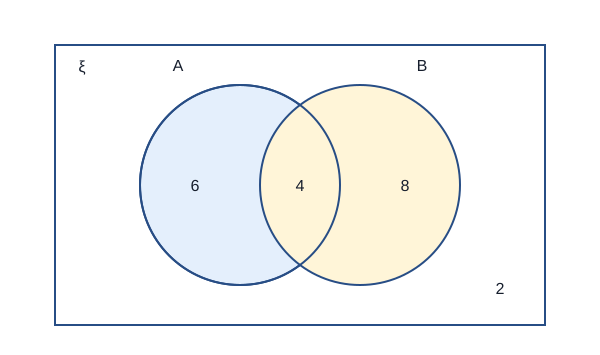
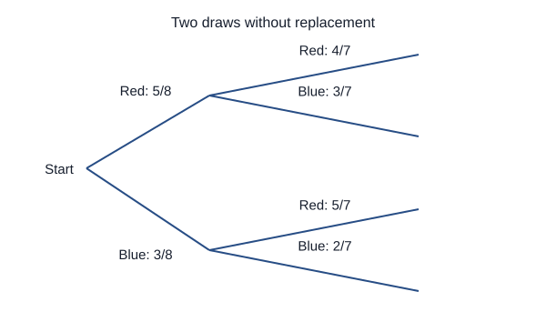
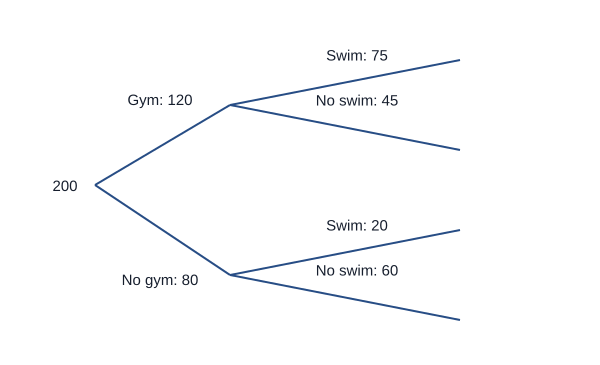

# Probability: questions and answers

## 1 mark

**1.** An event has probability 0. Which word describes it? An event has probability 1. Which word describes it?

**Answer:** Probability 0 means impossible; probability 1 means certain.

**2.** P(A) = 0.37. Find P(A′).

**Answer:** P(A′) = 1 − 0.37 = 0.63.

**3.** A fair six-sided die is rolled. Find the probability of a prime number.

**Answer:** The primes are 2, 3 and 5. Probability = 3/6 = 1/2.

## 2 marks

**4.** A spinner lands on blue 36 times in 120 spins. Estimate the probability of blue and the expected number of blues in another 500 spins under the same conditions.

**Answer:**

- Estimated probability = 36/120 = 0.3.
- Expected number = 500 × 0.3 = 150. This is a prediction, not a guaranteed count.

**5.** A biased spinner has four outcomes with probabilities 0.15, 0.28, 0.32 and x. Find x.

**Answer:**

- Probabilities of these exhaustive, disjoint outcomes sum to 1.
- x = 1 − (0.15 + 0.28 + 0.32) = 0.25.

**6.** A fair coin and a fair six-sided die are used independently. Find the probability of a head and a number greater than 4.

**Answer:**

- There are 2 × 6 = 12 equally likely pairs.
- H5 and H6 are favourable, so probability = 2/12 = 1/6.

**7.** P(A) = 0.4 and P(B) = 0.3. A and B are independent. Find P(A and B).

**Answer:**

- For independent events, multiply their probabilities.
- P(A and B) = 0.4 × 0.3 = 0.12.

**8.** P(A) = 0.6, P(B) = 0.5 and P(A and B) = 0.2. Find P(A or B).

**Answer:**

- P(A or B) = P(A) + P(B) − P(A and B).
- 0.6 + 0.5 − 0.2 = 0.9. The overlap must not be counted twice.

**9.** A fair coin gives 7 heads in 10 tosses. Explain why this does not establish that the coin is biased and how a larger experiment would help.

**Answer:**

- Small random samples can differ substantially from the theoretical probability 1/2.
- A much larger unbiased sample tends to give a more stable relative frequency. It still does not guarantee exactly half heads.

**10.** In the Venn diagram, find n(A ∩ B) and n((A ∪ B)′).

**Answer:**

- n(A ∩ B) = 4, the number in both sets.
- n((A ∪ B)′) = 2, the number outside both.

## 3 marks

**11.** The table records students and their travel. A student is chosen at random from those who cycle. Find the probability that the student is in Year 11.

| | Cycle | Bus | Total |
|---|---:|---:|---:|
| Year 10 | 12 | 18 | 30 |
| Year 11 | 8 | 22 | 30 |
| Total | 20 | 40 | 60 |

**Answer:**

- The condition restricts the sample to the 20 cyclists.
- Of those cyclists, 8 are in Year 11.
- The probability is 8/20 = 2/5. The denominator is not all 60 students.

**12.** A bag contains 5 red and 3 blue counters. Two counters are drawn without replacement. Find the probability that both are red.

**Answer:**

- The first red probability is 5/8.
- After one red is removed, 4 red remain out of 7 counters.
- P(both red) = (5/8)(4/7) = 5/14.

**13.** For the same bag containing 5 red and 3 blue counters, two are drawn without replacement. Find the probability of exactly one red.

**Answer:**

- The successful orders are red then blue, or blue then red.
- P(RB) = (5/8)(3/7) = 15/56; P(BR) = (3/8)(5/7) = 15/56.
- Adding gives 30/56 = 15/28.

**14.** In a group of 20 people, 6 are in A only, 4 are in both A and B, 8 are in B only, and 2 are in neither. Find P(A | B) and P(A′).

**Answer:**

- There are 4 + 8 = 12 people in B. Of them, 4 are also in A.
- P(A | B) = 4/12 = 1/3.
- There are 10 people not in A, so P(A′) = 10/20 = 1/2.

**15.** Two independent components each fail with probability 0.1. Find the probability that at least one fails.

**Answer:**

- Use the complement: neither fails means both work.
- P(both work) = 0.9² = 0.81.
- P(at least one fails) = 1 − 0.81 = 0.19.

**16.** A teacher chooses 2 students from 12. How many different pairs are possible? Explain why 12 × 11 is too large.

**Answer:**

- There are 12 × 11 ordered choices.
- Each pair is counted twice: choosing A then B is the same pair as B then A.
- The number of pairs is (12 × 11)/2 = 66.

## 4 marks

**17.** Of 200 people, 120 use a gym. Of the gym users, 75 swim. Of the non-users, 20 swim. Draw a frequency tree and find the probability that a randomly selected swimmer uses the gym.

**Answer:**

- First split: gym 120, no gym 80.
- Within gym: swim 75, do not swim 45. Within no gym: swim 20, do not swim 60.
- There are 75 + 20 = 95 swimmers.
- P(gym | swim) = 75/95 = 15/19.

**18.** Of 100 people, 40 are in A, 30 are in B and 12 are in both. Determine whether membership of A and B is independent.

**Answer:**

- P(A) = 40/100 = 0.4; P(B) = 30/100 = 0.3.
- P(A and B) = 12/100 = 0.12.
- P(A)P(B) = 0.4 × 0.3 = 0.12, equal to the intersection probability.
- The events are independent for this stated distribution. Equivalently, P(A | B) = 12/30 = 0.4 = P(A).

**19.** A biased coin has P(head) = 0.7. It is tossed three times independently. Find the probability of exactly two heads.

**Answer:**

- The possible successful orders are HHT, HTH and THH.
- Each has probability 0.7² × 0.3 = 0.147.
- There are three such mutually exclusive orders.
- The total probability is 3 × 0.147 = 0.441.

## 5 marks

**20.** In a class of 40, 22 study French, 18 study Spanish and 10 study both. A student is selected from those studying at least one of the languages. Find the probability they study exactly one language. Also find how many study neither.

**Answer:**

- French only = 22 − 10 = 12.
- Spanish only = 18 − 10 = 8.
- At least one = 12 + 10 + 8 = 30; exactly one = 12 + 8 = 20.
- The conditional probability is 20/30 = 2/3.
- Neither = 40 − 30 = 10.

**21.** Bag A has 3 red and 2 blue counters. Bag B has 1 red and 4 blue counters. A fair coin chooses the bag, then a counter is drawn. Given that it is red, find the probability that bag A was chosen.

**Answer:**

- P(A and red) = (1/2)(3/5) = 3/10.
- P(B and red) = (1/2)(1/5) = 1/10.
- P(red) = 3/10 + 1/10 = 4/10.
- Restrict the outcomes to red draws.
- P(A | red) = (3/10)/(4/10) = 3/4. Choosing the bags equally does not make them equally likely after the red result.

## 6 marks

**22.** A bag contains 3 blue counters and n red counters. Two counters are drawn without replacement. The probability that both are blue is 1/15. Find n.

**Answer:**

- P(both blue) = [3/(n + 3)] × [2/(n + 2)].
- 6/[(n + 3)(n + 2)] = 1/15.
- Hence (n + 3)(n + 2) = 90.
- n² + 5n − 84 = 0, so (n + 12)(n − 7) = 0.
- n = −12 or n = 7. Reject the negative count.
- There are 7 red counters. Check: (3/10)(2/9) = 1/15.

## Past-paper sources

- [Pearson Edexcel GCSE Mathematics: qualification and specification](https://qualifications.pearson.com/en/qualifications/edexcel-gcses/mathematics-2015.html).
- [PMT: Edexcel topic questions](https://www.physicsandmathstutor.com/maths-revision/gcse-questions-edexcel/).
- [PMT: Higher Paper 1 papers and mark schemes](https://www.physicsandmathstutor.com/past-papers/gcse-maths/edexcel-paper-1/).
- [PMT: Higher Paper 2 papers and mark schemes](https://www.physicsandmathstutor.com/past-papers/gcse-maths/edexcel-paper-2/).
- [PMT: Higher Paper 3 papers and mark schemes](https://www.physicsandmathstutor.com/past-papers/gcse-maths/edexcel-paper-3/).
- [Corbettmaths: topic video directory](https://corbettmaths.com/contents/).
