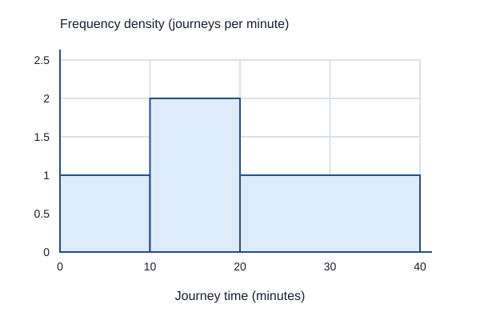
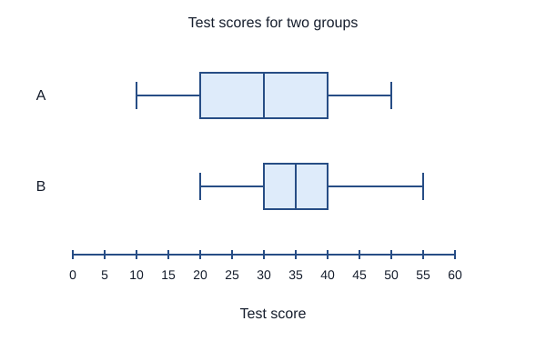
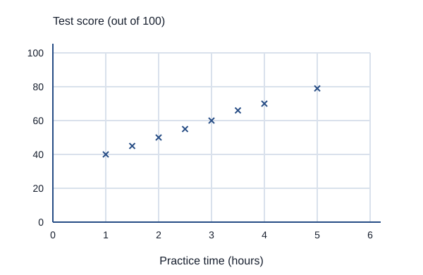
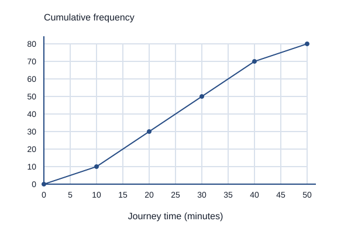

# Statistics: questions and answers

## 1 mark

**1.** State whether shoe size is discrete or continuous.

**Answer:** Discrete: the recorded values occur in separate allowed steps, not any real value in an interval.

**2.** Find the mode of 3, 5, 5, 7, 8, 8, 8, 10.

**Answer:** 8.

**3.** A scatter graph shows positive correlation between ice-cream sales and sunburn cases. Does it prove ice cream causes sunburn?

**Answer:** No. Correlation does not prove causation; hot sunny weather could affect both.

## 2 marks

**4.** For 4, 7, 7, 10, 12, find the mean and median.

**Answer:**

- Mean = (4 + 7 + 7 + 10 + 12)/5 = 40/5 = 8.
- The ordered middle value is 7, so the median is 7.

**5.** A survey of 120 people has 35 choosing cycling. Find the angle for cycling in a pie chart.

**Answer:**

- The fraction is 35/120.
- Sector angle = (35/120) × 360° = 105°.

**6.** A school has 600 students, including 150 in Year 11. A proportional stratified sample contains 80 students. How many should be from Year 11?

**Answer:**

- Year 11 forms 150/600 = 1/4 of the population.
- Select 80 × 1/4 = 20 Year 11 students randomly within that stratum.

**7.** A student estimates the whole school’s favourite sport by questioning only the football team. Explain the problem and suggest an improvement.

**Answer:**

- The team is not representative of the school; football is likely to be overrepresented.
- Use a random sample from the whole school or appropriate randomly sampled strata.

**8.** A data set has lower quartile 18, median 24 and upper quartile 31. Find its interquartile range and interpret it.

**Answer:**

- IQR = 31 − 18 = 13.
- The middle 50% of the data span 13 units.

**9.** A line of best fit uses data for ages 10 to 16. Explain why predicting a value at age 14 is generally safer than at age 30.

**Answer:**

- Age 14 is within the observed range, so the estimate is interpolation.
- Age 30 is extrapolation far beyond the data; the relationship may not continue.

**10.** A line graph shows monthly sales. Why is a line graph suitable, and why might comparing December directly with January be misleading?

**Answer:**

- Joining monthly values helps show change over ordered time.
- Seasonal patterns may make the months naturally different; compare the same month across years or account for seasonality.

## 3 marks

**11.** Find the mean number of pets from this frequency table.

| Pets | 0 | 1 | 2 | 3 |
|---|---:|---:|---:|---:|
| Frequency | 4 | 7 | 6 | 3 |

**Answer:**

- Total frequency = 4 + 7 + 6 + 3 = 20.
- Total pets = 0(4) + 1(7) + 2(6) + 3(3) = 28.
- Mean = 28/20 = 1.4 pets.

**12.** A histogram class 10 < x ≤ 15 has frequency 18. Another class 15 < x ≤ 25 has frequency 24. Find their frequency densities and explain which bar is taller.

**Answer:**

- First class width = 5, so density = 18/5 = 3.6.
- Second class width = 10, so density = 24/10 = 2.4.
- The first bar is taller even though it contains fewer values. In a histogram, area represents frequency.

**13.** The histogram represents 50 journeys. Find the frequency in 10 < t ≤ 20 and the fraction of journeys taking more than 20 minutes.

**Answer:**

- For 10 < t ≤ 20, frequency = width × density = 10 × 2 = 20.
- For 20 < t ≤ 40, frequency = 20 × 1 = 20.
- The fraction taking more than 20 minutes is 20/50 = 2/5.

**14.** Eight parcels have mean mass 2.5 kg. Three of them have mean mass 1.5 kg. Find the mean mass of the other five parcels.

**Answer:**

- Mass of all eight = 8 × 2.5 = 20 kg.
- Mass of the three = 3 × 1.5 = 4.5 kg.
- The other five total 15.5 kg, so their mean is 15.5/5 = 3.1 kg.

**15.** Salaries in a small business are £20000, £22000, £23000, £25000 and £150000. Find the mean and median. Explain which better describes a typical salary here.

**Answer:**

- Mean = £240000/5 = £48000.
- The median is £23000.
- The very high salary pulls up the mean, so the median better describes the typical employee in this set.

**16.** A bar chart compares values 90 and 100, but its vertical axis starts at 80. Explain why it may exaggerate the difference and how to improve it.

**Answer:**

- The visible bar heights are proportional to 10 and 20, making one appear twice the other.
- The actual values are 90 and 100, so the second is only about 11.1% greater.
- Use a zero baseline for bars, or display the values and any axis break clearly without implying bar-length proportionality.

## 4 marks

**17.** Estimate the mean mass from the grouped table.

| Mass m (kg) | 0 < m ≤ 10 | 10 < m ≤ 20 | 20 < m ≤ 40 |
|---|---:|---:|---:|
| Frequency | 6 | 10 | 4 |

**Answer:**

- Use class midpoints 5, 15 and 30 kg.
- Estimated total = 6(5) + 10(15) + 4(30) = 300 kg.
- Total frequency = 20, so estimated mean = 300/20 = 15 kg.
- This is an estimate because the positions of individual values inside each class are unknown.

**18.** The box plots compare test scores for groups A and B. Compare their typical scores and consistency, using numerical evidence.

**Answer:**

- Group A has median 30; group B has median 35. Group B has the higher typical score.
- Group A has IQR 40 − 20 = 20.
- Group B has IQR 40 − 30 = 10.
- The middle 50% of group B is less spread out, so B is more consistent by IQR. The diagrams do not establish that every B score exceeds every A score.

**19.** The scatter graph compares practice time and test score for eight students. Describe the correlation, estimate the score at 3.5 hours, and explain a limitation of predicting a score at 10 hours.

**Answer:**

- The points show positive correlation.
- A reasonable line of best fit gives about 64–66 marks at 3.5 hours; a value near 65 is reasonable.
- A prediction at 10 hours is extrapolation beyond the observed 1–5 hours.
- The pattern might not continue; scores also have an upper limit. The association alone does not prove a causal effect.

## 5 marks

**20.** A random sample of 80 households contains 18 with solar panels. Estimate how many of 1200 households have panels. Explain two limitations.

**Answer:**

- Sample proportion = 18/80 = 0.225.
- Estimated number = 1200 × 0.225 = 270 households.
- Random sampling reduces selection bias but does not remove sampling variation.
- The sample must cover the relevant population; missing some types of household could affect representativeness.
- 270 is an estimate, not an exact count of the population.

**21.** The table gives grouped observations. State the modal class, calculate the cumulative frequencies and identify the class containing the median. Explain why the exact median cannot be found from this table.

| Value x | 0 < x ≤ 10 | 10 < x ≤ 20 | 20 < x ≤ 30 | 30 < x ≤ 50 |
|---|---:|---:|---:|---:|
| Frequency | 8 | 10 | 18 | 4 |

**Answer:**

- The modal class is 20 < x ≤ 30 because it has the greatest frequency.
- The cumulative frequencies are 8, 18, 36 and 40.
- There are 40 values. The median is the mean of the 20th and 21st values in order.
- Both positions lie in 20 < x ≤ 30: only 18 values are at most 20, and 36 are at most 30.
- The exact values inside that interval are not known, so the table does not determine the exact median.

## 7 marks

**22.** The cumulative frequency graph represents 80 journey times. Estimate the median, lower and upper quartiles, IQR and number taking longer than 35 minutes. Explain why these are estimates.

**Answer:**

- Read the median at cumulative frequency 40: about 25 minutes.
- Read the lower quartile at cumulative frequency 20: about 15 minutes.
- Read the upper quartile at cumulative frequency 60: about 35 minutes.
- IQR ≈ 35 − 15 = 20 minutes.
- About 60 journeys take 35 minutes or less.
- Hence about 80 − 60 = 20 journeys take longer than 35 minutes.
- These are graph-based estimates from grouped observations; individual times and exact within-class positions are not known.

## Past-paper sources

- [Pearson Edexcel GCSE Mathematics: qualification and specification](https://qualifications.pearson.com/en/qualifications/edexcel-gcses/mathematics-2015.html).
- [PMT: Edexcel topic questions](https://www.physicsandmathstutor.com/maths-revision/gcse-questions-edexcel/).
- [PMT: Higher Paper 1 papers and mark schemes](https://www.physicsandmathstutor.com/past-papers/gcse-maths/edexcel-paper-1/).
- [PMT: Higher Paper 2 papers and mark schemes](https://www.physicsandmathstutor.com/past-papers/gcse-maths/edexcel-paper-2/).
- [PMT: Higher Paper 3 papers and mark schemes](https://www.physicsandmathstutor.com/past-papers/gcse-maths/edexcel-paper-3/).
- [Corbettmaths: topic video directory](https://corbettmaths.com/contents/).
