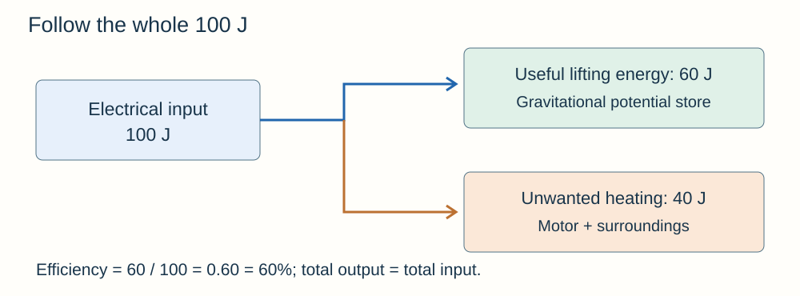

# Energy

## Stores and transfers

Energy is a way of keeping track of changes. Imagine money moving between accounts: the amount in each account changes, but moving it does not create extra money.

A **system** is the object or group of objects you are considering. Describe **which store decreases, how energy transfers, and which store increases**.

| Store | Example |
|---|---|
| Kinetic | A moving cyclist |
| Gravitational potential | A book raised above the floor |
| Elastic potential | A stretched spring |
| Thermal / internal | Hot water |
| Chemical | Food, fuel or a battery |
| Nuclear | An atomic nucleus |
| Magnetic | Repelling magnets held close together |
| Electrostatic | Repelling charges pushed closer together |

Energy transfers **mechanically** when forces do work, **electrically** when charge flows, **by heating**, or **by radiation** such as light. Light and sound transfer energy; do not describe them as stores.

**A ball rising:** its kinetic store decreases as its gravitational potential store increases. Air resistance also increases the thermal stores of the ball and surroundings.

**A car braking:** its kinetic store decreases. Mechanical work against friction warms the brakes, tyres and surroundings.

**A collision:** deformation can increase elastic energy temporarily. Energy also transfers to thermal stores and travels away as sound. Total energy is conserved even when kinetic energy is not.

**A motor accelerating a trolley:** energy transfers electrically from the supply. The motor then does mechanical work, increasing the trolley's kinetic store.

**A kettle heating water:** electrical work increases the water's thermal store. Some energy also heats the kettle and surroundings. Once the water boils, continued heating can change its state without raising its temperature.

## Calculating changes in stores

| Energy store | Equation |
|---|---|
| Kinetic | **Eₖ = ½mv²** |
| Gravitational potential | **Eₚ = mgΔh** |
| Elastic potential | **Eₑ = ½ke²** |

**Symbols and units**

| Symbol | Meaning | Unit |
|---|---|---|
| Eₖ | Kinetic energy | joules (J) |
| Eₚ | Change in gravitational potential energy | joules (J) |
| Eₑ | Elastic potential energy | joules (J) |
| m | Mass | kilograms (kg) |
| v | Speed | metres per second (m/s) |
| g | Gravitational field strength | newtons per kilogram (N/kg) |
| Δh | Vertical change in height | metres (m) |
| k | Spring constant | newtons per metre (N/m) |
| e | Extension | metres (m) |

The spring equation applies **within the limit of proportionality**. Extension is the change in length, not the whole spring length. Use the value of g supplied in the question.

**Example: kinetic energy**

An object has a mass of 2.0 kg and moves at 3.0 m/s.

Eₖ = ½ × 2.0 × 3.0² = **9.0 J**

**Example: gravitational potential energy**

A 4.0 kg bag is lifted by 1.5 m. Use g = 9.8 N/kg.

Eₚ = 4.0 × 9.8 × 1.5 = **58.8 J**

**Example: elastic potential energy**

A spring has a spring constant of 200 N/m and is stretched by 5.0 cm.

1. Convert the extension to metres: e = 5.0 ÷ 100 = **0.050 m**.
2. Substitute into the equation: Eₑ = ½ × 200 × 0.050² = **0.25 J**.

**How changes affect stored energy**

- **Doubling speed quadruples kinetic energy**, if mass stays the same.
- Doubling extension quadruples elastic energy while the spring remains proportional.
- Doubling mass doubles kinetic energy at the same speed.

**Example: finding speed from energy**

A 2.0 kg object has 36 J of kinetic energy.

1. Rearrange the equation: **v = √(2Eₖ/m)**.
2. Substitute: v = √(2 × 36 ÷ 2.0) = √36.
3. The speed is **6.0 m/s**.

## Conservation, dissipation and efficiency

**Energy cannot be created or destroyed.** In a closed system, the total energy stays constant. If an object loses energy, another part of the system gains it. Include the surroundings in your system when they receive energy.

**Dissipation** means energy spreads into the surroundings, usually into thermal stores. Imagine warm water cooling in a room. The energy is still there, but it is spread out and harder to use for the intended purpose. “Wasted” energy has not been destroyed.

**Efficiency** tells you what fraction of the input produces the useful output.

- **Efficiency = useful energy output ÷ total energy input.**
- You can also use **efficiency = useful power output ÷ total power input**.
- Multiply a decimal efficiency by 100 to express it as a percentage.
- Efficiency has **no unit**. It cannot exceed 1, or 100%.

**Example: finding efficiency**

A motor receives 500 J and transfers 350 J to a lifted load.

1. Divide useful output by total input: efficiency = 350 ÷ 500 = **0.70**.
2. Convert to a percentage: 0.70 × 100 = **70%**.
3. Find the energy transferred in unwanted ways: 500 − 350 = **150 J**.

**Example: finding the input energy**

Another motor has an efficiency of 0.80 and a useful output of 240 J.

Input energy = useful output ÷ efficiency

Input energy = 240 ÷ 0.80 = **300 J**

**Improving efficiency:** lubrication reduces friction, so less energy transfers to unwanted thermal stores. Insulation reduces unwanted heating of the surroundings. A more efficient device needs less input energy for the **same useful output**.

## Power and work

**Power is the rate of energy transfer**, or the rate of doing work. It tells you how quickly energy is transferred.

**Power = energy transferred ÷ time**

**P = E/t**

When the energy is transferred by doing work, you can also use:

**P = W/t**

**Symbols and units**

- **P:** power, measured in watts (W).
- **E:** energy transferred, measured in joules (J).
- **W:** work done, measured in joules (J).
- **t:** time, measured in seconds (s).

**1 W = 1 J/s**

One watt means one joule of energy transferred each second. A joule measures an amount of energy; a watt measures how quickly it transfers.

In **W/t**, the symbol W means **work done**. After a value such as **60 W**, W is the unit **watt**.

**Example: finding power**

A motor transfers 1,800 J in 30 s.

1. Choose the equation: P = E/t.
2. Substitute: P = 1,800 ÷ 30.
3. The power is **60 W**.

**Example: finding time**

A 120 W motor transfers the same 1,800 J.

1. Rearrange the equation: t = E/P.
2. Substitute: t = 1,800 ÷ 120.
3. The time is **15 s**.

Two identical motors may lift the same load through the same height. They do the same useful work. The one doing it in less time has **greater useful power**.

Greater power alone does not prove greater efficiency. Efficiency compares the useful output with the total input.

**Useful conversions**

- **1 kJ = 1,000 J**
- **1 kW = 1,000 W**
- **1 minute = 60 s**

Keep energy and power separate when interpreting graphs or comparing appliances.

## Heating and specific heat capacity

**Specific heat capacity** is the energy needed to raise the temperature of **1 kg** of a substance by **1°C**, without changing state. Think of a larger c as a bigger energy cost for each degree of warming.

**ΔE = mcΔθ**

- ΔE: change in thermal energy, J.
- m: mass, kg.
- c: specific heat capacity, J/kg°C.
- Δθ: **final temperature − initial temperature**, °C. It is not the final temperature alone.

**Example: heating water**

- Mass of water: **0.50 kg**.
- Initial temperature: **20°C**.
- Final temperature: **40°C**.
- Specific heat capacity: **4,200 J/kg°C**.

1. Find the temperature rise: Δθ = 40 − 20 = **20°C**.
2. Substitute: ΔE = 0.50 × 4,200 × 20.
3. The energy needed is **42,000 J**.

At the same mass and energy input, a material with **larger c has a smaller temperature rise**. During melting or boiling, use latent heat instead; temperature need not rise.

## Practical: measure specific heat capacity

1. Measure the mass of a metal block using a balance. Fit an electrical heater and thermometer into its holes. A little suitable oil improves thermal contact.
2. Wrap the block in insulation. Record its initial temperature.
3. Use a low-voltage supply. Measure energy input with a joulemeter, or record power and heating time using **E = Pt**. If needed, measure V and I and use E = VIt.
4. Record temperature at regular time intervals while heating. Switch off before the block becomes dangerously hot.
5. Find Δθ, then calculate **c = E/(mΔθ)**. Repeat and compare results.

**Example: calculating specific heat capacity**

An energy input of 12,000 J heats a 1.0 kg block by 30°C.

1. Rearrange: c = E/(mΔθ).
2. Substitute: c = 12,000 ÷ (1.0 × 30).
3. The specific heat capacity is **400 J/kg°C**.

**Improve the method:** good insulation and contact reduce heat loss and temperature lag. A lid can help for a liquid; stir the liquid gently for an even temperature. Keep electrical parts dry.

Not all electrical energy heats the sample. Some heats the heater and surroundings. Treating all input as the sample's energy usually makes the calculated c **too high**. On a graph of energy supplied against temperature rise, the ideal gradient is **mc**; divide by mass to find c.

## Insulation and cooling

Energy transfers from hotter to cooler surroundings. **Higher thermal conductivity means faster conduction**, for the same dimensions and temperature difference. A thicker wall or lower-conductivity material reduces this transfer.

- Loft insulation and cavity-wall insulation trap air, reducing conduction and air circulation.
- Double glazing traps a layer of gas between panes; draught-proofing reduces warm air escaping.
- Thicker insulation usually slows cooling, but each extra layer may give a smaller extra benefit.
- Compare cost with savings and practicality. Simple **payback time = installation cost ÷ annual saving** when annual savings are assumed constant.

## Practical: compare thermal insulators

1. Wrap identical containers in equal thicknesses of different materials. Include an uninsulated control.
2. Add the same mass of hot water at the same starting temperature. Use matching lids and thermometers.
3. Measure temperature at equal time intervals for the same total time. Keep room conditions, exposed area and container size constant.
4. Repeat each material and calculate mean temperature drops. **Smaller drop in the same time means better insulation** under these conditions.
5. Plot temperature against time. A less steep cooling curve shows a lower rate of energy loss for matching conditions.

Use hot water carefully on a stable surface; handle containers with suitable protection. To investigate **thickness**, keep the material fixed and change only thickness. Do not change both at once. Repeats reduce the effect of random variation; they do not remove a thermometer's zero error.

## Energy resources and decisions

A **renewable resource is replenished as it is used**. Fossil fuels and nuclear fuels are non-renewable: their usable supplies are finite.

| Resource | Uses and strengths | Limitations and impacts |
|---|---|---|
| Coal, oil and gas | Controllable heating and electricity; oil fuels transport | CO₂ contributes to climate change; pollution; extraction damage; finite fuels |
| Nuclear fuel | Reliable large-scale electricity, low operational CO₂ | Radioactive waste, high building/decommissioning costs; finite fuel |
| Biofuel | Heating, electricity or transport; can be regrown | Land competes with food/habitats; burning produces CO₂; carbon balance depends on regrowth and processing |
| Wind | Renewable electricity without burning fuel | Variable wind; visual/noise impacts; wildlife and site constraints |
| Sun | Solar electricity and water heating | Daylight/weather vary; large area may be needed |
| Hydroelectric | Electricity; stored water can respond quickly to demand | Reservoirs flood habitats/settlements; drought can reduce supply |
| Tides | Predictable timing for electricity | Output is not continuous; high cost and estuary/ecosystem changes |
| Waves | Renewable electricity | Variable sea conditions; difficult maintenance; coastal impacts |
| Geothermal | Heating and electricity; steady at suitable sites | Suitable sites limited; drilling costs |

**Reliable does not always mean renewable**, and renewable does not mean impact-free. A mix of resources, storage and flexible generation can help match variable supply to demand.

When evaluating a choice, use the given data: output, reliability, cost, land use and emissions. State which factor matters most for the situation, then give a justified conclusion. Scientists can measure emissions and risks; policy also depends on **economic, social, ethical and political decisions**.

For trends, distinguish an increase in total energy from an increase in percentage share. New technology, cost, fuel availability and environmental policy can change the mix. Avoid inventing current percentages when the question supplies a graph.
