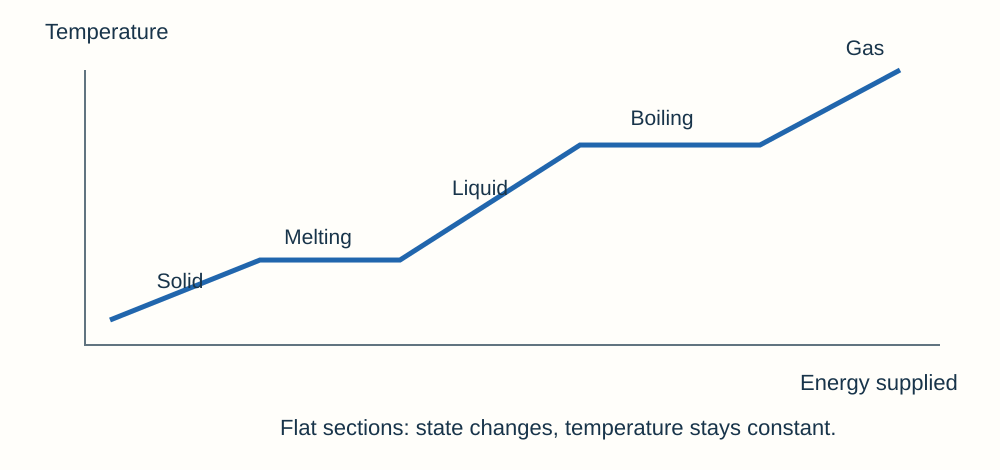

# Particle model of matter questions & answers

## 1 mark

**1.** Write the equation linking density, mass and volume.

**Answer:** ρ = m/V.

**2.** Name the change from solid directly to gas.

**Answer:** Sublimation.

**3.** What is the unit of specific latent heat?

**Answer:** J/kg.

**4.** What happens to the temperature of a pure substance while it melts at constant pressure?

**Answer:** It stays constant.

**5.** A pure substance melts at constant pressure. Which statement is correct? Choose one: A its particles become larger; B its internal energy increases while its temperature stays constant; C its mass increases; D its average particle kinetic energy must increase.

**Answer:** B: its internal energy increases while its temperature stays constant.

## 2 marks

**6.** Compare particle movement in a solid and a gas.

**Answer:** - In a solid particles **vibrate about fixed positions**.
- In a gas particles move rapidly and **randomly in all directions**.

**7.** Define internal energy.

**Answer:** The **total kinetic energy and potential energy of all the particles** in a system.

**8.** A block has mass 540 g and volume 200 cm³. Calculate its density in g/cm³.

**Answer:** ρ = m/V = 540/200 = **2.7 g/cm³**.

**9.** Why does a gas usually have much lower density than a liquid of the same substance?

**Answer:** - Gas particles are **much farther apart**.
- The same mass occupies a much larger volume, so **mass per unit volume is lower**.

**10.** An empty cylinder has mass 60 g. With 80 cm³ of liquid it has mass 124 g. Calculate the liquid’s density.

**Answer:** Liquid mass = 124 − 60 = **64 g**. Density = 64/80 = **0.80 g/cm³**.

**11.** Explain why mass can decrease in an open beaker when water evaporates without violating conservation of mass.

**Answer:** - Water particles **escape into the surroundings** as vapour.
- Total mass including the escaped vapour is conserved; particles are not destroyed.

**12.** Why must the starting water volume be subtracted when measuring an irregular object’s volume?

**Answer:** - The final reading includes both the original water and the displaced volume.
- **Final minus initial volume** gives the volume of the submerged object alone.

## 3 marks

**13.** A 0.25 kg sample has specific heat capacity 800 J/kg°C. Calculate the energy needed to warm it from 20°C to 50°C.

**Answer:** - Δθ = 50 − 20 = **30°C**.
- ΔE = mcΔθ = 0.25 × 800 × 30.
- **6,000 J**.

**14.** Calculate the energy required to melt 0.15 kg of ice at 0°C. Its specific latent heat of fusion is 334,000 J/kg.

**Answer:** - **E = mL**.
- E = 0.15 × 334,000.
- **50,100 J**.

**15.** A sealed gas occupies 40 cm³ at 120 kPa. It expands to 60 cm³ at constant temperature. Calculate its new pressure.

**Answer:** - **p₁V₁ = p₂V₂**.
- p₂ = 120 × 40/60.
- **80 kPa**.

**16.** Explain why heating a fixed mass of gas in a rigid sealed container increases its pressure.

**Answer:** - Average kinetic energy increases, so particles **move faster**.
- Wall collisions occur more frequently and involve larger momentum changes.
- The force per unit area increases, so **pressure rises**.

**17.** A bicycle pump becomes warm during rapid compression. Explain why.

**Answer:** - A force moves the piston, doing **work on the gas**.
- Energy transfers into the gas’s **internal energy**.
- With little time for energy to escape, average particle kinetic energy and **temperature increase**.

**18.** Explain why internal energy increases while ice melts even though its temperature is constant.

**Answer:** - Energy is transferred into the ice by heating.
- It increases particle **potential energy** as the arrangement and interactions change.
- Average kinetic energy does not increase, so **temperature stays constant**.

## 4 marks

**19.** A cuboid measures 4.0 cm × 3.0 cm × 2.0 cm and has mass 192 g. Calculate its density in g/cm³ and kg/m³.

**Answer:** - V = 4.0 × 3.0 × 2.0 = **24 cm³**.
- ρ = 192/24 = **8.0 g/cm³**.
- 1 g/cm³ = **1,000 kg/m³**.
- Density = **8,000 kg/m³**.

**20.** A gas is compressed slowly at constant temperature from 100 cm³ to 25 cm³. Its initial pressure is 90 kPa. Calculate the new pressure and explain the increase using particles.

**Answer:** - p₂ = p₁V₁/V₂ = 90 × 100/25 = **360 kPa**.
- Average particle kinetic energy stays the same because **temperature is constant**.
- Particles collide with the walls more frequently per unit area in the smaller volume.
- Greater force per unit area means **greater pressure**.

**21.** A 200 W heater melts 0.20 kg of ice at 0°C and warms the water to 10°C. Use L = 334,000 J/kg and c = 4,200 J/kg°C. Calculate the minimum heating time.

**Answer:** - Melting energy = mL = 0.20 × 334,000 = **66,800 J**.
- Warming energy = mcΔθ = 0.20 × 4,200 × 10 = **8,400 J**.
- Total energy = **75,200 J**.
- t = E/P = 75,200/200 = **376 s**; real heat losses increase the time.

**22.** A student slowly compresses a fixed mass of gas and records the results below. Use calculations to test whether the results support pV = constant. Explain why the gas must be allowed to return to room temperature between readings.

| Volume (cm³) | Pressure (kPa) |
|---|---|
| 60 | 100 |
| 40 | 150 |
| 30 | 200 |

**Answer:** - The products are 60 × 100 = **6000**, 40 × 150 = **6000**, and 30 × 200 = **6000 kPa cm³**.
- The equal products support **pV = constant** for these measurements.
- Compression can do work on the gas and raise its temperature.
- Waiting lets it return to the same temperature, so changes in temperature do not affect the pressure comparison.

## 5 marks

**23.** A 250 W heater melts 150 g of ice initially at 0°C and then warms the water to 25°C. Assume no energy is lost. Use L = 334 000 J/kg and c = 4200 J/kg°C. Calculate the total energy required and the heating time.

**Answer:** - Convert mass: 150 g = **0.150 kg**.
- Melting energy: **E = mL** = 0.150 × 334 000 = **50 100 J**.
- Warming energy: **E = mcΔθ** = 0.150 × 4200 × 25 = **15 750 J**.
- Total energy = 50 100 + 15 750 = **65 850 J**.
- **t = E/P** = 65 850 ÷ 250 = **263.4 s**, or about **263 s**.

## 6 marks

**24.** Describe a method to determine the density of an irregular stone which does not dissolve in water. Include ways to obtain reliable measurements.

**Answer:** - Zero a balance and measure the dry stone’s **mass**.
- Record the initial water volume in a measuring cylinder large enough for the stone.
- Lower the stone gently until fully submerged, avoiding splashes and trapped air bubbles. Read the final volume at eye level.
- Calculate stone volume from **final minus initial water volume**. A displacement can with collected water is an alternative.
- Calculate **ρ = m/V** with consistent units.
- Repeat and compare values; use suitably fine instrument scales and investigate anomalies. Repeats reduce random variation but do not correct a systematic zero error.

**25.** Explain how the energy of particles changes as a pure solid is heated, melts and then warms as a liquid. Refer to this heating curve.

**Answer:** - Initially the solid’s particles vibrate more rapidly as their **kinetic energy increases**, so temperature rises.
- During melting the supplied energy changes the particle arrangement and increases **potential energy**.
- Average kinetic energy stays constant during this stage, giving a **flat temperature section** even though internal energy increases.
- Once all the solid has melted, further heating increases the average kinetic energy of the liquid’s particles, so temperature rises again.
- **Internal energy is the total kinetic plus potential energy of all particles**. Use mcΔθ on warming sections and mL for the state change.
- The particles themselves do not melt or expand into different particles; the material changes state.

## Past-paper sources

Original practice questions with tutor-written answers. The linked AQA papers and mark schemes provide the assessment examples.

### Resource directory

- [AQA Physics assessment resources](https://www.aqa.org.uk/subjects/physics/gcse/physics-8463/assessment-resources)
- [Physics & Maths Tutor paper archive](https://www.physicsandmathstutor.com/past-papers/gcse-physics/aqa-paper-1/)
- [Revision Science archive](https://revisionscience.com/gcse-revision/physics/physics-gcse-past-papers/aqa-gcse-physics-past-papers)

### Papers reviewed

- June 2022, Paper 1 Higher: [question paper](../../00 - Past papers/Paper 1 Higher/AQA-84631H-QP-JUN22.PDF) · [mark scheme](../../00 - Past papers/Paper 1 Higher/AQA-84631H-MS-JUN22.PDF).

- June 2023, Paper 1 Higher: [question paper](../../00 - Past papers/Paper 1 Higher/AQA-84631H-QP-JUN23.PDF) · [mark scheme](../../00 - Past papers/Paper 1 Higher/AQA-84631H-MS-JUN23.PDF).

### Evidence and selection

The sample includes a six-mark density investigation in 2022 Q02.1 and particle/internal-energy explanation in 2023 Q03.4. Gas-temperature reasoning appears in 2023 Q09.3. These examples support prioritising measurement, unit conversion and linked particle explanations; no recurrence claim is made for an individual topic seen in only one sampled paper. Other calculations practise the full current topic.

The two-paper sample illustrates question types; it is not a prediction. Additional questions cover the current specification, including Higher-tier and separate Physics content.
