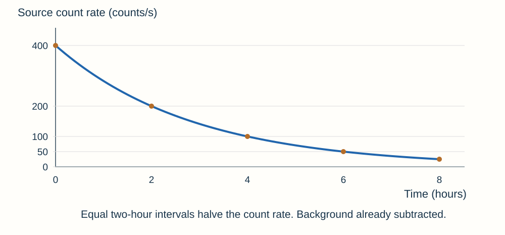
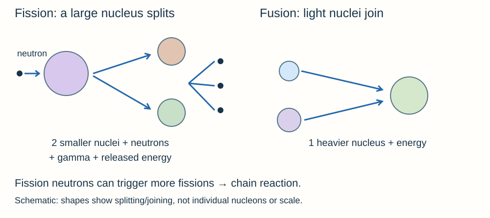

# Atomic structure

## Atoms, isotopes and ions

An atom has a tiny **positive nucleus** containing protons and neutrons, surrounded by **negative electrons** in energy levels. Most of its volume is empty space and almost all its mass is in the nucleus.

Imagine a large stadium with a tiny heavy object at the centre: the important point is the huge size difference, not a literal model of electron paths.

| Particle | Relative charge | Relative mass | Location |
|---|---|---|---|
| Proton | +1 | 1 | Nucleus |
| Neutron | 0 | 1 | Nucleus |
| Electron | −1 | Very small | Energy levels around nucleus |

**Size:** a typical atom has a radius of about **1 × 10⁻¹⁰ m**. Its nucleus has a radius **less than one ten-thousandth** as large.

**Atomic number, Z:** this is the number of protons. It identifies the element.

**Mass number, A:** this is the total number of protons and neutrons. Calculate the neutron number using **A − Z**.

**Neutral atoms and ions:** a neutral atom has equal numbers of protons and electrons. Losing electrons forms a **positive ion**. The proton number stays the same, so the element does not change.

**Isotopes:** these are atoms of the same element with different numbers of neutrons. They have the same atomic number but different mass numbers.

Carbon-14 has Z = 6 and A = 14: **6 protons, 8 neutrons and 6 electrons** when neutral. Carbon-12 has the same protons but only 6 neutrons.

## Electron energy levels and changing models

Electrons can **absorb electromagnetic radiation** and move to higher energy levels farther from the nucleus. When they return to lower levels, they **emit electromagnetic radiation**. If an electron leaves completely, the atom is ionised. These are electron changes, not nuclear decay.

| Model or discovery | What changed and why |
|---|---|
| Early solid-sphere model | Atoms thought indivisible |
| Electron discovered | Plum pudding: negative electrons embedded in spread-out positive charge |
| Alpha scattering | Most particles passed through; a few deflected strongly or returned |
| Nuclear model | Mostly empty space; tiny dense positive nucleus containing most mass |
| Bohr | Electrons occupy specific energy levels, supported by observed radiation |
| Proton identified | Nuclear positive charge occurs in units carried by protons |
| Chadwick's neutron evidence | Nucleus also contains uncharged particles |

**Link the observation to the conclusion:**

- Most alpha particles pass straight through → atom is **mostly empty space**.
- Some deflect → positive alpha particles are repelled by a **positive nucleus**.
- Very few return almost backwards → charge and mass occupy a **tiny, dense region**.

The plum pudding model could not explain the rare large deflections. **New evidence can change a model**; it does not mean scientists previously had no evidence or simply guessed.

## Radioactive decay and types of radiation

Some nuclei are unstable. **Radioactive decay is a random nuclear change** that emits radiation as the nucleus becomes more stable. You cannot predict which nucleus decays next. Large samples nevertheless show a predictable overall pattern.

**Activity** is the number of decays per second, measured in **becquerels (Bq)**. **Count rate** is what a detector records per second or minute. It is usually lower than activity because a detector does not detect every emission.

| Radiation | What it is | Penetration and range | Ionising power |
|---|---|---|---|
| Alpha, α | 2 protons + 2 neutrons; helium nucleus | Stopped by paper or outer skin; a few cm in air | High |
| Beta-minus, β | Fast electron emitted from nucleus as neutron becomes proton | Stopped by a few mm of aluminium; metres in air | Medium |
| Gamma, γ | Electromagnetic radiation from nucleus | Reduced by thick lead/concrete; long range | Low compared with alpha/beta |
| Neutron | Uncharged particle from nucleus | Can penetrate matter; important in fission | No charge; can cause effects through interactions with nuclei |

**Ionisation** means removing electrons from atoms. Radiation can damage living cells and DNA. Gamma is not completely “stopped” by a thin barrier; shielding reduces the intensity.

Beta electrons come from a nuclear change, **not the electron shells**. Alpha emission changes the nucleus; losing an ordinary outer electron does not.

## Balancing nuclear equations

Both **mass numbers and atomic numbers balance** across a nuclear equation. The nucleus may become a different element when its proton number changes.

**Alpha decay:** the nucleus loses two protons and two neutrons in an alpha particle. Its mass number A decreases by **4**, and its atomic number Z decreases by **2**.

**Beta-minus decay:** a neutron changes into a proton and an electron is emitted. The number of nucleons stays the same, so **A is unchanged**. There is one more proton, so **Z increases by 1**. The emitted electron has mass number 0 and charge number −1.

**Gamma emission:** the nucleus releases energy as electromagnetic radiation. Its proton and neutron numbers do not change, so **A and Z are unchanged**.

**Examples**

- ²³⁸₉₂U → ²³⁴₉₀Th + ⁴₂He. Check: 238 = 234 + 4 and 92 = 90 + 2.
- ¹⁴₆C → ¹⁴₇N + ⁰₋₁e. Check: 14 = 14 + 0 and 6 = 7 − 1.

If the daughter symbol is given, use the balances to find its numbers. Do not subtract 4 from atomic number during alpha decay or say beta decay adds an external proton.

## Half-life and background correction

**Half-life** is the time taken for the number of undecayed nuclei, activity or corrected count rate to fall to **half its initial value**.

Think of repeated halving of the amount still undecayed. Each step takes the same half-life, but a smaller number decays in each later step. It is not a fixed number of nuclei disappearing every minute.

**After n half-lives: remaining fraction = (½)ⁿ.**

**Remaining and decayed amounts:** after three half-lives, ½ × ½ × ½ = **1/8 remains**. The other **7/8 has decayed**. The ratio of remaining activity to initial activity is **1 : 8**. The ratio of the decline to initial activity is **7 : 8**.

**Worked example:** an activity of 640 Bq with a two-hour half-life becomes 320 Bq after two hours, 160 Bq after four hours and **80 Bq after six hours**.

**Using a graph:** choose an activity, find half that value and read the time interval between them. Start at another point and repeat the check. Equal halving intervals support the half-life you found.

**Subtract background first.** If total count rate is 84 counts/s and background is 4 counts/s, the source rate is 80 counts/s. After one half-life, source rate is 40, so the measured total would be **44 counts/s**, not 42.

Keep detector distance and shielding constant. Measure over a longer time and repeat to reduce the effect of random count fluctuations. Average counts, not a prediction of when an individual nucleus will decay.

## Contamination, irradiation and protection

- **Irradiation:** exposure to radiation from a source. Once the source is removed or shielded, exposure stops. The irradiated object does not become radioactive in these uses.
- **Contamination:** radioactive material is present where it is not wanted, on skin, objects or inside the body. It keeps emitting until removed or decayed.

Alpha outside the body is mostly stopped by skin. **Inside the body, alpha is especially damaging** because it deposits energy and ionises strongly over a short distance. Gamma can reach organs from outside. Risk depends on **type, activity, exposure time, position and absorption**, not just the radiation's name.

Reduce exposure time, increase distance and use suitable shielding. Use tongs, secure labelled storage and appropriate monitoring under trained supervision; prevent material being inhaled, swallowed or spread. These controls address both external exposure and contamination routes.

## Background radiation and uses

Background radiation is always present. Natural sources include **rocks, radon gas, cosmic rays and substances in food/living things**. Human-made sources include fallout from weapons tests and nuclear accidents. Medical procedures can add to a person's dose.

Location and occupation affect dose: rock type, altitude and work around radiation can matter. Radiation dose measures biological effect; **1 Sv = 1,000 mSv**. Compare data in the same units.

| Use | Suitable choice and reason |
|---|---|
| Medical tracer | Gamma can leave the body and reach an external detector; choose a half-life long enough for the investigation but short enough to limit continuing exposure |
| Destroying unwanted tissue | Radiation damages cells; direct the dose at the target and limit exposure of healthy tissue |
| Thickness monitoring | Beta can pass through a thin sheet but its detected count changes with thickness; alpha would be absorbed too easily and gamma may pass through too readily |
| Sterilising equipment | Penetrating gamma reaches microorganisms without leaving radioactive material on the equipment |

For the same initial number of radioactive nuclei, **shorter half-life means greater initial activity**, but activity falls faster. A long-lived contaminant can remain a problem for much longer. “Longer half-life is always safer” is wrong: assess the whole situation.

When comparing benefits and risks, use the dose, expected benefit and available alternatives supplied in the question. Published research and **peer review** let other scientists check evidence about radiation effects.

## Fission, fusion and chain reactions

**Fission splits a large unstable nucleus**. It usually begins when the nucleus absorbs a neutron. The nucleus splits into two smaller nuclei and releases **two or three neutrons, gamma radiation and energy**. The products carry kinetic energy.

Some emitted neutrons cause further fissions, producing a **chain reaction**. A reactor controls this chain so energy is released at a controlled rate; neutron-absorbing control rods help regulate it. An uncontrolled chain reaction can release energy extremely rapidly.

**Fusion joins two light nuclei into a heavier nucleus**. Some mass is converted into energy of radiation. Very high temperatures help positively charged nuclei overcome their mutual repulsion. Fusion powers stars.

Do not confuse fusion with melting: melting rearranges particles without changing nuclei. Fission and fusion both change nuclei and can release energy, but they do so in opposite structural ways.
