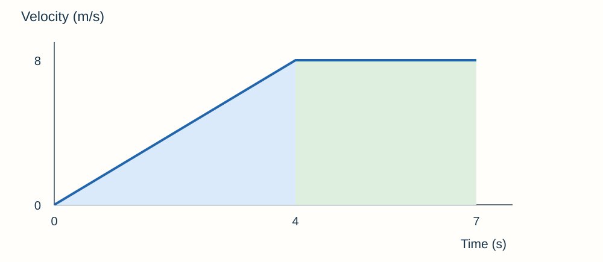

# Forces questions & answers

## 1 mark

**1.** What is a vector quantity?

**Answer:** A quantity with magnitude and direction.

**2.** Name the force opposing motion through air.

**Answer:** Air resistance.

**3.** What is the unit of a moment?

**Answer:** Newton-metre (Nm).

**4.** State the equation for momentum.

**Answer:** p = mv.

**5.** What does the gradient of a distance–time graph represent?

**Answer:** Speed.

## 2 marks

**6.** A person walks 30 m east and 10 m west. State the total distance and displacement.

**Answer:**

- Distance = 30 + 10 = **40 m**.
- Displacement = **20 m east**.

**7.** Calculate the weight of a 50 kg object where g = 9.8 N/kg.

**Answer:** **W = mg** = 50 × 9.8 = **490 N**.

**8.** Forces of 18 N east and 7 N west act on an object. Find the resultant.

**Answer:** 18 − 7 = **11 N east**.

**9.** A 5 N resultant force acts on a 2.0 kg object. Calculate its acceleration.

**Answer:** **a = F/m** = 5/2.0 = **2.5 m/s²** in the direction of the resultant force.

**10.** Explain how an object can move at constant speed but have changing velocity.

**Answer:**

- Velocity includes **direction** as well as speed.
- Motion around a circle changes direction, so velocity changes even at constant speed.

**11.** State the difference between elastic and inelastic deformation.

**Answer:**

- Elastic deformation **reverses when the forces are removed**.
- Inelastic deformation leaves a **permanent shape change**.

**12.** Explain why using a longer spanner can make a nut easier to turn.

**Answer:**

- It increases the **perpendicular distance from the pivot**.
- **M = Fd**, so the same force produces a greater moment.

**13.** Give two factors that can increase thinking distance at the same speed.

**Answer:**

- Tiredness can **increase reaction time**.
- Distraction can **delay the driver’s response**.

**14.** Why does atmospheric pressure decrease with height?

**Answer:**

- At higher altitude there is **less air above** a surface.
- The weight of the air above and its density are lower, so atmospheric pressure is lower.

## 3 marks

**15.** A spring extends from 12.0 cm to 15.0 cm under a force of 9.0 N. Calculate its spring constant within the proportional region.

**Answer:**

- Extension = 15.0 − 12.0 = 3.0 cm = **0.030 m**.
- **k = F/e** = 9.0/0.030.
- **300 N/m**.

**16.** A force of 25 N moves a box 2.4 m along the force direction. Calculate the work and describe the main energy transfer if the box moves steadily against friction.

**Answer:**

- **W = Fs** = 25 × 2.4 = **60 J**.
- The force does work against friction.
- Energy transfers into **thermal stores** of the surfaces and surroundings.

**17.** A 40 N force acts 0.15 m from a pivot. A second perpendicular force acts 0.30 m on the other side. Find the force needed for rotational balance.

**Answer:**

- First moment = 40 × 0.15 = **6.0 Nm**.
- Balance requires F × 0.30 = 6.0.
- **F = 20 N**.

**18.** Calculate the pressure due to water at a depth of 3.0 m. Density is 1,000 kg/m³ and g = 9.8 N/kg.

**Answer:**

- **p = hρg**.
- p = 3.0 × 1,000 × 9.8.
- **29,400 Pa**, above the pressure at the surface.

**19.** Explain why an immersed object experiences upthrust.

**Answer:**

- Liquid pressure **increases with depth**.
- Pressure on the bottom is greater than on the top.
- The difference gives an **upward resultant force**.

**20.** A car accelerates uniformly from 4.0 m/s to 16 m/s in 6.0 s. Calculate its acceleration and state the resultant force if its mass is 1,000 kg.

**Answer:**

- a = (v − u)/t = (16 − 4.0)/6.0 = **2.0 m/s²**.
- **F = ma**.
- F = 1,000 × 2.0 = **2,000 N**.

**21.** Explain how a falling object reaches terminal velocity.

**Answer:**

- Initially weight exceeds drag, so it accelerates downwards.
- Increasing speed increases **drag**, reducing the resultant force.
- When **drag equals weight**, acceleration is zero and velocity becomes constant.

**22.** A book rests on a table. Explain why its weight and the table’s normal force are not a Newton’s third-law pair, and identify the partner to its weight.

**Answer:**

- Both named forces act on the **same object**, the book.
- Third-law partners act on **different objects**.
- The partner to Earth’s gravitational pull on the book is the **book’s gravitational pull on Earth**.

**23.** A 1,500 kg car at 20 m/s has a driver reaction time of 0.60 s. Calculate its momentum and thinking distance.

**Answer:**

- Momentum = mv = 1,500 × 20 = **30,000 kg m/s**.
- Thinking distance = speed × reaction time.
- 20 × 0.60 = **12 m**.

**24.** Explain how an airbag reduces injury in a collision using momentum.

**Answer:**

- The passenger undergoes the same required **momentum change** to come to rest.
- The airbag increases the **stopping time**.
- **F = Δp/Δt**, so average force is smaller.

## 4 marks

**25.** An object accelerates uniformly from rest at 3.0 m/s² over 24 m. Calculate its final speed.

**Answer:**

- **v² − u² = 2as**.
- v² = 0 + 2 × 3.0 × 24 = **144**.
- v = √144.
- **12 m/s**.

**26.** A 3.0 kg trolley moving right at 4.0 m/s sticks to a 1.0 kg trolley moving left at 2.0 m/s. Calculate their shared final velocity, assuming no resultant external force.

**Answer:**

- Choose right positive: initial momentum = 3.0 × 4.0 + 1.0 × (−2.0) = **10 kg m/s**.
- Total mass = **4.0 kg**.
- Conserved momentum gives 4.0v = 10.
- **v = 2.5 m/s right**.

**27.** A 0.50 kg ball moving right at 6.0 m/s rebounds left at 4.0 m/s in 0.10 s. Find the average force on the ball.

**Answer:**

- Right positive: u = +6.0, v = −4.0 m/s.
- Δp = m(v − u) = 0.50 × (−4.0 − 6.0) = **−5.0 kg m/s**.
- F = Δp/Δt = −5.0/0.10 = **−50 N**.
- The force is **50 N left**.

**28.** Use the graph to calculate acceleration during the first 4 s and total displacement in 7 s.

**Answer:**

- Acceleration = gradient = (8 − 0)/(4 − 0) = **2 m/s²**.
- Triangle area = ½ × 4 × 8 = **16 m**.
- Rectangle area = 3 × 8 = **24 m**.
- Total displacement = **40 m**.

**29.** Explain the effect of doubling a car’s speed on thinking distance and braking distance, assuming fixed reaction time, mass and braking force.

**Answer:**

- Thinking distance = vt, so it **doubles**.
- Kinetic energy = ½mv², so it **quadruples**.
- Braking work Fs removes that energy; with fixed F, braking distance **quadruples**.
- Total stopping distance is the sum, so its increase depends on the original two distances; it does not simply double.

**30.** A piston experiences 120 N over 6.0 cm². Calculate the pressure in pascals.

**Answer:**

- 1 cm² = **10⁻⁴ m²**.
- Area = **0.00060 m²**.
- p = F/A = 120/0.00060.
- **200,000 Pa**.

## 6 marks

**31.** Plan an investigation of force and spring extension. Include how to find the spring constant and test whether deformation is elastic.

**Answer:**

- Secure a spring to a stable stand with a ruler and pointer beside it. Measure the **unloaded length**.
- Add known masses in steps, including the hanger in total mass. Calculate force using **F = mg**.
- Let the spring settle, read length at eye level and calculate **extension = loaded − unloaded length**.
- Repeat readings and plot force vertically against extension horizontally, using metres. The straight section’s **gradient is k**.
- Remove loads and check return to the original length to test **elastic recovery**. Loss of proportionality and permanent deformation are not necessarily the same point.
- Keep the spring/setup fixed, avoid overloading, secure the stand and protect against falling masses or a snapping spring.

**32.** Describe how to investigate the effect of resultant driving force on the acceleration of a trolley system while keeping total moving mass constant.

**Answer:**

- Use a low-friction trolley connected by string over a pulley to a mass hanger. Secure the track and pulley.
- Use light gates or a motion sensor to measure velocity changes and calculate **a = Δv/Δt** before the hanger hits the floor.
- Move masses from the trolley to the hanger: **total moving mass remains constant**, while hanging weight increases.
- For the whole moving system, driving force is approximately **hanger mass × g**, allowing for friction. It is not simply the tension force on the trolley alone.
- Repeat for several forces, calculate mean accelerations and plot **a against F**. An approximately straight line through the origin supports direct proportionality.
- Control friction and starting conditions, keep the string taut and catch the trolley safely.

**33.** A 1,000 kg car travels at 20 m/s. Reaction time is 0.70 s and braking force is constant at 5,000 N. Calculate stopping distance and explain how wet road conditions could change it.

**Answer:**

- Thinking distance = 20 × 0.70 = **14 m**.
- Kinetic energy = ½ × 1,000 × 20² = **200,000 J**.
- Braking work equals energy removed, so braking distance = 200,000/5,000 = **40 m**.
- Total stopping distance = 14 + 40 = **54 m**.
- A wet road can reduce tyre grip and the effective braking force, increasing the distance needed to remove the same kinetic energy.
- If speed and reaction time are unchanged, thinking distance stays 14 m; the increase is in the braking part.

## Past-paper sources

Original practice questions with tutor-written answers. The linked AQA papers and mark schemes provide the assessment examples.

### Resource directory

- [AQA Physics assessment resources](https://www.aqa.org.uk/subjects/physics/gcse/physics-8463/assessment-resources)
- [Physics & Maths Tutor paper archive](https://www.physicsandmathstutor.com/past-papers/gcse-physics/aqa-paper-2/)
- [Revision Science archive](https://revisionscience.com/gcse-revision/physics/physics-gcse-past-papers/aqa-gcse-physics-past-papers)

### Papers reviewed

- June 2022, Paper 2 Higher: [question paper](../../00 - Past papers/Paper 2 Higher/AQA-84632H-QP-JUN22.PDF) · [mark scheme](../../00 - Past papers/Paper 2 Higher/AQA-84632H-MS-JUN22.PDF).

- June 2023, Paper 2 Higher: [question paper](../../00 - Past papers/Paper 2 Higher/AQA-84632H-QP-JUN23.PDF) · [mark scheme](../../00 - Past papers/Paper 2 Higher/AQA-84632H-MS-JUN23.PDF).

### Evidence and selection

Motion calculations and braking reasoning occur in both sampled papers (2022 replacement Paper 2HR Q01 and Q03; 2023 Paper 2H Q03 and Q05). Force-balance reasoning is illustrated by 2022 Q04 and 2023 Q02. Pressure examples occur in 2023 Q01 and momentum/safety in Q05. These overlapping broad types are counted once per paper. Additional practice covers spring and acceleration practicals, moments, vectors, fluid pressure and collision calculations.

The two-paper sample illustrates question types; it is not a prediction. Additional questions cover the current specification, including Higher-tier and separate Physics content.
