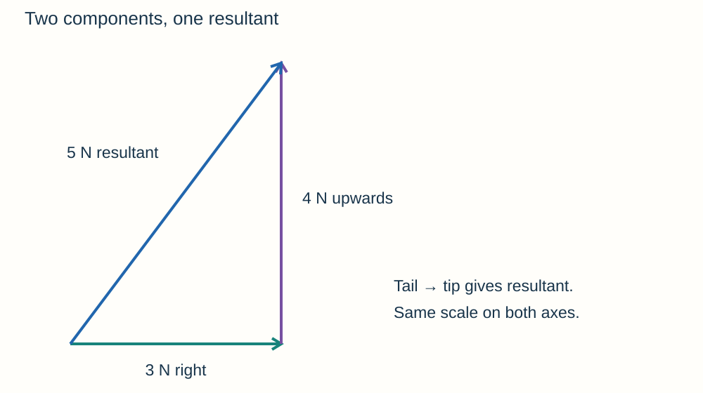
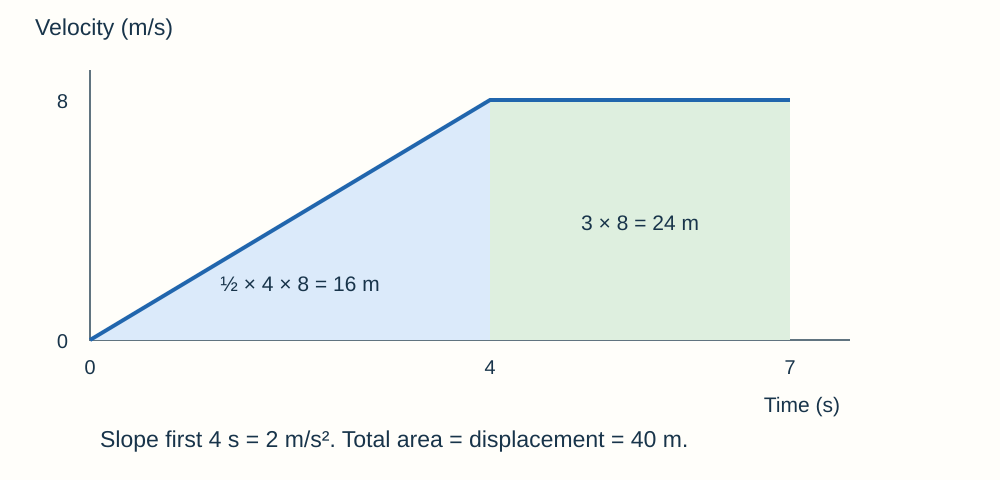

# Forces

## Scalars, vectors and interactions

A **scalar** has size only: distance, speed, mass, time, energy and temperature. A **vector** has size and direction: displacement, velocity, acceleration, force, weight and momentum.

Imagine walking around a park and returning to the gate. You have travelled a distance, but your **displacement is zero** because your finishing position equals your starting position.

Forces are interactions between objects, measured in **newtons (N)**. An arrow shows a force's direction; its scaled length shows its size.

- **Contact forces:** friction, air resistance, tension and normal contact force.
- **Non-contact forces:** gravitational, magnetic and electrostatic forces.
- A **free-body diagram** shows only forces acting on the chosen object. Name the source of each force where useful.

## Weight, resultants and components

**Weight is gravitational force: W = mg.** W is in N, m in kg and g in N/kg. Use the supplied g. Mass does not change just because an object moves to another planet; weight can.

A 60 kg person with g = 9.8 N/kg weighs **588 N**. A calibrated newtonmeter measures weight. Weight can be treated as acting at the **centre of mass**.

The **resultant** is the single force with the same overall effect as the forces combined. Along a line, add forces in one direction and subtract those in the other. 12 N right and 5 N left give **7 N right**.

For forces at angles, use a **scale drawing**:

1. Choose a scale, such as 1 cm = 2 N.
2. Draw one arrow, then draw the second from its tip, preserving its direction.
3. The resultant runs from the first tail to the last tip. Measure its length and direction.
4. To **resolve** a force, construct horizontal and vertical components whose diagonal is the original force. Together, they have the same effect as that force.

Balanced forces have **zero resultant**. This means zero acceleration, not necessarily zero velocity. An object can move steadily while forces are balanced.

## Work and elastic deformation

A force does **work** when it produces displacement along its line of action. **W = Fs**, where work W is in J, force F in N and distance s in m. **1 J = 1 Nm** for work.

A 40 N force moving a box 3.0 m transfers **120 J**. Work against friction transfers energy into thermal stores, warming surfaces.

To stretch, compress or bend a **stationary object**, more than one force acts: for example, a pull at each end. **Elastic deformation** reverses when forces are removed; **inelastic deformation** leaves a permanent shape change.

**Hooke's law: F = ke**, up to the **limit of proportionality**.

- k: spring constant, N/m; a larger k means a stiffer spring.
- e: extension or compression in m, not total length.
- A 6.0 N force extends a spring by 0.030 m: k = 6.0/0.030 = **200 N/m**.
- A force–extension graph is straight through the origin while proportional. With F vertical and e horizontal, its gradient is **k**.
- Beyond the proportional limit, F and e are no longer directly proportional. This is not automatically the same point as permanent deformation.

Energy stored within the proportional region is **Eₑ = ½ke²**. It equals the triangular area under an F-against-e graph. A spring stores energy while stretching, so use average force, not final force × extension for a Hooke's-law spring.

## Practical: force and extension

1. Clamp a spring to a secure stand. Place a ruler beside it with a pointer to make readings clear. Measure its unloaded length.
2. Add known masses in small steps. Convert each mass into force using **F = mg**, including the mass hanger.
3. Let the spring settle. Read length at eye level; calculate **extension = loaded − unloaded length**.
4. Repeat and plot F against e. Use the straight section's gradient to find k.
5. Remove masses and check whether the spring returns to its original length. This tests elastic recovery separately from proportionality.

Keep the spring and ruler arrangement fixed. Secure the stand and use a tray below the masses; keep eyes and feet clear of a snapping spring or falling loads. Do not overload the spring.

## Moments, levers and gears

A **moment** is the turning effect of a force: **M = Fd**, in **Nm**. d is the **perpendicular distance from the pivot to the force's line of action**.

A 20 N force applied at right angles 0.30 m from a pivot gives **6.0 Nm**. A longer spanner allows the same moment with less force.

For rotational balance, **total clockwise moment = total anticlockwise moment**. If 30 N acts 0.20 m on one side, a force 0.40 m on the other must be (30 × 0.20)/0.40 = **15 N**. A fully stationary object also needs balanced forces.

Levers transmit turning effects about a pivot. Meshing gears transmit rotation through forces between teeth; adjacent gears rotate in **opposite directions**. A larger driven gear rotates more slowly and gives a greater turning effect for an ideal system. Mechanical advantage does not create energy.

## Pressure, upthrust and the atmosphere

A **fluid** is a liquid or gas. Fluid pressure produces forces **normal to a surface**.

**p = F/A**: p in Pa, F perpendicular to the surface in N, A in m². **1 Pa = 1 N/m²**. Smaller area gives larger pressure for the same force. Convert area carefully: **1 cm² = 10⁻⁴ m²**.

Pressure due to a liquid column is **p = hρg**: depth h in m, density ρ in kg/m³. More depth or greater density means more weight of liquid above each unit area.

At 2.0 m depth in water, with ρ = 1,000 kg/m³ and g = 9.8 N/kg, liquid pressure = **19,600 Pa**. If total pressure is requested, add the pressure at the surface. Pressure difference between depths is **Δp = Δhρg**.

- Pressure is greater on an immersed object's bottom than its top, giving an upward resultant called **upthrust**.
- A floating object at rest has **upthrust = weight**.
- Ignoring other forces, weight greater than upthrust makes it accelerate downwards; upthrust greater than weight makes it rise.
- An object's **average density**, including air spaces, helps explain floating. A hollow steel ship can float even though solid steel is denser than water.

Atmospheric pressure comes from air-particle collisions and the weight of the atmosphere. Higher altitude means **less air above**, lower air density and **lower atmospheric pressure**.

## Describing motion

**Average speed = total distance / total time.** At constant speed, **s = vt**. Speed is in m/s. Average velocity uses **displacement / time** and includes direction.

A runner travels 200 m in 40 s: average speed = **5.0 m/s**. If the runner returns to the starting point, average velocity for the full journey is zero even though average speed is not.

Useful approximate speeds: **walking 1.5 m/s, running 3 m/s, cycling 6 m/s, sound in air 330 m/s**. A car might travel around 13 m/s in a town and 30 m/s on a fast road; a train around 50 m/s and an airliner around 250 m/s. These are estimates, not fixed properties. Terrain, fitness, traffic and conditions matter.

**Acceleration a = (v − u)/t**, in m/s². A car increasing from 5 to 17 m/s in 4 s has acceleration **3 m/s²**. Slowing gives acceleration opposite to the motion.

For **constant acceleration**, **v² − u² = 2as**. From rest at 2.0 m/s² over 25 m, v = √(2 × 2.0 × 25) = **10 m/s**. This equation is not for changing acceleration.

Moving in a circle at constant speed still changes **velocity**, because direction changes. A resultant force towards the centre is needed.

## Reading motion graphs

| Graph | Gradient | Area |
|---|---|---|
| Distance–time | Speed | Not the distance travelled |
| Velocity–time | Acceleration | Signed displacement |

- A flat distance–time line means stationary; a straight sloping line means constant speed.
- On a curved distance–time graph, draw a **tangent** at the time and calculate its gradient to estimate instantaneous speed.
- A flat velocity–time line means **constant velocity**, not necessarily rest.
- For a velocity–time graph, find areas using rectangles and triangles or count squares. **Area below the time axis is negative displacement**. Add the magnitudes of areas for total distance.

Here acceleration = 8/4 = **2 m/s²** for the first 4 s. Displacement = ½ × 4 × 8 + 3 × 8 = **40 m**. All velocities are positive, so distance is also 40 m.

## Newton's laws and terminal velocity

**First law:** zero resultant force means rest or **constant velocity**. **Inertia** is the tendency to keep that state. Motion does not require a continuing forward resultant force.

**Second law: F = ma**, using the **resultant force**, mass in kg and acceleration in m/s². Greater F gives greater a for fixed mass; greater mass gives smaller a for fixed F. **Inertial mass = F/a**, measuring resistance to changing velocity.

**Third law:** interacting objects exert **equal and opposite forces of the same type on each other**. They act on **different objects**, so do not cancel on one free-body diagram. A book's weight and the table's upward force both act on the book; they are not a third-law pair. The partner to Earth's pull on the book is the book's pull on Earth.

**Falling through air**

1. Initially, weight exceeds drag, so the object accelerates downwards.
2. Increasing speed increases drag. Resultant force and acceleration decrease.
3. When **drag = weight**, resultant force is zero: the object falls at **terminal velocity**.
4. A parachute increases drag; immediately after opening, upward drag may exceed weight, so it slows. A new, lower terminal velocity is reached when forces balance again.

Free fall with negligible air resistance gives acceleration about **9.8 m/s²** near Earth. At terminal velocity there are still forces; they balance.

## Practical: force, mass and acceleration

Use a low-friction trolley pulled by a string over a pulley by hanging masses. Light gates or a motion sensor measure velocities and acceleration. Keep the string taut and measure before the hanging mass hits the floor.

**Vary force at constant mass**

- Transfer small masses **from the trolley to the hanger**. Total moving mass of trolley, hanger and added masses stays constant, while the driving weight increases.
- For the whole moving system, driving force is approximately the hanging weight when friction is negligible. The string tension on the trolley alone is not equal to the hanging weight while it accelerates.
- Measure acceleration for each driving force. Repeat and plot **a against F**; expect approximate direct proportionality.

**Vary mass at constant force**

- Keep hanging mass fixed and add mass to the trolley. Total moving mass increases while the driving weight remains the same.
- Measure acceleration and repeat. A graph of **a against 1/total mass** should be approximately straight if force is constant.
- Measure and allow for friction; keep track and pulley conditions consistent. Secure the pulley, catch the trolley safely and keep clear of falling masses.

Use **Δv/Δt** for acceleration when measured velocities and their time interval are available. A single speed measurement is not an acceleration.

## Thinking, braking and stopping

**Stopping distance = thinking distance + braking distance.**

- **Thinking distance = speed × reaction time**. Tiredness, alcohol/drugs and distraction can increase reaction time.
- Typical reaction times are about **0.2–0.9 s**. A ruler-drop test measures distance fallen before catching; use a conversion table or suitable equation to obtain time. Repeat with the same setup and compare means, while recognising practice and anticipation effects.
- Wet/icy roads, worn tyres and poor brakes can increase **braking distance** by reducing the available braking force.
- Friction does work, reducing kinetic energy and heating brakes. Large braking forces give large decelerations, with risks of overheating and losing control.

For constant mass and braking force, kinetic energy is proportional to **speed squared**, so **doubling speed quadruples braking distance**. Thinking distance only doubles if reaction time stays fixed. Total stopping distance therefore does not usually simply double or quadruple.

**Example:** a car at 20 m/s with reaction time 0.70 s travels **14 m** before braking. A 1,000 kg car has Eₖ = ½ × 1,000 × 20² = **200,000 J**. With a constant 5,000 N braking force, braking distance = E/F = **40 m**, so stopping distance = **54 m**.

## Momentum and collision safety

**Momentum p = mv**, in **kg m/s**. It is a vector: choose a positive direction and use negative velocities for the opposite direction.

In a closed system with no resultant external force, **total momentum before = total momentum after**. Total kinetic energy need not be conserved in a collision; some can become thermal energy or deformation.

**Joining trolleys:** a 2 kg trolley moving right at 3 m/s hits a stationary 1 kg trolley and they stick. Initial momentum = 2 × 3 = 6 kg m/s. Combined mass = 3 kg, so final v = 6/3 = **2 m/s right**.

**Recoil:** two objects initially at rest have zero total momentum. If they push apart, their momenta are equal in size and opposite in direction. The lighter object has the greater speed.

**Force = rate of change of momentum: F = Δp/Δt = m(v − u)/Δt.** This gives an average force for the stated time interval.

Airbags, seat belts, helmets, crash mats and cushioned playground surfaces increase **stopping time** for the same momentum change, reducing average force. They do not remove the need for momentum to change.

A 60 kg passenger slows from 10 m/s to rest: momentum change has magnitude **600 kg m/s**. Over 0.20 s, average force magnitude = 600/0.20 = **3,000 N**; over 0.50 s, it is **1,200 N**.
