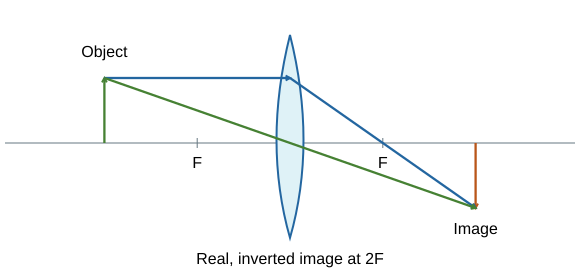

# Waves questions & answers

## 1 mark

**1.** Name the wave type in which vibrations are parallel to the direction of energy transfer.

**Answer:** Longitudinal.

**2.** What does the amplitude of a wave measure?

**Answer:** The maximum displacement from the resting position.

**3.** Give the approximate upper frequency limit of normal human hearing.

**Answer:** 20 kHz.

**4.** Which electromagnetic group lies between visible light and X-rays?

**Answer:** Ultraviolet.

**5.** What type of image can be formed on a screen?

**Answer:** Real.

**6.** Name the line from which angles of incidence and reflection are measured.

**Answer:** The normal.

**7.** Which seismic wave cannot travel through liquids?

**Answer:** S-wave.

**8.** What happens to a wave’s frequency when it enters a different medium?

**Answer:** It stays the same.

**9.** What is a perfect black body?

**Answer:** An object that absorbs all radiation incident on it.

**10.** Which pair of changes occurs when light enters glass from air and slows down? Choose one: A frequency falls and wavelength stays constant; B frequency stays constant and wavelength falls; C both increase; D both stay constant.

**Answer:** B: frequency stays constant and wavelength falls.

## 2 marks

**11.** Compare particle vibrations in transverse and longitudinal waves.

**Answer:** - Transverse vibrations are **perpendicular** to energy transfer.
- Longitudinal vibrations are **parallel** to energy transfer.

**12.** A cork bobs in a ripple tank but stays in approximately the same horizontal position. Explain what this shows.

**Answer:** - The cork and nearby water move locally as the disturbance passes.
- The wave transfers **energy without an overall transfer of the water** across the tank.

**13.** A wave has frequency 25 Hz. Calculate its period.

**Answer:** **T = 1/f = 1/25 = 0.040 s**.

**14.** A ripple has frequency 5.0 Hz and wavelength 0.060 m. Calculate its speed.

**Answer:** **v = fλ = 5.0 × 0.060 = 0.30 m/s**.

**15.** Why is a distance–displacement wave graph unsuitable for reading the period directly?

**Answer:** - Its horizontal axis shows **distance**, so a full cycle gives wavelength.
- Period needs a **time axis** or a separate timing measurement.

**16.** A ray strikes a mirror at 35° to the normal. State its reflection angle and its angle to the mirror surface.

**Answer:** - Reflection angle = **35°**.
- Angle to the surface = 90° − 35° = **55°**.

**17.** Explain why rough surfaces scatter reflected light even though the reflection law still applies.

**Answer:** - Different small parts of the surface have **different normal directions**.
- Each obeys i = r, but the reflected rays travel in **different directions**.

**18.** Why can ultrasound be used to find a hidden boundary?

**Answer:** - Some ultrasound is **reflected at a boundary between different materials**.
- The returning echo’s time delay reveals the boundary’s **distance**, using the wave speed.

**19.** Explain why S-wave observations support a liquid outer core.

**Answer:** - S-waves **cannot travel through liquids**.
- Their failure to pass through the outer core supports the conclusion that it is **liquid**.

**20.** Why are X-rays suitable for an image of a broken bone?

**Answer:** - Bone **absorbs more X-rays** than surrounding soft tissue.
- Different amounts reaching the detector produce **contrast**, showing the bone and fracture.

**21.** Explain why a red shirt appears dark under only blue light.

**Answer:** - It mostly **absorbs blue** and reflects red.
- There is little red in the illumination, so **little light reaches the eye from the shirt**.

**22.** A lens forms a 30 mm image of a 12 mm object. Calculate magnification and state whether it has a unit.

**Answer:** Magnification = 30/12 = **2.5**, with **no unit**.

**23.** Explain why an object cools by radiation when it emits 80 W and absorbs 50 W.

**Answer:** - It loses energy at a **net rate of 30 W**.
- More radiation is emitted than absorbed, so its **temperature falls**, assuming no other transfers balance the loss.

**24.** Why must the distance between an infrared detector and each Leslie-cube face be the same?

**Answer:** - Detector reading changes with distance.
- Keeping distance constant helps ensure differences are caused by **surface finish**, rather than measurement position.

**25.** Two students report reflection angles of 29.1° and 29.2° using a protractor marked every 1°. Explain the problem.

**Answer:** - The instrument’s **resolution is 1°**.
- It does not resolve a **0.1° difference**, so those readings imply unjustified precision.

**26.** How can radio waves be generated and then detected in electrical circuits?

**Answer:** - **Oscillating electrical currents** generate radio waves.
- Absorbed radio waves can induce an **alternating current at the same frequency** in a receiving circuit.

## 3 marks

**27.** Sound of frequency 400 Hz travels at 340 m/s in air and 1,500 m/s in water. Calculate its wavelength in both media and explain the frequency.

**Answer:** - Air: λ = v/f = 340/400 = **0.85 m**.
- Water: λ = 1,500/400 = **3.75 m**.
- Frequency remains **400 Hz** because it is set by the source.

**28.** A microwave travels at 3.0 × 10⁸ m/s and has wavelength 12.0 cm. Calculate its frequency in standard form.

**Answer:** - λ = **0.120 m**.
- f = v/λ = (3.0 × 10⁸)/0.120.
- **f = 2.5 × 10⁹ Hz**.

**29.** An echo returns 0.060 s after a pulse is sent through water. Sound travels at 1,480 m/s. Calculate the distance to the reflector.

**Answer:** - Total travelled distance = vt = 1,480 × 0.060 = **88.8 m**.
- This is the **out-and-back** journey.
- Distance to reflector = 88.8/2 = **44.4 m**.

**30.** Explain why a light ray entering glass obliquely bends towards the normal.

**Answer:** - Parts of a wavefront reach the glass at **different times**.
- Light travels **more slowly in glass**, so one part slows before another.
- The wavefront turns, changing the ray’s direction **towards the normal**.

**31.** A convex lens is used as a magnifying glass. Where is the object, and what are three properties of its image?

**Answer:** - Object is **closer to the lens than its focal length**.
- Image is **virtual and upright**.
- It is **magnified**, on the same side as the object.

**32.** Describe how to locate the virtual image formed by a concave lens on a ray diagram.

**Answer:** - Draw a ray from the object tip **parallel to the axis**, then diverging as if from the near focus.
- Draw a second ray through the **optical centre**, continuing straight.
- Extend outgoing rays **backwards with dashed lines**. Their intersection locates the virtual image tip.

**33.** Explain one benefit and two precautions when using X-rays for medical imaging.

**Answer:** - They can reveal internal structures such as **bone fractures** without surgery.
- Use the **lowest dose that gives useful information**, limiting exposure time and unnecessary repeats.
- Use appropriate **shielding** for staff and unaffected areas where suitable, because ionising radiation can damage cells.

**34.** Six consecutive crest lines span 0.15 m in a ripple tank. Frequency is 12 Hz. Calculate wavelength and speed.

**Answer:** - Six crest lines contain **five wavelengths**.
- λ = 0.15/5 = **0.030 m**.
- v = fλ = 12 × 0.030 = **0.36 m/s**.

**35.** A string has four stationary loops across 1.20 m and vibrates at 50 Hz. Calculate the travelling wave’s wavelength and speed.

**Answer:** - Each loop spans **half a wavelength**.
- λ = 2 × 1.20/4 = **0.60 m**.
- v = 50 × 0.60 = **30 m/s**.

**36.** White light passes through an ideal red filter and then an ideal blue filter. Explain why almost no light emerges.

**Answer:** - The first filter **transmits red light** and absorbs other visible wavelengths.
- The second mainly **transmits blue** and absorbs red.
- Little of the light leaving the first filter can pass the second; filters **do not create new colours**.

## 4 marks

**37.** Describe a method to measure the speed of sound using two microphones.

**Answer:** - Measure the **separation** of microphones connected to a data logger or oscilloscope.
- Make a sharp sound in line with them and identify the **same pulse** in both recordings.
- Measure arrival-time difference and calculate **v = separation/time delay**.
- Repeat and average. Use enough separation for a measurable delay; electronic timing avoids human reaction-time error.

**38.** Explain how a warming object’s emitted radiation changes and what radiation balance means.

**Answer:** - It emits **more energy per second** as temperature rises.
- Its spectrum shifts towards **shorter wavelengths**.
- At constant temperature, absorbed and emitted power balance if radiation is the only energy transfer.
- If absorbed power exceeds emitted power, its **temperature rises** until the balance changes.

**39.** An IR experiment compares a black and a shiny surface. The black surface starts hotter and is closer to the detector. Explain why the result does not isolate the effect of surface finish and how to improve it.

**Answer:** - **Hotter surfaces emit more**, so starting-temperature differences affect the readings.
- **Distance** also affects the detector’s reading.
- Use faces at the **same temperature**, for example on one hot Leslie cube.
- Keep **detector distance and angle fixed**, repeat, and compare readings.

**40.** Describe how a convex-lens ray diagram shows a real image for an object beyond twice the focal length.

**Answer:** - Draw the axis, lens, **F and 2F** on both sides, and the object beyond 2F.
- Draw a tip ray parallel to the axis, refracted through the **far focus**.
- Draw a second ray through the optical centre, continuing straight.
- Their intersection gives a **real, inverted, smaller** image between F and 2F.

**41.** Draw a ray diagram for an object at twice the focal length of a convex lens. Use it to state the image's position, orientation and size.

**Answer:** Draw the lens, principal axis and **F and 2F on both sides**. Place the object at 2F. From its tip, draw a ray parallel to the axis that refracts through the far focus, and a ray through the optical centre that continues straight. They meet at **2F on the other side**, forming a **real, inverted image of equal size**.

## 5 marks

**42.** A ripple-tank experiment produces 30 complete waves in 5.0 s. Six consecutive crests span 20 cm. Calculate the frequency, wavelength and wave speed. The source frequency is then doubled without changing the water depth. Predict the new wavelength, assuming wave speed stays constant.

**Answer:** - Frequency = number ÷ time = 30 ÷ 5.0 = **6.0 Hz**.
- Six consecutive crests enclose **five wavelengths**, so wavelength = 20 ÷ 5 = **4.0 cm = 0.040 m**.
- Wave speed: **v = fλ** = 6.0 × 0.040 = **0.24 m/s**.
- The new frequency is **12 Hz**. At constant speed, **λ = v/f** = 0.24 ÷ 12 = **0.020 m**, or **2.0 cm**.
- Doubling frequency therefore **halves wavelength** in these conditions.

## 6 marks

**43.** Describe a valid investigation of how incident angle affects refraction through a rectangular glass block. Include measurement and ways to reduce uncertainty.

**Answer:** - Place the block on paper and **trace its outline** so its position is recorded.
- Shine a **narrow ray** at one face. Mark two points on the incident ray and two on the emerging ray while the block stays fixed.
- Remove it. Join the ray marks and connect entry and exit points to reconstruct the path inside the glass.
- Draw a **normal at 90° to the surface** at entry. Measure incidence and refraction angles from this normal using a protractor.
- Repeat across a suitable range of incident angles, keeping the same block and entry face. Repeat readings and calculate means.
- Use fine marks and a ruler, consistent eye position, and a resolution appropriate to the claimed difference. Plot refracted angle against incident angle and describe the trend. Do not replace a refraction method with a mirror-reflection method.

**44.** Describe how to compare the infrared absorption of different surface finishes. Explain how to make a valid comparison.

**Answer:** - Use otherwise identical containers or samples with different finishes. Put the **same mass of water or material** in each, starting at the same temperature.
- Place each at the **same distance and orientation** from an IR lamp, with equal exposure time and lamp output.
- Record initial and final temperatures and calculate **temperature increases**. Keep thermometer positions, room conditions and other apparatus comparable.
- Repeat, average and compare the rises. A greater rise under matched conditions indicates greater absorption, because the same amount of material needs more absorbed energy to warm further.
- Prevent unequal mass, shading, draughts or differing heat loss from determining the result. A matt black surface generally absorbs more IR than a shiny surface.
- Use heatproof surfaces and avoid hot lamps or water; keep electrical equipment dry.

**45.** Explain how a change in atmospheric greenhouse gases can affect Earth’s temperature. Include incoming, outgoing and reflected radiation.

**Answer:** - Solar radiation reaches Earth; **some is reflected** into space and some is absorbed by the surface and atmosphere.
- Earth’s surface **emits infrared**, transferring energy away.
- Greenhouse gases **absorb and emit infrared**, including emission towards the surface, changing energy transfer to space.
- An increase can initially reduce outgoing energy for the existing temperature. Then absorbed incoming power exceeds outgoing power and the surface and lower atmosphere **warm**.
- As temperature rises, radiation emitted increases. A new balance can be reached at a higher temperature, depending on the other factors involved.
- Changes in reflection, such as cloud or surface changes, also affect absorbed sunlight. The explanation is an **energy balance**, not a claim that all radiation is trapped forever.

## Past-paper sources

### Resource directory

- [AQA assessment resources](https://www.aqa.org.uk/subjects/physics/gcse/physics-8463/assessment-resources)

### Question selection

June 2022 and 2023 Paper 2 Higher were reviewed. Reflection/refraction practical reasoning appears in 2022 Q02.1–02.4 and 2023 Q07.1–07.6 (2/2 papers). Infrared surfaces appear in 2023 Q01; wave-equation conversion in 2023 Q06.2; hearing-data interpretation in 2023 Q04. This small sample does not establish a ranked frequency list. Remaining questions provide specification-based coverage. Original numbers, wording and contexts are used.

These are original practice questions and tutor-written answers, informed by the linked papers. Mark allocations are practice allocations.

- June 2022, Paper 2 Higher: [question paper](../../00 - Past papers/Paper 2 Higher/AQA-84632H-QP-JUN22.PDF) · [mark scheme](../../00 - Past papers/Paper 2 Higher/AQA-84632H-MS-JUN22.PDF).

- June 2023, Paper 2 Higher: [question paper](../../00 - Past papers/Paper 2 Higher/AQA-84632H-QP-JUN23.PDF) · [mark scheme](../../00 - Past papers/Paper 2 Higher/AQA-84632H-MS-JUN23.PDF).
