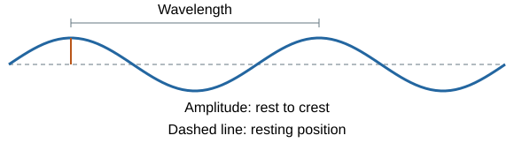
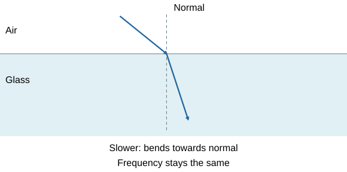

# Waves

## What a wave carries

A wave is a travelling disturbance that **transfers energy without transferring matter overall**. Think of a Mexican wave in a stadium: the pattern moves around the crowd, while each person moves up and down near their seat.

- **Transverse:** vibrations are **perpendicular** to the direction of energy transfer. Examples: electromagnetic waves and ripples on water.
- **Longitudinal:** vibrations are **parallel** to the direction of energy transfer. Examples: sound in air and a compression pulse along a spring.
- A **compression** is a region where particles are closer together. A **rarefaction** is a region where they are further apart.
- A floating cork bobs as a ripple passes rather than travelling across the tank with it. Air particles vibrate back and forth as sound travels. These are evidence that the disturbance travels, rather than the material moving with the wave.

**Sound needs a medium** such as air, water or a solid. Electromagnetic waves can travel through a **vacuum**.

## Describing and calculating waves

| Quantity | Meaning | Unit |
|---|---|---|
| **Amplitude** | Maximum displacement from the resting position | metre, m |
| **Wavelength λ** | Distance between equivalent points on adjacent waves, such as crest to crest or compression to compression | metre, m |
| **Frequency f** | Number of complete waves passing a point each second | hertz, Hz |
| **Period T** | Time for one complete vibration | second, s |
| **Wave speed v** | Speed at which the disturbance or energy travels | metre per second, m/s |

**Wave speed: v = fλ**

**Period: T = 1/f**

Rearrange before substituting if it helps:

- To find wavelength: **λ = v/f**.
- To find frequency: **f = v/λ**.

**Example:** water ripples have f = 8.0 Hz and λ = 2.5 cm.

1. Convert wavelength: 2.5 cm = **0.025 m**.
2. v = 8.0 × 0.025 = **0.20 m/s**.
3. T = 1/8.0 = **0.125 s**.

A graph against **distance** gives wavelength. A graph against **time** gives period. Amplitude is not crest-to-trough height: that height is **twice the amplitude**.

When a wave enters a new medium, its **frequency stays the same** because the source still produces the same number of vibrations each second. A change in speed therefore changes wavelength.

**Example: sound at 500 Hz**

Using the supplied speeds:

- In air: λ = 340 ÷ 500 = **0.68 m**.
- In water: λ = 1,500 ÷ 500 = **3.0 m**.

## Practical: measuring waves

**Ripple tank**

1. Use a shallow, level tank, a vibrating dipper and a lamp to project clear wave patterns onto paper below. Keep water depth constant.
2. Use the dipper's measured frequency, or count complete waves passing a point over a measured time: **f = number/time**. A calibrated strobe can make the pattern appear stationary, but check it is not matching a multiple of the true frequency.
3. Measure a distance covering several **complete wavelengths** between equivalent crests. Divide by the number of wavelengths. For example, six crest lines enclose **five wavelengths**.
4. Calculate **v = fλ**. Repeat measurements and average. Measuring a longer distance reduces the percentage uncertainty in λ.

**Waves in a solid**

- Connect a vibration generator to a stretched string using a signal generator. Keep the string's tension and type fixed.
- Adjust frequency until there is a clear stationary pattern. The signal-generator setting gives f.
- The distance between adjacent stationary points (**nodes**) is **λ/2**, not λ. For three loops over 0.90 m, λ = 2 × 0.90/3 = **0.60 m**.
- Use v = fλ. The stationary pattern comes from travelling waves interfering; the crests of this pattern do not travel along the string.
- Do not let a hanging load fall. Keep water away from electrical equipment and avoid rapidly flashing lights around people with photosensitive conditions.

**Speed of sound in air:** place two microphones a measured distance apart, connected to a data logger or oscilloscope. Make a sharp sound in line with them. Measure the delay between the same pulse reaching each microphone and use **v = separation/time delay**. Use a large enough separation and repeat.

A 1.02 m separation with a 0.0030 s delay gives **340 m/s**.

Hand-timing such a tiny delay is unsuitable.

## Reflection, absorption and transmission

When a wave reaches a boundary, some energy may be **reflected**, **absorbed** or **transmitted**. The proportions depend on the materials and the wavelength.

**Reflection:** the wave returns into its original medium. Draw a **normal** at 90° to the surface. The **angle of incidence equals the angle of reflection**, with both angles measured from this normal.

**Absorption:** energy transfers to the material, often increasing its thermal store. Soft wall coverings can absorb sound, reducing echoes.

**Transmission:** the wave passes through the material. For example, glass transmits much visible light, although it does not transmit every wavelength equally.

**Smooth and rough surfaces:** a smooth surface gives **specular reflection**. Parallel rays reflect in one direction, allowing a clear image. A rough surface gives **diffuse reflection** because its small patches face different directions. Each patch still obeys the reflection law, but the reflected rays scatter in different directions.

## Refraction and the wavefront explanation

**Refraction** is a change in a wave's direction when it changes speed at a boundary and enters at an angle.

Think of a line of people walking from a smooth path into mud. The first person slows before the others, so the line turns. Similarly, one part of a **wavefront slows before another**, changing the wavefront's orientation.

- Light going from air into glass usually slows and bends **towards the normal**. Frequency is unchanged and wavelength decreases.
- Going from glass into air, it speeds up and bends **away from the normal**. Wavelength increases.
- At **normal incidence**, all parts of a straight wavefront enter together. Speed and wavelength change, but direction does not.

**Practical: reflection and refraction**

1. Put a mirror on a drawn line, or place a transparent block on paper and trace its outline.
2. Use a ray box with a narrow beam. Mark two points along each visible ray, without moving the surface or block.
3. Remove the apparatus. Join points with a ruler to reconstruct the ray. For a block, connect entry and exit points to show the ray inside it.
4. Draw a normal at the boundary. Use a protractor to measure angles **from the normal**, not from the surface.
5. Repeat at several incident angles. Compare i with r for reflection. For refraction, record incident and refracted angles and repeat with another material.
6. Compare smooth and rough surfaces: look for a concentrated reflected beam versus scattered light. Keep incident light conditions comparable.

Use narrow rays and fine marks to reduce uncertainty. Keep your eye position consistent to reduce **parallax**. A protractor marked every 1° cannot support precise conclusions about a 0.1° difference. Do not look directly into bright beams; use low-voltage equipment and handle hot ray boxes carefully.

## Sound, ultrasound and seismic waves

A vibrating loudspeaker creates pressure changes in air. These cause the **eardrum and other parts of the ear to vibrate**. Mechanical parts respond over a limited frequency range, so normal human hearing is approximately **20 Hz to 20 kHz**.

**Pitch and loudness:** frequency determines pitch, so a higher frequency produces a higher-pitched sound. For the same kind of sound, a greater amplitude generally means a louder sound. Increasing loudness does not necessarily change pitch.

**Ultrasound** is sound with a frequency above **20 kHz**. Some of it reflects when it reaches a boundary between different tissues or materials.

**Imaging:** a transducer sends ultrasound pulses and detects their returning echoes. The time delay tells us how far away a boundary is. Differences in echo strength also help reveal structures inside the body or flaws in a material. Ultrasound is **non-ionising**.

**Echo sounding** uses the same principle to locate underwater objects and measure water depth.

**Distance to a reflecting boundary = vt/2**

The measured echo time includes the journey **there and back**.

**Example:** v = 1,500 m/s and t = 0.080 s.

Depth = 1,500 × 0.080 ÷ 2 = **60 m**.

Earthquakes produce **seismic waves**:

| Wave | Type | Where it travels | What the evidence shows |
|---|---|---|---|
| **P-wave** | Longitudinal | Solids and liquids, at different speeds | Changes in speed and direction reveal internal boundaries |
| **S-wave** | Transverse | Solids; **not liquids** | Their absence after crossing the core supports a liquid outer core |

Scientists combine arrival times, changing paths and regions without direct waves to infer Earth's hidden structure and core size. The inference uses several observations, rather than just one missing signal.

## The electromagnetic spectrum

All electromagnetic waves are **transverse**. They transfer energy from a **source to an absorber** and form a continuous spectrum. In a vacuum they all travel at **3.0 × 10⁸ m/s**; air is approximately the same for GCSE calculations.

From **longest wavelength / lowest frequency** to **shortest wavelength / highest frequency**:

**Radio → microwave → infrared → visible → ultraviolet → X-ray → gamma.** Within visible light, **red to violet** follows the same direction.

Because v = fλ and vacuum speed is fixed, **higher frequency means shorter wavelength**. Our eyes detect only the visible part.

**Example:** a microwave has λ = 0.15 m.

f = 3.0 × 10⁸/0.15 = **2.0 × 10⁹ Hz**.

Keep powers of ten and units visible in your working.

## Choosing electromagnetic waves

| Wave | Uses | Why it is suitable |
|---|---|---|
| **Radio** | Radio and television broadcasts | Carries information over long distances; can be generated and detected by electrical circuits |
| **Microwave** | Satellite communication; cooking | Suitable frequencies pass through the atmosphere; food absorbs energy and heats up |
| **Infrared** | Electric heaters, cooking, thermal cameras | Absorbed radiation transfers energy to thermal stores; warm objects emit IR that a detector can measure |
| **Visible** | Fibre-optic communication | Light carries information along fibres; suitable fibres limit energy loss |
| **Ultraviolet** | Energy-efficient fluorescent lamps; sun tanning | Can make a phosphor emit visible light; affects skin pigment, with health risks |
| **X-ray** | Medical imaging | Soft tissue transmits more than dense bone, creating contrast |
| **Gamma** | Imaging with suitable tracers; cancer treatment | Penetrating radiation can be detected outside a body; carefully targeted doses damage cancer cells |

Choose the wave using **absorption, transmission, penetration and risk**, not its name alone. Different wavelengths interact differently with the same substance.

**Radio waves and circuits:** alternating electrical currents produce radio waves. Absorption by a receiving circuit can induce an **alternating current at the wave's frequency**. Changes in atoms can emit or absorb electromagnetic radiation. **Gamma rays originate from changes in atomic nuclei**.

## Radiation hazards and dose

- **Ultraviolet:** can cause premature skin ageing and increase skin-cancer risk.
- **X-rays and gamma:** **ionising** radiation can damage cells, cause gene mutations and increase cancer risk.
- Heating can also cause harm: microwaves and infrared are not harmless merely because they are non-ionising.
- Risk depends on the **radiation type and dose**. Consider exposure time, intensity and shielding, using the evidence supplied.
- If dose is given, **1 Sv = 1,000 mSv**. Compare quantities in the same unit. A dose figure measures risk, not a guarantee that an individual will develop disease.

Medical use needs a reasoned balance: useful diagnosis or treatment against the exposure and possible harm. Do not assume every radiation type carries the same risk for an equal exposure.

## Lenses and ray diagrams

A lens bends light by **refraction**. Imagine guiding streams of people so they meet at one place or spread apart.

**Convex, or converging, lens:** this is thicker in the middle. Rays parallel to its principal axis meet at the **principal focus, F**. The **focal length** is the distance from the lens to that focus.

**Concave, or diverging, lens:** this is thinner in the middle. Parallel rays spread out after passing through it. They appear to come from the focus on the side where the light entered.

**Real image:** light rays actually meet at the image. It can be formed on a screen.

**Virtual image:** the rays do not actually meet. Their backward extensions meet at a point from which the light appears to come. This image cannot be formed on a screen.

**Convex lens: drawing the image**

1. Draw the principal axis, lens and focal points on both sides to scale. Draw an object arrow.
2. From the arrow tip, draw a ray parallel to the axis. After the lens it passes through the far focus.
3. Draw another ray through the lens's optical centre, continuing straight.
4. Where these rays meet is the image tip. If they diverge, extend them backwards with **dashed lines** to locate a virtual image.

| Convex-lens object position | Image |
|---|---|
| Beyond 2F | Real, inverted, smaller, between F and 2F |
| At 2F | Real, inverted, same size, at 2F |
| Between F and 2F | Real, inverted, larger, beyond 2F |
| At F | Emerging rays parallel; no finite screen image |
| Closer than F | Virtual, upright, larger, on the object's side; a magnifying glass |

**Concave lens:** draw the parallel ray diverging as if from the near focus, then a straight centre ray. Their backward extensions meet on the object's side. For a real object, the image is **virtual, upright and smaller**.

**Magnification = image height / object height.**

It has **no unit**. Use matching height units.

A 24 mm image of an 8 mm object has magnification **3**.

Magnification less than 1 means reduced size. Ray diagrams show inversion separately.

## Colour and filters

Colour depends on which wavelengths reach the eye.

- An opaque **red object** reflects red light more strongly and absorbs most other visible colours.
- A **white object** reflects visible wavelengths roughly equally. A **black object** absorbs most of them.
- A **red filter** transmits red wavelengths and absorbs most others; it does not create red light.
- A red object under only blue light usually looks dark because there is little red light to reflect.
- White light through a red filter and then a blue filter has very little transmitted light, because the second filter absorbs most of what passed the first.
- **Transparent:** transmits light with little scattering, allowing a clear view. **Translucent:** transmits but scatters light, blurring the view.

Do not confuse absorption with reflection. A red object appears red because red is **reflected**, while a red transparent filter appears red because red is **transmitted**.

## Infrared emission and radiation balance

All objects **emit and absorb infrared radiation**, even when they are not glowing visibly. Hotter objects radiate more energy per second. Their emitted spectrum shifts towards **shorter wavelengths** as temperature rises, and intensity increases.

A **perfect black body** absorbs **all radiation incident on it**, reflecting and transmitting none. It is also the best possible emitter at a given temperature. Ordinary matt black surfaces approximate some of this behaviour; they are not automatically perfect black bodies.

- **Absorbed power = emitted power:** constant temperature due to radiation balance.
- **Absorbed power > emitted power:** temperature rises.
- **Emitted power > absorbed power:** temperature falls.

Think of a bath: the water level stays steady if water enters as fast as it leaves. Here the balance is **energy per second**, not water. Objects may also exchange energy by conduction or convection; include these if the question involves them.

**Earth:** some sunlight is reflected into space; the rest is absorbed by the surface and atmosphere. Earth emits infrared. Greenhouse gases absorb and emit some of this IR, affecting transfer to space. Increased absorption of outgoing IR initially changes the balance, so the surface and lower atmosphere warm until a new balance is reached. Greater reflection of incoming sunlight generally reduces absorbed power. Do not describe greenhouse gases as simply reflecting all heat back.

## Practical: infrared surfaces

**Comparing emission**

1. Fill a Leslie cube with hot water. Its differently finished faces share approximately the same temperature.
2. Hold an IR detector the same distance and angle from each face. Keep surroundings and detector settings unchanged.
3. Record readings and repeat. **Matt black** is generally the strongest emitter; **shiny metal** is a weaker emitter at the same temperature.

**Comparing absorption**

1. Use otherwise identical surfaces or containers with different finishes, the same starting temperature and equal amounts of material or water.
2. Expose each to the same IR lamp at the same distance for the same time.
3. Measure temperature increase. A larger rise, under controlled conditions, indicates more absorbed energy.
4. Repeat and average. Prevent other differences, such as unequal mass or draughts, from explaining the result.

Use a heatproof surface. Handle hot water and lamps carefully. Keep mains equipment away from water. Do not compare emissions at different temperatures and attribute everything to surface colour.

## Avoid these mistakes

- Measure angles from the **normal** and amplitude from the **resting position**.
- Keep frequency constant at a boundary; speed and wavelength can change.
- Divide echo distance by **two**.
- Sound cannot travel through a vacuum; electromagnetic waves can.
- A lens image can be real or virtual; a concave lens does not make a real image of an ordinary real object.
- A rough surface still obeys the reflection law locally.
- A good absorber is generally a good emitter. Shiny surfaces are poor absorbers and emitters of IR under comparable conditions.
- Convert cm, mm, kHz and powers of ten before calculating.

## Sources

- [AQA Waves specification](https://www.aqa.org.uk/subjects/physics/gcse/physics-8463/specification/subject-content/waves)
- [AQA practical resources](https://www.aqa.org.uk/subjects/physics/gcse/physics-8463/teaching-resources)
