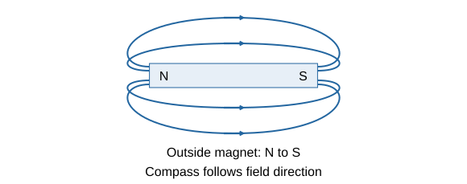
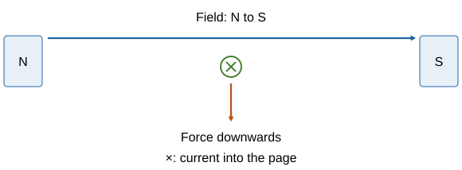
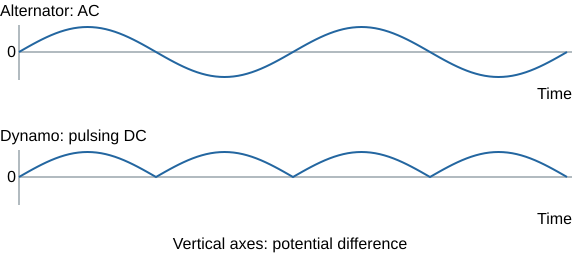
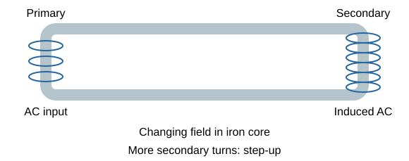

# Magnetism and electromagnetism

## Magnetic poles and materials

A magnet can exert a force without touching another object. Its strongest regions are its **north and south poles**.

- **Like poles repel. Unlike poles attract.** Repulsion is a useful test that an object is itself a magnet: attraction alone could mean a magnet attracting an unmagnetised material.
- Magnetic materials include **iron, steel, cobalt and nickel**. Steel is an iron-based alloy. Not every metal is magnetic: copper and aluminium are not attracted like iron in this GCSE model.
- A **permanent magnet** produces its own magnetic field and retains magnetism.
- An **induced magnet** becomes magnetic in an external field. It usually loses most or all induced magnetism when that field is removed.
- The force between a magnet and an initially unmagnetised magnetic material is **attractive**. The nearby end acquires the opposite pole.

A fridge magnet keeps its magnetism when you move it away from the fridge. An iron paper clip behaves differently: near a magnet it can attract another clip, but it usually loses most of that induced magnetism when the magnet is removed.

## Fields and compasses

A **magnetic field** is the region where a magnetic material or another magnet experiences a force.

- Outside a bar magnet, field arrows go **from north to south**. They show the direction a small **north pole** would move.
- Field lines are closer together where the field is **stronger**, especially near the poles. Strength decreases with distance.
- Lines are a model, not physical strings. They should not cross: the field cannot point in two directions at one position.
- A compass is a small permanent magnet that aligns with the local field. Its north-seeking end gives the field direction.
- A compass responding far from a laboratory magnet is evidence for **Earth's magnetic field**, associated with its core.

**Plotting a bar-magnet field**

1. Place the magnet on paper and trace its outline. Keep it fixed.
2. Place a plotting compass nearby. Mark both ends of its needle.
3. Move the compass so one end lies at the previous mark. Mark the new direction and repeat.
4. Join the marks into a smooth line. Add an arrow using the north-seeking needle's direction.
5. Start at several places to build the pattern. Keep other magnets and large iron objects away.

Iron filings reveal the **shape** of a field but not its direction. Use a compass for direction. Do not confuse the direction of a field with the direction of an electron current.

## Current makes a magnetic field

A current-carrying wire creates a magnetic field. A compass near the wire changes direction when current flows.

**Straight wire:** its magnetic field lines form circles centred on the wire. Use the **right-hand grip rule**: point your thumb along conventional current. Your curled fingers show the field direction. A greater current gives a stronger field, while moving farther from the wire gives a weaker field. Reversing current reverses the field.

**Solenoid:** this is a long coil of wire. Its field resembles a bar magnet's field. Inside the coil, the field is **strong and approximately uniform**, shown by parallel, evenly spaced field lines. For the grip rule, curl your fingers in the direction of conventional current around the turns. Your thumb points towards the coil's north pole.

**Making an electromagnet stronger:** increase the current or the number of turns per unit length. An **iron core** becomes magnetised and strengthens the field further. A solenoid with an iron core is an **electromagnet**.

Think of several people pushing the same object: a coil arranges many wire sections so their fields reinforce one another inside.

Electromagnets are useful because they can be **switched on and off** and their strength can be varied. In an electromagnetic relay, current in a control coil attracts an iron armature, closing a separate contact. When the coil current stops, a spring can reopen the contact. In a scrapyard crane, switching off releases the load.

### Read the pattern before choosing a rule

For a straight wire viewed end-on, **a dot** represents current coming out of the page, like an arrow tip. **A cross** represents current going into the page, like its tail. The right-hand grip rule then gives anticlockwise field lines for current out of the page and clockwise lines for current into it.

For a solenoid, consider current **around the turns**, rather than treating its axis as the current direction. More turns packed into the same length reinforce the internal field. Adding turns while changing the current or coil dimensions is not a fair one-variable comparison.

## The motor effect and Fleming's rule

A current-carrying conductor in a magnetic field experiences a **force**. The conductor and the magnet exert forces on one another. This is the **motor effect**.

**Fleming's left-hand rule:** hold thumb, first finger and second finger at right angles.

- **First finger:** magnetic **field**, north to south.
- **Second finger:** **conventional current**, positive to negative.
- **Thumb:** **force or motion**.

Reversing **current alone** or **field alone** reverses force. Reversing **both** leaves the force direction unchanged. The force is greatest when current and field are perpendicular; it is zero for a straight wire parallel to the field in this model.

For a perpendicular wire: **F = BIl**.

- F: force, **N**.
- B: magnetic flux density, **tesla (T)**.
- I: current, **A**.
- l: length of wire **within the field**, **m**.

**Example: force on a wire**

- Magnetic flux density B = **0.25 T**.
- Current I = **3.0 A**.
- Length inside the field l = **0.080 m**.

F = BIl = 0.25 × 3.0 × 0.080 = **0.060 N**

Do not use the total cable length if only part is in the field.

**Conversion:** 1 mT = 10⁻³ T.

## Motors, loudspeakers and headphones

**Electric motor**

1. A coil carrying current sits in a magnetic field.
2. Current runs in opposite directions along its two opposite sides, producing **opposite forces**.
3. These forces create a **turning effect**, rotating the coil. Electrical energy transfers into mechanical work and other stores.
4. In a simple DC motor, a **split-ring commutator reverses current every half-turn**. This keeps the turning effect in the same rotational direction. Brushes maintain electrical contact.
5. Greater current, a stronger magnetic field or more suitable coil turns can increase the turning effect.

The opposite forces do not stop the coil rotating: they act at **different positions**. The split ring is not the same as two complete slip rings in a simple alternator.

**Moving-coil loudspeaker and headphones**

- A coil attached to a cone sits in a permanent magnetic field.
- The audio signal is a **changing current**. Changes in its size and direction change the force on the coil.
- Coil and cone move back and forth, creating **compressions and rarefactions** in air.
- Faster changes give higher sound frequency; larger vibrations usually give louder sound.

The speaker uses the **motor effect**: electrical variations cause movement. A microphone works the opposite way.

## The generator effect

Moving a conductor relative to a magnetic field, or changing the field through a coil, can induce a **potential difference**. This is the **generator effect**, also called electromagnetic induction.

**When current flows:** induced potential difference can exist across an open circuit. An induced current flows only when there is a **complete conducting circuit**.

**Moving a magnet:** pushing it into a coil produces a pulse of potential difference. Holding it still produces no sustained signal because the field through the coil is no longer changing. Pulling it out reverses the pulse.

**Increasing the signal:** move faster, use a stronger magnetic field or use more turns linked by the changing field. Keep the other conditions the same when comparing these effects.

**Reversing the signal:** reverse either the motion or the magnet's poles. This reverses the induced potential difference and, in a closed circuit, the induced current.

**Energy supply:** the induced current creates a field that **opposes the change that produced it**. Pushing a magnet into a coil therefore meets magnetic opposition. You must do work to keep it moving.

Imagine pushing a door against a spring: a response pushes back against the change. The coil does not supply free energy. Mechanical work supplies the electrical output, with some energy also dissipated.

Do not say that induction needs a wire to move in every case: a **changing field around a stationary coil** can induce potential difference too.

### Diagnose the signal from the change

| Action in the same magnet-and-coil setup | Expected observation |
|---|---|
| Hold the magnet still inside the coil. | There is no sustained induced potential difference. |
| Push the north pole in. | A pulse occurs with one polarity. |
| Pull the north pole out. | A pulse occurs with the opposite polarity. |
| Push the south pole in at the same speed. | The polarity reverses compared with pushing the north pole in. |
| Move the same pole faster along the same path. | The pulse is generally larger and briefer. |

Keep the meter connections the same when comparing signs. Swapping leads also reverses the reading, so a minus sign by itself does not identify which pole moved.

## Alternators, dynamos and microphones

| Device | Mechanism | Output or effect |
|---|---|---|
| **Alternator** | Coil rotates in a field; two complete **slip rings** connect each end to the same brush | **AC:** potential difference changes sign each half-turn |
| **Dynamo** | Rotating coil with a **split-ring commutator** swaps its external connections each half-turn | **DC:** current stays in one external direction; output may pulse |
| **Moving-coil microphone** | Sound vibrates a diaphragm and attached coil in a field | Changing induced potential difference represents the sound |

For a simple rotating-coil AC generator, potential difference is greatest when the coil cuts field lines most rapidly. It is zero when no field lines are being cut at that instant. On a graph, an AC signal alternates **above and below zero**; a simple dynamo's pulsating output remains on one side.

Faster rotation generally raises both **peak potential difference and frequency**. Stronger magnets or more turns can raise amplitude without increasing rotation frequency.

**Microphone sequence:** sound pressure changes → diaphragm/coil vibrates → field linked with the coil changes → induced electrical signal. **Speaker sequence:** electrical signal → force on coil → vibrating cone → sound. A microphone uses the generator effect; a speaker uses the motor effect.

### Amplitude and frequency carry different information

A faster rotating coil makes more electrical cycles each second, increasing **frequency** as well as usually increasing peak potential difference. A stronger field at the **same rotation speed** increases the peak without increasing the number of cycles per second.

Similarly, a louder sound can produce a larger microphone signal without a higher pitch. Increasing the sound's frequency changes the signal frequency. Do not use “bigger signal” to describe both effects without naming which measurement changes.

## How a transformer works

A transformer changes an **alternating potential difference** using two coils on a common **iron core**. The input coil is **primary**; the output coil is **secondary**.

1. **Alternating current in the primary** creates a changing magnetic field.
2. The iron core carries the changing field through the secondary. Iron is useful because it is **easily magnetised and demagnetised**.
3. The changing field induces an **alternating potential difference across the secondary**.
4. If the secondary circuit is complete, a current can flow in it.

The coils are magnetically linked; they do not need a conducting connection to one another. **Steady DC does not operate a normal transformer continuously**, because it does not produce a continuously changing field. Brief switching changes are a different situation.

Think of the core as a shared link between two separate circuits, rather than a pipe carrying charges from one coil to the other.

## Transformer calculations and the National Grid

**Vₚ/Vₛ = nₚ/nₛ**

Equivalently:

**Vₛ/Vₚ = nₛ/nₚ**

- **Step-up:** secondary has more turns; **Vₛ > Vₚ**.
- **Step-down:** secondary has fewer turns; **Vₛ < Vₚ**.
- Keep primary quantities together and secondary quantities together. Turns have no unit; potential difference is in V.

**Example: transformer turns**

- Primary coil: **200 turns** at **230 V**.
- Secondary coil: **1,000 turns**.

Vₛ = 230 × 1,000 ÷ 200 = **1,150 V**

It is a **step-up transformer**.

For an **ideal, 100% efficient transformer**:

**VₚIₚ = VₛIₛ**

Output power equals input power.

Stepping up voltage lowers current for the same power. It does not create energy.

**Example: transformer current**

The output is 12 V at 4.0 A. The input potential difference is 240 V.

**For an ideal transformer:**

1. Output power = 12 × 4.0 = **48 W**.
2. Input power is also **48 W**.
3. Primary current Iₚ = 48 ÷ 240 = **0.20 A**.

**If efficiency is 0.80 instead:**

1. Input power = 48 ÷ 0.80 = **60 W**.
2. Primary current = 60 ÷ 240 = **0.25 A**.

Do not apply the ideal equation unchanged when losses are specified.

**National Grid**

- A step-up transformer raises potential difference before long-distance transmission.
- For a given transmitted power **P = VI**, higher V means lower I.
- Cable heating is **P_loss = I²R**. Lower current therefore reduces energy wasted heating cables.
- A step-down transformer reduces potential difference before use by consumers.
- If current is halved while cable resistance stays fixed, heating power becomes **one quarter**.

Use the full chain: **higher voltage → lower current at the same power → less I²R heating**. A high voltage alone is not a complete explanation of reduced loss. Transmission equipment needs insulation and safe separation because the voltages are hazardous.

### Use one consistent primary–secondary ratio

A transformer has **600 primary turns** and **150 secondary turns**, with **240 V** input.

1. Secondary-to-primary turns ratio = **150 ÷ 600 = 0.25**.
2. Output potential difference = **240 × 0.25 = 60 V**.
3. If output current is **2.0 A**, output power = **60 × 2.0 = 120 W**.
4. For an ideal transformer, input current = **120 ÷ 240 = 0.50 A**.

Voltage falls while available current for the same ideal power rises. If both voltage and current were multiplied by four, output power would be sixteen times greater: that would violate the stated energy balance.

## Avoid these mistakes

- Attraction alone does not prove both objects are permanent magnets.
- Use a **compass** for field direction, not iron filings alone.
- Use **conventional current** in hand rules.
- F = BIl uses perpendicular field and current, and only the wire length inside the field.
- A generator needs a **change**; a stationary magnet beside a stationary coil is insufficient.
- Potential difference can be induced in an open circuit; current needs a complete circuit.
- A transformer changes voltage and current without producing extra power.
- A DC motor and a dynamo can both use a split ring, but one produces motion and the other electrical output.

## Sources

- [AQA Magnetism and electromagnetism specification](https://www.aqa.org.uk/subjects/physics/gcse/physics-8463/specification/subject-content/magnetism-and-electromagnetism)

- [PMT: Summary Notes](../Reference Materials/PMT - Summary - AQA Physics.pdf). Unmodified reference; its original board is recorded in the review metadata.
- [Study Rocket: Magnetism Electric Motors And Loudspeakers](https://studyrocket.co.uk/revision/gcse-physics-triple-aqa/magnetism-and-electromagnetism/magnetism-electric-motors-and-loudspeakers). Cross-checked against the project specification.
- [Study Rocket: Magnetism Electromagnetism](https://studyrocket.co.uk/revision/gcse-physics-triple-aqa/magnetism-and-electromagnetism/magnetism-electromagnetism). Cross-checked against the project specification.
- [Study Rocket: Magnetism Generators And Microphones](https://studyrocket.co.uk/revision/gcse-physics-triple-aqa/magnetism-and-electromagnetism/magnetism-generators-and-microphones). Cross-checked against the project specification.
- [Study Rocket: Magnetism Permanent And Induced Magnets](https://studyrocket.co.uk/revision/gcse-physics-triple-aqa/magnetism-and-electromagnetism/magnetism-permanent-and-induced-magnets). Cross-checked against the project specification.
- [Study Rocket: Magnetism The Generator Effect](https://studyrocket.co.uk/revision/gcse-physics-triple-aqa/magnetism-and-electromagnetism/magnetism-the-generator-effect). Cross-checked against the project specification.
- [Study Rocket: Magnetism The Motor Effect](https://studyrocket.co.uk/revision/gcse-physics-triple-aqa/magnetism-and-electromagnetism/magnetism-the-motor-effect). Cross-checked against the project specification.
- [Study Rocket: Magnetism Transformers](https://studyrocket.co.uk/revision/gcse-physics-triple-aqa/magnetism-and-electromagnetism/magnetism-transformers). Cross-checked against the project specification.
