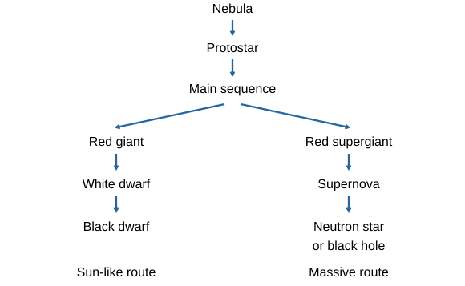
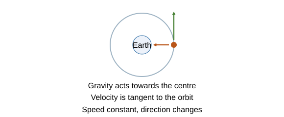
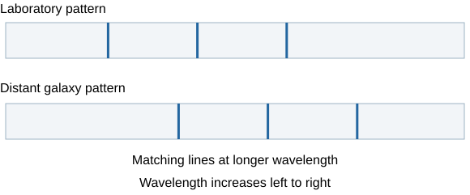

# Space physics

## Our place in space

The **solar system** contains the Sun and objects orbiting it. The Sun is a **star**, not a planet. Its gravity holds planets in their orbits.

- The eight planets, outwards from the Sun, are **Mercury, Venus, Earth, Mars, Jupiter, Saturn, Uranus and Neptune**.
- **Dwarf planets** also orbit the Sun. They are a different category from the eight planets.
- **Natural satellites**, such as our Moon, orbit planets. A satellite is an orbiting object; it does not have to be human-made.
- An **artificial satellite** is placed in orbit by people, often for communication, observation or navigation.
- Our solar system is a small part of the **Milky Way galaxy**. A galaxy contains many stars. The universe contains many galaxies.

Think of the solar system as one household, the galaxy as a huge city containing many households, and the universe as everything containing those cities. The comparison helps with nesting, not the real distances or sizes.

## From nebula to a stable star

1. A **nebula** is a cloud of gas and dust, mainly hydrogen.
2. **Gravity pulls material together**. As the cloud contracts, temperature and pressure rise, producing a **protostar**.
3. When the core is hot enough, **nuclear fusion begins**: small nuclei join into larger ones. Hydrogen nuclei form helium and energy is released.
4. The star becomes a **main-sequence star**. It can remain stable for a long period.

**Main-sequence balance:** gravity acts **inwards**. Fusion supplies energy that maintains pressure and an **outward effect**. The inward and outward effects balance, preventing continuing collapse or rapid expansion.

Imagine people pushing on opposite sides of a door with equal forces. Balance does not mean the forces vanish. Similarly, a stable star still has gravity and active fusion. It is not burning hydrogen in oxygen like a fire.

## Two stellar life-cycle routes

A star's **initial mass determines its later life cycle**. Both routes begin with a nebula, protostar and main-sequence star.

**A star with a mass like the Sun**

- As its hydrogen fuel in the core becomes depleted, the balance changes. Outer layers expand and it becomes a **red giant**.
- It loses outer material, leaving a hot, dense **white dwarf**.
- A white dwarf cools over an extremely long time towards an expected **black dwarf**. This is a predicted final stage; the universe has not existed long enough for such remnants to have fully cooled.
- The Sun does **not** become a supernova or a black hole in this route.

**A much more massive star**

- It becomes a **red supergiant** as its fuel and structure change.
- Later, its core collapses and it explodes as a **supernova**.
- The remnant becomes a **neutron star**, or a **black hole** if the remaining core is sufficiently massive.
- The supernova ejects material into space. A black hole has gravity so strong that even light cannot escape from within its event horizon.

Do not decide the route just from how large a star looks at one stage. A red giant has expanded enormously, but initial **mass**, rather than a temporary radius, determines the broad route.

## Where elements come from

**Fusion joins lighter nuclei into heavier nuclei**, creating new elements. Main-sequence stars fuse hydrogen into helium. Later fusion stages in massive stars can form heavier elements **up to iron**.

The extreme conditions of a **supernova can produce elements heavier than iron**. The explosion distributes elements into space. Material enriched by earlier stars can become part of new stars, planets and living things.

Think of a star as a workshop making larger building blocks, and a supernova as both an extreme manufacturing event and a delivery event. **Making elements** and **spreading them** are separate ideas; mention both when asked how stars contribute to planets.

Fusion is a **nuclear** process. It changes nuclei and can create a new element. Ordinary chemical reactions rearrange electrons and bonds without changing the elements' nuclei.

## Why objects stay in orbit

An orbiting object keeps moving while gravity continually changes the direction of its motion. For a **circular orbit**, gravity provides the inward force towards the central body.

**Force and velocity point in different directions:** gravity acts **towards the centre**. The satellite's instantaneous velocity is **along a tangent**, at right angles to the radius.

**Constant speed can still mean acceleration:** velocity includes direction. As the satellite follows a circle, its direction keeps changing. It therefore accelerates even when its speed stays constant.

Gravity is not cancelled out. The satellite continually falls towards the central body while moving sideways, producing its curved path. A forward force balancing gravity is not needed for a stable circular orbit.

Think of whirling a ball on a string: the string pulls inwards while the ball moves around the circle. Gravity supplies the inward force in an orbit; there is no physical string.

For stable circular orbits around the **same central body**, a smaller orbital radius corresponds to a **higher orbital speed**. A larger radius has a lower speed. If the speed changes, the radius of a stable circular orbit must change too. This comparison does not describe every instant of a rocket manoeuvre or an elliptical orbit.

## Comparing satellites and orbital data

| Object | What it orbits | Natural or artificial |
|---|---|---|
| Earth | Sun | Natural planet |
| Moon | Earth | Natural satellite |
| Communications satellite around Earth | Earth | Artificial satellite |

All use gravity for orbital motion. Artificial satellites are constructed and launched; moons formed naturally. A satellite is not necessarily a small moon, and a planet is not an artificial object.

For a circular orbit with radius r and period T:

**Distance for one orbit = 2πr**

**Speed = 2πr/T**

- Use radius in **metres**. Convert km to m first.
- Use period in **seconds**. Convert hours to seconds first.

**Example:** r = 7.0 × 10⁶ m and T = 6,000 s.

1. Circumference = 2π × 7.0 × 10⁶ = about **4.4 × 10⁷ m**.
2. Speed = (4.4 × 10⁷)/6,000 = about **7.3 × 10³ m/s**.

If a diagram gives **height above Earth's surface**, that is not the orbital radius. Add Earth's radius when a calculation needs the distance from its centre. Use values supplied in the question rather than memorising additional orbital formulae.

## What red-shift means

Light from many distant galaxies shows the same familiar pattern of spectral lines, but at **longer wavelengths** than the corresponding laboratory lines. This is **red-shift**: the pattern shifts towards the red end of the spectrum.

**What the shift tells us:** most distant galaxies show red-shift, indicating that they are **moving away from us**. A greater red-shift indicates a greater recession speed in these comparisons.

**The distance pattern:** more distant galaxies generally have **greater red-shifts and faster recession speeds**. This observed relationship is evidence for an expanding universe.

A galaxy simply looking red is not enough. Scientists identify **corresponding spectral lines** and compare their wavelengths with a laboratory spectrum. The whole pattern shifts; the galaxy does not emit only red light.

Imagine spots on a balloon as its surface expands. Most pairs of spots move apart, and more widely separated spots move apart faster. This is a way to picture expansion; it does not put Earth at the centre of the universe or turn the real universe into a balloon surface.

## Evidence for the Big Bang

The distance–recession pattern supports the conclusion that **space itself is expanding**. Running this pattern backwards suggests the universe was once far more compact.

The **Big Bang model** describes the universe beginning in an **extremely hot, dense state** and expanding. It is not an explosion of a star into otherwise empty, already-existing space.

**Build an explanation in steps:**

1. Observation: matching spectral lines are shifted to longer wavelengths.
2. Interpretation: most distant galaxies are receding, with greater recession speed at greater distance.
3. Model: the universe is expanding.
4. Implication: its earlier state was hotter, denser and much more compact, supporting the Big Bang model.

Observations **support** models. Scientists test a model's predictions against further evidence and revise it if it cannot explain new observations. One observation is not proof of every detail of the universe's beginning.

## Accelerating expansion and unanswered questions

Observations of distant **supernovae**, including evidence reported from 1998 onwards, indicate that the expansion is **accelerating**. This means the expansion rate changes over time; it is distinct from the observation that further galaxies currently recede faster.

**Dark matter** is inferred from gravitational effects, although it does not emit the electromagnetic radiation expected from ordinary visible matter.

**Dark energy** is the name associated with the unknown cause of accelerating expansion.

The nature of both is still not fully understood. Giving an unknown effect a name does not completely explain its cause.

Science develops by using indirect observations to infer what cannot be seen directly. Claims should distinguish **measured observations**, **interpretations** and **remaining uncertainty**.

## Avoid these mistakes

- A galaxy contains many stars; the solar system is not a galaxy.
- Both stellar routes share the early stages, but the Sun-like route does not include a supernova.
- Balance in a stable star includes ongoing fusion, not zero gravity.
- Fusion creates elements; a supernova also distributes them.
- Constant orbital speed does not mean constant velocity or zero resultant force.
- Use radius from the **central body's centre**, not just height above its surface.
- Red-shift is a **wavelength increase**, not a brightness increase.
- Greater distance and greater red-shift form an observed trend, not a claim that every nearby object is receding.

## Sources

- [AQA Space physics specification](https://www.aqa.org.uk/subjects/physics/gcse/physics-8463/specification/subject-content/space-physics)
