# Working scientifically and required practicals

## Build a testable investigation

A good investigation answers a clear question with measurements that can test an idea. Treat it like trying a new cake recipe: change one ingredient, keep the others comparable, then judge a measured result rather than a feeling.

- **Hypothesis:** a testable explanation or prediction based on a scientific idea. Example: “Resistance increases with wire length because charge encounters more resistance along a longer path.”
- **Independent variable:** what you deliberately change or select, such as wire length.
- **Dependent variable:** what you measure or calculate in response, such as resistance from V/I.
- **Control variables:** factors kept the same to avoid another explanation, such as wire material, cross-sectional area and temperature.
- Choose a **useful range and spacing** of independent-variable values. Include enough measurements to reveal a trend rather than comparing just two convenient values.
- Use appropriate apparatus and units. A stopwatch cannot resolve a tiny microphone delay as well as electronic recording can.

A valid investigation measures what it is intended to test. **Repeats cannot repair an unfair comparison**: repeating a wire-length experiment while also changing wire material does not isolate length.

## Safe methods and representative samples

A **hazard** is a potential source of harm. **Risk** considers how likely that harm is and how serious it could be. Explain a specific precaution and its purpose.

| Hazard | Useful control |
|---|---|
| Hot water or heater | Heatproof surface, careful handling and time to cool |
| Wire heating at high current | Low-voltage supply, limit current, switch off between readings |
| Falling masses or moving trolley | Secure stand/pulley, catch trolley, keep feet clear |
| Bright beam or hot ray box | Avoid looking into beam; handle hot equipment carefully |
| Water near electrical equipment | Keep connections dry and equipment safely separated |

Select **representative samples** when studying a population or a variable material. Avoid choosing only objects that are easy to measure or happen to support the hypothesis. Use random selection where suitable, enough samples, and a clear sampling method. Do not claim a sample represents all materials when only one specimen was tested.

## Measurement quality and errors

| Term | Meaning | Useful action |
|---|---|---|
| **Accuracy** | Close to the true value | Calibrate, correct zero error and use a valid method |
| **Precision** | Repeated values cluster closely | Reduce random variation and improve measurement technique |
| **Resolution** | Smallest change an instrument can distinguish | Choose a suitable scale or sensor |
| **Repeatability** | Same investigator and conditions give similar results | Repeat the measurement consistently |
| **Reproducibility** | Different investigators or equipment give similar results | Compare independent investigations |

**Random error** makes results vary unpredictably. Repeat measurements and use a mean to reduce its effect. **Systematic error** consistently shifts results, such as a balance with an uncorrected zero offset. More repeats do not remove that offset.

**Zero error:** the instrument does not read zero when it should. Check it before use, then reset it or correct the readings. Repeated readings can be close together yet still be inaccurate if they all contain the same offset.

**Parallax:** a scale is viewed from an unsuitable angle. Read at eye level and, where appropriate, keep a pointer close to the scale.

**Anomalies:** a result that does not fit the pattern needs investigation. Repeat the measurement and record what happened. Exclude it from a mean only with a reason, such as a documented measurement failure. Do not discard a result just because it is inconvenient.

## Record and analyse data

Use a table with **quantity and unit in each column heading**, consistent decimal places appropriate to the instrument, and separate repeat readings. Keep raw measurements before calculated quantities.

**Example:** repeated times are 2.4, 2.6 and 2.5 s.

For the readings **2.4, 2.6 and 2.5 s**:

1. Mean = (2.4 + 2.6 + 2.5) ÷ 3 = **2.5 s**.
2. Range = 2.6 − 2.4 = **0.2 s**.
3. A simple uncertainty estimate is **half the range**, giving **±0.1 s**.
4. Percentage uncertainty = 0.1 ÷ 2.5 × 100 = **4%**.

State the uncertainty method used. Instrument uncertainty and other errors can also matter.

Measuring a longer interval, several wavelengths, or multiple wire diameters can reduce **percentage uncertainty**, provided the method remains appropriate. Avoid claiming that a mean has more reliable decimal places than the equipment supports.

**Graphs**

1. Put the independent variable on x and dependent variable on y, unless instructed otherwise.
2. Label quantities and units. Choose a regular scale that uses much of the plotting area.
3. Plot carefully. Draw a suitable **line or curve of best fit**, not automatic dot-to-dot segments.
4. For a straight line, **gradient = change in y/change in x**. Use a large triangle on the best-fit line.
5. State a trend with data and units. “Increases” is weaker than “Extension increased from 0.020 m to 0.050 m as force rose from 4 N to 10 N.”
6. **Direct proportionality** needs a straight line through the origin; any straight line is not automatically proportional.

Use a **bar chart** for separate categories and a scatter graph for paired continuous quantities. A histogram shows grouped numerical data; adjacent intervals have adjoining bars. Compare rates, gradients and areas only when their physical meaning is known.

## Evaluate explanations and evidence

Use a chain: **problem → effect on result → improvement**. “Be more careful” does not identify a mechanism.

**Example:** some heater energy warms the room. Using all electrical input as block heating makes calculated c too large. Insulating the block reduces this energy loss.

**Using evidence:** state whether the results support the hypothesis. Quote relevant measurements with units and consider their uncertainty. **Correlation alone does not establish causation**: another variable, an unrepresentative sample or chance may explain a pattern.

**Using models:** a model simplifies reality so that we can explain and predict it. Particle drawings, circuits and equations are models. Explain the limits of the model, such as using F = ke only while force and extension are proportional. New reliable evidence can require a model to change. Rutherford's scattering observations challenged the earlier atomic model.

**Checking a claim:** in **peer review**, other specialists scrutinise the methods and conclusions. Independent reproduction tests whether other investigators obtain similar results. Both help assess a claim, although neither guarantees it is correct.

**Making decisions:** compare measured benefits and risks with costs, environmental effects and ethical considerations. Science supplies evidence, but it cannot decide every value judgement. Also distinguish measured risk from perceived risk. An invisible or unfamiliar hazard may feel more dangerous without the data supporting that ranking.

Present the reasoning in a logical order. Use appropriate units, diagrams and calculations, and distinguish what was observed from how it is interpreted.

## Practical: specific heat capacity

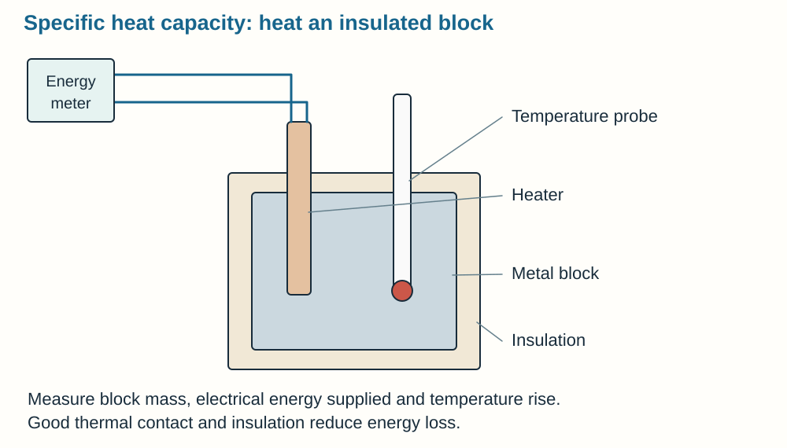

**Aim:** link energy transferred to a material with its temperature rise.

1. Measure the mass of a metal block. Insert a heater and temperature probe with good thermal contact. Insulate the block.
2. Record initial temperature. Supply measured electrical energy, using a joulemeter or **E = Pt** with measured power and time.
3. Record temperature rise **Δθ**, not final temperature alone.
4. Calculate **c = E/(mΔθ)**. Repeat; allow the probe to respond and compare a suitable set of readings.

Energy also heats equipment and escapes to the room. Treating all electrical input as energy gained by the block generally **overestimates c**. Improve insulation and thermal contact. Handle heaters and hot blocks safely. Other suitable materials and apparatus may be used if their mass, energy input and temperature change are measured.

## Practical: thermal insulation

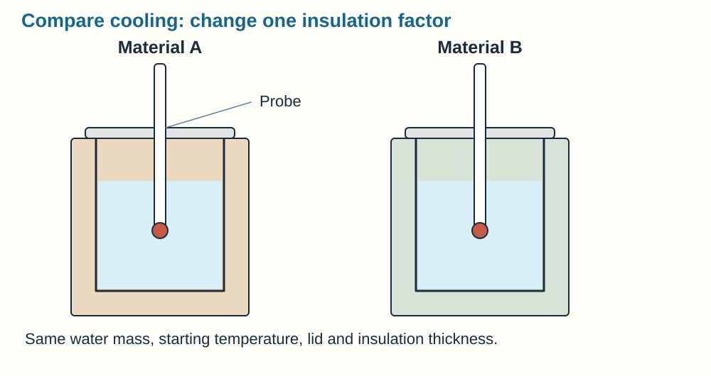

Compare cooling in identical containers with the same water mass and starting temperature.

- To test **material**, use equal insulation thicknesses. To test **thickness**, use the same material at different thicknesses.
- Keep container, lid, exposed area, room conditions and measurement intervals comparable.
- Record temperature at regular times. Repeat and compare mean temperature drops over the same interval.
- A **smaller temperature drop** indicates better insulation under those conditions. Compare complete cooling curves if supplied.
- Control draughts and minimise reading delays. Use a heatproof surface and handle hot water safely.

## Practical: density

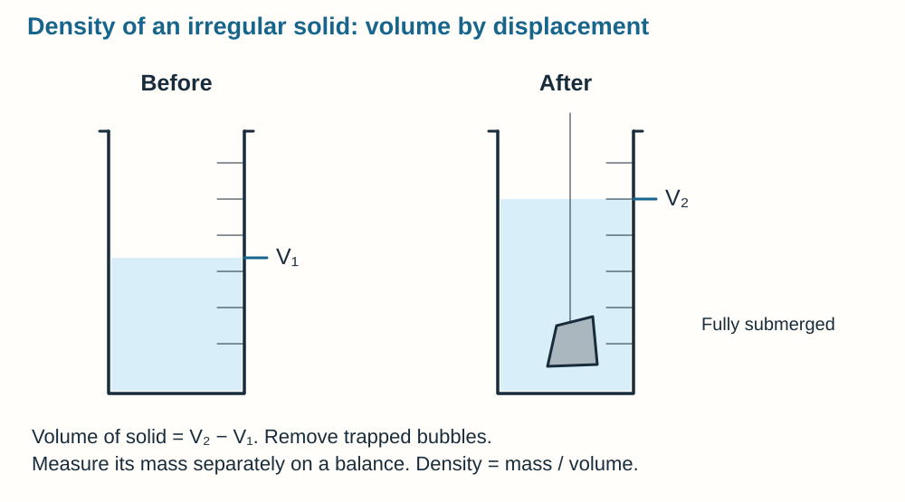

**ρ = m/V**. Choose a volume method that fits the sample.

- **Regular solid:** measure mass with a balance. Measure dimensions with suitable apparatus: ruler, callipers or micrometer. Calculate volume, for example V = length × width × height.
- **Irregular solid:** measure mass. Submerge completely in water and measure displaced volume using a measuring cylinder or displacement can. Remove trapped air; choose a sample that does not dissolve or absorb water appreciably.
- **Liquid:** measure an empty container's mass, then mass with a measured liquid volume. **Liquid mass = full − empty container mass**.
- Read a measuring-cylinder meniscus at eye level. Convert units consistently: **1 cm³ = 10⁻⁶ m³** and **1 g/cm³ = 1,000 kg/m³**.

Repeated dimension measurements can improve a regular-solid estimate. Do not assume a small millimetre error is harmless: volume multiplies dimensions, so the effect can be substantial for small objects.

## Practical: force and extension

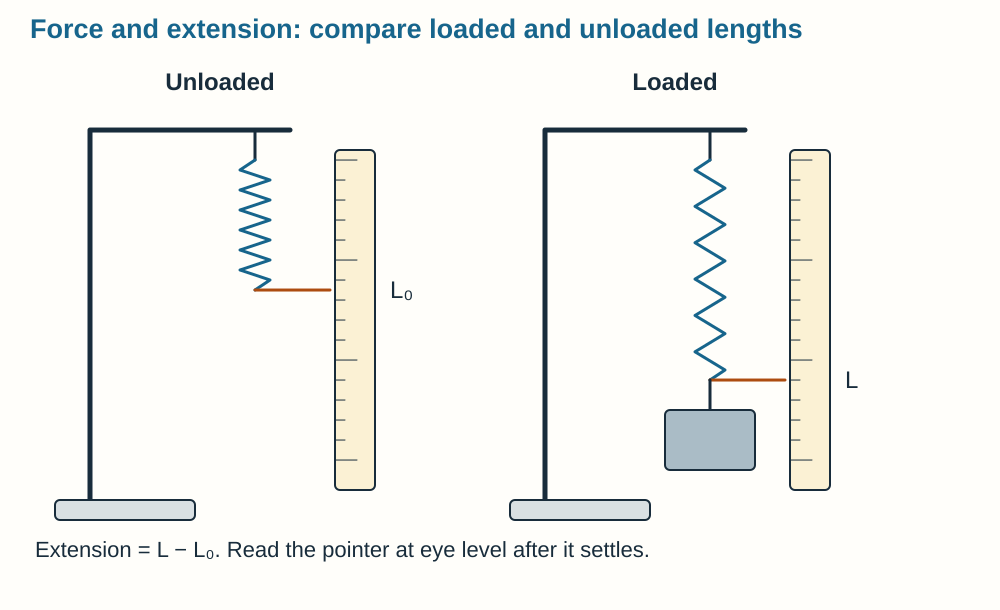

1. Secure a spring on a stand with a ruler beside it. Measure its unloaded length.
2. Add known loads in steps, including the hanger's mass. Use **F = mg** to find force.
3. Let it settle. Read length at eye level and calculate **extension = loaded − unloaded length**.
4. Repeat. Plot force against extension; the straight-region gradient is **spring constant k** because F = ke.
5. Unload and check recovery. Proportional behaviour and returning to the original length are related but **not identical tests**.

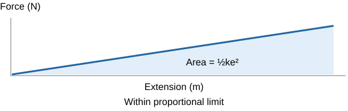

Use small load steps and avoid overstretching. Secure the stand and keep eyes and feet away from a spring or falling masses. Do not substitute total length for extension.

## Practical: force, mass and acceleration

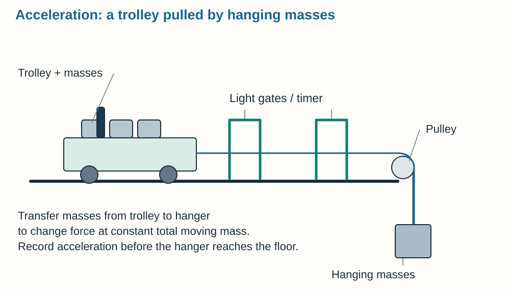

Use a low-friction trolley pulled by a string over a pulley by hanging masses. Light gates or a motion sensor measure velocities, allowing **a = Δv/Δt**.

**Changing force at constant total moving mass**

- Transfer masses from the **trolley to the hanger**. Total moving mass stays constant while the hanging weight increases.
- Use driving weight as an approximation to the force on the **whole moving system** when friction is negligible.
- Record acceleration at each force, repeat and plot a against F. Expect approximate direct proportionality.

**Changing mass at approximately constant driving force**

- Keep hanging mass fixed and add mass to the trolley.
- Total moving mass rises while driving weight stays the same. Repeat acceleration readings.
- Plot a against **1/total moving mass** for an approximately straight relationship at fixed force.

Minimise and account for friction; keep track and pulley conditions consistent. Hanging weight is not simply equal to string tension on the accelerating trolley. Take readings before the hanger hits the floor. Secure the pulley, catch the trolley and keep feet clear of masses.

## Practical: resistance

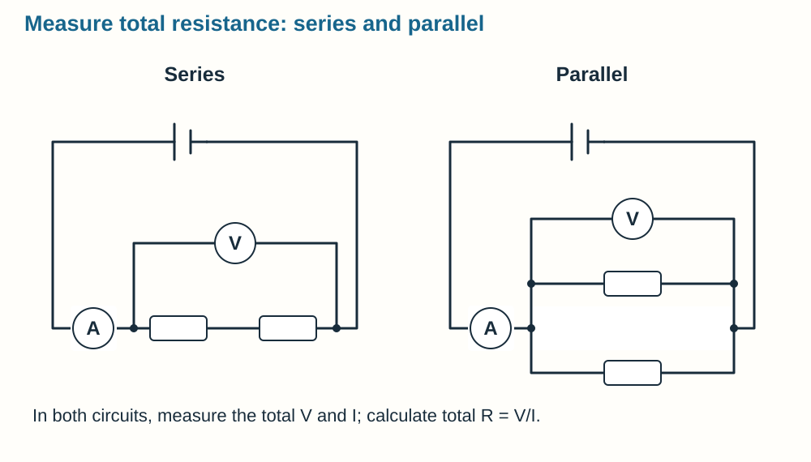

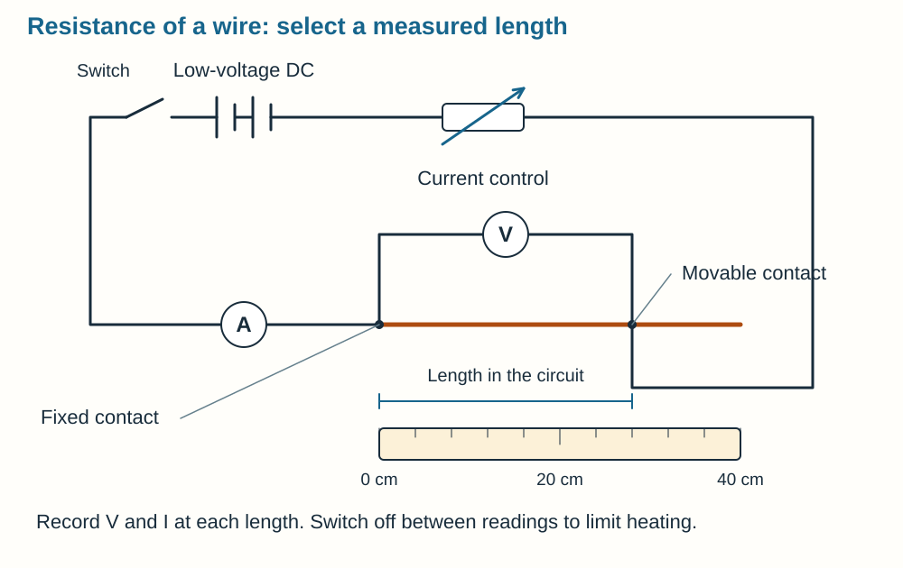

Use a low-voltage supply, an **ammeter in series** and a **voltmeter across** the test wire or resistor. Calculate **R = V/I** rather than treating current alone as resistance.

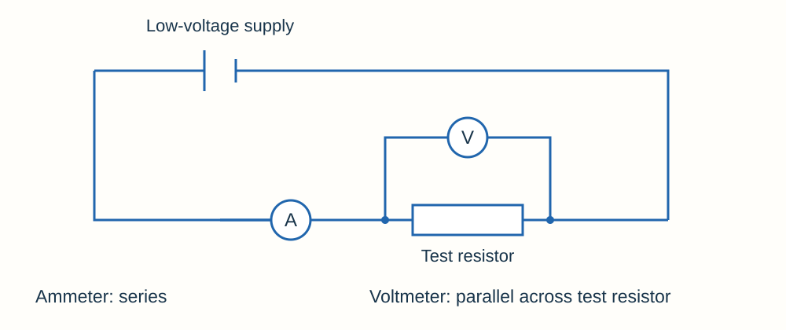

**Wire length**

- Fix one connection and use a movable contact to select measured lengths of the same wire.
- Keep **material, diameter/cross-sectional area and temperature** constant.
- Record V and I for each length, calculate R, repeat and plot R against length.
- Limit current and switch off between readings so heating does not change resistance.

**Series and parallel resistors**

- Measure total V and I for one resistor, then combinations. Calculate total R.
- In **series**, resistances add. In **parallel**, additional paths reduce total resistance below the smallest branch resistance.
- Check circuit connections before switching on and avoid short circuits. Compare at stable temperatures.

## Practical: current–voltage characteristics

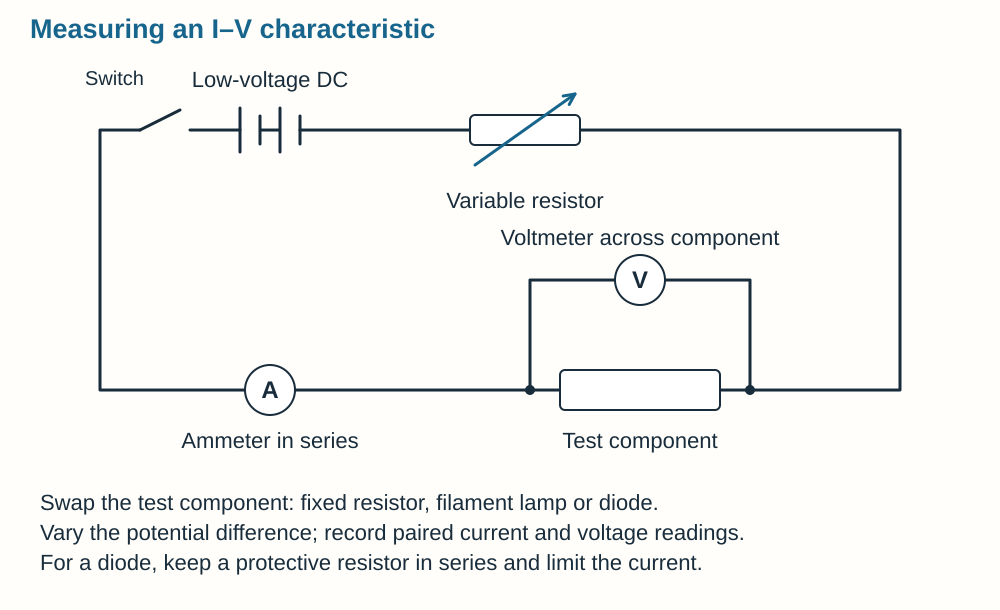

1. Put the test component and ammeter in series. Put a voltmeter in parallel with the component.
2. Use an adjustable supply or variable resistor to change potential difference. Record paired **V and I** values across a suitable range.
3. Reverse connections or supply polarity for negative readings where appropriate. Limit current, especially through a diode.
4. Repeat and plot **current on y, potential difference on x**.

- **Fixed resistor at constant temperature:** straight line through origin. Its I/V gradient is **1/R**.
- **Filament lamp:** heats as current increases, so resistance rises and the I–V gradient decreases.
- **Diode:** conducts significantly in one direction, with very little reverse current under suitable test conditions.

For an ohmic-resistor investigation, keep temperature approximately constant. Heating is part of the filament lamp's changing behaviour; do not claim the lamp must stay at constant temperature while explaining its curve.

## Practical: waves in water and solids

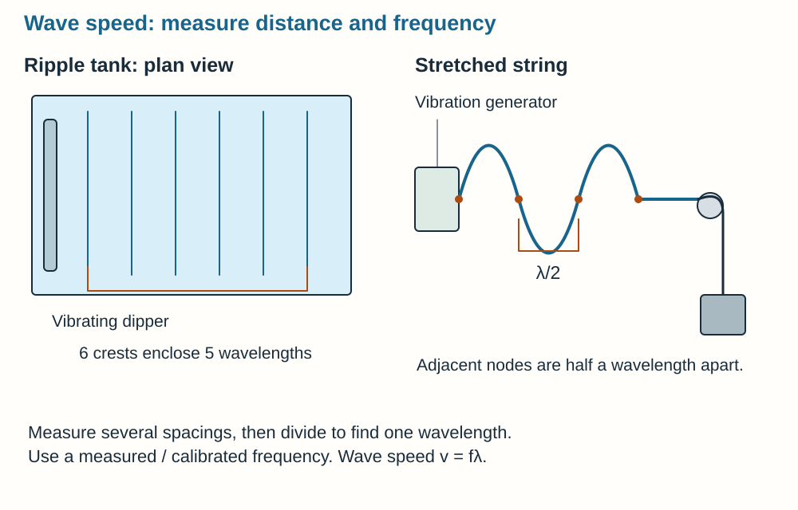

**Ripple tank:** use a vibrating dipper in shallow water and a lamp to see the pattern. Measure several crest-to-crest spacings, divide by the number of wavelengths, and measure or use calibrated vibration frequency. Calculate **v = fλ**. Keep water depth constant and repeat. Six crest lines enclose five wavelengths.

**Stretched string:** use a signal generator and vibration generator, with fixed tension and string type. Adjust frequency to see a clear stationary pattern. Adjacent nodes are **λ/2** apart; find λ from loop length and use the frequency setting to calculate v. Secure loads and apparatus.

For very short sound delays, microphones with electronic timing are suitable; human stopwatch timing is not. Choose apparatus based on the time or distance to be resolved, not simply what is available.

## Practical: reflection and refraction

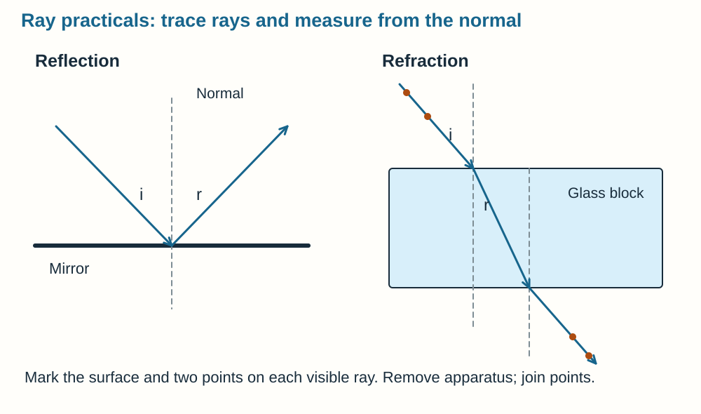

- Trace a mirror position or a transparent block's outline on paper.
- Shine a narrow ray. Mark two points along each visible incident, reflected or emerging ray without moving the apparatus.
- Remove it and join marks with a ruler. For refraction, connect entry and exit points through the block.
- Draw a **normal at 90°** to the surface. Measure all relevant angles from the normal.
- Repeat over several incident angles. For reflection, test **i = r**; compare smooth and rough surfaces. For refraction, compare angles through different substances.
- Narrow beams, fine marks and consistent eye position reduce uncertainty. A protractor marked every 1° cannot justify a 0.1° comparison.

Reflection returns into the original medium. Refraction describes a speed-related change in direction; they are not interchangeable methods. Avoid looking into bright beams and handle hot ray boxes carefully.

## Practical: infrared absorption and emission

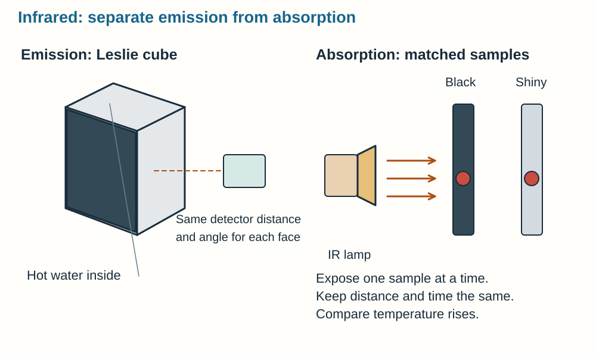

**Emission:** a hot Leslie cube has differently finished faces at approximately the same temperature. Measure IR from each face with a detector at the same distance and angle. Repeat. A **matt black surface** generally emits more than a shiny surface at the same temperature.

**Absorption:** expose matched samples with different finishes to the same IR lamp for the same time and distance. Keep mass, material, starting temperature and surroundings comparable. Compare **temperature rises**, repeat and average. A larger rise indicates more absorption if other transfers are adequately controlled.

Do not compare unequal temperatures or detector positions and attribute everything to finish. Keep electrical parts dry and avoid burns from hot lamps or water.

## Write a complete practical answer

Use this flexible route, adding only details relevant to the question:

1. Name apparatus and show how it is connected or arranged.
2. State what changes, the range used and what stays constant.
3. Explain exactly what is measured, including scales or timings.
4. Repeat and process measurements: mean, difference, ratio or equation.
5. Explain the graph or comparison used to answer the question.
6. Identify a specific limitation, its effect and a matching improvement. Add a relevant safety precaution.

Use linked steps for a six-mark method. A disconnected list of apparatus or generic phrases such as “repeat for accuracy” does not explain why the investigation works.

## Sources

- [AQA Working scientifically](https://www.aqa.org.uk/subjects/physics/gcse/physics-8463/specification/working-scientifically)
- [AQA Practical assessment](https://www.aqa.org.uk/subjects/physics/gcse/physics-8463/specification/practical-assessment)
