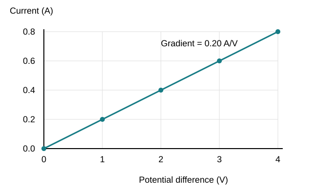

# Mathematical requirements and equations questions & answers

## 1 mark

**1.** Convert 250 mA to amperes.

**Answer:** 0.250 A.

**2.** Convert 3.0 minutes to seconds.

**Answer:** 180 s.

**3.** Write 72,000 in standard form.

**Answer:** 7.2 × 10⁴.

**4.** How many significant figures are in 0.00620?

**Answer:** Three.

**5.** What unit is obtained by dividing energy in joules by time in seconds?

**Answer:** Watt (W).

**6.** What does the symbol ∝ mean?

**Answer:** Proportional to.

**7.** What quantity is given by the gradient of a distance–time graph?

**Answer:** Speed.

**8.** What quantity is given by the signed area under a velocity–time graph?

**Answer:** Displacement.

**9.** Which conversion is correct? Choose one: A 1 cm² = 0.01 m²; B 1 cm² = 0.0001 m²; C 1 cm² = 100 m²; D 1 cm² = 0.000001 m².

**Answer:** B: 1 cm² = 0.0001 m².

## 2 marks

**10.** Convert 8.0 cm² to m².

**Answer:** 1 cm² = 10⁻⁴ m², so **8.0 cm² = 8.0 × 10⁻⁴ m²**.

**11.** Convert 25 cm³ to m³.

**Answer:** 1 cm³ = 10⁻⁶ m³, so **25 cm³ = 2.5 × 10⁻⁵ m³**.

**12.** A potential difference of 9.0 V causes a current of 0.30 A. Calculate resistance.

**Answer:** **R = V/I = 9.0/0.30 = 30 Ω**.

**13.** A speed is 72 km/h. Convert it to m/s.

**Answer:** 72/3.6 = **20 m/s**.

**14.** A resistor’s I–V graph has current on y and voltage on x. What does its straight-line gradient equal?

**Answer:** - Gradient = I/V = **1/R**.
- Reversing the axes to V against I would give **R**.

**15.** Explain why a straight-line graph with a non-zero y-intercept does not show direct proportionality between y and x.

**Answer:** - Direct proportion has **y = kx**.
- It requires a line **through the origin**; a non-zero intercept adds a constant term.

**16.** A power output rises from 80 W to 100 W. Calculate the percentage increase.

**Answer:** Percentage increase = (100 − 80)/80 × 100 = **25%**.

**17.** At fixed mass, what happens to kinetic energy if speed triples? Explain using the relationship.

**Answer:** - **Eₖ ∝ v²**.
- Tripling speed multiplies kinetic energy by **3² = 9**.

**18.** An echo returns after 0.10 s in water where wave speed is 1,500 m/s. Calculate one-way distance.

**Answer:** **Distance = vt/2 = 1,500 × 0.10/2 = 75 m**.

**19.** A 0.050 m length has estimated uncertainty ±0.001 m. Calculate percentage uncertainty.

**Answer:** 0.001/0.050 × 100 = **2%**.

**20.** A histogram bar covers a width of 5 units and represents 20 readings. Calculate its frequency density.

**Answer:** Frequency density = frequency/interval width = 20/5 = **4 readings per unit**.

**21.** Round 0.004867 to three significant figures.

**Answer:** **0.00487**. Leading zeros are not significant; retain 4, 8 and rounded 7.

## 3 marks

**22.** Calculate speed from kinetic energy 36 J and mass 2.0 kg.

**Answer:** - Eₖ = ½mv² gives **v = √(2Eₖ/m)**.
- v = √(2 × 36/2.0) = √36.
- **v = 6.0 m/s**.

**23.** A gas at 100 kPa occupies 60 cm³. It is compressed to 40 cm³ without changing temperature or gas mass. Calculate final pressure.

**Answer:** - **p₁V₁ = p₂V₂**.
- p₂ = 100 × 60/40.
- **p₂ = 150 kPa**. Matching volume units are used on both sides.

**24.** A force–extension best-fit line passes through (0.020 m, 4 N) and (0.050 m, 10 N). Calculate gradient and identify its physical meaning.

**Answer:** - Gradient = (10 − 4)/(0.050 − 0.020).
- **200 N/m**.
- It is the **spring constant k** in the proportional region.

**25.** A tangent to a distance–time graph rises by 18 m over 3.0 s. Calculate the speed and explain why the tangent is used.

**Answer:** - Gradient = 18/3.0 = **6.0 m/s**.
- A tangent gives the rate of change **at the chosen point**.
- It estimates **instantaneous speed**, unlike a chord’s interval-average rate.

**26.** Find the mean, median and mode of 20, 21, 21, 22 and 26.

**Answer:** - Mean = 110/5 = **22**.
- Median = middle sorted value = **21**.
- Mode = most frequent value = **21**.

**27.** A frequency table records value 2 three times, value 3 four times and value 5 once. Calculate the mean.

**Answer:** - Weighted sum = 2 × 3 + 3 × 4 + 5 × 1 = **23**.
- Total frequency = 3 + 4 + 1 = **8**.
- Mean = 23/8 = **2.875**, about 2.9 at two significant figures.

**28.** A cube has side length 3.0 cm. Calculate its volume in cm³ and m³, and its total surface area in cm².

**Answer:** - Volume = 3.0³ = **27 cm³**.
- Volume = 27 × 10⁻⁶ = **2.7 × 10⁻⁵ m³**.
- Surface area = 6 × 3.0² = **54 cm²**.

**29.** A 400 N force acts normally on a 20 cm² surface. Calculate pressure in Pa.

**Answer:** - Area = 20 × 10⁻⁴ = **0.0020 m²**.
- p = F/A = 400/0.0020.
- **p = 2.0 × 10⁵ Pa**.

**30.** An electromagnetic wave has wavelength 6.0 cm in vacuum. Calculate frequency using c = 3.0 × 10⁸ m/s.

**Answer:** - λ = **0.060 m**.
- f = c/λ = (3.0 × 10⁸)/0.060.
- **f = 5.0 × 10⁹ Hz**.

**31.** A 2.0 A current flows for 5.0 minutes through a 6.0 V component. Calculate charge and energy transferred.

**Answer:** - t = **300 s**, so Q = It = 2.0 × 300 = **600 C**.
- E = QV = 600 × 6.0.
- **E = 3,600 J**.

**32.** A 0.20 T field acts on a perpendicular 8.0 cm wire carrying 1.5 A. Calculate force.

**Answer:** - l = **0.080 m**.
- F = BIl = 0.20 × 1.5 × 0.080.
- **F = 0.024 N**.

**33.** The velocity–time area above zero is 30 m and the area below zero has magnitude 10 m. Calculate displacement and total distance.

**Answer:** - Signed displacement = 30 − 10 = **20 m** in the chosen positive direction.
- Total distance = 30 + 10 = **40 m**.
- Opposite-direction travel reduces displacement but still adds to distance.

**34.** A force of 600 N acts perpendicular to a lever, 0.050 m from the pivot. Calculate the moment and state why total lever length is not always used.

**Answer:** - M = Fd = 600 × 0.050 = **30 Nm**.
- d is the **perpendicular distance to the force’s line of action**.
- It need not equal the full length of the lever.

## 4 marks

**35.** An object accelerates uniformly from 3.0 m/s to 7.0 m/s over 10 m. Calculate acceleration using v² − u² = 2as.

**Answer:** - Rearrange: **a = (v² − u²)/(2s)**.
- v² − u² = 7.0² − 3.0² = **40 m²/s²**.
- a = 40/(2 × 10).
- **a = 2.0 m/s²**, using constant acceleration.

**36.** A 50 kg load is lifted 2.0 m in 5.0 s by a motor with efficiency 0.80. Use g = 10 N/kg. Calculate input power.

**Answer:** - Useful energy = mgh = 50 × 10 × 2.0 = **1,000 J**.
- Useful power = 1,000/5.0 = **200 W**.
- Input power = useful power/efficiency = 200/0.80.
- **250 W**.

**37.** Velocity rises linearly from 0 to 6.0 m/s in 4.0 s, then stays at 6.0 m/s for another 5.0 s. Calculate total displacement.

**Answer:** - Accelerating section: triangle area = ½ × 4.0 × 6.0 = **12 m**.
- Steady section: rectangle area = 5.0 × 6.0 = **30 m**.
- Total = 12 + 30 = **42 m**.
- All velocities are positive, so distance also equals 42 m.

**38.** An ideal transformer has a 240 V primary with 1,200 turns and a secondary with 60 turns. Secondary current is 2.0 A. Calculate secondary voltage and primary current.

**Answer:** - Vₛ = 240 × 60/1,200 = **12 V**.
- Secondary power = 12 × 2.0 = **24 W**.
- Ideal primary power also equals 24 W.
- Iₚ = 24/240 = **0.10 A**.

**39.** A student calculates a walking speed as 1.2 × 10⁴ m/s. Explain how to check and improve the calculation.

**Answer:** - Estimate expected walking speed as **order 1 m/s**, so the result is implausible.
- Check distance and time conversions, especially **cm to m and minutes to seconds**.
- Check that distance was divided by time rather than multiplied.
- Recalculate with labelled quantities and units, keeping sensible significant figures.

## 5 marks

**40.** Plot current against potential difference using the readings below. Draw a suitable best-fit line, calculate its gradient and use it to determine the resistance.

| Potential difference (V) | Current (A) |
|---|---|
| 0 | 0.00 |
| 1.0 | 0.20 |
| 2.0 | 0.40 |
| 3.0 | 0.60 |
| 4.0 | 0.80 |

**Answer:** - Put **potential difference (V) on the horizontal axis** and **current (A) on the vertical axis**. Choose even scales that use most of the plotting area.
- Plot all five points and draw a **straight best-fit line through the origin**.
- Gradient = ΔI/ΔV = (0.80 − 0) ÷ (4.0 − 0) = **0.20 A/V**.
- For these axes, gradient = **1/R**, so R = 1 ÷ 0.20 = **5.0 Ω**.

## 6 marks

**41.** A heater warms 0.50 kg of ice from −10°C to 0°C and then melts it completely. Use c_ice = 2,100 J/kg°C and L = 334,000 J/kg. Heater power is 500 W and 80% of its input reaches the ice. Calculate the required time.

**Answer:** - First stage is warming: ΔE₁ = mcΔθ = 0.50 × 2,100 × 10 = **10,500 J**.
- Second stage is melting at constant temperature: E₂ = mL = 0.50 × 334,000 = **167,000 J**.
- Total energy reaching the ice = **177,500 J**.
- Efficiency = useful/input, so required input = 177,500/0.80 = **221,875 J**.
- Time = E_input/P = 221,875/500 = **443.75 s**, about **440 s** to two significant figures.
- The calculation separates warming from the state change and assumes constant power and the stated efficiency throughout.

## Past-paper sources

### Resource directory

- [AQA assessment resources](https://www.aqa.org.uk/subjects/physics/gcse/physics-8463/assessment-resources)

### Question selection

June 2022 and 2023 Paper 2 Higher were reviewed. Equation selection, substitutions and conversions are represented by 2022 Q07.2,Q07.5 and 2023 Q05.3,Q06.2,Q08.2. Current mathematical requirements and all 35 entries in the official 2027 equation sheet were checked independently. Questions here are original skill practice, not copied past-paper wording or a ranked frequency prediction.

These are original practice questions and tutor-written answers, informed by the linked papers. Mark allocations are practice allocations.

- June 2022, Paper 2 Higher: [question paper](../../00 - Past papers/Paper 2 Higher/AQA-84632H-QP-JUN22.PDF) · [mark scheme](../../00 - Past papers/Paper 2 Higher/AQA-84632H-MS-JUN22.PDF).

- June 2023, Paper 2 Higher: [question paper](../../00 - Past papers/Paper 2 Higher/AQA-84632H-QP-JUN23.PDF) · [mark scheme](../../00 - Past papers/Paper 2 Higher/AQA-84632H-MS-JUN23.PDF).
