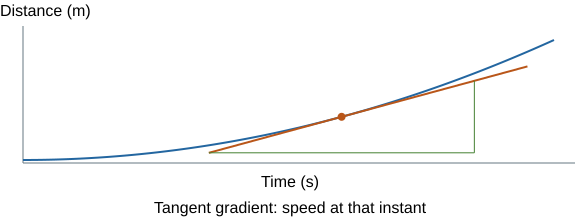
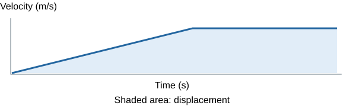

# Mathematical requirements and equations

## Choose a relationship before calculating

A calculation is a short explanation written with numbers. Think of an equation sheet as a toolbox: knowing where the tools are helps, but you still need to choose the right tool and use it correctly.

1. Identify what is asked for and its unit.
2. Write the quantities you know, with units.
3. Choose a relationship containing the unknown and useful known values.
4. Check the conditions, such as constant acceleration or an ideal transformer.
5. Convert units, rearrange if needed, substitute and calculate.
6. State the answer with a unit and sensible precision. Check that its size is plausible.

The **full equation sheet is supplied in the exams**. Use the [official equation sheet](../../00 - Specification/AQA-8463-equations-JUN27.pdf) when practising. Understanding symbols, units and conditions is still essential.

The same symbol may mean different quantities: **W** can be work or weight; **p** can be pressure or momentum; **V** can be volume or potential difference. Decide from the context and units.

## Units and conversions

| Prefix | Multiplier | Example |
|---|---|---|
| tera, T | 10¹² | 1 TJ = 10¹² J |
| giga, G | 10⁹ | 1 GHz = 10⁹ Hz |
| mega, M | 10⁶ | 1 MJ = 10⁶ J |
| kilo, k | 10³ | 1 kW = 1,000 W |
| centi, c | 10⁻² | 1 cm = 0.01 m |
| milli, m | 10⁻³ | 1 mA = 0.001 A |
| micro, μ | 10⁻⁶ | 1 μC = 10⁻⁶ C |
| nano, n | 10⁻⁹ | 1 nm = 10⁻⁹ m |

- **Mass:** 1 kg = 1,000 g; 1 g = 1,000 mg.
- **Time:** 1 minute = 60 s; 1 hour = 3,600 s.
- **Area:** 1 cm² = **10⁻⁴ m²**, because both dimensions are converted.
- **Volume:** 1 cm³ = **10⁻⁶ m³**, because all three dimensions are converted.
- **Density:** 1 g/cm³ = **1,000 kg/m³**.
- **Speed:** divide km/h by **3.6** to get m/s; multiply m/s by 3.6 to get km/h.

**Example:** a 20 cm² contact area is **20 × 10⁻⁴ = 0.0020 m²**, not 0.20 m². A 600 N force then gives p = F/A = 600/0.0020 = **300,000 Pa**.

Units also describe relationships: 1 W = 1 J/s; 1 Pa = 1 N/m²; 1 V = 1 J/C. A result for power should not end in joules alone.

## Standard form, estimates and significant figures

**Standard form** is a × 10ⁿ, where **1 ≤ a < 10**. Examples: 48,000 = **4.8 × 10⁴** and 0.00032 = **3.2 × 10⁻⁴**.

- Multiplying powers: 10³ × 10⁵ = 10⁸.
- Dividing powers: 10⁸/10² = 10⁶.
- For addition, express quantities using compatible powers before combining. Use the calculator's exponent key carefully.
- An **order-of-magnitude estimate** compares powers of ten. Check whether an answer should be tens, thousands or millions before accepting it.
- Symbols: **≈** means approximately equal; **∝** means proportional to; **<** and **>** mean less/greater than; **≪** and **≫** mean much less/greater than.

**Significant figures** communicate numerical precision. Leading zeros do not count: 0.00450 has **three significant figures**. 3.746 rounds to **3.7** at two significant figures and **3.75** at three. Keep extra calculator digits during intermediate steps and round the final answer appropriately. Do not round every step or claim precision unsupported by the data.

## Rearrange and recognise proportionality

Keep both sides of an equation balanced, like a balance scale. Perform the same operation on both sides.

**Finding resistance:** start with V = IR. Divide both sides by I to obtain **R = V/I**. To find current instead, divide V by R to obtain **I = V/R**.

**Finding speed from kinetic energy:** start with Eₖ = ½mv². Multiply by 2 and divide by m to get v² = 2Eₖ/m. Then take the square root: **v = √(2Eₖ/m)**. For a 2.0 kg object with 25 J of kinetic energy, v = √(2 × 25 ÷ 2.0) = **5.0 m/s**.

**Finding a changed gas pressure:** for a fixed mass at constant temperature, pV is constant. Write **p₁V₁ = p₂V₂**, then divide by V₂ to obtain p₂ = p₁V₁/V₂.

**Finding acceleration:** for constant acceleration, start with v² − u² = 2as. Divide by 2s to obtain **a = (v² − u²)/(2s)**.

| Relationship | What happens when x doubles? | Graph |
|---|---|---|
| **Direct proportion: y = kx** | y doubles, with other factors fixed. | Straight line through the origin. |
| **Inverse proportion: y = k/x** | y halves. At fixed force, doubling mass halves acceleration. | A decreasing curve; plotting y against 1/x gives a straight line through the origin. |
| **Squared relationship: y = kx²** | y becomes four times as large. At fixed mass, doubling speed quadruples kinetic energy. | Plotting y against x² gives a straight line through the origin. |

Elastic energy also follows a squared relationship with extension when spring constant is fixed and the spring remains within its proportional region.

## Equations: energy and heating

| Relationship | Units and conditions |
|---|---|
| **Eₖ = ½mv²** | J, kg, m/s; square speed |
| **Eₚ = mgh** | J, kg, N/kg, m; use height change for energy change |
| **Eₑ = ½ke²** | J, N/m, m; extension, within proportional spring behaviour |
| **ΔE = mcΔθ** | J, kg, J/kg°C, °C; temperature change, not final temperature |
| **E = mL** | J, kg, J/kg; energy for a change of state |
| **P = E/t = W/t** | W, J, s; power is a rate |
| **Efficiency = useful output/total input** | Use both energies or both powers; no unit; ×100 for % |

**Choose c or L:** warming without a state change uses **mcΔθ**. Melting or boiling at constant temperature uses **mL**. If both occur, calculate separate stages and add the energies.

**Example:** warm 0.20 kg from 20°C to 40°C with c = 900 J/kg°C. ΔE = 0.20 × 900 × 20 = **3,600 J**. If energy input is 4,500 J, useful heating efficiency = 3,600/4,500 = **0.80 = 80%**.

## Equations: electricity and matter

| Relationship | Units and conditions |
|---|---|
| **Q = It** | C, A, s; current treated as constant over the stated interval |
| **V = IR** | V, A, Ω; use resistance at the relevant operating conditions |
| **P = VI** | W, V, A |
| **P = I²R** | W, A, Ω |
| **E = Pt** | J, W, s |
| **E = QV** | J, C, V |
| **ρ = m/V** | kg/m³, kg, m³; or a matching alternative such as g/cm³ |
| **pV = constant** | Fixed mass of gas at **constant temperature**; matching pressure/volume units |

**Example:** 0.50 A for 3 minutes gives Q = 0.50 × 180 = **90 C**. At 12 V, energy transferred = QV = 90 × 12 = **1,080 J**.

For gas changes, do not use inverse pressure–volume reasoning if temperature or the amount of gas also changes. Calculate **p₂ = p₁V₁/V₂** when the conditions apply.

## Equations: forces and motion

| Relationship | Units and conditions |
|---|---|
| **Weight W = mg** | N, kg, N/kg; mass is not weight |
| **Work W = Fs** | J, N, m; displacement along the force's line of action |
| **F = ke** | N, N/m, m; extension, within proportional region |
| **Moment M = Fd** | Nm, N, m; d is perpendicular distance to the force's line |
| **p = F/A** | Pa, N, m²; force normal to the surface |
| **p = hρg** | Pa, m, kg/m³, N/kg; pressure due to a liquid column |
| **s = vt** | m, m/s, s; constant speed, or an appropriate average speed |
| **a = (v − u)/t** | m/s², m/s, s; average acceleration over the interval |
| **v² − u² = 2as** | Constant acceleration; convert before squaring |
| **F = ma** | N, kg, m/s²; F is the **resultant force** |
| **Momentum p = mv** | kg m/s, kg, m/s; include direction |
| **F = Δp/Δt = m(v − u)/Δt** | N; average force for constant mass over the interval |

Use a consistent positive direction in momentum questions. For a closed system with zero resultant external force, **total momentum before = total momentum after**. This does not imply that kinetic energy is also conserved.

**Example:** 2 kg at +3 m/s sticks to a stationary 1 kg trolley. Initial momentum = **6 kg m/s**. Combined mass = 3 kg, so final velocity = 6/3 = **+2 m/s**.

## Equations: waves and electromagnetism

| Relationship | Units and conditions |
|---|---|
| **T = 1/f** | s, Hz; T is period |
| **v = fλ** | m/s, Hz, m; frequency stays unchanged at a medium boundary |
| **Magnification = image height/object height** | No unit; matching height units |
| **F = BIl** | N, T, A, m; conductor perpendicular to field; length **inside the field** |
| **Vₚ/Vₛ = nₚ/nₛ** | V and coil turns; keep matching subscripts together |
| **VₚIₚ = VₛIₛ** | Equal input/output power for an **ideal transformer** |

For an echo, use the wave relationship plus the journey: **one-way distance = vt/2**. The time includes the return trip. For a real transformer with given efficiency, use **input power = output power/efficiency** before finding current.

## Linked calculations

Some questions need two or more relationships. Plan the route before entering numbers.

**A motor lifts a load:** mass and height → useful gravitational energy → useful power → input power using efficiency.

**Example:** lift 10 kg by 2.0 m in 4.0 s, with g = 10 N/kg and efficiency 0.50.

1. Useful energy = mgh = 10 × 10 × 2.0 = **200 J**.
2. Useful power = 200/4.0 = **50 W**.
3. Input power = 50/0.50 = **100 W**.

**Heat and melt:** calculate energy for the temperature rise, then latent energy for the state change. Do not use a temperature-rise equation for the constant-temperature stage.

**Uncertainty check:** if a measured length is 0.050 ± 0.001 m, percentage uncertainty is 0.001/0.050 × 100 = **2%**. Whether an improvement matters depends on the biggest sources of uncertainty, not just adding more decimal places.

## Read linear graphs and their units

For **y = mx + c**, m is gradient and c is the y-intercept. A straight line through the origin has c = 0. A non-zero intercept can reveal an offset or a physical starting value; it is not always an error.

- **Gradient = Δy/Δx**, using two widely separated points on the best-fit line.
- Gradient units are **y-axis unit / x-axis unit**.
- F against extension: gradient = **k**, N/m.
- I against V: gradient = **1/R**, A/V. V against I instead has gradient R, V/A.
- Distance against time: gradient = speed, m/s.
- Velocity against time: gradient = acceleration, m/s².

**Example:** a force–extension line passes through (0.010 m, 2 N) and (0.040 m, 8 N). Gradient = (8 − 2)/(0.040 − 0.010) = **200 N/m**. Read values from the fitted line, not a tiny triangle between noisy neighbouring measurements.

## Tangents and area under a graph

On a curved distance–time graph, draw a **tangent at the required time**. Use a large triangle along that straight tangent to calculate **instantaneous speed**. A chord joining two points on the curve gives an average rate over that interval, not necessarily the rate at the chosen point.

The meaning of **area** depends on the axes.

- **Velocity–time:** signed area gives **displacement**. Add magnitudes above and below zero for total distance.
- **Force–extension:** area gives work transferred to the spring, **½ke²** within proportional behaviour.
- Count squares for an irregular area, multiplying by the physical quantity represented by one square.
- Rectangle area = base × height. Triangle area = **½ × base × height**.

**Example:** velocity rises from 0 to 8 m/s over 4 s, then remains 8 m/s for 3 s. Displacement = ½ × 4 × 8 + 3 × 8 = **40 m**. The distance–time graph's area is not a distance.

## Statistics, charts and correlations

- **Mean:** sum divided by number. With a frequency table, use **Σ(value × frequency)/Σfrequency**.
- **Median:** middle value after sorting. For an even number, average the middle two.
- **Mode:** most frequent value; a set may have more than one mode or none.
- **Range:** maximum − minimum. It describes spread, not the typical value.
- **Percentage change:** (new − original)/original × 100. Use the original quantity as the denominator.

For 20, 21, 21, 22 and 26, mean = **22**, median = **21**, mode = **21**, range = **6**. The high value affects the mean more than the median.

Use a bar chart for categories and a scatter graph for paired numerical data. **Positive correlation** rises overall; **negative correlation** falls. Neither establishes cause by itself.

In a histogram, adjacent numerical intervals have adjoining bars. With unequal interval widths, **frequency is represented by area**, so **frequency density = frequency/interval width**. A taller bar does not automatically contain more observations if widths differ.

## Angles, areas and three-dimensional shapes

- Draw a normal **90° to a surface**. Reflection angles are measured from it; i = r.
- A force's moment uses the **perpendicular distance** from the pivot to its line of action.
- Use a scale drawing to combine angled forces, keeping arrow directions. Do not add their magnitudes as though they act along one line.
- Rectangle area = length × width. Triangle area = ½ × base × perpendicular height.
- Cuboid volume = length × width × height. Cube volume = side³ and total surface area = **6 × side²**.
- Use 2D views to understand a 3D object. A thin wire's diameter must be measured with suitable precision; tiny dimension errors can strongly affect calculated area or volume.

**Example:** a cube of side 2.0 cm has volume **8.0 cm³** and surface area **24 cm²**. In SI units, side = 0.020 m, volume = **8.0 × 10⁻⁶ m³**, surface area = **2.4 × 10⁻³ m²**.

## Check your result

- Is the **unit** correct and consistent with the equation?
- Did you square converted values and take any required square root?
- Did you use a temperature change, extension, perpendicular distance or one-way echo distance correctly?
- Is efficiency at most 1 or 100%? Does input exceed useful output when losses are present?
- Does a greater mass at fixed force give smaller acceleration, as expected?
- Have you retained direction where velocity, force or momentum is a vector?
- Is the answer's order of magnitude plausible? A car speed of 10,000 m/s should trigger a check.
- Does the result depend on a condition, such as constant temperature, constant acceleration or an ideal transformer, that the question actually supplies?

## Sources

- [AQA Maths requirements](https://www.aqa.org.uk/subjects/physics/gcse/physics-8463/specification/mathematical-requirements)
- [AQA equation-sheet arrangements](https://www.aqa.org.uk/news/gcse-maths-sciences-formulae-equation-sheets-2027-28)
- [Official equation sheet](../../00 - Specification/AQA-8463-equations-JUN27.pdf)
